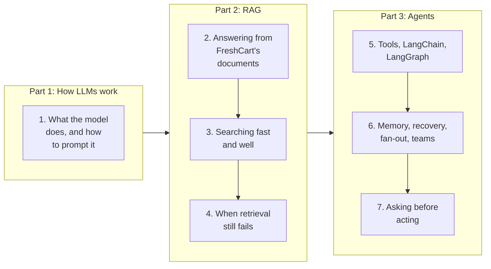
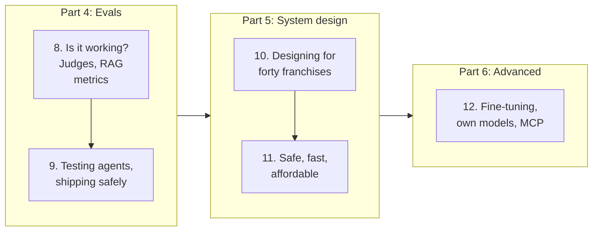
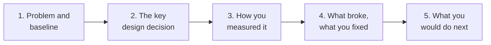
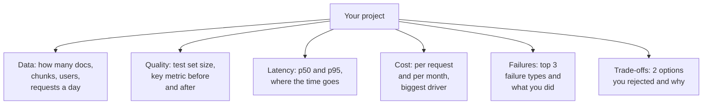

Every page of this stack follows one company, so the ideas build on each other instead of floating in the air.

**FreshCart** is a grocery delivery company in Pune and Bengaluru. It has 12,000 internal documents: refund policies, delivery-slot rules, warehouse runbooks, incident write-ups and franchise agreements. Over these pages you will build three things for it:

- **Ask FreshCart**: an assistant that answers support agents' questions from those documents, and later looks up live orders.
- **Planner Copilot**: an agent that changes warehouse stock settings, but only after a planner approves.
- The evaluation, security and scaling work that turns both into something the company can trust.

This first page is about the round that opens almost every AI engineer interview: "walk me through an AI system you built." Before that, here is the road ahead.

## 0. The journey, and the words you will meet

If you are new to all of this, good: the stack is written for you. It reads like a book of twelve chapters. Each one solves a problem FreshCart actually has, then ends with a new problem that the solution cannot handle, and the next chapter starts there. Every new word is explained properly the first time it matters.

The first half builds the two products:

The second half makes them trustworthy, then goes further:

Some of those words already appear on this page, so here they are in one plain sentence each. Do not memorise them; each gets its own chapter later.

- **LLM** (large language model): a program that has read a huge amount of text and predicts what text comes next, which turns out to be enough to answer questions and follow instructions.
- **RAG** (retrieval-augmented generation): look up the relevant documents first, then let the model answer from them, so it uses your facts instead of guessing.
- **Embedding / vector search**: turning text into a list of numbers so that "find similar meaning" becomes "find nearby numbers".
- **Chunk**: a small piece of a document, the unit you search and hand to the model.
- **Agent**: a model that can ask your code to run tools (look up an order, update a setting) in a loop until a task is done.
- **LangChain / LangGraph**: popular Python libraries for building such assistants and agents.
- **Evals**: tests for AI systems, with a fixed set of questions and a way to grade the answers.
- **Latency, p95**: how long a request takes; "p95" is the time within which 95% of requests finish, which shows the slow cases an average hides.
- **CI** (continuous integration): the automatic checks that run on every code change before it is merged.
- **Guardrails**: checks around the model that stop unsafe inputs, outputs or actions.

## 1. What an AI engineer interview is checking

An **AI engineer** builds products on top of existing models (the large language models, or LLMs, from providers such as OpenAI, Anthropic or Google, or open models you host). An **ML engineer** trains and serves models. The two overlap in one place: both have to prove the system works on real inputs.

So an AI interview loop is mostly a backend loop with an AI centre:

- **Project deep-dive**: one system you understand end to end.
- **Concepts**: retrieval (RAG), agents, LangGraph, human approval.
- **LLM system design**: "design a document assistant for 500 companies."
- **Evals and ship decisions**: "how do you know it works?"
- **Practical coding**: often a small retrieval or tool-calling loop in Python, without a framework.

Correction: the most common gap is not prompting skill. It is the answer to "how do you know it works?" A good answer has a test set, a metric and a baseline. "It looked good when I tried it" fails.

## 2. Telling the story of Ask FreshCart in two minutes

Imagine you built Ask FreshCart and an interviewer says "walk me through it." Rambling through every component loses them in thirty seconds. Use one fixed shape, with a number in it:

For Ask FreshCart:

- **Problem and baseline**: 80 support agents spent about 4 minutes per question searching the wiki, and sometimes quoted outdated refund rules.
- **The key decision**: retrieval from FreshCart's own documents with citations, instead of a bare model or fine-tuning, because policies change monthly and agents must be able to check the source. Mention one alternative you rejected and why.
- **How you measured it**: an 80-question test set with the right passage for each question; the share of questions where the right passage was retrieved went from 0.61 to 0.86 after adding keyword search alongside meaning-based search.
- **What broke**: an outdated policy kept being cited because old document versions were never removed from the index. The fix was deleting old chunks whenever a document changed.
- **Next**: a quality gate in CI, so a prompt change can never silently make answers worse.

Interviewers interrupt at steps 3 and 4, so those must be concrete.

**Decision point: the interviewer asks "your background is backend; why an AI role?"** Turn it into the strength it is. Most AI engineering is backend engineering around a component that is sometimes wrong. Production LLM systems fail on backend problems: retries and rate limits, queues, caching, idempotency (safe repeats), data freshness, access control. Someone who has shipped those, and also the AI parts, is exactly who these teams need.

## 3. Every claim is a question

Whatever you write on a resume or say in the walkthrough becomes the next question. Three that come up for almost any RAG project:

- "Did hybrid search beat vector search, and by how much?" Answer with a number, the baseline and the data it was measured on.
- "You cut LLM calls by 80%. 80% of what, measured how?" A percentage needs a denominator: calls per request with and without your change, counted on a fixed set.
- "What would make it production-grade?" In order of risk: an eval gate in CI, tracing with cost per request, guardrails against injected instructions, fallbacks when the model provider fails, and a feedback loop from users into the test set.

If you cannot explain a claim for ten minutes, reword it or drop it. Evidence beats vocabulary.

## 4. The numbers to know about your own project

Before any interview, write down these facts about the system you will present. Interviewers ask for them, and hesitating on them undoes a good walkthrough:

If you do not have a number, say how you would measure it rather than invent one.

## 5. The behavioural side of AI work

Behavioural rounds for AI roles ask the usual questions with an AI twist. Prepare one short story for each:

- **A model or prompt change that made things worse**: how you noticed, how you rolled back, what test you added.
- **Pushing back on a launch**: the evidence was thin; what bounded experiment you proposed instead.
- **Explaining uncertainty to non-engineers**: how you told a business owner that the system is right 92% of the time, and what happens the other 8%.
- **A data problem disguised as a model problem**: the "hallucination" that turned out to be an outdated document.

Each story: the situation, what you did, the result with a number, what you learned.

The twelve chapters build the knowledge behind each of those answers. Chapter 1 starts where you would: in your first week at FreshCart, with a plain chat model and three awkward questions about it.
