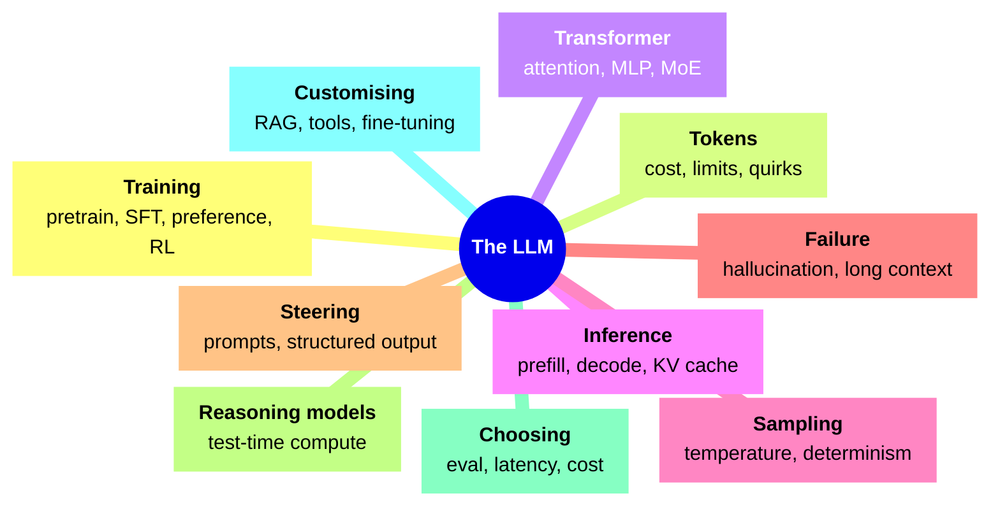
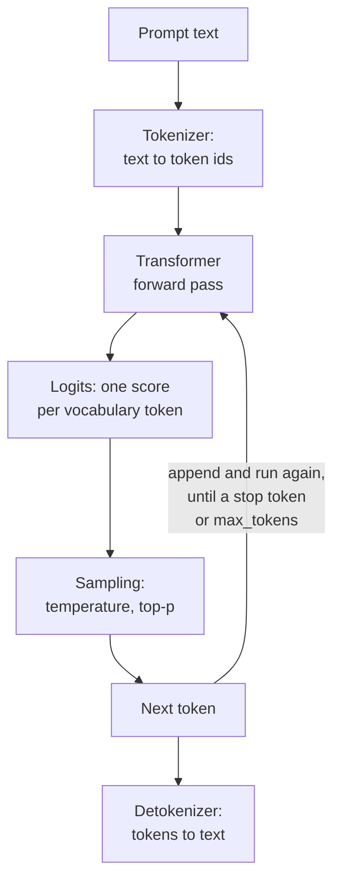
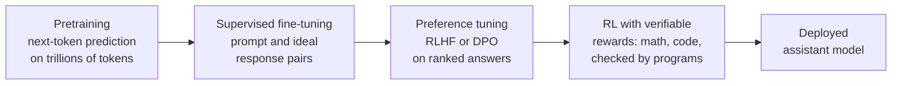
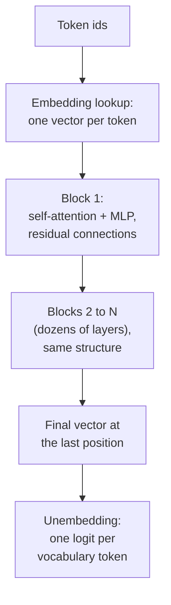
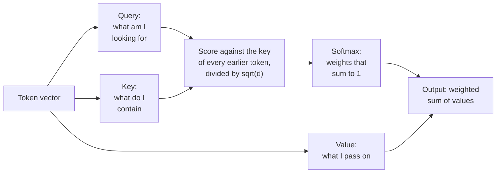
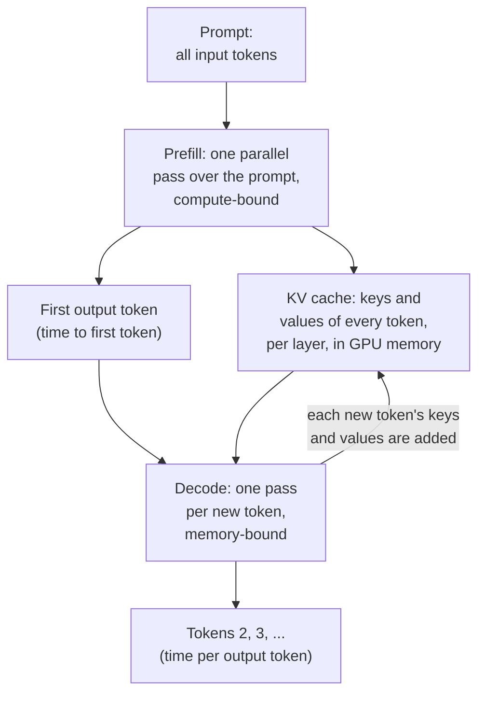
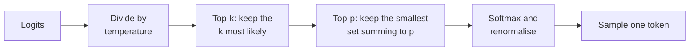
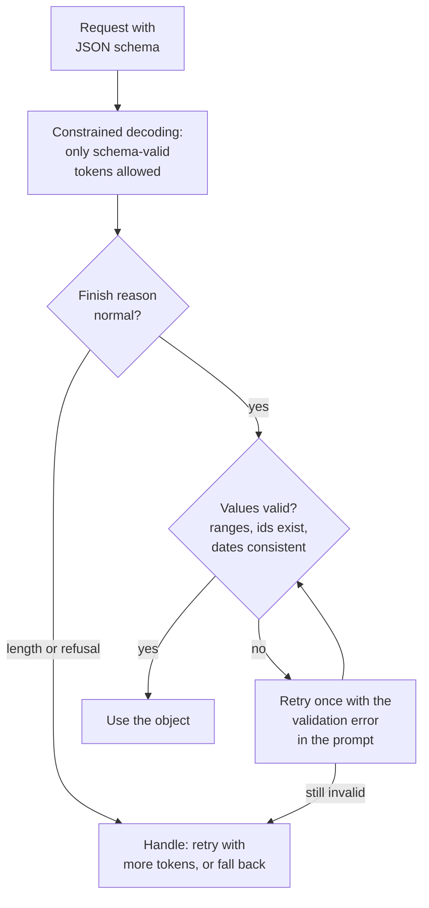
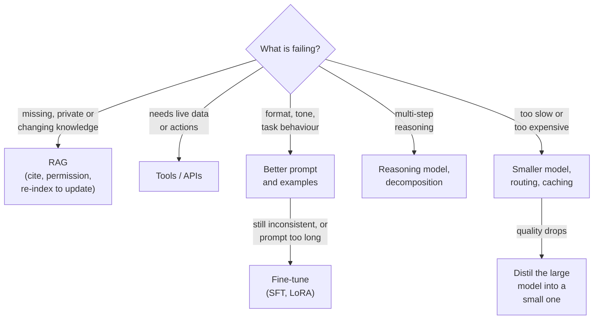
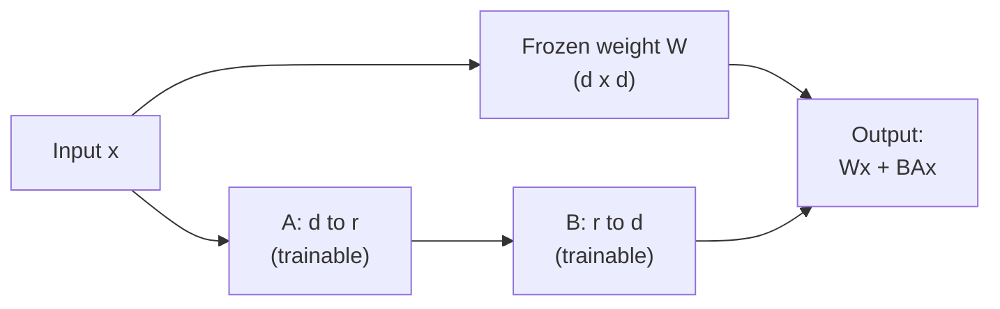

Every GenAI system is built around one component with unusual properties: it is stateless, probabilistic, frozen in time, fluent when wrong, fed through a single text channel, and priced and timed per token. Every later decision (retrieval, agents, evals, caching, guardrails) answers one of those properties. Know the mechanism and you can derive the design instead of memorising it.

## 1. What an LLM is, and the six properties that drive every design

An LLM is a function: given a sequence of tokens, it returns a probability for every token in its vocabulary being next. Generation is that function run in a loop.

- The tokenizer turns text into integer ids; the model never sees characters.
- One forward pass scores every possible next token; sampling picks one.
- The chosen token is appended and the model runs again. It stops at an end-of-sequence token, a stop sequence or the `max_tokens` cap.

The six properties, and what each forces you to build:

1. **Stateless.** Nothing is remembered between calls. A conversation is the client re-sending the whole history every turn. Memory, sessions and personalisation are your system's job, and cost grows with conversation length.
2. **Probabilistic.** Output is sampled, so the same input can produce different outputs. You need validation, retries and evals over many runs, not one demo.
3. **Frozen knowledge.** The model knows its training data up to a cutoff and has never seen your private data. Fresh or private knowledge must arrive through the context: retrieval and tools.
4. **Plausibility, not truth.** It is trained to produce likely text, so it is equally fluent when wrong. You need grounding, citations and verification.
5. **One channel.** Instructions, documents, tool results and user text all arrive as tokens in one window. The model cannot reliably tell instructions from data, which is why prompt injection is structural, not a bug to patch.
6. **Per-token cost and time.** Input tokens cost money and processing time; output tokens cost more and are generated one at a time. Cost and latency are token budgets.

Say it like this: "An LLM predicts the next token in a loop. It's stateless, probabilistic, frozen at a cutoff, optimised for plausibility rather than truth, takes everything through one text channel, and is billed and timed per token. Memory, retrieval, validation, evals, injection defences and token budgets all exist because of those six properties."

## 2. How a model is trained, and why it behaves the way it does

- **Pretraining**: predict the next token over web text, books and code. The label is the text itself (self-supervised). The result is a **base model**: it knows language, facts and patterns, but only continues text; it does not follow instructions.
- **Supervised fine-tuning (SFT)**: train on (instruction, ideal response) pairs. The model learns to follow instructions, the chat format and the tool-call format.
- **Preference tuning**: people (or models) compare two answers and pick the better one. **RLHF** trains a reward model on those comparisons, then optimises the model with reinforcement learning (PPO) while a KL penalty keeps it close to the SFT model. **DPO** skips the reward model and the RL loop: it adjusts the model directly so the preferred answer becomes more likely than the rejected one. This shapes helpfulness, tone and refusals, and also produces side effects: **sycophancy** (agreeing with the user) and verbosity.
- **RL with verifiable rewards**: reward comes from an automatic check (the math answer is right, the code passes its tests). Long, self-checking chains of reasoning emerge: these are **reasoning models**.

Consequences you will use:

- **Knowledge comes from pretraining; behaviour from post-training.** That is why fine-tuning changes format and style well but injects facts poorly.
- **Models are rewarded for guessing.** Benchmarks that score only accuracy give a guess some chance of credit and "I don't know" none, so models learn to answer confidently. This is a root cause of hallucination, and why your own evals must reward abstention.

## 3. Tokens

- A **tokenizer** (byte-pair encoding) splits text into subword pieces from a fixed vocabulary of roughly 100k to 200k entries, learned from frequent byte sequences. Common words are one token; rare words, names, long numbers, code and non-English text take several.
- Rule of thumb for English: **1 token is about 4 characters, or 0.75 words**. JSON, code and many Indian languages use noticeably more tokens per word.
- Each model family has its own tokenizer, so the same text has different token counts across providers. Count with the provider's tokenizer.

Why it matters:

- **Cost, rate limits and the context window are all in tokens.** The window holds input plus output.
- **Character-level tasks are hard**: counting letters, reversing strings, exact digit arithmetic. The model sees chunks, not characters.
- **Verbose formats are expensive**: JSON repeats every key in every record. Compact formats cut cost and latency.
- **Rare identifiers split into many tokens**, so copying an order id or SKU exactly is error-prone. Validate ids against your systems instead of trusting them.

## 4. Inside the transformer

Terms first: an **embedding** is a vector (a list of numbers, for example 4,096 of them) representing a token. A **layer** (or block) transforms every token's vector. **Attention** lets a token's vector take in information from other tokens. The **MLP** (feed-forward network) transforms each token's vector on its own.

- **Embedding lookup**: each token id indexes a learned table and becomes a vector.
- **Blocks**: each block runs self-attention (mixes information across positions) and then an MLP (transforms each position; much of the model's stored knowledge lives here). Each sub-layer adds its result back to its input (a **residual connection**), so information flows through dozens of layers without being lost, and normalisation keeps values stable.
- **Position**: attention on its own ignores word order. Modern models encode position by rotating queries and keys inside attention (**RoPE**).
- **Output**: the last position's final vector is multiplied by the unembedding matrix to give one score (**logit**) per vocabulary token.

### Attention

- Each token's vector is multiplied by three learned matrices to produce a **query**, a **key** and a **value**.
- The token's query is compared (dot product) with the key of every token **at or before** its position. The **causal mask** forbids looking at later tokens, because at generation time they do not exist yet. Scores are divided by the square root of the vector size to keep them in a stable range.
- Softmax turns the scores into weights that sum to 1. The output is the weighted sum of the values: the token absorbs information mostly from the tokens it scored highest.
- **Multi-head attention** runs many of these in parallel with different matrices; heads specialise (grammar, which noun "it" refers to, copying), and their outputs are combined.
- **Cost**: every token attends to every earlier token, so processing a prompt of n tokens costs on the order of n^2 attention computations, and the stored keys and values grow linearly with n.

Say it like this: "Each token produces a query, a key and a value. Its query is compared with the keys of all earlier tokens, softmax turns the scores into weights, and the token's new representation is the weighted sum of their values. Many heads do this in parallel, so the model learns several kinds of relationships, and the causal mask stops a token from seeing the future."

### Model families you will be asked about

- **Decoder-only** (GPT, Claude, Llama, Gemini, Qwen): causal attention, generates text. Every chat LLM.
- **Encoder-only** (BERT family): every token attends to every other token in both directions. Strong representations, no generation: classifiers, entity extraction, **cross-encoder rerankers**, classic embedding models. Many modern embedding models are adapted decoder LLMs instead.
- **Encoder-decoder** (T5, the original transformer): the encoder reads the input, the decoder generates. Translation and summarisation; rare for chat today.
- **Mixture of experts (MoE)**: the MLP in each block is replaced by many expert MLPs plus a **router** that sends each token to its top few experts. Total parameters are large, active parameters per token small (Mixtral 8x7B: about 47B in total, about 13B used per token), so you get big-model quality at closer to small-model compute. All experts must still fit in GPU memory.
- **Multimodal**: an image is cut into patches, encoded by a vision encoder and projected into vectors the language model reads like tokens. Cost scales with image resolution (hundreds to thousands of tokens per image). Weak spots: tiny text, exact counts, precise positions; images can carry hidden instructions.

## 5. Inference: prefill, decode and the KV cache

- **Prefill**: all prompt tokens go through the model in one parallel pass. It is limited by GPU compute and grows with prompt length. It produces the KV cache and the first output token. **Time to first token (TTFT)** is queueing time plus prefill.
- **KV cache**: the keys and values of every token so far, for every layer, kept in GPU memory. Each decode step then computes the query, key and value for the **new token only** and attends to the cached ones, instead of reprocessing the whole sequence.
- **Decode**: one token per forward pass. Each pass must read all model weights and the KV cache from GPU memory, so it is limited by memory bandwidth, not compute. **Time per output token (TPOT)** is roughly constant for a given model, hardware and load.
- **Total latency is about TTFT + output tokens x TPOT.** With a 0.5 s TTFT, 500 output tokens at 20 ms each add 10 s. Output length usually dominates.

Consequences:

- **Shorter outputs are the biggest latency lever.** Streaming hides the rest: the user starts reading after TTFT.
- **Output tokens cost more than input tokens** (often 3 to 5 times): each one needs its own sequential pass, while input tokens are processed in parallel.
- **Long prompts raise TTFT and cost.** **Prompt caching** keeps the KV cache of a prompt prefix on the provider's side; a later request with the **identical prefix** skips prefill for that part, so it is faster and the cached input tokens are billed at a fraction of the normal price. It only works if the prefix is byte-identical: put stable content first (system prompt, tool definitions, reference documents) and variable content last (history, the user's question). Changing anything early invalidates everything after it.

Say it like this: "Prefill processes the whole prompt in parallel and decides time to first token; decode generates one token per pass, reusing the KV cache, and is bound by memory bandwidth. A longer prompt raises prefill time and input cost, a longer answer adds a fixed time per token, and prompt caching skips prefill for a repeated prefix."

## 6. Sampling and determinism

- **Temperature** divides the logits before softmax. Below 1 it sharpens the distribution (likely tokens dominate); above 1 it flattens it (more variety); near 0 it becomes **greedy decoding** (always the top token).
- **Top-k** keeps only the k most likely tokens. **Top-p (nucleus)** keeps the smallest set whose probabilities add up to p: few candidates when the model is confident, many when it is unsure.
- Low temperature for extraction, classification, code and SQL; higher for brainstorming and varied wording. Tune temperature or top-p, not both.
- Other controls:
  - **`max_tokens`** caps the output. When hit, the finish reason is `length` and the output stops mid-sentence or mid-JSON. Always check the finish reason.
  - **Stop sequences** end generation at a marker.
  - **Frequency and presence penalties** reduce repetition.
  - **Logprobs** return token probabilities: a confidence signal for classification and for routing low-confidence cases elsewhere.
  - **Seed**: best-effort reproducibility only.

**Why temperature 0 is still not deterministic:**

- Floating-point addition is not associative: adding the same numbers in a different order gives slightly different results.
- GPU kernels change their order of operations with **batch size**, and the batch size depends on how many other users' requests share the GPU at that moment. The servers are not **batch-invariant**.
- A tiny difference in logits flips a near-tie between two tokens, and every later token diverges from there.
- Providers may also update the model behind the same name.

Design for it: validate outputs, evaluate over several runs, pin model snapshots, and cache responses when you need identical answers.

Correction: "Temperature 0 makes the output deterministic." It makes the choice greedy; the numbers feeding that choice still vary from run to run.

## 7. Why models hallucinate, and what reduces it

A **hallucination** is fluent output that is not supported by facts or by the context provided.

- **Factuality errors**: wrong facts about the world (rare facts, events after the cutoff).
- **Faithfulness errors**: the answer contradicts or goes beyond the provided documents.
- **Fabrication**: invented citations, ids, URLs, API methods, quotes.

Causes:

- **The objective**: next-token training rewards plausible continuations; nothing inside checks facts.
- **Rewarded guessing**: accuracy-only scoring teaches the model that a guess beats abstaining.
- **Missing knowledge**: long-tail facts seen rarely in training; nothing after the cutoff; nothing private.
- **Prompt pressure**: no allowed "I don't know"; leading questions; sycophancy.
- **Context problems**: the answer is absent, buried in the middle of a long context, or contradicted by another document.
- **Compounding**: every token conditions the next, so an early wrong token is followed by a confident justification.

Mitigations, each matched to a cause:

- **Ground it**: put the evidence in the context (retrieval), use tools for live data, use code or a calculator for arithmetic.
- **Allow abstention**: an explicit rule plus an example of answering "not in the sources"; score abstention as correct in your evals when the evidence is missing.
- **Constrain it**: structured output, enums, citations limited to the ids of the sources you supplied, ids checked against the database.
- **Verify it**: check that each citation exists and supports its sentence (a judge model or an entailment check), recompute numbers with tools, sample several answers and treat disagreement as low confidence (**self-consistency**).
- Lower temperature for factual tasks; human review where an error is expensive.
- Measure groundedness on real traffic, continuously.

Correction: "RAG eliminates hallucination." Retrieval fills knowledge gaps; the model can still ignore, misread or embellish the context, so you still verify.

Say it like this: "Models hallucinate because they're trained to produce plausible text and rewarded for guessing, and they fill knowledge gaps fluently. I ground answers in retrieved evidence, explicitly allow 'not found', constrain outputs and citations to known ids, and verify claims after generation, with groundedness measured on live traffic."

## 8. The context window: hard limit and soft limits

- The window holds everything in one call: system prompt, tool definitions, history, retrieved content, the user message and the output being generated.
- **Hard limit**: exceed it and the API rejects the request, or a framework silently truncates, which is worse: it may drop your instructions or the user's latest message.
- **Soft limits** appear long before the hard one:
  - **Lost in the middle**: information in the middle of a long context is used less reliably than information at the start or the end.
  - **Context rot**: accuracy falls as the input grows, even on simple lookups; passages that look relevant but are wrong (distractors) hurt the most.
  - Cost and TTFT grow with every input token.

Rules:

- Send only what is relevant; retrieve instead of stuffing.
- Put the most important material at the start or the end. For long documents, documents first and the question last.
- Give every document an id and metadata so the model can cite and tell versions apart.
- Summarise or trim long histories before they hit the limit, and count tokens before every call.

Correction: "Million-token windows make retrieval obsolete." They allow larger chunks and whole-document reading, but cost, latency, distraction, permissions and freshness still favour sending only what is relevant.

## 9. Prompting for production

A production prompt has a fixed anatomy:

1. **Role and goal**: what the model is, what a good result is, who reads it.
2. **Context and data**, clearly delimited (for example `<document id="7">...</document>`), long material first.
3. **Instructions**: steps, constraints, and what to do when information is missing or the request is out of scope.
4. **Output format**: a schema or an exact template.
5. **Examples** (few-shot), including an edge case and an "abstain" case.
6. **The input or question last.**

Principles:

- **Explicit beats clever.** State exactly what you want, and give the reason behind each rule; models generalise from reasons.
- Say what to do, not only what to avoid.
- **Delimit untrusted text.** Never splice user or document text into the instructions.
- **Few-shot examples teach surface features.** Three to five diverse examples with a consistent format. Models over-predict the label that appears most in the examples and favour the label of the last example, so balance and shuffle them. When inputs vary widely, retrieve the examples most similar to the current input (dynamic few-shot).
- **Chain of thought** (reasoning before the answer) improves multi-step math, logic and planning on non-reasoning models. It costs output tokens and latency, adds little for simple lookups and classification, and the written reasoning is not a faithful record of how the model decided. With reasoning models, do not script the steps: give the goal and the constraints and set the reasoning effort.
- **Decompose.** A chain of small prompts (classify, then extract, then write) is easier to test and fix than one giant prompt.
- **System prompts are not secret.** Users can extract them; never put credentials or private logic there.

**Prompts are code.** When every hand-made fix breaks something else, the missing piece is a process:

- Keep prompts in version control, and log the prompt version with every request.
- Build an eval set from real failures; every change runs it, and results are compared per slice against the current version.
- Change one thing at a time; every fixed failure becomes a permanent regression case.

Say it like this: "I treat prompts like code: versioned, logged with each request, and changed only against an eval set built from real failures, so a fix that breaks another slice is caught before it ships."

## 10. Structured output

Code needs fields, not prose. Four levels of reliability:

1. **Prompt only** ("reply in JSON"): fails on edge cases with extra prose, comments, or JSON cut off at `max_tokens`.
2. **JSON mode**: guarantees syntactically valid JSON, not your schema.
3. **Schema-constrained decoding** (structured outputs, strict tool calling): at every step the server masks out any token that would break the JSON schema, so the output always parses and matches the schema.
4. **Validate the values anyway.** A valid shape can hold wrong values.

- Check the finish reason first: a refusal or a `max_tokens` stop gives no usable object.
- Validate meaning in code (Pydantic models plus business checks).
- On failure, retry once with the exact validation error in the prompt (a **repair loop**), then fall back or send to a human.

Schema design:

- **Order matters**: the model writes fields left to right, so a `reasoning` field must come **before** the `answer` field if the answer should use it.
- Enums for categories, required fields, and **nullable fields for "not found"**, so the model is never forced to invent a value.
- Keep schemas flat and small; deep optional nesting raises error rates and latency.
- Tool calling is structured output: the tool's arguments are a schema-constrained object.

## 11. Reasoning models

- **What**: models trained with reinforcement learning to produce a long chain of reasoning ("thinking tokens") before answering. They plan, try approaches, check intermediate results and backtrack.
- **Why it works**: spending more computation at answer time (**test-time compute**) buys accuracy on problems whose steps can be checked: math, code, logic, planning, rule-heavy extraction.
- **Cost**: thinking tokens are billed as output and add seconds to minutes; latency varies a lot from request to request.
- **Control**: a reasoning-effort setting or a thinking-token budget.
- **Use them** for hard multi-step tasks, agent planning, complex extraction rules and code. **Avoid them** for simple classification, extraction, routing and latency-critical or high-volume paths.
- Other ways to spend test-time compute: **self-consistency** (sample several answers, take the majority), **best-of-N with a verifier** (generate several, keep the one a checker scores best), and generate-critique-revise loops.

## 12. Choosing a model

What actually decides, in order:

1. **Quality on your eval set**: your tasks, your data. Public leaderboards only shortlist.
2. **Latency**: TTFT and output tokens per second at your real prompt sizes.
3. **Cost**: input and output prices, cached-input and batch discounts, and the tokens your prompts actually use with that model's tokenizer.
4. **Capabilities**: context length, tool-calling reliability, structured output, vision, reasoning modes.
5. **Operations**: rate limits, regions and data residency, data retention terms, SLAs, deprecation schedule.
6. **Open weights or API**: open weights give control, fine-tuning, on-premises deployment and predictable cost at steady high volume, at the price of GPUs, serving expertise and usually a quality gap at the frontier.

Process:

- Prototype with the strongest model to learn whether the task is feasible and to set the quality bar.
- Build the eval set, then try cheaper and faster models against it; send only the hard cases to the expensive model.
- Pin model snapshots, re-run evals before every upgrade, and keep a tested fallback model.

## 13. Customising behaviour: prompt, RAG, tools or fine-tuning

- **Prompting** comes first: cheapest, fastest to iterate.
- **RAG** for knowledge the model lacks or that changes: answers cite sources, respect per-user permissions and update by re-indexing.
- **Tools** for live data and actions: prices, account state, calculations.
- **Fine-tuning** for behaviour: a consistent format or style, a domain-specific task pattern, shorter prompts (instructions move into the weights), or a small model matching a large one on a narrow task. It is a poor way to add facts: no citations, retraining for every update, facts still get hallucinated, and no permissions.

Fine-tuning methods:

- **Full fine-tuning** updates every weight. It fits best but needs the most GPU memory (weights, gradients and optimiser state) and risks **catastrophic forgetting** of general skills.
- **LoRA (low-rank adaptation)** freezes the original weights and learns a small update for chosen weight matrices: the update is the product of two thin matrices, B times A, with a small rank r (typically 8 to 64).

  - Trains well under 1% of the parameters, so it needs far less memory and time.
  - The adapter is megabytes; one base model can serve many adapters (per task or per customer), or the adapter can be merged into W for zero extra latency.
- **QLoRA** loads the frozen base model in 4-bit precision and trains LoRA adapters on top, so large models fine-tune on a single GPU.
- **Data**: hundreds to a few thousand high-quality (input, ideal output) pairs that look like production inputs, including edge cases and refusals. Quality beats quantity. Hold out a test set.
- **Preference tuning**: RLHF uses a learned reward model and reinforcement learning; DPO trains directly on chosen-versus-rejected pairs, which is simpler and more stable. RLHF's reward model is reusable and more flexible.
- **Distillation**: a large **teacher** model labels many real inputs; a small **student** is fine-tuned on those outputs and matches the teacher on that narrow task at a fraction of the cost and latency.

"The large model is 95% accurate but too slow and expensive":

1. Pin down the target: eval set, latency and cost budgets.
2. Cheap wins: shorter prompt, prompt caching, batch API for offline work, a smaller model with a better prompt.
3. Distil: run the large model on thousands of real inputs, filter its outputs with validation and spot checks, fine-tune a small model with LoRA, compare on the held-out set.
4. Cascade: the small model answers first; low-confidence cases (low logprobs, failed validation) go to the large model.
5. Monitor for drift and refresh the training data.

Risks of fine-tuning: overfitting, forgetting, memorised sensitive data, retraining whenever the base model is upgraded, and a permanent eval burden.

Say it like this: "RAG changes what the model knows at request time, with citations, permissions and instant updates; fine-tuning changes how it behaves: format, style, task patterns, or a small model matching a big one. I start with prompting, add RAG for knowledge and tools for live data, and fine-tune, usually with LoRA, only when the eval shows a behaviour gap that prompting can't close or when cost and latency demand a smaller model."

## Thinking checklist

- Which of the six properties does this design decision answer?
- Where do the tokens go, per call and per task, and which are output tokens?
- Is the latency problem TTFT (prompt size, queueing) or generation (output length)? Can it stream?
- What happens when the output is wrong, truncated, malformed or refused?
- Is the failure about knowledge, behaviour, reasoning or cost? That picks RAG, prompting or fine-tuning, a reasoning model, or a smaller model.
- How would I know that quality changed after a prompt or model change?
