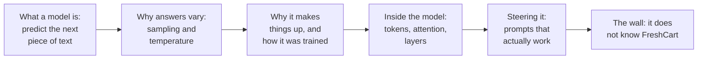
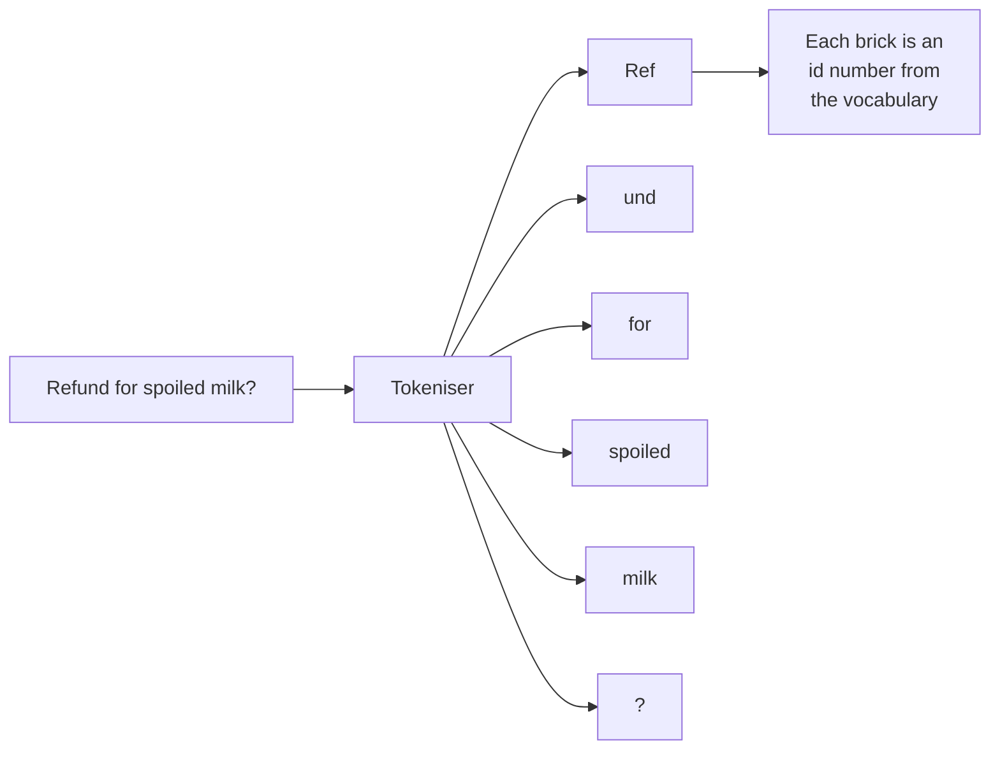
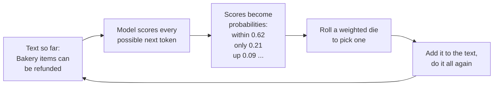
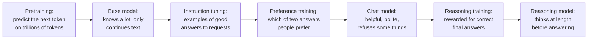
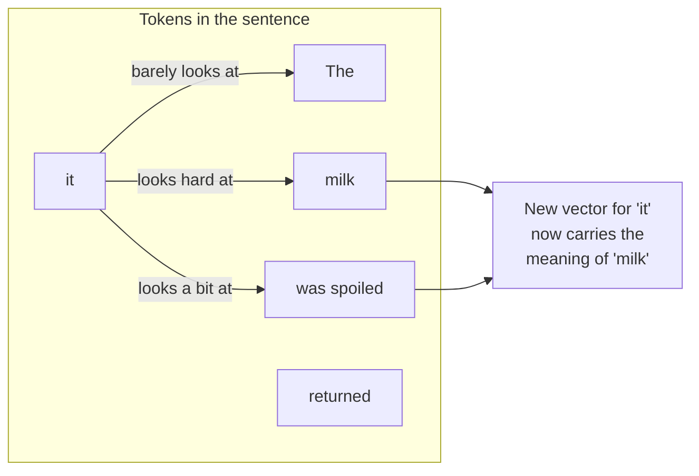
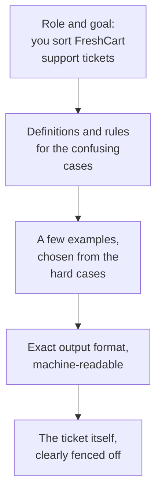
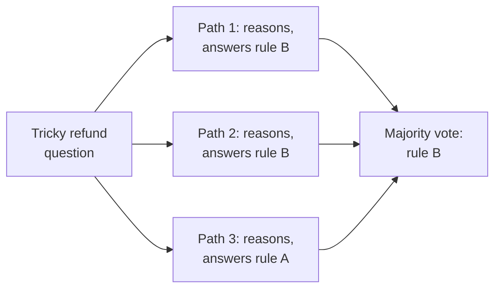
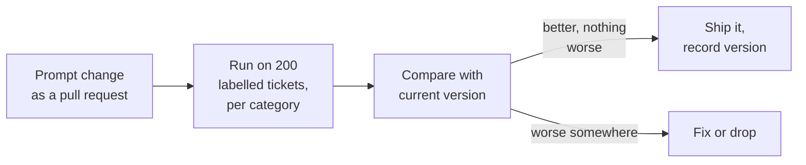

It is your first week at FreshCart, a grocery delivery company in Pune and Bengaluru. Nobody expects you to build anything yet. Your manager says: "Let people try a plain chat model for a week, and write down every question they ask about it." By Friday you have three questions that come up again and again:

- Meera, who leads support: "I asked it the same thing twice and got two different answers. Which one is right?"
- Someone from finance: "Why does a question in Marathi cost more than the same question in English?"
- Everyone, after one bad afternoon: "It told me a refund rule with total confidence, and the rule does not exist. How can it just make things up?"

Each of these is a classic interview question in disguise. By the end of this chapter you will be able to answer all three, look inside the model to see why, and use the one tool you have to steer it: the prompt. Here is the path:



## 1. Autocomplete, scaled up enormously

Your phone's keyboard suggests the next word as you type. Type "see you" and it offers "tomorrow". It learned that from millions of messages.


*A phone keyboard offering next-word suggestions. An LLM does the same job at an enormous scale. Image: Jay Alammar, The Illustrated Word2vec, CC BY-NC-SA 4.0.*

A **large language model (LLM)** is exactly that idea, taken to an extreme. It is a program that reads some text and predicts what text is likely to come next. That is the whole job.

What makes it "large":

- It was trained on trillions of words: books, websites, code, forums.
- It contains billions of adjustable numbers, called **parameters**, that were tuned during training until its predictions became very good.


*How plain text becomes training material: every position in a sentence is a small quiz, "given the text so far, what comes next?" The model guesses, is corrected, and its parameters shift slightly. Repeat that trillions of times. Image: Jay Alammar, How GPT3 Works, CC BY-NC-SA 4.0.*

Here is the surprising part. To predict the next word well across that much text, the model had to absorb grammar, facts about the world, writing styles, and even patterns of step-by-step reasoning. If the text so far is "The capital of France is", predicting "Paris" requires knowing a fact. If the text is a maths problem followed by "Step 1:", predicting a good next line requires something that looks like reasoning. So a machine whose only job is "guess the next word" ends up able to answer questions, write code and summarise documents.

Keep one consequence in your head for the rest of this stack, because it explains most of what goes wrong:

> **The model produces text that is likely, not text that is checked.**

Most of the time, likely and correct are the same thing. When they are not, you get confident nonsense.

## 2. Tokens: the Lego pieces of text

Models do not read letters, and they do not read whole words either. They read **tokens**: pieces of text from a fixed vocabulary, a bit like a box of Lego bricks. Before the model sees your text, a **tokeniser** breaks it into those bricks.



- Common English words are often a single brick. Rarer words get split into several bricks (the split above is illustrative; every tokeniser splits differently).
- Codes like `ERR_SLOT_EXPIRED`, long numbers and many non-English scripts get split into many small bricks.
- Rule of thumb: 100 tokens is about 75 English words.

Now finance's question answers itself. The tokeniser's vocabulary was built mostly from English text, so English words map to few bricks. Marathi, written in the Devanagari script, has fewer ready-made bricks in the box, so the same sentence needs more of them. Providers charge per token, so the same question costs more.

Everything practical in this field is counted in tokens:

- the **price** of a call (input tokens and output tokens are priced separately, output usually higher);
- how much text one call can hold (the context window, section 5);
- how fast you are allowed to send requests (rate limits);
- and, later in this stack, how documents get cut into pieces for search.

Different providers use different tokenisers, so the same text has a different count, and a different price, on different models.

## 3. Why the same question gets two answers

Meera asks "Can bakery items be refunded after 6 hours?" twice and gets two differently worded answers. To see why, slow the model down and watch it write.



1. The model looks at the text so far and gives every token in its vocabulary a score. These raw scores are called **logits**.
2. A small function called **softmax** turns the scores into **probabilities** that add up to 1: "within" 62%, "only" 21%, "up" 9%, and tiny amounts for everything else.
3. The model picks one token by rolling a weighted die: "within" comes up 62 times in 100, "only" 21 times. This step is called **sampling**.
4. The chosen token is glued onto the text, and the whole thing runs again for the next token. An answer of 100 tokens is 100 rolls.


*The loop in motion: each new token is appended to the input, and the model runs again to produce the next one. Image: Jay Alammar, The Illustrated GPT-2, CC BY-NC-SA 4.0.*

If one early roll lands on "only" instead of "within", every later token is predicted from a different start, so the whole answer can come out differently. That is Meera's two answers.

You control the die with two settings:

- **Temperature** changes how lopsided the die is. Low temperature makes the favourite even more likely, so answers become predictable. High temperature evens the odds, so unusual tokens get picked more often and answers become varied, "creative". Temperature 0 means: always pick the favourite, no roll at all.
- **Top-p** (and its cousin **top-k**) removes the long tail of unlikely tokens before the roll. With top-p 0.9, the model only rolls among the smallest set of tokens whose probabilities add up to 90%, so it can never pick something absurd.

For refund rules you want boring and consistent: low temperature. For writing ten different subject lines for a marketing email you want variety: higher temperature.

Correction: "set temperature to 0 and the output is reproducible" is wrong for hosted models. Models run on **GPUs**, chips built for the enormous number of multiplications involved. Providers process many people's requests together on the same GPUs, and tiny rounding differences depend on how each batch of requests happens to be made up. When two tokens are almost tied, that tiny difference can flip the choice. Providers also update models without telling you. So design for some variation, and pin the exact model version you use.

## 4. Why it makes things up

Back to the invented refund rule. FreshCart's policies were never in the model's training data. Asked about them, the model does what it always does: it writes the most likely-sounding continuation, which is a plausible, generic refund rule. Fluent, confident and wrong. This is called a **hallucination**.

It helps to know how a chat model is made, because each stage leaves fingerprints on its behaviour:



- **Pretraining** is the "predict the next token" stage on a huge pile of text. It produces a **base model**. Ask a base model a question and it may simply continue with three more questions, because that is what text on the internet often looks like. Its knowledge stops at a **knowledge cutoff** date.
- **Instruction tuning** shows it thousands of examples of a request and a good answer, so it learns to respond like an assistant.
- **Preference training** shows it pairs of answers where people picked the better one. This is where its helpful tone, and its refusals, come from.
- **Reasoning models** get one more stage: **reinforcement learning**, which is training by trial and reward. The model attempts problems with checkable answers (maths, code) and is rewarded when the final answer is right. It learns to write out a long hidden chain of thought before answering. Much better at multi-step problems; slower and more expensive, because all that thinking is generated and billed token by token.

Notice what is missing from every stage: FreshCart. Nothing in this process ever showed the model your refund policy. Each cause of hallucination has its own fix:

- **Missing knowledge** (private, recent or rare facts): look the facts up and give them to the model together with the question. That is the subject of the next three chapters.
- **Vague questions**: clearer instructions, or let the model ask a clarifying question back.
- **Pressure to always answer**: give it an exit ("if you are not sure, say so") and check its answer against the source afterwards.

**Decision point: a manager suggests "training the model on FreshCart's policies so it just knows them".** That is **fine-tuning**: continuing the model's training on your own examples. It sounds right and is usually the wrong tool for facts. Fine-tuning reliably teaches *behaviour* (a format, a tone, a narrow task) and unreliably teaches *facts*: the model cannot say where it learned something, may blend it with older knowledge, and must be retrained whenever a policy changes. Chapter 12 shows where fine-tuning does pay off.

> **Pause and think.** Finance's director asks two more questions: "Why does a longer prompt cost more, even for the same short answer? And why can't we simply paste all 12,000 of our documents into the prompt?" Before reading on, guess: what inside the model would make long inputs expensive?

## 5. Inside the model: vectors, attention and layers

You do not need the maths for an AI engineer interview. You do need this picture.

**Step one: every token becomes a list of numbers.** The model keeps a big lookup table. Each token id is replaced by a **vector**, which is simply a list of numbers, for example 4,096 of them, learned during training. Think of it as the token's coordinates in a space of meaning: tokens used in similar ways end up with similar numbers. Position information is added too, because "dog bites man" and "man bites dog" contain the same tokens in a different order.


*The lookup table: one row of numbers for every token in the vocabulary. GPT-2 has 50,257 tokens and 768 to 1,600 numbers per row, depending on its size; today's models use thousands. Image: Jay Alammar, The Illustrated GPT-2, CC BY-NC-SA 4.0.*

**Step two: tokens look at each other.** Take the sentence "The milk was spoiled, so the customer returned it." To understand "it", the model must look back and realise "it" means "the milk". The mechanism that does this is called **attention**.




*A real attention pattern from a trained model: while processing "it", this attention head looks mostly at "The animal", exactly the kind of link the diagram above describes. Image: Jay Alammar, The Illustrated Transformer, CC BY-NC-SA 4.0.*

In plain words, each token asks a question and every earlier token offers an answer:

- every token produces a **query** ("what am I looking for?"), a **key** ("what do I contain?") and a **value** ("what do I pass on if you pick me?");
- the query of "it" is compared with the key of every earlier token; good matches get high weight;
- the new vector for "it" is a weighted blend of the values, mostly "milk", a bit of "spoiled".


*Attention as a filing cabinet: "it" holds up its query like a sticky note; every earlier token is a folder with a key on its tab and a value inside. Comparing the query with each key gives the scores: here "robot" 50%, "a" 30%. Image: Jay Alammar, The Illustrated GPT-2, CC BY-NC-SA 4.0.*


*Then each value is multiplied by its score and the results are added up. The new vector for "it" is mostly "robot", partly "a". In the FreshCart sentence it would be mostly "milk". Image: Jay Alammar, The Illustrated GPT-2, CC BY-NC-SA 4.0.*

**Multi-head attention** runs several of these in parallel, each free to notice a different kind of relationship: who did what, which word refers to which, grammar. In a model that writes text, a token may only look at tokens *before* it, never after, because while writing, the future does not exist yet.


*Left: in an encoder, a token may look both ways. Right: in a model that writes text, a token may only look at the tokens before it (masked self-attention). Image: Jay Alammar, The Illustrated GPT-2, CC BY-NC-SA 4.0.*

**Step three: repeat in layers.** A **layer** is one round of attention (tokens share information) followed by a small **feed-forward network** that transforms each token's vector on its own. A large model stacks dozens of layers, like an assembly line where each station refines the meaning a little more. Much of what the model "knows" as facts is stored in the feed-forward parts. At the end, the vector of the last token is turned into the scores for the next token, and you are back at the weighted die from section 3.


*The last step: the final vector is compared with every token's row in the lookup table, giving a score for every token in the vocabulary, and one token is sampled from them. Image: Jay Alammar, The Illustrated GPT-2, CC BY-NC-SA 4.0.*


*The full architecture of a GPT-style model: token and position embeddings at the bottom, a stack of transformer blocks (attention plus feed-forward), and the final step that produces next-token probabilities at the top. Image: "Full GPT architecture" by Marxav, vectorised by Mrmw, Wikimedia Commons, public domain (CC0 1.0).*

This whole design is called a **transformer**. Every major chat model today is a transformer that only looks backwards (a **decoder-only** model). Embedding models and rerankers, which you will meet in chapters 2 and 3, are usually the other kind, an **encoder**, which looks both ways across a fixed piece of text because it only needs to understand it, not continue it.

Now the director's questions:

- **Why a longer prompt costs more.** Before writing anything, the model must run every prompt token through every layer. This first pass is called **prefill**. And attention compares each token with every earlier token, so doubling the prompt more than doubles that work. You pay per input token, and you wait longer for the first word.
- **Why not paste in all 12,000 documents.** First, they would be hundreds of millions of tokens, far beyond any model's **context window**, the maximum number of tokens one call can handle (prompt plus answer). Today's windows range from tens of thousands to over a million tokens. Second, even inside the window, attention spread over a huge input gets diluted: models use information buried in the middle of a long input noticeably less reliably. Third, while writing, the model keeps the attention keys and values of every earlier token in GPU memory, called the **KV cache**, so it does not recompute them for each new token. That memory grows with the length of the input and limits how many users one GPU can serve.

One more trick worth knowing now: **prompt caching**. If many requests start with exactly the same text (the same long instructions), the provider can keep the processed start and reuse it. Requests become cheaper and faster. That is why well-built assistants put their fixed instructions at the very start of every prompt and the changing parts at the end.

Correction: "the model reads the whole document like a person" is misleading. Its reliability drops as the input grows, so what you put in the context, and where, matters a great deal.

> **Pause and think.** You cannot retrain the model, and you cannot paste in everything. What is left that you control on every single call?

## 6. Steering the model: prompts that work

What you control is the **prompt**: the text instructions you send with each request. FreshCart gives you a small first task to practise on. About 3,000 customer tickets arrive every day, and two people spend their mornings sorting them by hand into refund, late delivery, missing item and other. Can the model do the sorting?

**Attempt one.** You write: "Classify this ticket as refund, late_delivery, missing_item or other." Meera's team has hand-labelled 200 tickets as a test set. Your prompt gets 81% right. Then the patching starts. Someone adds "IMPORTANT: refunds are not complaints!!!", another adds a rule for late deliveries, and every fix breaks something else.

Prompting looks like writing. Done well, it is engineering.

**A structure that works.** Think of briefing a smart new colleague on their first day: who they are helping, what the categories mean, a few examples of tricky cases, exactly what form you want the answer in.



- **Role and goal** in a sentence or two.
- **Definitions and rules**, including how to resolve the cases people disagree on ("if money back is requested, it is refund, even if the order was also late").
- **Examples** (next paragraph).
- **Output format**: a precise description of the fields and allowed values, called a **schema**. Most providers offer **structured output**, a feature that forces the reply to follow your schema, so your code never has to parse chatty text.
- **The input**, fenced off with tags like `<ticket>...</ticket>`, so words inside a ticket ("ignore your instructions") are treated as data, not instructions.

Clear rules beat emphasis. "IMPORTANT!!!" in capital letters does nothing that a precise definition does not do better.

**Examples teach faster than rules.** Giving no examples is called **zero-shot** prompting. Adding a handful of input-output examples is **few-shot** prompting, and the model copies the pattern. Choose examples on purpose:

- show the hard boundaries, not the easy cases;
- balance the labels: if seven of eight examples are refunds, the model leans towards refund;
- vary the wording, or the model copies surface features;
- better still, keep a pool of a few hundred labelled tickets and, for each new ticket, use the most similar ones as examples (**dynamic few-shot**). Finding "the most similar ones" is exactly the search problem the next chapter solves.

**Letting the model think.** Some tickets need steps: "Ordered Monday, slot moved twice, arrived Thursday spoiled, which rule applies?" Asking the model to reason step by step before answering, **chain-of-thought**, measurably helps on multi-step problems, because the model can build on its own written intermediate steps. Keep that reasoning in a separate field so your code only reads the final answer. **Self-consistency** goes further: sample several reasoning paths (at a temperature above zero) and take the majority answer.



More reliable, and three times the cost. Reasoning models (section 4) already think internally; for them, give the goal and the constraints rather than a procedure.

**Split big jobs.** When one prompt tries to classify, extract the order id, check the policy and draft a reply, it does all of them a bit worse. A chain of small prompts, with plain code between the steps checking each output, is easier to test and can run on smaller, cheaper models. This is called **prompt chaining**.

**Treat prompts as code.** Prompts live in version control next to the code. Every change runs against the 200 labelled tickets, with accuracy per category, because a fix for refunds often breaks complaints. Ship a change only if it is better without making any category worse. Every request in production records which prompt version produced it, so a bad answer can be traced to its prompt. And re-run the test set whenever the model version changes.



**Attempt two**, the prompt after applying all of this:

```text
You sort FreshCart grocery-delivery support tickets so they reach the right team.

Categories:
- refund: the customer asks for money back, for any reason.
- late_delivery: the order arrived after its slot, and no money is requested.
- missing_item: something ordered was not in the delivery.
- other: anything else, including general complaints.

Rules for unclear cases:
- If money back is requested, it is refund, even if the order was also late.
- Anger alone does not make a ticket a refund.

Examples:
<ticket>Order came 2 hours late, I want my delivery fee back</ticket> -> refund
<ticket>Driver was rude and the slot was missed</ticket> -> late_delivery
<ticket>No bread in my bag today</ticket> -> missing_item

Reply with JSON only: {"intent": "<one of the four categories>"}

<ticket>{ticket}</ticket>
```

On the same 200 tickets it scores around 93%. Nothing magic happened: every category got a definition, the confusing boundary got an explicit rule, the examples show the hard cases, and the output is a format code can read.

Correction: "prompt engineering is about magic phrases" is wrong. The gains come from clear instructions, good examples, sensible splitting of the task, and measurement.

## 7. Complete example: the weighted die, by hand

```python
import math, random

def softmax(logits, temperature):
    # turn raw scores into probabilities that add up to 1
    if temperature == 0:
        best = max(range(len(logits)), key=lambda i: logits[i])
        return [1.0 if i == best else 0.0 for i in range(len(logits))]
    scaled = [l / temperature for l in logits]
    m = max(scaled)
    exps = [math.exp(s - m) for s in scaled]
    total = sum(exps)
    return [e / total for e in exps]

def top_p_filter(probs, p):
    # keep the most likely tokens until their probabilities reach p
    order = sorted(range(len(probs)), key=lambda i: probs[i], reverse=True)
    kept, running = [], 0.0
    for i in order:
        kept.append(i)
        running += probs[i]
        if running >= p:
            break
    total = sum(probs[i] for i in kept)
    return {i: probs[i] / total for i in kept}

def sample(tokens, logits, temperature=0.7, top_p=0.9, rng=random):
    probs = top_p_filter(softmax(logits, temperature), top_p)
    r, acc = rng.random(), 0.0
    for i, pr in probs.items():
        acc += pr
        if r <= acc:
            return tokens[i]
    return tokens[max(probs, key=probs.get)]
```

Expected behaviour, for `tokens = ["within", "only", "up"]` and scores `logits = [2.0, 0.9, 0.1]`:

- `softmax(logits, 0)` returns `[1.0, 0.0, 0.0]`: at temperature 0, "within" always wins.
- `softmax(logits, 1.0)` returns about `[0.67, 0.22, 0.10]`; at temperature 2.0 the odds even out to about `[0.51, 0.29, 0.20]`, so "only" and "up" come up more often.
- `top_p_filter` with p = 0.85 at temperature 1.0 keeps "within" and "only" (0.67 + 0.22 = 0.90, the first point at or above 0.85) and drops "up" entirely.

Also asked: "Explain attention in one minute." Each token compares its query with the keys of earlier tokens, turns the matches into weights, and takes a weighted blend of their values, so every token's vector absorbs information from the tokens that matter to it.

## What breaks next

The ticket sorter works. Meera is impressed and asks for the real thing: "Can it answer my agents' questions? Things like: can bakery items be refunded after 6 hours?"

You now know exactly why the plain model cannot. The answer lives in FreshCart's refund policy, which the model never saw. Prompting cannot fix that, because the prompt would need to contain the policy. And you cannot put every policy into every prompt: 12,000 documents are hundreds of millions of tokens, far past the context window, and even a model with a huge window gets worse and slower as the input grows.

> **Pause and think.** For each question, only two or three pages out of 12,000 documents actually matter. If you could somehow find those pages first, in a fraction of a second, what would you do with them? And how would a computer know which pages "match" a question that uses completely different words from the document?

That is chapter 2.
