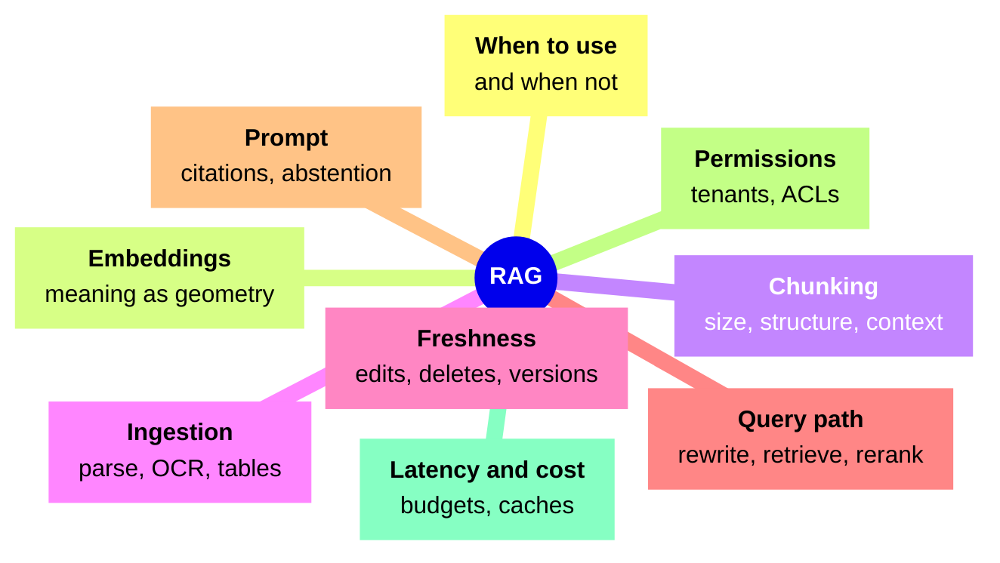
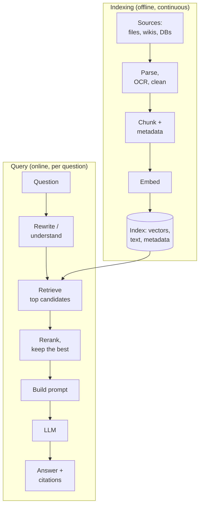
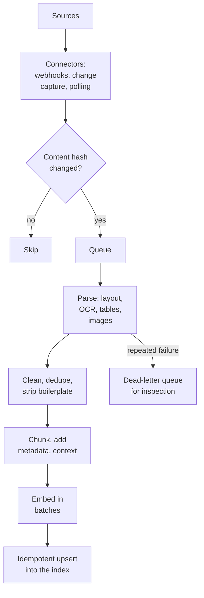
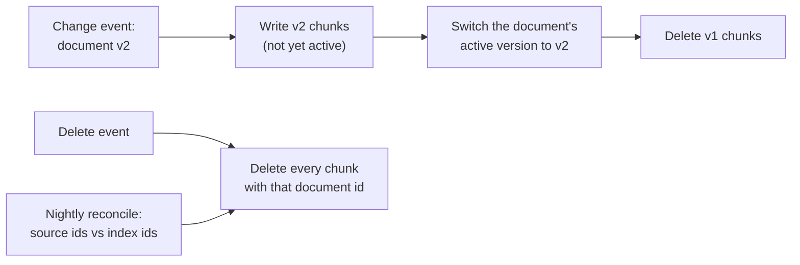
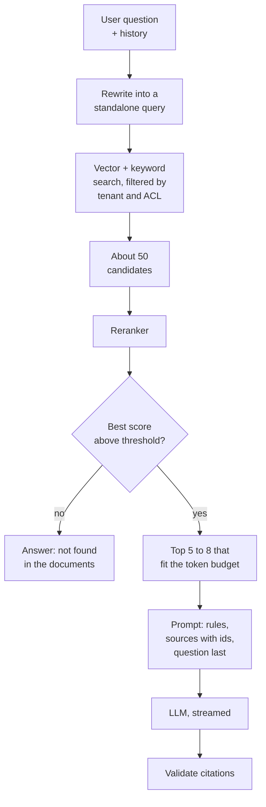

Retrieval-augmented generation (RAG) answers questions from your own documents: at question time, find the relevant passages, put them in the prompt, and make the model answer from them with citations. It is two systems: an **indexing pipeline** that prepares documents, and a **query pipeline** that serves a question. Most RAG quality problems are created in the first and noticed in the second.

## 1. What RAG is, and when it is the wrong tool

- **Indexing** turns documents into searchable chunks: parse, split, embed, store with metadata. It runs continuously as documents change.
- **Query** turns a question into a search, keeps the best passages, and asks the model to answer only from them.
- The index is the contract between the two: whatever parsing or chunking lost cannot be recovered at question time.

Why retrieval instead of the alternatives:

- **Instead of fine-tuning**: updates in minutes by re-indexing, citations to sources, and per-user permissions at request time.
- **Instead of putting everything in a long context**: corpora are larger than any window, and every token costs money, time and accuracy.

**When RAG is the wrong tool:**

- **Aggregations and analytics** ("how many tickets were escalated last month, by region"): the data is structured; use SQL or text-to-SQL. Retrieval returns ten passages; it cannot count fifty thousand rows.
- **Exhaustive questions** ("list every contract with an auto-renewal clause"): top-k returns k items, not all. Extract structured fields at ingestion and query them.
- **Whole-document tasks** (summarise this contract, compare two versions): give the whole document, or map over sections and combine.
- **Small, stable knowledge** (a 20-page policy): put it in the prompt with prompt caching. Simpler and more accurate.
- **Live data** (order status, stock levels): a tool call.
- **Behaviour or format problems**: prompting or fine-tuning.

Correction: "Million-token context windows killed RAG." Corpora outgrow any window; cost and time to first token scale with input; accuracy falls with length and distractors; permissions must be enforced per user; and an index updates incrementally. Long context changes RAG (bigger chunks, whole sections) rather than replacing it.

Say it like this: "RAG retrieves relevant passages at question time and makes the model answer from them with citations, so knowledge stays fresh, attributable and permission-aware. I don't use it for aggregations, which belong in SQL, for exhaustive listings, for whole-document tasks, or when the knowledge fits in a cached prompt."

## 2. Embeddings: meaning as geometry

An **embedding model** maps a text to a fixed-length vector so that texts with similar meaning land close together.

How it learns:

- **Contrastive training** on pairs that belong together: a question and the passage that answers it, a title and its article.
- The loss pulls each pair together and pushes apart the other passages in the same batch (**in-batch negatives**).
- **Hard negatives**, passages that look relevant but do not answer (the warranty page for a returns question), force the model to learn fine distinctions. Without them it learns only topic.

How it is used:

- **Bi-encoder**: query and document are embedded **separately**, so every document vector is computed once at indexing time; a query costs one embedding plus a nearest-neighbour search. The price: the model never sees query and document together. Rerankers fix that later.
- **Similarity**: **cosine** (the angle between vectors), **dot product** (equal to cosine when vectors are normalised to length 1), **L2** (straight-line distance; for normalised vectors it ranks results the same as cosine). Use what the model was trained with, normalise, and the three agree on ranking.
- **Asymmetric models** expect markers such as `query:` and `passage:`, or separate query and document modes. Forgetting them silently lowers quality.

What embeddings miss: exact identifiers (error codes, SKUs, ticket numbers), rare jargon, negation ("not covered"), numbers and dates, and vocabulary the model never saw. That is why lexical search runs alongside them.

**Choosing an embedding model:**

1. Shortlist from the MTEB retrieval leaderboard, in your languages.
2. Measure **recall@k on your own queries and documents**: the only number that decides.
3. Check the **maximum input length** (many models silently truncate at 512 tokens), dimensions (storage), latency and price, hosting (API or self-hosted for data residency), and multilingual support.

**Storage**: vectors take N x dimensions x bytes. 10 million chunks x 1,024 dimensions x 4 bytes (float32) is about 41 GB before any index overhead.

- **Matryoshka embeddings** are trained so the first m dimensions are themselves a good embedding: truncate 1,024 to 256 dimensions for 4 times less storage and faster search at a small quality cost, or search with short vectors and rescore the top results with full ones.
- **Quantisation**: int8 is 4 times smaller; binary (1 bit per dimension) is 32 times smaller, compared with Hamming distance, with the top candidates rescored using full vectors.
- **Changing the embedding model means re-embedding everything.** Vectors from different models live in different spaces. Build a new versioned index in parallel, evaluate both, switch an alias, keep the old one for rollback.

**When domain vocabulary defeats the embedding model**, in order:

1. Add keyword search (BM25) as a hybrid: catches exact terms immediately.
2. Enrich chunks: titles, section paths, contextual headers, glossary expansions.
3. Expand queries with domain synonyms (a glossary or an LLM rewrite).
4. Evaluate stronger or domain-specific embedding models on your eval set.
5. **Fine-tune the embedding model**: generate synthetic queries from your chunks with an LLM, mine hard negatives with the current retriever, train contrastively, and measure recall@k on held-out real queries.
6. Add a reranker.

Say it like this: "Embedding models are trained contrastively to pull matching query-passage pairs together and push non-matches apart, especially hard negatives, so meaning becomes distance. With normalised vectors cosine, dot product and L2 give the same ranking. I pick the model by recall@k on our own queries, not the leaderboard, and I version the index because changing the model means re-embedding everything."

## 3. Chunking

Why split documents at all:

- Embedding models truncate long input.
- One vector for a 40-page document averages every topic into a blur (**dilution**), so a specific question matches nothing strongly.
- The prompt needs passages, not whole documents.

**The trade-off**: small chunks match precisely but lose context (a sentence such as "this does not apply to contractors" separated from the rule it modifies); large chunks keep context but blur the embedding and spend more prompt tokens.

Strategies:

- **Fixed size by tokens with overlap** (for example 300 to 500 tokens, 10 to 20% overlap): the simple baseline; cuts mid-sentence and mid-table.
- **Recursive**: split on the largest natural boundary that fits: sections, then paragraphs, then sentences, then words.
- **Structure-aware**: follow the document's own structure: Markdown or HTML headings, layout sections in PDFs, code by function or class, FAQs by question-and-answer pair, tables whole with their header row.
- **Semantic**: split where the meaning shifts (similarity between neighbouring sentences drops). Costlier at indexing, mixed results; measure before adopting.

Pick size and overlap by evaluation (recall@k and answer quality on your questions), not folklore: answers that live in one paragraph favour small chunks; answers that need a whole procedure favour larger ones.

**Every chunk carries metadata**: document id, version, title, section path, page, source URL, timestamps, tenant id, access-control list, language, document type, content hash. Metadata powers filters, citations, freshness and deletes.

Upgrades that fix "too small to understand":

- **Parent-child (small-to-big)**: index small chunks for precise matching; on a hit, send the larger parent section, or the neighbouring chunks, to the model.
- **Contextual chunk headers**: prepend "Document title > Section > Subsection" to each chunk before embedding.
- **Contextual retrieval**: an LLM writes 50 to 100 tokens situating each chunk within its whole document, prepended before embedding and keyword indexing. Anthropic measured failed retrievals falling by about half with contextual embeddings plus contextual BM25, and by about two thirds with reranking added. Cost: one LLM call per chunk at indexing, made cheap by caching the full document in the prompt.
- **Multi-representation indexing**: index an LLM-written summary or the questions a chunk answers, and return the original chunk on a hit.

Say it like this: "Chunk size is a precision-versus-context trade-off, so I split along the document's structure, keep tables and procedures whole, attach metadata to every chunk, and tune size and overlap on recall@k. When chunks lose context I use parent-child retrieval or contextual headers."

## 4. Ingestion: where quality is decided

- **Connectors** detect changes by webhook, change-data capture or polling by modified time. A **content hash** skips documents that did not really change.
- **The queue** decouples bursty uploads from rate-limited embedding APIs; workers scale out, retry with backoff, and send documents that keep failing to a **dead-letter queue** instead of blocking the pipeline.
- **Parsing is where most quality is lost**:
  - Multi-column PDFs lose reading order; headers and footers repeat on every page.
  - **Scanned PDFs** have no text layer and need OCR. Keep page images and OCR confidence, flag low-confidence pages, and expect errors to flow into every later stage.
  - **Tables** flattened to text lose rows and columns. Keep each table whole as Markdown or HTML, index a short natural-language summary of it, and send the full table to the model.
  - Charts and images need vision-model descriptions; emails need quoted replies and signatures stripped.
  - Complex layouts justify layout-aware parsers or a vision LLM. Common choices: open-source parsers such as Unstructured and Docling, hosted parsers, cloud document services (AWS Textract, Azure Document Intelligence, Google Document AI), or a vision model reading page images directly.
- **Idempotent upsert**: the chunk id is derived from (document id, version, position), so a retry overwrites instead of duplicating.
- **Lineage**: record which parser version and embedding model produced each chunk, so you can re-process selectively.

## 5. Keeping the index correct: edits, deletes, permissions

- **Edits**: re-parse and re-chunk; compare chunk hashes and re-embed only what changed; write the new version's chunks; switch the document's active version in one step; then delete the old chunks. A search during the switch never sees a mix of old and new.
- **Deletes**: remove every chunk by document id within an agreed time (privacy and legal duties). Events get lost, so a periodic **reconciliation** job compares source ids with index ids and removes orphans.
- **Permission changes**: update the access-control metadata on the document's chunks; no re-embedding needed. This path must be fast: a user removed from a group should lose access within minutes. For strict systems, also re-check the final results against the source system at query time (**late binding**).
- **Model or chunking changes**: full re-index into a new versioned index, evaluate both, switch an alias, keep the old index for rollback.
- **Freshness** is a metric: lag from "source changed" to "searchable", with an alert.

## 6. The query path and the prompt

- **Rewrite**: a follow-up such as "and for contractors?" is rewritten with the history into "parental leave policy for contractors" before searching.
- **Search** runs with access filters applied inside the search (section 7), returning a generous candidate set.
- **Rerank** scores candidates precisely; if even the best is weak, answering "not found" is cheaper and more honest than generating.
- **Select** the top passages that fit the budget; never cut a passage mid-way.
- **Validate** citations after generation.

Building the prompt:

- Rules: answer only from the sources; if they do not contain the answer, say so; cite source ids after each claim; quote numbers exactly; when sources conflict, prefer the newest or report the conflict.
- Sources in tags with id, title and date: `<source id="S3" title="Travel policy" updated="2025-03-01">...</source>`.
- Most relevant first, near-duplicates removed, more than one document represented when possible. The question goes last.

**Citations you can trust:**

1. Every passage has a short id; the model cites ids per sentence.
2. Every cited id must be one you supplied; a fabricated id means drop the sentence or regenerate.
3. A judge or entailment model checks that each cited source supports its sentence; unsupported sentences are removed or flagged.
4. The user sees the quoted span and a link to the exact page.

**Abstention** has two layers: a retrieval threshold (no good evidence, no generation) and a generation rule with an example, both measured with unanswerable questions in the eval set.

## 7. Permissions and multi-tenancy

**Enforce access in retrieval, never in the prompt.** Once a passage is in the context, the model can repeat it; "do not reveal X" is not a control, and injected text can override it.

- Every chunk carries `tenant_id` and an access list (users or groups allowed).
- At query time, resolve the user's groups from the identity provider (cached briefly) and filter the search: tenant matches **and** the access list overlaps the user's groups.
- The filter must run **inside** the search. Filtering after taking the top results returns too few or zero results for users who can see little.

Isolation options:

- **Index per tenant**: strongest isolation, simple per-tenant deletion and tuning; many small indexes to operate. Suits a few large tenants.
- **Shared index with a tenant filter**: efficient for many small tenants; one filter bug leaks data, and heavy tenants slow others (**noisy neighbours**).
- **Partitions or namespaces per tenant** inside one cluster: the middle ground most vector databases offer.
- Common hybrid: large tenants get dedicated indexes, small ones share.

**Everything derived from documents inherits their permissions**: caches (the key includes tenant and permission scope), conversation memory, summaries, eval datasets and traces. Log which chunks were shown to which user.

Say it like this: "Permissions are enforced as filters inside the retrieval query, using the tenant and access list stored on every chunk, so the model never sees text the user can't. Caches, memory and logs are scoped the same way, permission changes propagate as metadata updates within minutes, and for strict cases I re-check the final results against the source system."

## 8. Latency and cost of one request

A typical interactive budget:

- Query rewrite with a small model (optional): 200 to 400 ms.
- Query embedding: 10 to 50 ms.
- Vector and keyword search: 10 to 100 ms.
- Reranking 50 candidates: 50 to 200 ms.
- LLM time to first token: 0.3 to 2 s, growing with the source tokens.
- Generation: output tokens x 10 to 30 ms.

The LLM dominates; retrieval is rarely the bottleneck. Levers:

- Stream the answer.
- Send fewer, better passages: a reranker lets you send 5 instead of 20, cutting both cost and distraction.
- Cap answer length.
- Cache at every layer: query embeddings, retrieval results, the static prompt prefix (prompt caching), and full answers to repeated questions. Every cache is keyed by tenant and permission scope and invalidated when its documents change.
- Skip the rewrite for first-turn questions; run independent steps in parallel.

Cost per request is roughly (rules + passages + question tokens) x input price + answer tokens x output price; embedding and reranking are small. **Passages dominate input**, so retrieval precision directly controls cost.

## Thinking checklist

- Is this question answerable by retrieving a few passages, or does it need SQL, a whole document, or a tool?
- What did parsing lose (tables, scans, reading order), and would I notice?
- Does each chunk have enough context to be understood alone, and the metadata to filter, cite and delete it?
- How fast does an edit, delete or permission change become visible, and how do I know?
- Where exactly are permissions enforced, and what else (cache, memory, logs) holds document content?
- What does the system do when the evidence is missing, conflicting or out of date?
- Which stage would I check first if an answer is wrong, and is that stage logged?
