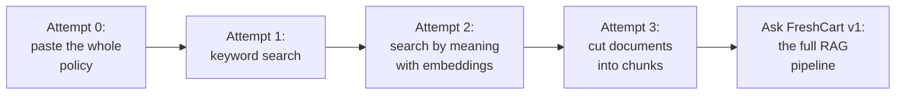
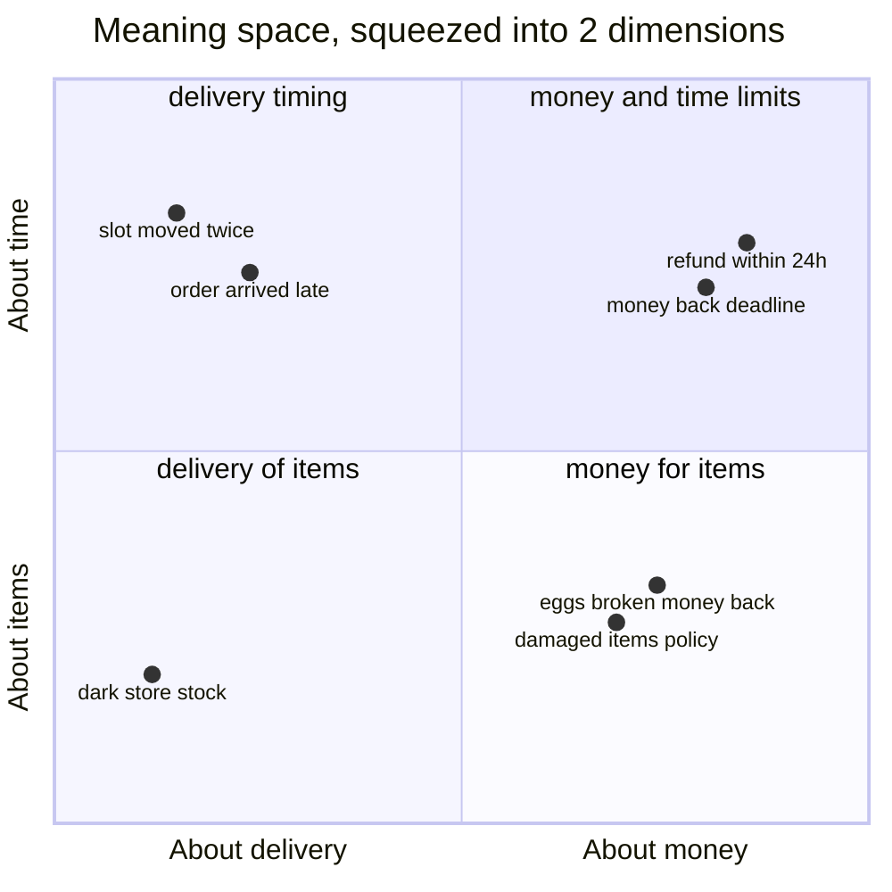
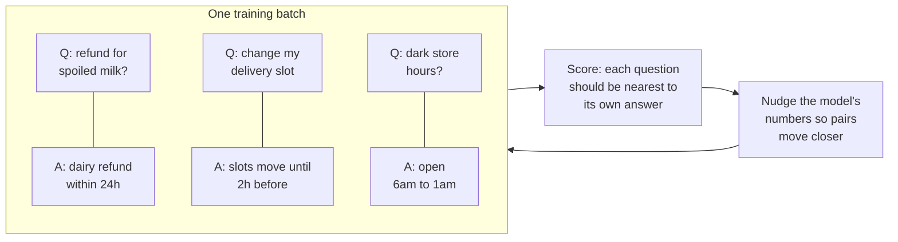
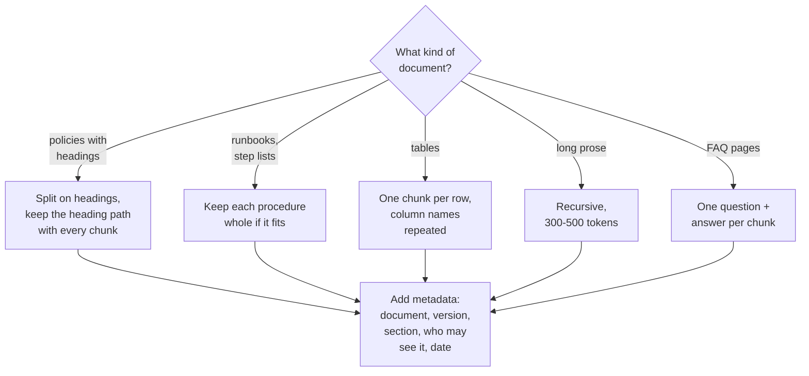
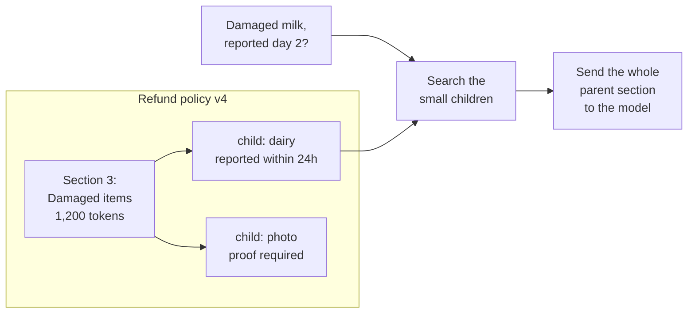
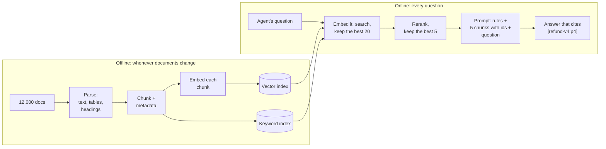
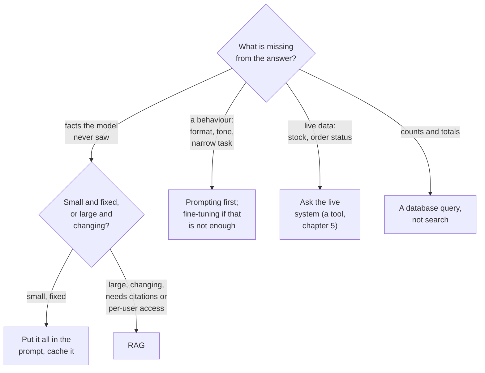
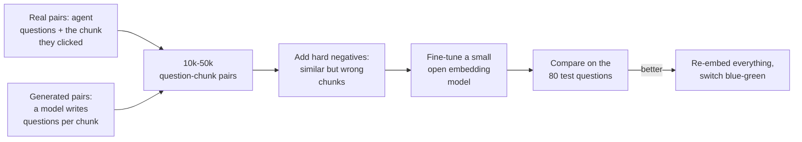

Meera's question is simple: "Can bakery items be refunded after 6 hours?" The answer is sitting in FreshCart's refund policy, page 4, in a table. Chapter 1 ended with the problem: the model never saw that page, and you cannot paste all 12,000 documents into every prompt.

Think about how you would answer it yourself. You would not memorise all 12,000 documents. You would open the right policy, find the right paragraph, read it, and answer. That is an **open-book exam**, and it is exactly the idea behind this chapter.

**Retrieval-Augmented Generation (RAG)** splits answering into two jobs:

- **Retrieval**: find the few passages that answer the question.
- **Generation**: hand those passages to the model with the question, and tell it to answer only from them and to say which passage it used.

The model stops being the source of facts and becomes a reader of evidence you give it. In this chapter you will build Ask FreshCart, the assistant for Meera's 80 support agents, one attempt at a time. Each attempt fixes the last one's problem and reveals the next.



## 1. Attempt 0: just paste the document

For one question about one policy, the simplest thing works. Copy the 40-page refund policy into the prompt, add the question, and ask the model to answer from it. It answers correctly and can even quote the page.

This is worth remembering, because it is the right design in some real cases: when the knowledge is small (a few dozen pages) and rarely changes, put all of it in the prompt every time and turn on prompt caching so the repeated part is cheap. No search means no search mistakes.

But Meera's agents ask about everything: refunds, delivery slots, warehouse runbooks, franchise rules. All of it is 12,000 documents, hundreds of millions of tokens. It cannot fit, and even the part that fits would be slow, expensive and less accurate (chapter 1, section 5).

> **Pause and think.** For each question, only two or three pages matter. What is the most obvious way to find them?

## 2. Attempt 1: search by keywords

The obvious way is the way you search your own files: look for documents containing the words of the question. This is **keyword search**, and it is decades old and very good at what it does.

It handles "What does ERR_SLOT_EXPIRED mean?" perfectly: exactly one runbook contains that string.

Then an agent types: "eggs broken on arrival, can they get money back?" The policy says: "Damaged items reported within 24 hours are eligible for a full refund." Look at the two sentences. They share almost no words. "Broken" versus "damaged", "money back" versus "refund", "on arrival" versus "reported". Keyword search finds nothing useful.

People describe the same thing in endlessly different words. A search that only matches spelling will keep missing.

> **Pause and think.** To a human, "eggs broken on arrival" and "damaged items" obviously mean nearly the same thing. How could a computer measure that two sentences mean the same thing, when they share no words?

## 3. Attempt 2: search by meaning with embeddings

### Meaning as a location on a map

Imagine a map where every sentence has a location, and sentences that mean similar things are placed close together. "Refund within 24 hours" and "money back for damaged items" are neighbours. "Delivery slot moved" lives in a different neighbourhood. If you had such a map, searching by meaning would be easy: put the question on the map and look at what is nearby.

An **embedding** is exactly that location. An **embedding model** reads a piece of text and outputs a fixed-length list of numbers, a **vector**, typically 384 to 3,072 numbers long. Each vector is a point in a space with that many directions. Nobody can picture 768 directions, but the idea is the same as a 2D map, so here is one squeezed down to two:



- The question "eggs broken, money back" lands right next to "damaged items policy", even though they share no words.
- "Slot moved twice" lands among the delivery-timing texts, far away.
- In the real 768-dimensional space, the axes do not have human names like "about money"; the model learned its own directions. The picture is a simplification of the idea, not of the actual numbers.

**Vector search** is then: embed the question, find the stored vectors nearest to it, return their texts. A **vector index** is the data structure that answers "which stored vectors are nearest to this one?" quickly (chapter 3 opens it up).

### Measuring "near"

Three common ways to measure how close two vectors are:

- **Cosine similarity** compares the directions the two vectors point in, ignoring their length. 1 means same direction, 0 means unrelated.
- **Dot product**: multiply the two vectors number by number and add it all up.
- **Euclidean (L2) distance**: the straight-line distance between the two points.

A practical trick: scale every vector to length 1 when you store it (**normalise** it). Then cosine similarity and dot product give the same answer, and Euclidean distance ranks results in the same order. So you normalise once and use the dot product, the cheapest to compute.

### How does the model learn where to put things?

This is the part interviewers love, because it explains *why* embeddings work. An embedding model is trained on millions of pairs of texts that belong together: a question and its answer, a search query and the page people clicked, a title and its article. Training uses **contrastive learning**: pull matching pairs together, push non-matching ones apart.



- Each question in the batch has its correct answer. All the *other* answers in the batch serve as wrong answers for free (**in-batch negatives**).
- The model computes a **loss**, a score of how wrong it currently is: high if a question sits closer to a wrong answer than to its own, low if every question is nearest its own answer.
- Training nudges the model's billions of numbers, a tiny bit each step, to make the loss smaller. After millions of steps, texts that answer each other end up close together.
- The best training sets include **hard negatives**: wrong answers that look very similar to the right one, such as the bakery rule for a dairy question. They teach fine distinctions.

### Choosing an embedding model

- **Test on your own questions.** Run three or four candidate models on 50-100 real questions where you know the right document, and keep the one that finds it most often. Public leaderboards such as MTEB are a good shortlist, not a decision: their tasks are not your documents.
- **Check the input limit.** Each model reads at most a fixed number of tokens (often 512) and silently ignores the rest.
- **Dimensions cost memory and speed.** More numbers per vector can hold finer meaning but take more storage and slower comparisons. Some models are trained so that the first part of the vector works on its own (**Matryoshka embeddings**, after the nesting dolls): keep 256 of 1,024 numbers and it still works, a little less precisely.
- **Use the prefixes.** Many models expect questions and documents to be marked differently, for example `query: ...` and `passage: ...`. Forgetting this quietly lowers quality.
- **Languages and vocabulary.** If agents mix Hindi, Marathi and English, test exactly that mix. If FreshCart's own words ("dark store", "FC slot", product codes) keep confusing the model, you can **fine-tune the embedding model** on FreshCart's own question-and-document pairs; section 9 shows how.

Correction: switching embedding models later is not a configuration change. Vectors from different models live in different spaces and cannot be compared, so every document must be embedded again.

> **Pause and think.** You embed the whole 40-page refund policy as one vector and ask "what is the refund window for damaged dairy?". The policy covers dairy, bakery, frozen food, delivery fees, disputes and fraud. What does a single point on the map for all of that look like, and will it be close to this specific question?

## 4. Attempt 3: cut documents into chunks

One vector for 40 pages is an average of everything in it, a blurry point somewhere in the middle of "refund-ish" space. It matches every refund question weakly and none of them sharply. And when it is retrieved, it drags 20,000 tokens into the prompt.

So documents are cut into **chunks**: pieces of a few hundred tokens, each embedded and searched on its own. Think of cutting a book into index cards, one idea per card.

Chunk size is a trade-off between two failures:

- **Too big**: the vector averages many topics and matches nothing sharply; every hit is expensive to paste.
- **Too small**: "The limit is 24 hours." Limit on what? A tiny chunk loses the context that gives it meaning.

### Ways to cut

- **Fixed-size with overlap**: every 400 tokens, with the last 50 tokens repeated at the start of the next chunk, so a sentence cut at the border appears whole in one of them. Simple, but it slices through sentences and tables.
- **Recursive**: try to split on paragraph breaks; if a piece is still too big, split it on line breaks, then on sentences, until every piece fits. A strong default (LangChain, a popular library covered in chapter 5, ships one called `RecursiveCharacterTextSplitter`).
- **Structure-aware**: split on the document's own structure, headings, sections, list items and table rows, keeping each heading attached to its text.
- **Semantic**: embed each sentence and start a new chunk wherever neighbouring sentences stop being similar in meaning.

Real document collections need a mix:



- **Headings are context.** A chunk that starts "Within 24 hours of delivery..." is far easier to find when it carries "Refund policy > Damaged items > Dairy".
- **Tables need their column names.** "Bakery | 12 hours | Photo" means nothing alone; "Category: Bakery. Refund window: 12 hours. Proof: photo required." is findable and readable.
- **Metadata** is extra information stored with each chunk: which document and version it came from, the section, which franchises may see it, the date. You will filter and cite with it constantly.

Two rules people get wrong: count **tokens**, not characters (the embedding model silently cuts off anything past its limit), and keep overlap modest (0-20%), because more overlap just duplicates content.

**Decision point: what chunk size should Ask FreshCart use?** Do not guess; measure. Take 80 real agent questions, mark the passage that answers each, build the index three times at 200, 400 and 800 tokens per chunk, and count how often the right passage lands in the top 10 results for each. Keep the winner. "512 because everyone uses 512" is the weak interview answer. "I compared three sizes on our real questions" is the strong one.

### Two upgrades that fix the "too small" problem

**Parent-child retrieval** gets precision and context at once. Embed small chunks (a few sentences) because small chunks have sharp meaning; each remembers the bigger section it came from, its **parent**. Search the small ones, send the parents to the model.



The model now also sees the photo-proof rule sitting next to the dairy rule.

**Contextual retrieval** (published by Anthropic) fixes chunks that make no sense alone. Before indexing, a model reads each chunk together with its whole document and writes one sentence that places it: "From FreshCart refund policy v4, section on damaged dairy items." That sentence is glued to the front of the chunk before embedding. Anthropic reported this roughly halved retrieval failures in their tests. The cost is one model call per chunk at indexing time.

## 5. Ask FreshCart v1: the full pipeline

Put the pieces together and you have the standard RAG architecture. It is two pipelines that run at different times:



**Offline**, whenever a document is created, edited or deleted: parse it into clean text, cut it into chunks with metadata, embed each chunk, and store it in the vector index. The same chunks also go into a keyword index, because, as you saw in attempt 1, keyword search still wins on exact codes. (Chapter 3 shows how to combine the two properly.)

**Online**, for every question:

1. Embed the question with the same embedding model.
2. Search for the best 20 candidate chunks, keeping only chunks this agent is allowed to see.
3. A **reranker**, a slower and more accurate model, rereads those 20 and keeps the best 5 (chapter 3).
4. Build the prompt: instructions, the 5 chunks each labelled with an id like `[refund-v4:p4]`, then the question.
5. The model answers and cites the ids, so Meera's agents can click through and check.

### Building the prompt

Order matters as much as content:

- **Instructions first**: who the assistant is and the rules. "Answer only from the documents below. If they do not answer the question, say you could not find it. Cite the id of every passage you use."
- **The documents next**, each wrapped with its id and a little metadata: `[refund-v4:p4 | Refund policy v4 | updated 2026-09-01]`. The date lets the model prefer the newer of two conflicting passages.
- **The question last.**

Fixed parts first means prompt caching can reuse them across questions. Remove near-duplicate chunks before building the prompt (the policy and an FAQ quoting it), so one fact does not take up five slots.

A token budget for one call might be: instructions 800, five chunks of 400 = 2,000, recent conversation 500, question 100, room for the answer 500. About 3,900 tokens. When answers need more evidence, the fix is better chunks or better ranking, not more chunks: more text often makes answers worse (chapter 4).

### Citations you can trust

Ask the model for structured output with two fields, `answer` and `citations`. Afterwards, in code, drop any cited id that was not actually retrieved, and run a check: for each sentence, a second model call answers "is this sentence supported by the chunk it cites?". Unsupported sentences are removed, or the assistant says it could not find the answer.

### Where the time goes

For one answer: embedding the question 10-50 ms, both searches 10-50 ms, reranking 50-300 ms, and generation, which dominates everything. **Stream** the answer, showing words as they are produced, so agents start reading after the first word instead of waiting for the last. Also cache: embeddings of repeated questions, search results for very frequent questions (cleared whenever the index changes), and the fixed start of the prompt.

## 6. Keeping the index honest when documents change

The refund policy is updated to version 4. What has to happen?

Every chunk is stored with its `doc_id` and `version`. On an update: re-parse and re-chunk the document, embed and store the new chunks, and delete all old chunks of that `doc_id`, in the vector index and the keyword index, as one operation. Change events come from the wiki's webhooks, or a nightly job that compares a fingerprint (hash) of every document's content.

Correction: teams often add the new chunks and forget the delete. Then versions 3 and 4 are both searchable and answers mix them. Worse, a document that was deleted, or that some people lost access to, stays searchable. That is a data leak, not just a stale answer.

Bigger changes, such as a new chunk size or a new embedding model, mean rebuilding the whole index. Doing that in place would leave a half-old, half-new index for hours. The safe pattern is **blue-green re-indexing**: build the new index next to the old one, keep both updated, test the new one on your 80 questions, switch queries over in one step, and delete the old one after a safety period.

## 7. The numbers behind the index

A quick estimate makes any design answer stronger:

- 12,000 documents, about 160 chunks each: roughly 2 million chunks.
- One embedding: 768 numbers x 4 bytes = about 3 KB. 2 million chunks = about 6 GB of vectors, plus the index's own overhead.
- Embedding everything once: 2 million chunks x 400 tokens = 800 million tokens. At an assumed $0.02 per million tokens for an embedding API, about $16. Embedding is cheap; generating answers is where the money goes.

## 8. When RAG is the wrong tool

Interviewers rarely ask "what is RAG?". They ask "why RAG, and not something else?".



"How many refunds did we issue last week?" is the trap question: search returns *some* refund documents; it cannot count all refund records. That is a database query.

## 9. When the embedding model does not speak FreshCart

After a month, one weakness remains: agents write "dark store" for a small warehouse and "FC slot" for a delivery window, and the general embedding model puts "dark store Kothrud stock" near articles about shop lighting. Fixes, in order of cost:

1. Keyword search alongside vector search (chapter 3), which catches exact terms.
2. Contextual sentences and good metadata on chunks.
3. Trying other embedding models on your 80 questions.
4. **Fine-tuning the embedding model** on FreshCart's own pairs:



A few thousand good pairs can noticeably improve search on domain vocabulary. The cost is owning a model: hosting it, and re-embedding everything when it changes. So it comes last.

Correction: "the top model on the leaderboard will be best for us" is often false. A smaller model tuned on your own pairs can beat it on your data.

## 10. Complete example: the smallest real RAG

```python
import numpy as np

def build_index(chunks, embed):
    vecs = np.array(embed([c["text"] for c in chunks]), dtype=np.float32)
    vecs /= np.linalg.norm(vecs, axis=1, keepdims=True)      # normalise once
    return vecs

def search(question, chunks, vecs, embed, k=5, allowed=None):
    q = np.array(embed([question])[0], dtype=np.float32)
    q /= np.linalg.norm(q)
    scores = vecs @ q                                        # dot == cosine now
    order = np.argsort(-scores)
    hits = [chunks[i] for i in order if allowed is None or chunks[i]["franchise"] in allowed]
    return hits[:k]

def build_prompt(question, hits):
    docs = "\n\n".join(f"[{h['id']} | {h['title']} | {h['updated']}]\n{h['text']}" for h in hits)
    return (
        "You answer FreshCart support questions using ONLY the documents below.\n"
        "If they do not contain the answer, say you could not find it.\n"
        "Cite the id of every document you use, like [refund-v4:p4].\n\n"
        f"<documents>\n{docs}\n</documents>\n\nQuestion: {question}"
    )
```

Expected behaviour:

- "eggs broken on arrival, money back?" retrieves the damaged-items chunk first, although they share almost no words, because their vectors are close.
- An agent from a franchise that may not see a document never gets its chunks, because they are filtered out before the prompt is built.
- If no chunk is relevant, the instructions tell the model to say it could not find the answer, rather than invent one.

Notice a quiet problem in `search`: it scores every one of the 2 million vectors on every question, and it filters *after* ranking. Remember both; they are the start of the next chapter.

## What breaks next

Ask FreshCart v1 goes live and agents love it. Within two weeks, three complaints arrive:

1. **It is slow.** Every question compares against all 2 million chunk vectors: 2 million x 768 multiplications, over a billion operations per question, at 50 questions a second at peak.
2. **The Bengaluru-North franchise gets no results** for its own runbooks, although they are definitely indexed. The franchise owns 1% of the chunks.
3. **Error codes fail again.** "What does ERR_SLOT_EXPIRED mean?" returns vague chunks about delivery delays. Meaning search does not know what that code means, and the exact-match strength of keyword search was lost.

> **Pause and think.** How could you find the nearest vectors without comparing against all 2 million? Why might a filter for "only Bengaluru-North" make results disappear rather than just shrink? And how would you combine a keyword ranking and a meaning ranking whose scores are on completely different scales?

That is chapter 3.
