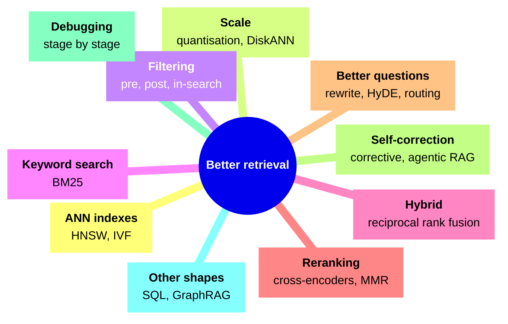
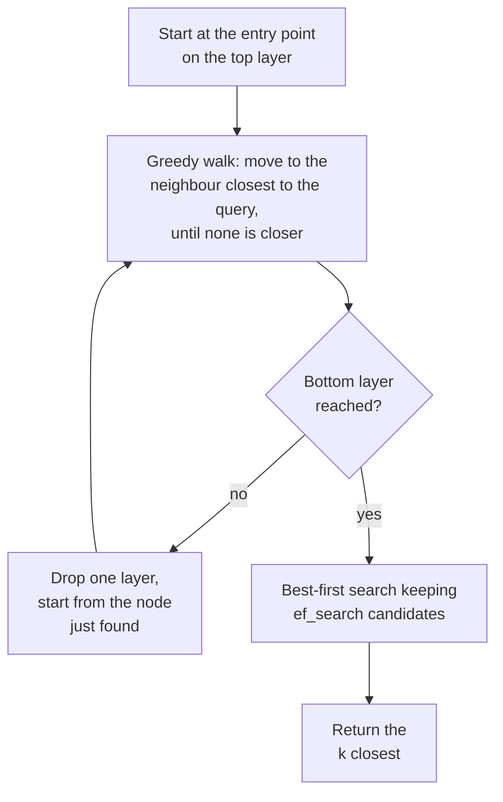
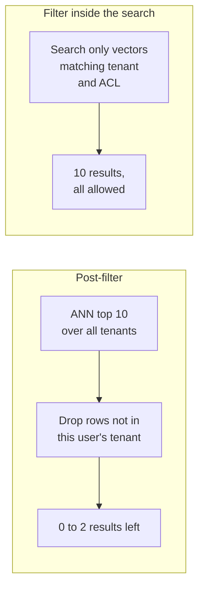
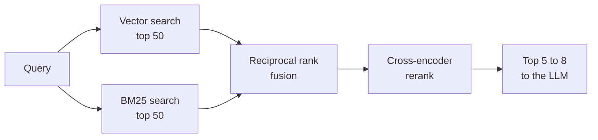
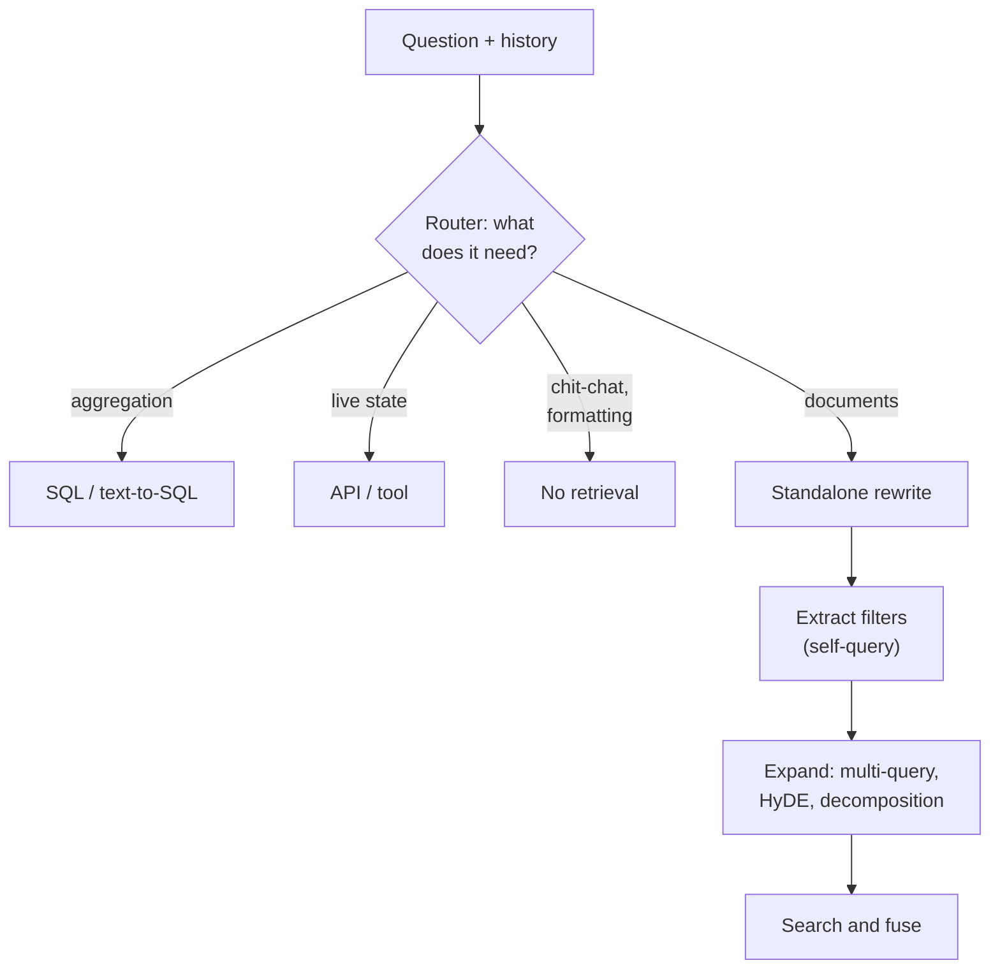
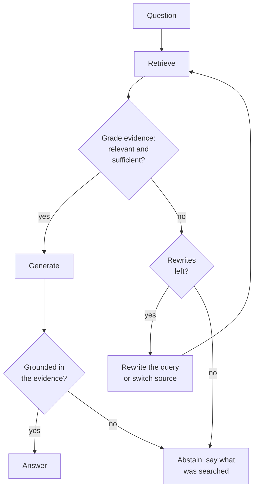
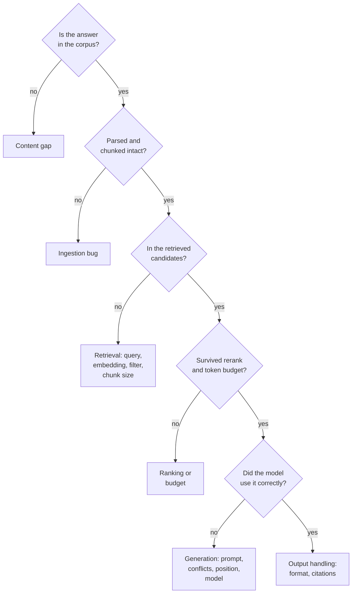

A basic RAG pipeline works on a demo and then fails at scale in predictable ways: exact search becomes too slow, filters make results vanish, exact terms are missed, the right passage ranks fourteenth, the question is a poor search key, and some questions do not fit chunk search at all. This chapter is the toolbox for each failure, plus the method to find out which one you have before reaching for a fix.

## 1. Approximate nearest neighbour search

- **Exact (flat) search** compares the query with every vector: N x d multiply-adds. For 10 million vectors of 1,024 dimensions that is about 10 billion operations per query: too slow for interactive use. It is fine below roughly 100,000 vectors, or when a filter leaves only a few thousand rows.
- **Approximate nearest neighbour (ANN)** indexes give up a little accuracy for orders of magnitude of speed.
- Their accuracy is **ANN recall@k**: the fraction of the true top-k (what exact search would return) that the index actually returns. Typical targets are 0.95 to 0.99.

## 2. HNSW: the default index

**HNSW (hierarchical navigable small world)** is a layered graph. Every vector is a node linked to its near neighbours. Upper layers hold few nodes with long-range links (motorways); the bottom layer holds every node with short local links (streets).

- On the sparse top layers, a few long hops get close to the query's region quickly.
- Each layer down starts where the last one ended, refining the position.
- On the bottom layer, a wider search keeps a list of `ef_search` candidates, exploring their neighbours, and returns the k best.

**Building**: each new vector is assigned a random top layer (each layer up holds an exponentially smaller fraction of the nodes), is found a place by the same search (with `ef_construction` candidates), and is linked to up to `M` neighbours per layer.

Parameters:

- **M** (links per node): higher means better recall, especially at high dimensions, but more memory and slower inserts. Typical 16 to 64; pgvector's default is 16.
- **ef_construction** (candidates while building): higher means a better graph and a slower build. pgvector's default is 64.
- **ef_search** (candidates at query time, at least k): the main runtime knob. Higher means better recall and higher latency. Tune it by measuring recall against exact search on a sample; it can be set per query. pgvector's default is 40.

Properties: the best recall-for-latency trade-off in general use; accepts inserts without retraining; deletes are only marked and slowly degrade the graph until a rebuild; memory-hungry (vectors and links in RAM); slow to build for very large datasets.

**IVF (inverted file index)**, the main alternative:

- k-means groups the vectors into `lists` clusters; each vector is stored in its nearest cluster.
- A query finds the `probes` nearest cluster centres and searches only those clusters, exactly.
- Knobs: `lists` (pgvector guidance: rows / 1,000 up to a million rows, the square root of rows beyond), `probes` (start near the square root of lists; more probes, better recall, slower).
- The centres are learned from the data, so build it **after** loading representative data, and rebuild when the data distribution drifts. Faster to build and smaller than HNSW, with a worse recall-latency trade-off.

In pgvector: HNSW can be built on an empty table and maintained as rows arrive; IVFFlat needs the data first. Default to HNSW unless memory or build time is the binding constraint.

Say it like this: "HNSW is a layered graph: sparse upper layers with long links get you near the query fast, and the dense bottom layer refines with a best-first search. M sets links per node, trading memory for recall; ef_construction sets build quality; ef_search is the query-time recall-versus-latency knob, which I tune against exact search on a sample."

## 3. When the index does not fit in memory

100 million vectors of 1,024 float32 dimensions take about 410 GB. Options:

- **Scalar quantisation (int8)**: 4 times smaller, small recall loss.
- **Product quantisation (PQ)**: split each vector into m sub-vectors, learn 256 centroids per sub-space, and store each sub-vector as a one-byte centroid id. A 4 KB vector becomes m bytes (64 bytes is a 64-fold reduction). Distances are approximated with lookup tables; recall drops. Combined with IVF (**IVF-PQ**) it is the classic billion-scale index.
- **Binary quantisation**: 1 bit per dimension (32 times smaller); Hamming distance is extremely fast. Works best with high-dimensional models; always rescore.
- **DiskANN**: a graph index on SSD with compressed vectors in RAM; serves billions of vectors from one machine at low latency.
- **Fewer dimensions**: Matryoshka truncation.
- **Sharding and replicas**: split the index across machines, search shards in parallel and merge their top-k; add replicas for throughput.

The rule: **compress to generate candidates, rescore with full precision for the final ranking.**

## 4. Filtering: when results vanish

- **Post-filtering** takes the ANN top-k, then drops non-matching rows. If 1% of vectors match the filter, the top 10 almost never contains them: the user gets few or zero results. Worst for selective filters: small tenants, per-user access lists.
- **Pre-filtering with exact search** finds matching rows first with an ordinary index, then computes exact distances on them. Perfect recall; fast when the matches are few, slow when they are many.
- **Filtering during graph traversal** skips non-matching nodes. With a selective filter the remaining graph falls apart into islands and the search stalls far from any match: recall collapses. Engines counter this with filter-aware traversal that may pass through non-matching nodes (Qdrant's filterable HNSW, Weaviate's ACORN), iterative scans that keep searching until enough matches are found (pgvector 0.8 `hnsw.iterative_scan`), and planners that switch to exact search when the filter is selective.
- Design fixes: give the most selective, always-present filter its own **partition** (tenant), **over-fetch** (k x 10) for mildly selective filters, and index the filtered fields.

Say it like this: "Post-filtering after an ANN search returns too few results when the filter is selective, because the top-k is computed over everyone. I filter inside the search, with an engine that keeps graph search connected under filters or falls back to exact search for small match sets, and I partition by tenant so the most selective filter is free."

## 5. Keyword search: BM25

An **inverted index** maps each term to the documents that contain it. **BM25** scores a document for a query by summing, over the query's terms:

`IDF(term) x tf x (k1 + 1) / (tf + k1 x (1 - b + b x doc_length / avg_doc_length))`

- **IDF**: rare terms count more than common ones.
- **Term-frequency saturation** (`k1`, usually 1.2 to 2.0): the tenth occurrence adds little over the third.
- **Length normalisation** (`b`, usually 0.75): a match in a short document counts more than one in a long document.
- Saturation and length normalisation are what make it better than plain TF-IDF.

Strengths: exact terms, ids, error codes, names, rare jargon; no training; explainable. Weaknesses: synonyms and paraphrases ("cancel" versus "terminate"), typos (needs fuzzy matching), and language-specific tokenisation. Found in Elasticsearch and OpenSearch, Lucene and Tantivy, and Postgres through extensions (Postgres's built-in `ts_rank` is not BM25).

## 6. Hybrid search and rank fusion

- The two scores cannot be compared: BM25 is unbounded, cosine lies between -1 and 1, and both distributions shift per query. So fuse **ranks**, not scores.
- **Reciprocal rank fusion (RRF)**: each document scores the sum, over the result lists, of `1 / (k + rank)`, with k = 60 from the original paper.
  - A document ranked 1st in the vector list and 10th in the keyword list scores 1/61 + 1/70 = 0.0307.
  - A document ranked 3rd in both scores 2/63 = 0.0317 and wins: **agreement across retrievers beats one strong vote**.
  - k dampens the advantage of the very top positions. No tuning, and immune to score scales. Weighted RRF multiplies each list's contribution by a weight.
- The alternative, a weighted sum of normalised scores, needs per-corpus tuning and breaks on outliers.

**When hybrid scores below keyword search alone**, fusion is diluting a strong retriever with a weak one for some query type. Evaluate per slice (id-like queries versus natural language), then: weight the lists, route by query type (id patterns go to keyword search only), improve the weak retriever, rerank after fusion, and tune how many candidates each side contributes.

## 7. Reranking

**Two-stage retrieval**: the first stage (vectors plus BM25) maximises recall cheaply over millions of documents; the second stage (a reranker) maximises precision over 50 to 100 candidates.

- A **bi-encoder** embeds query and document separately: fast, precomputable, but it only measures topical closeness.
- A **cross-encoder** reads the query and one candidate **together**: every query token attends to every document token, so it judges real relevance (negation, which entity, whether the passage actually answers). It outputs one relevance score per pair.
- **Why not retrieve with a cross-encoder**: nothing can be precomputed, so it runs once per (query, document) pair at query time. Ten million passes per query is impossible; fifty takes tens to a couple of hundred milliseconds on a GPU.
- Options: hosted rerank APIs and open cross-encoders; **LLM rerankers** (strongest, slowest, most expensive); **late interaction (ColBERT)**: one stored vector per document token, scoring by summing each query token's best match. More precise than one vector per passage and precomputable, at a large storage cost.
- **Diversity (MMR)**: pick each next result to maximise relevance minus similarity to results already picked, so the model does not receive five near-copies of one paragraph.
- **Skip reranking** when the first stage already places the answer in the top few (measure whether reranking changes answer quality), when the latency budget is tight, for tiny corpora, at very high query rates where cost dominates, and for exact-id lookups.

Say it like this: "A bi-encoder embeds query and document separately, so documents are precomputed and search is fast but shallow. A cross-encoder reads them together with full attention, which is far more accurate but has to run per pair at query time. So I retrieve 50 candidates with hybrid search and rerank only those."

## 8. Better questions: query transformation and routing

The user's words are often a poor search key: short, vague, conversational, multi-part, or full of hidden constraints.

- **Standalone rewrite**: fold the conversation into a self-contained query. Always needed in chat.
- **Self-query (hidden filters)**: pull structured constraints out of the text into metadata filters plus a semantic remainder: "invoices over 10k from Q3 2024" becomes filters on type, date range and amount plus the query "invoices". Validate extracted values against the allowed fields.
- **Multi-query**: generate 3 to 5 paraphrases, retrieve for each, fuse with RRF. Raises recall for vague or vocabulary-mismatched queries; costs one LLM call and N searches.
- **HyDE**: the LLM writes a hypothetical answer, and you search with its embedding, so an answer-shaped vector matches answer-shaped passages. Helps short, vague questions in a domain the LLM knows; hurts when the hypothesis invents wrong specifics; useless for id lookups.
- **Decomposition**: split multi-part or multi-hop questions into sub-questions. Independent parts are retrieved in parallel; dependent ones in sequence, when the second needs the first's answer.
- **Step-back**: also retrieve with a more general version of the question, to pull in the governing policy or principle.
- **Routing**: a small model with structured output picks the source: an index or collection, SQL for aggregations, a live API, web search, or nothing. When it is unsure, query several sources and fuse.

Which to use: conversational, rewrite; constraints in the text, self-query; vocabulary mismatch, multi-query; short and vague, HyDE; multi-part, decomposition; mixed sources, routing. Each adds latency and cost, so each must earn its place in the eval.

## 9. Self-correction: corrective and agentic RAG

- **Grading** uses an LLM judge with a binary rubric, or a cheaper reranker-score threshold.
- **The loop guard**: at most one or two rewrites and a token and time budget, then abstain and say what was searched. An unbounded loop is a cost incident.
- **The groundedness check** catches answers that drift beyond the evidence.
- **Cost**: a grading call on every question plus extra retrievals on failures. The adaptive version grades only when the best reranker score is low.
- **Worth it** when wrong answers are expensive, retrieval failures are common and fixable by rephrasing, and the eval shows the gain. Not for high-volume, low-stakes, latency-critical search.

**Agentic RAG** makes retrieval a tool the agent calls with its own queries, across sources, until it has enough evidence.

- Handles multi-hop and exploratory questions that one retrieval cannot.
- Risks: unpredictable latency and cost, loops, over-retrieval flooding the context, harder evaluation, and injected instructions in retrieved text steering the agent.
- Controls: step and token budgets, an explicit "enough evidence" check, deduplication of retrieved passages, and mandatory citations in the final answer.

## 10. Debugging: find the failing stage

Walk a failure down the stages; the first "no" is the cause. These match the known RAG failure points: missing content, missed top-ranked documents, not in context, not extracted, wrong format, wrong specificity, incomplete answer. This only works if every request logs every stage: original and rewritten query, filters, candidate ids and scores, reranked ids, the final context, the prompt version, the answer and its citations.

**Retrieval or generation, at scale**: label a set of (question, relevant chunk ids) and measure **context recall**: was a relevant chunk in the final context? If not, retrieval failed; if it was and the answer is still wrong, generation failed. On unlabelled production traffic, an LLM judge can estimate "does the context contain the answer?".

Common cases:

- **"The right document exists but the answer is wrong"**: the fact is split across chunks; the chunk was retrieved but cut by the budget; old and new versions were both retrieved (filter to active versions, include dates, prefer the newest); the passage sat in the middle of the context; a table was flattened; the question needs arithmetic (use a tool).
- **"Confident answer without support"**: a retrieval threshold for abstention, an explicit not-found rule with an example, a groundedness check, and unanswerable questions in the eval set.
- **Lost in the middle**: fewer passages, the best at the start and end, reranking, and compressing passages to their relevant sentences.

Say it like this: "I debug RAG stage by stage: is the answer in the corpus, was it parsed intact, was it retrieved, did it survive reranking and the token budget, did the model use it. Context recall on a labelled set splits retrieval failures from generation failures at scale, and that needs every stage logged per request."

## 11. When chunk search is the wrong shape

- **Aggregations and counts**: SQL over structured data, or fields extracted at ingestion.
- **Global questions over the whole corpus** ("the main complaints across all feedback this quarter"): no single chunk holds the answer. Use map-reduce summarisation or GraphRAG.
- **GraphRAG**: at indexing, an LLM extracts entities and relationships from every chunk into a knowledge graph; the graph is clustered into communities at several levels, and each community gets an LLM-written summary. Global questions are answered by map-reduce over community summaries; specific questions start from matching entities and walk their neighbourhood. Strong for themes and multi-hop relationships; expensive to build and harder to update.
- **Hierarchical summaries (RAPTOR)**: cluster chunks, summarise the clusters, repeat into a tree, and retrieve at the right level of abstraction.
- **Knowledge graph plus vectors** for entity-centric multi-hop questions ("which suppliers of our largest customer also supply its competitor").

## 12. Where the vectors live

- **pgvector (Postgres)**: vectors beside relational data; transactions, joins, SQL filters and row-level security in one place; HNSW and IVFFlat; fine into tens of millions of vectors with tuning; one fewer system. Limits: single-node scaling, memory for large HNSW indexes, care needed with filtered search.
- **Dedicated vector databases** (Qdrant, Weaviate, Milvus, Pinecone): sharding and replication, filter-aware search, quantisation, multi-tenancy features, hybrid search, managed options. One more system to sync and secure.
- **Search engines** (Elasticsearch, OpenSearch): mature BM25, vector and hybrid search in one engine, aggregations, existing operational know-how; heavier to run.
- **FAISS** is a library of index algorithms running inside your process, not a database: no persistence management, replication, access control, metadata filtering or online updates out of the box. Good inside a service or for offline similarity jobs.

Decide by what the team already runs, scale (vectors and queries per second), filtering and permission needs, hybrid needs, update rate, latency target, and managed versus self-hosted.

Say it like this: "If we already run Postgres and have tens of millions of vectors or fewer, pgvector keeps vectors, metadata and permissions in one transactional store. I'd move to a dedicated vector database for hundreds of millions of vectors, heavy filtered search or multi-tenant scale, or to OpenSearch if we need strong BM25 and hybrid search in one engine."

## Thinking checklist

- Is the miss a recall problem (never retrieved) or a precision problem (retrieved but outranked)? Measure before choosing a fix.
- Which filters run, how selective are they, and does the engine filter inside the search?
- Which query types fail: ids, jargon, multi-part, conversational, aggregations? Each has its own fix.
- What does each added stage (rewrite, multi-query, reranking, grading) cost in latency and money, and what did the eval show it buys?
- What stops a corrective or agentic loop?
- If retrieval were perfect, would the answer be right? If not, the problem is generation.
