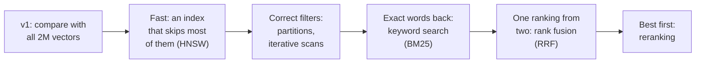
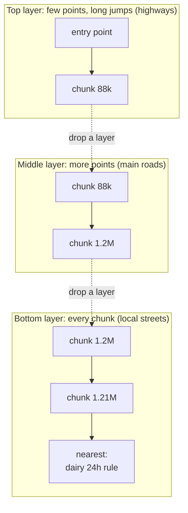
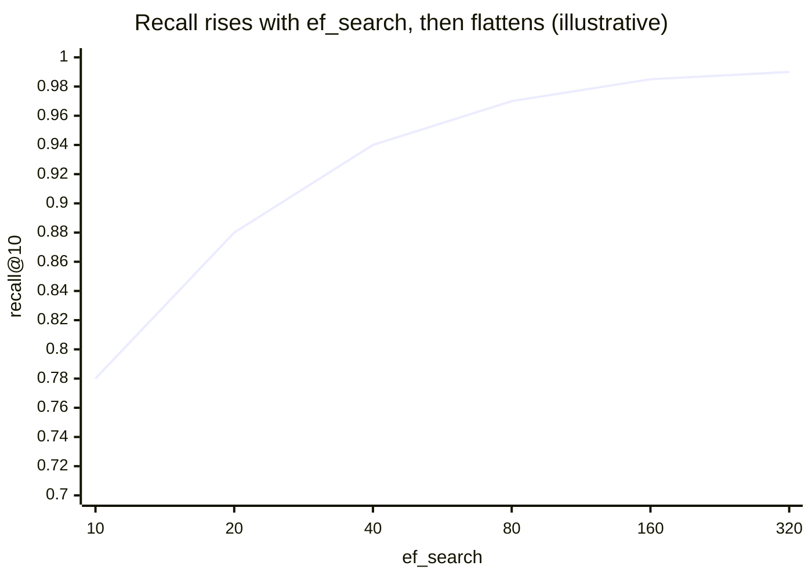
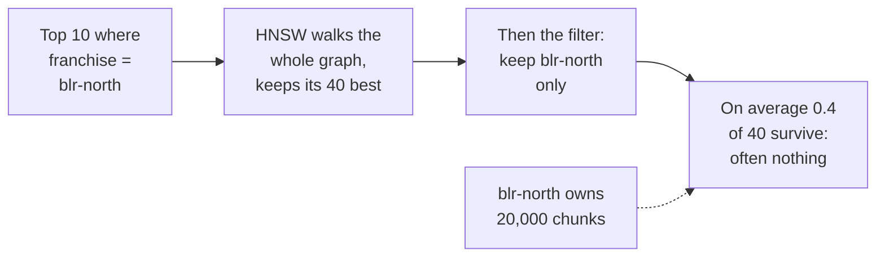
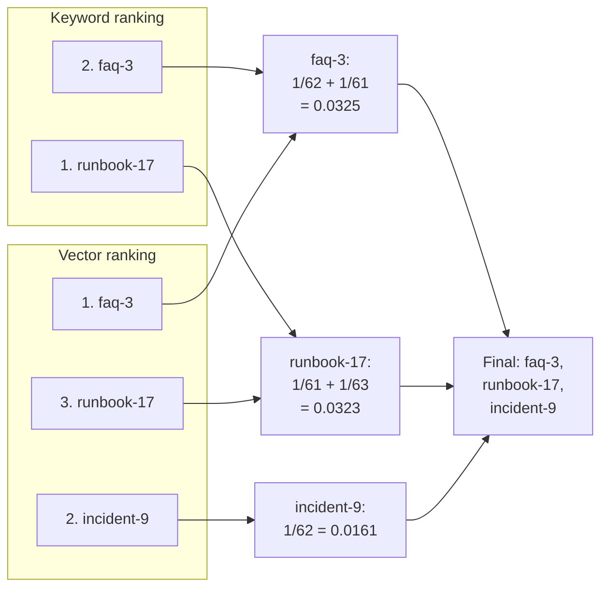
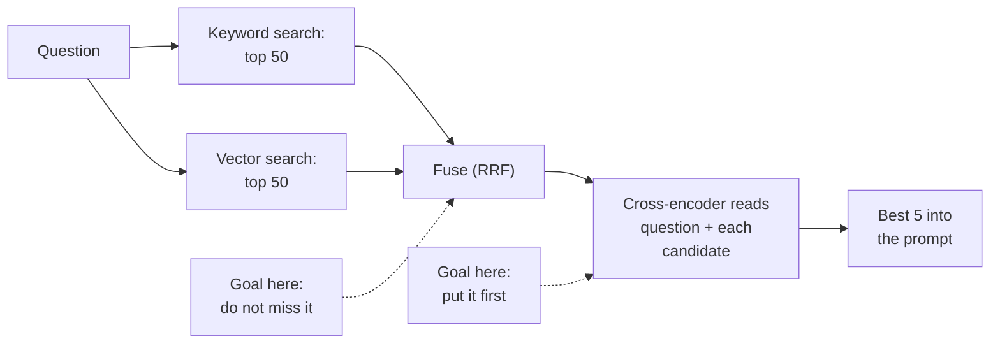
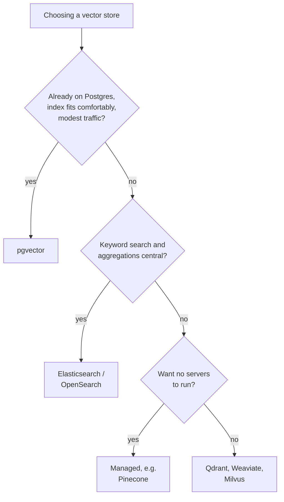
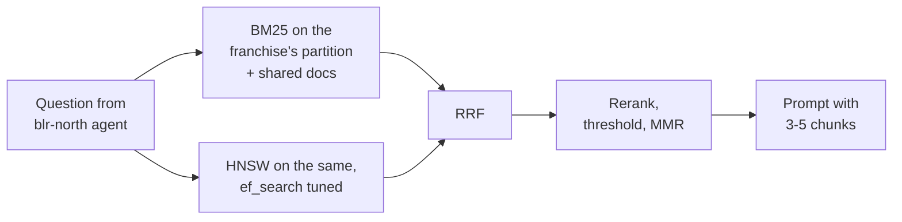

Ask FreshCart v1 works, and three complaints have landed on your desk:

1. It is slow at peak.
2. The Bengaluru-North franchise gets no results for its own runbooks.
3. "What does ERR_SLOT_EXPIRED mean?" returns vague chunks about delivery delays.

They look unrelated. By the end of this chapter you will see they are the three classic problems of search: speed, filtering, and matching exact words. Fixing them turns Ask FreshCart v1 into v2:



## 1. Why v1 is slow, and the idea that fixes it

v1 finds the nearest chunks the honest way: compare the question's vector with all 2 million stored vectors and sort. That is called an **exact scan**, or brute force. It is always correct. It also costs 2 million x 768 multiplications, more than a billion, for every question.

Picture finding the nearest coffee shop by measuring the distance from your house to every coffee shop in India and sorting the list. Correct, and absurd. You would start from your own neighbourhood.

An **approximate nearest neighbour (ANN) index** is that common sense, made precise. It looks at a small, cleverly chosen part of the data and answers in milliseconds. The price is that it occasionally misses one of the true nearest vectors. How much it misses is called **recall**: of the true 10 nearest vectors, how many it returned. A recall of 0.95 means 9.5 out of 10 on average. Every ANN index has knobs that trade recall against speed, and you set them by measuring.

## 2. HNSW: highways and local roads

The most widely used ANN index is **HNSW (Hierarchical Navigable Small World)**. It is the default in pgvector (the vector extension for Postgres) and most vector databases.

Think about how you drive across a country. You do not take local roads the whole way. You take a highway to the right region, a main road to the right town, and local streets to the exact door. HNSW builds the same structure for vectors:

- Every chunk is a point linked to a few of its nearest neighbours: the local streets.
- A random small fraction of the points also live in a second layer, with longer links: main roads.
- An even smaller fraction live in a third layer: the highways.



One search:

1. Start at a fixed entry point in the top layer.
2. Look at the current point's neighbours; move to whichever is closer to the question. Repeat until no neighbour is closer.
3. Drop to the same point in the layer below and repeat, now with shorter, denser links.
4. In the bottom layer, instead of following just one path, keep a short list of the best candidates seen so far, and return the best 10 from it.

It is approximate because this greedy walk can get stuck at a spot that is only locally best, like a driver who turns into a nearby dead end. Keeping a longer candidate list explores more side streets and finds more of the true neighbours.

Three settings control it (pgvector's defaults in brackets):

- `m` (16): how many links each point keeps. More links, better recall, more memory, slower to build.
- `ef_construction` (64): how hard the build works to find good links. Higher builds a better graph, more slowly.
- `hnsw.ef_search` (40): the length of the candidate list at query time. Higher means better recall and slower queries. It must be at least the number of results you want.



The curve is the whole tuning story: the first increases buy a lot of recall cheaply, the last ones buy very little and cost latency.

**Decision point: answers feel slightly worse than with v1's exact scan. What do you tune?** Take 1,000 real questions, compute their true nearest chunks with an exact scan, then raise `ef_search` step by step, recording recall@10 and **p95 latency** (the time within which 95% of searches finish). Stop where recall meets your target. Rebuild with a larger `m` only if `ef_search` alone cannot get there.

### The other common index: IVFFlat

**IVFFlat** works more like postal codes. It first groups all vectors into clusters using **k-means**, an algorithm that finds natural groups of nearby points; the number of clusters is `lists` (pgvector suggests about rows / 1000 for up to a million rows). A search finds the few cluster centres nearest the question (`probes` of them) and scans only the vectors in those clusters. It builds faster and uses less memory than HNSW, but it learns its clusters from the data present when it is built, so it must be built after the data is loaded and rebuilt as the data changes. HNSW is the usual default.

## 3. The Bengaluru bug: when filters make results vanish

Now complaint 2. All 40 franchises share one chunk table; each chunk records its franchise. The Bengaluru-North search is "the 10 nearest chunks where franchise = blr-north", and that franchise owns 1% of the chunks.

> **Pause and think.** HNSW walks the graph and keeps its best 40 candidates. Where in that process does "franchise = blr-north" get applied?



The index knows nothing about franchises. It returns its 40 best candidates from *all* franchises, and only then does the database apply the filter. With 1% ownership, on average 0.4 of those 40 belong to Bengaluru-North. The partner sees nothing, although 20,000 of their chunks exist. This is the **post-filtering** problem.

The opposite, filtering *during* the graph walk (**pre-filtering**), has its own problem: if 99% of points are off-limits, the walk keeps hitting dead ends, because the links it depends on lead to forbidden points. Recall drops again.

Fixes, from most to least robust:

- **Partition by the filter.** Give each large franchise (or each user session, if every search is scoped to one) its own table or index. The filter becomes free, and each graph is small. The costs are more indexes to manage, more build time, and cleanup when a partition is no longer needed.
- **Iterative index scans** (pgvector 0.8 and later): `SET hnsw.iterative_scan = relaxed_order;` makes the index keep walking past its first candidate list until enough rows pass the filter.
- **Over-fetching**: ask for 400 to keep 10. A quick patch, not a design.

Correction: "just add a WHERE clause" is not a complete answer to multi-tenant vector search (many customers, or **tenants**, sharing one system). With a selective filter it silently returns too few results.

## 4. When the index no longer fits in memory

HNSW is fast because the whole graph sits in memory; reading links from disk at every hop would be far slower. FreshCart's 2 million chunks are about 6 GB. Plans for 50 million chunks mean 150 GB and more. Three ways to push that wall back:

**Store smaller numbers (quantisation).** Each of the 768 numbers is normally a 32-bit float.

- 16-bit (`halfvec` in pgvector): half the memory, almost no loss.
- 8-bit: a quarter of the memory, a small loss.
- 1-bit (**binary quantisation**): keep only whether each number is positive or negative. 32 times smaller, and comparing two vectors becomes counting differing bits, which is extremely fast. Too rough on its own, so it is paired with rescoring:


Hugging Face reported binary quantisation with rescoring keeping around 96% of retrieval quality in their tests, at a fraction of the memory.

**Use fewer dimensions.** Matryoshka embeddings (chapter 2) still work when cut to their first 256 numbers.

**Use disk-based indexes** such as DiskANN, which keep a compressed copy in memory and the full graph on fast SSDs.

Two costs people forget: deleting a vector usually just marks it, and the graph routes around it, so frequent deletes slowly hurt recall until the index is rebuilt (in Postgres, regular `VACUUM` and occasional `REINDEX`). And when one machine is not enough, the index is split into **shards**, each holding part of the vectors; a query goes to every shard and the results are merged, while **replicas** (copies of each shard) add capacity and survive failures.

## 5. Exact words are back: BM25

Complaint 3. "ERR_SLOT_EXPIRED" means nothing to the embedding model, so it maps the question to a vague "delivery trouble" neighbourhood. The runbook that contains the exact code is not near it. Chapter 2's attempt 1, keyword search, found it instantly. Meaning search and keyword search fail in opposite places:

- Meaning search wins on paraphrase: "eggs broken, money back" finds "damaged items refund".
- Keyword search wins on exact identifiers, codes, names and rare terms: `ERR_SLOT_EXPIRED`, SKU-881, "Kothrud".

So you run both. That is **hybrid search**. The keyword side almost always uses **BM25**, the classic ranking formula behind search engines. Think of an experienced librarian scoring how well a book matches your request. For each word of the question, BM25 asks three things:

- **How rare is the word?** `ERR_SLOT_EXPIRED` appears in 3 of 2 million chunks, so a match is very telling. "Delivery" appears in half of them, so a match means little. This is IDF, inverse document frequency.
- **How often does it appear in this chunk?** More is better, with diminishing returns: the tenth "refund" adds almost nothing over the third. A setting `k1` (usually 1.2 to 2.0) controls how quickly it levels off.
- **Is the chunk just long?** Long chunks contain more words by chance, so scores are adjusted for length. A setting `b` (usually 0.75) controls how much.

Correction: Postgres's built-in text ranking (`ts_rank`) is not BM25. It does not know how rare a word is across the whole collection, so a match on `ERR_SLOT_EXPIRED` is not rewarded the way it should be. Extensions such as ParadeDB's `pg_search` add real BM25 to Postgres.

> **Pause and think.** BM25 says runbook-17 scores 14.2. Vector search says faq-3 scores 0.83. How do you combine two rankings whose scores are on completely different scales?

## 6. One list from two: Reciprocal Rank Fusion

You do not combine the scores at all. You combine the **positions**. **Reciprocal Rank Fusion (RRF)** gives every chunk points based only on where it ranked in each list:

`RRF score = sum, over each list the chunk appears in, of 1 / (60 + its rank in that list)`

A worked example:

- Keyword list: runbook-17 is 1st, faq-3 is 2nd.
- Vector list: faq-3 is 1st, incident-9 is 2nd, runbook-17 is 3rd.



Chunks that both searches found rise to the top; a chunk found by only one still gets some points. The constant 60 comes from the original paper (Cormack and others, 2009): a large constant shrinks the gap between 1st and 2nd place so neither search can dominate. If one search deserves more trust, multiply its points by a weight.

Also asked: "Why not just normalise the scores and add them?" Because score ranges shift from query to query and from engine to engine; ranks are always comparable.

> **Pause and think.** Fusion often puts the right chunk 4th or 5th instead of 1st. The model reads all five, so does order matter? And can you afford a smarter, slower check on just the top few?

## 7. Best first: reranking

Order does matter: models use the first passages most reliably, and you want to send fewer, better chunks. A second, smarter look at the shortlist fixes the order.

Think of hiring. Screening 10,000 CVs with a quick keyword filter is fast and rough. Interviewing the top 20 properly is slow and accurate. Nobody interviews all 10,000.

- The embedding model you search with is a **bi-encoder**: the question and each chunk are turned into vectors *separately*. That is why chunk vectors can be computed in advance, and why searching millions takes milliseconds. The question and the chunk never actually "see" each other; their vectors are just compared. This is the CV screen.
- A **cross-encoder** reads the question and one chunk *together*, as one input, and outputs a relevance score. It sees exactly how each word of the question relates to each word of the chunk, so it judges far more accurately. But nothing can be computed in advance: scoring 2 million chunks would mean 2 million model runs per question. This is the interview.



The first stage cares about recall (the right chunk must be somewhere in the 100); the second cares about order (it must end up first).

Options range from hosted reranking APIs to open models you run yourself (cross-encoders from the sentence-transformers library, the BGE reranker family). Some teams use an LLM as the reranker for the hardest cases: the most accurate, and the slowest.

**Decision point: the reranker adds 200 ms to every question. Keep it?** Measure on the same test questions, with and without:

- **recall@5**: how often the right chunk is in the top 5;
- **MRR (mean reciprocal rank)**: for each question, 1 divided by the position of the first right chunk (1 if first, 0.5 if second, and so on), averaged;
- the added p95 latency and the cost per 1,000 questions.

Skip it when the right chunk is already nearly always in the top 3, when latency is tight (voice, autocomplete), or when you send only 3 chunks anyway.

Two refinements finish the ranking stage:

- **A score threshold.** Always sending the top 5 means always sending 5, even when nothing is relevant. Dropping candidates below a reranker score lets the system notice "I have no good evidence" and say so honestly.
- **Diversity (MMR).** If the top 5 are the same paragraph repeated in the policy, its FAQ and a training deck, the prompt holds one fact five times. **Maximal Marginal Relevance** picks chunks one at a time, each time choosing the one most relevant to the question yet least similar to those already picked.

You will also hear about two ideas between bi-encoders and cross-encoders: **ColBERT** (one small vector per token instead of per chunk, matched token by token at query time) and **learned sparse retrieval** such as SPLADE (a model expands each chunk into weighted keywords, including synonyms, searched like a keyword index). Knowing where they sit is enough.

## 8. Where should the vectors live?

The architecture review asks the inevitable question: "We are heading for 40 million chunks. Do we need a real vector database?" There are four families:

- **A vector extension in your existing database**, such as pgvector in Postgres. Vectors live next to your other data, with transactions, joins, backups and access control you already run.
- **A dedicated vector database**: Qdrant, Weaviate, Milvus, or a managed service such as Pinecone. Built for vector search at scale, with filtering, sharding and replication handled for you.
- **A search engine with vector support**: Elasticsearch or OpenSearch. Excellent BM25 and filtering, with vectors added.
- **A library** such as FAISS: very fast in-memory search inside your own program, but no storage, updates, filtering or durability. Good for experiments, not as a service.



What actually decides it: how many vectors and whether they fit in memory; how heavily searches are filtered; whether you need BM25 in the same engine; whether chunks must change in the same transaction as business data; how fast data changes; and who will run it at 3 a.m. **Decision point:** FreshCart benchmarks pgvector (partitioned per large franchise, with iterative scans) against a dedicated database on its own test set and traffic: filtered recall@10, p95 under peak load, re-index time, monthly bill. It picks on those numbers. Keeping retrieval behind a small interface (search, upsert, delete; an **upsert** inserts a row or updates it if it already exists) makes switching later cheap.

Correction: "we need a vector database because we are doing RAG" is not a reason. Many production RAG systems run on pgvector or Elasticsearch.

## 9. Ask FreshCart v2



All three complaints are fixed: searches take milliseconds, Bengaluru-North sees its runbooks, and error codes are found again.

## 10. Complete example: fusion and diversity

```python
import numpy as np

def rrf(rank_lists, k=60):
    scores = {}
    for ranks in rank_lists:
        for pos, chunk in enumerate(ranks, start=1):
            scores[chunk] = scores.get(chunk, 0.0) + 1.0 / (k + pos)
    return sorted(scores, key=scores.get, reverse=True)

def mmr(query_vec, cand_ids, cand_vecs, n=5, lam=0.7):
    # pick n candidates that are relevant to the query but not to each other
    picked = []
    rel = cand_vecs @ query_vec
    while len(picked) < min(n, len(cand_ids)):
        best, best_score = None, -1e9
        for i in range(len(cand_ids)):
            if i in picked:
                continue
            redundancy = max((cand_vecs[i] @ cand_vecs[j] for j in picked), default=0.0)
            score = lam * rel[i] - (1 - lam) * redundancy
            if score > best_score:
                best, best_score = i, score
        picked.append(best)
    return [cand_ids[i] for i in picked]
```

Expected behaviour:

- `rrf([["runbook-17", "faq-3"], ["faq-3", "incident-9", "runbook-17"]])` returns `["faq-3", "runbook-17", "incident-9"]`.
- With `lam=1.0`, `mmr` simply returns the 5 most relevant candidates; with `lam=0.7`, a near-copy of an already-picked chunk is skipped in favour of a relevant chunk that adds something new.

## What breaks next

Search is fast and accurate now. And yet the complaints change shape:

- An agent types "it keeps failing after the update, what changed?". There is no product, no error code, no date. Search returns noise and the model answers from it.
- "What is the refund window for dairy?" works. The follow-up, "and for bakery?", returns nothing useful.
- The bakery answer comes back as "48 hours" with a confident citation. The policy says 12. The right document is in the index.
- Questions about refund *windows* fail far more often than others. They live in tables inside PDFs.

> **Pause and think.** The search engine is not the problem in any of these. Where is each one going wrong: the question, the documents, or what happens between search and answer? And could the system notice on its own that its search came back weak, and try again?

That is chapter 4.
