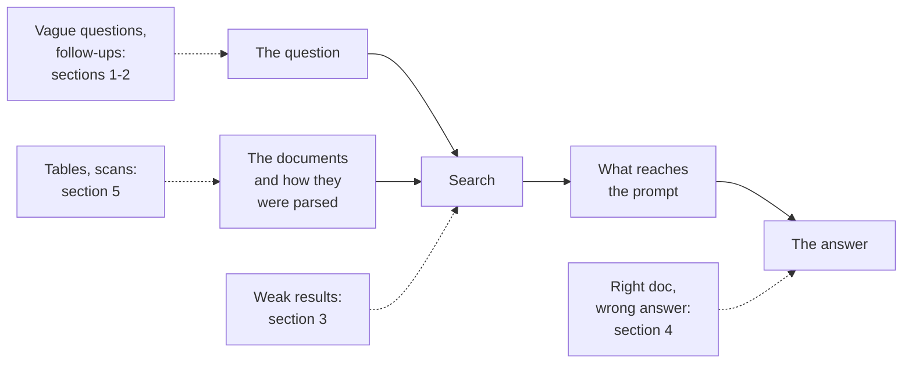
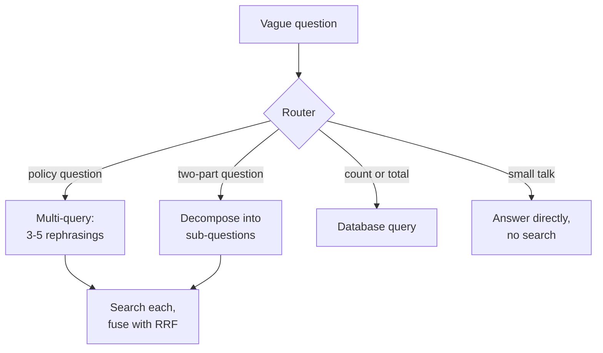
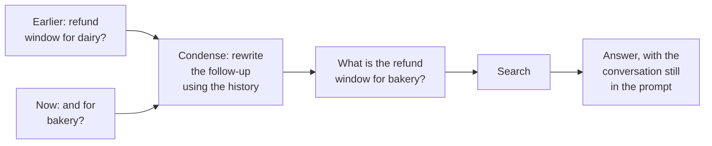
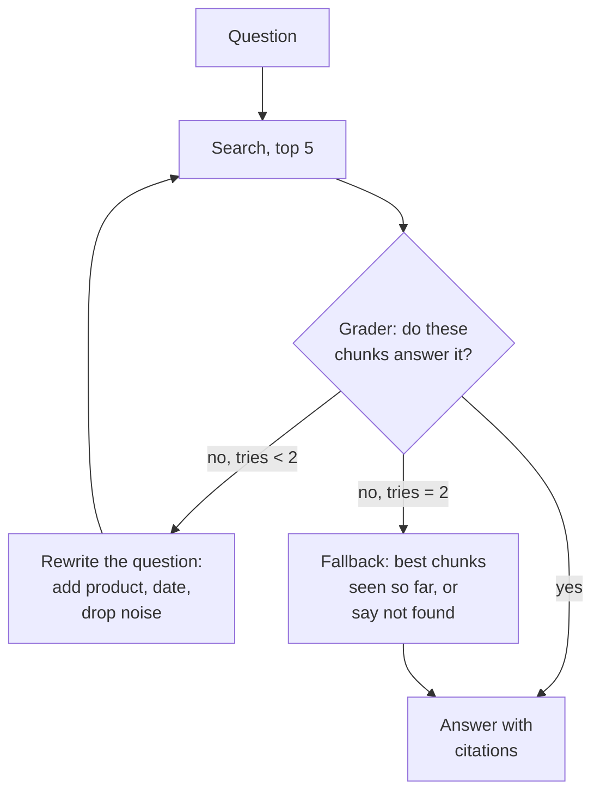
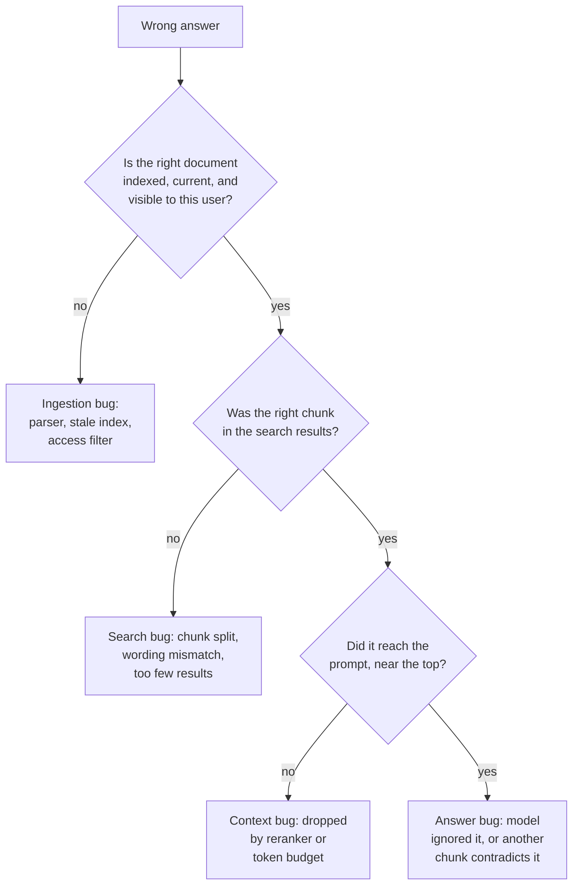
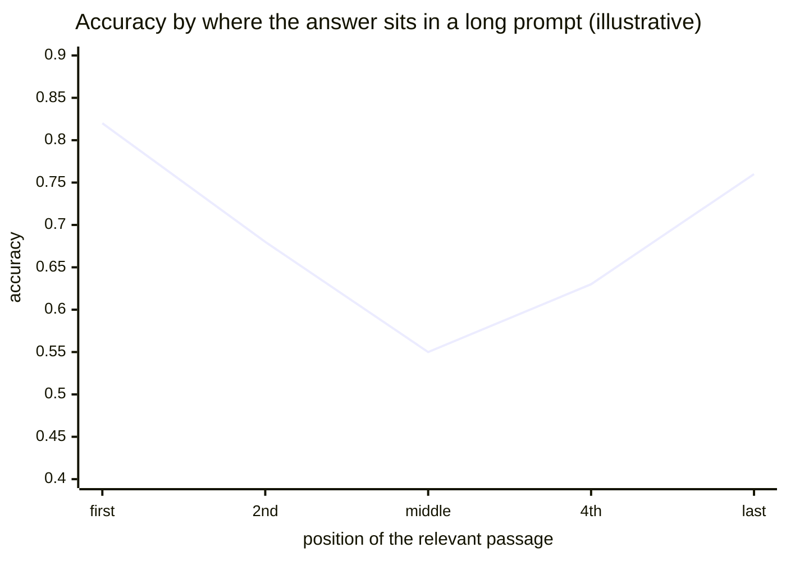
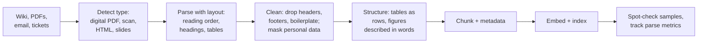
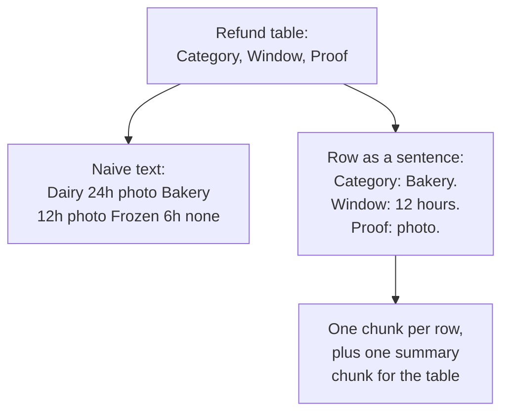
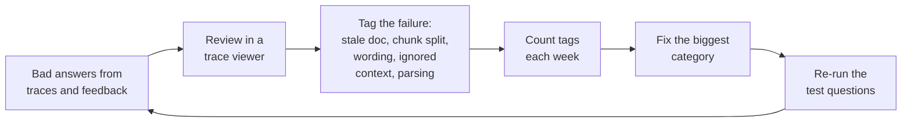
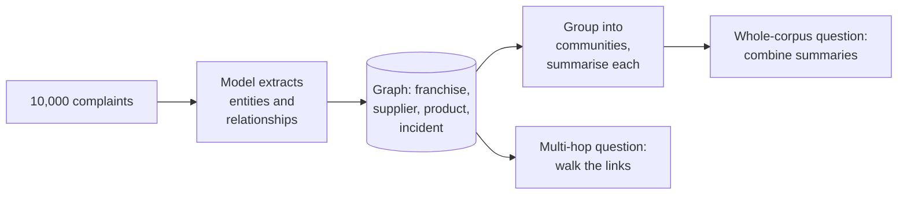

Search is fast and accurate now, yet four kinds of failure keep showing up in Meera's inbox:

- "it keeps failing after the update, what changed?" gets an answer built from noise.
- "and for bakery?", asked right after a dairy question, finds nothing.
- The bakery refund window comes back as "48 hours" with a confident citation. The policy says 12.
- Questions whose answers sit in PDF tables fail far more often than the rest.

Each one fails at a different place. A useful habit, and the backbone of this chapter, is to locate *where* in the pipeline something breaks before trying to fix it:



## 1. Fixing the question before searching

"it keeps failing after the update, what changed?" has nothing to search with. The search engine is fine; the question is a bad search query. All of the fixes below use one extra model call to transform the question before retrieval:

- **Multi-query** (also called RAG-Fusion): a model writes three to five rephrasings ("app crash after version update", "checkout error new release", ...), each is searched, and the result lists are merged with RRF (chapter 3). Helps vague questions.
- **Decomposition**: "compare the Pune and Bengaluru slot rules" becomes two questions, searched and answered separately, then combined. For multi-part and comparison questions.
- **Step-back**: also search a broader version ("how do delivery slot rules work?"), so the general rule comes back next to the specific detail.
- **HyDE** (hypothetical document embeddings): a model writes a plausible *fake answer*, and the fake answer is embedded instead of the question. A paragraph shaped like an answer sits closer to real answer paragraphs than a short question does. The risk: a confidently wrong fake answer pulls in the wrong documents.
- **Routing**: decide where the question should go at all: the policy documents, the incident archive, a database, or nowhere (small talk). A wrong route caps the whole answer, so test the router on its own labelled questions.



Every one of these adds latency and cost. Turn each on only where your test questions show the failure it fixes.

## 2. Follow-up questions and hidden filters

Conversations look like this:

- "What is the refund window for dairy?" -> answered.
- "And for bakery?"

Searching for "And for bakery?" finds nothing, because the question only means something together with the conversation. The standard fix is **condensing**: before searching, a model rewrites the latest message into a **standalone question**.



Search uses only the standalone question; the final answer still sees the conversation, so it can say "unlike dairy, bakery...". Skip the condense call when the message is already standalone, since it adds latency to every turn.

A related trick, **self-query**: "Pune incident reports from last week about cold-chain failures" contains a meaning to search for ("cold-chain failure") and exact filters (city = Pune, type = incident, date in the last week). A model splits the question into search text plus structured filters, from a list of allowed metadata fields. The filters run exactly; the meaning ranks what is left. Validate the generated filters (models invent fields) and never let them widen what the user may see.

> **Pause and think.** Even with good questions, some searches come back weak: none of the chunks really answers the question. Right now the model answers from them anyway. Could the system notice that its own search failed, and do something about it?

## 3. Corrective RAG: check the evidence before answering

It can. **Corrective RAG** adds a grader after retrieval. If the chunks are not relevant, it rewrites the question and searches again, instead of answering from bad evidence. A student who reads the question, flips to the chapter, and says "this is not the right chapter, let me look again" is doing corrective RAG.



The run keeps a few values between steps: the original `question`, the current `query`, the `chunks` just found, a `tries` counter, and `best_chunks`, the best set seen so far.

1. **Search** with the current query. If these chunks grade better than any earlier attempt, keep them as `best_chunks`.
2. **Grade**: a small, cheap model answers "relevant: yes or no" for each chunk, in structured output so code can read it.
3. **Relevant**: answer.
4. **Not relevant, tries left**: rewrite the query, add one to `tries`, search again.
5. **Not relevant, no tries left**: stop. Answer from `best_chunks`, or say "I could not find this in FreshCart's documents". Never an empty answer, never an invented one.

Three brakes stop it looping forever: the counter, a hard limit on total steps in whatever runs the workflow (chapter 5), and the fallback.

**Decision point: the grader adds a model call to every question, and the retry path roughly doubles latency.** Keep it only if, on your test questions, the retry path rescues questions the first search missed. If it fires on most questions, your search is the real problem; fix that. If it rarely changes the answer, delete it.

Related names you will hear: **Self-RAG** and **adaptive RAG** decide whether to search at all and check the final answer against the evidence. **Agentic RAG** lets an agent call search whenever it wants, as many times as it wants, across several sources: more flexible, harder to bound and harder to test.

> **Pause and think.** The bakery question retrieves the right policy, the grader says "relevant", and the answer is still "48 hours". The policy says 12. If search worked and the grader passed, where else could the error come from?

## 4. Right document, wrong answer: debugging the pipeline

Guessing and editing the prompt is how teams lose weeks here. Debugging RAG is a walk backwards through the pipeline, with evidence.

The evidence is the **trace**: a record kept for every question showing the rewritten query, every chunk retrieved with its score, what the reranker kept, the exact final prompt, the answer, and the time and tokens of each step. Without traces you are guessing.



FreshCart's bakery bug turned out to be the last box: the prompt contained *two* bakery chunks, the current policy (12 hours) and a 2023 version (48 hours) that was never deleted. The model picked the wrong one.

**Separating the two halves at scale.** One ticket can be traced by hand; a thousand need numbers. Two measurements split every failure into "search problem" or "answer problem" (chapter 8 computes them properly):

- **Context recall**: did the retrieved chunks contain the facts the answer needed?
- **Faithfulness**: are the claims in the answer supported by those chunks?

Low context recall: fix search or ingestion. High context recall but low faithfulness: the model strays from good evidence, fix generation. Both high and still wrong: the documents themselves are wrong or outdated.

**More text is not safer.** Models use information at the start and end of a long prompt better than information in the middle. This is the **"lost in the middle"** finding (Liu and others, 2023); the accuracy curve looks roughly like a U:



Chroma's "context rot" study found the same direction more broadly: quality drops as the input grows, even on simple tasks. So send fewer, better chunks, most relevant first.

**When documents disagree.** FreshCart's 12,000 documents were written by different teams over years. The fix is in the data, not the prompt:

- every chunk carries `version`, `effective_from` and a status such as current or superseded, and superseded documents are filtered out of search by default;
- one document is the official owner of each policy, and copies (slides, FAQs) point to it rather than restate it;
- when two current documents disagree, the answer says so, cites both, and the conflict is logged for the owners.

**When the evidence is missing and the model answers anyway**, defend in layers: an explicit instruction with an example ("if the documents do not answer it, say you could not find it"); a structured field `answerable: true/false` before the answer; no generation at all when the best search score is weak; and unanswerable questions kept in the test set, checking that the system declines (declining too often is also a failure).

Correction: fixing a RAG bug by editing the prompt until one failing example passes usually breaks other questions. Add the example to the test set and fix the category of failure.

> **Pause and think.** Refund-window questions fail three times more than others. The trace shows the right PDF *was* searched, but the chunks look like "Dairy 24 Bakery 12 Frozen 6 Photo Photo None". What went wrong before search ever ran?

## 5. Messy documents: the ingestion pipeline

Most real RAG failures happen before retrieval, when documents are turned into text. FreshCart's refund policy is a PDF with two columns, a table, and a footer on every page. The first parser read it left to right across both columns, flattened the table into one line of numbers, and repeated "FreshCart Confidential - Page 7" forty times. Search can only ever be as good as that text.

**Ingestion** is everything between "a document exists somewhere" and "its chunks are in the index":



- **Detect the type.** A digital PDF has a text layer you can extract. A scanned PDF is just pictures of pages and needs **OCR** (optical character recognition), which turns images of text into text and brings its own errors: "1" read as "l", "24h" as "2411".
- **Parse with layout.** Tools such as Docling and Unstructured use layout models to find columns, headings, tables and figures, and output clean Markdown or JSON. For awkward pages, some pipelines hand the page image to a vision-capable model and ask for Markdown.
- **Clean.** Remove repeated headers, footers and menus. Mask personal data (customer phone numbers in tickets) before it ever reaches the index.
- **Describe figures** in words with a vision model, so charts and photos become searchable.

Tables deserve special care, because they hold many of the most-asked facts:



Write each row as its own chunk with the column names repeated, add one summary chunk for overview questions, and keep the original table attached for display. Very large tables (a 5,000-row price list) should not be chunked at all: load them into a database and answer through a SQL query.

**Keeping the index in sync.** Re-processing 12,000 documents every night wastes hours and money. Instead, store a fingerprint (hash) of each document's content; on each sync, skip unchanged ones, re-process changed ones (deleting their old chunks in the same step), and handle deletions and access changes as urgent events. Record which parser version produced each chunk, so a parser upgrade re-processes only what it affects, through a blue-green re-index (chapter 2).

**Measure parsing too**: the share of documents that parse without errors, the share of pages with no extracted text (likely scans), a few "golden documents" whose correct parsed output is known and checked on every parser change, and test questions whose answers live in tables, tracked as their own group.

Correction: "the PDF loader handles it" is the assumption behind many failing RAG systems. Read the parsed text of your most important documents before tuning anything else.

## 6. The tools that make teams fast

Teams that improve RAG quickly share three habits:



- **A trace viewer** that shows one question's whole journey on one screen. Hamel Husain argues that a simple viewer built for your own data is the highest-value tool an AI team can build.
- **A retrieval playground**: type a question, see the top 20 from keyword search, vector search and the fused list side by side. Most search bugs are obvious there within seconds.
- **Failure tags and weekly counts**, so you fix what is most common, not what is most recent.

In production, watch signals that move when quality drops: the share of questions whose best search score is below the threshold (content gaps or a broken index), the share of answers that cite nothing or decline, the thumbs-down rate, "asked again in different words", and the age of the newest indexed document (a stalled ingestion pipeline shows up here first).

## 7. When chunk search is not the right shape

Three ideas from a quarterly review, each a classic interview follow-up:

**"New models read a million tokens; skip search and give them everything."** Long context does not replace retrieval: every question pays for every token in money and waiting time, quality drops as inputs grow, a stuffed prompt cannot hide documents a user may not see, and citations come naturally from retrieval. Long context is right for a small, fixed corpus. **Cache-augmented generation (CAG)** is that idea made efficient: load FreshCart's 40-page franchise handbook into the prompt once, let the provider cache it, and answer every handbook question against the cached copy.

**"Leadership wants questions across all 10,000 complaints at once."** Two kinds of question defeat chunk search: multi-hop ("which suppliers of our largest franchise had food-safety incidents?" needs following links) and whole-corpus ("what are the main complaint themes?" lives in no single chunk). **GraphRAG** (from Microsoft) uses a model to extract entities and relationships into a **knowledge graph**, groups closely connected parts into communities, and summarises each:



Indexing is slow and expensive and hard to update, so use it when those question types matter and the gain is measured.

**"Agents keep asking for counts."** "How many orders were late in Kothrud last week?" is a database query, not search: search returns *some* late-delivery documents; it cannot count every order. Use a safe SQL tool (chapter 11) and keep RAG for the "why" questions that follow.

Images and scans can also be searched directly: **multimodal** embedding models place images and text in the same space, and newer document-retrieval models embed whole page images, sidestepping parsing for complex layouts.

## 8. Complete example: the corrective loop

```python
def ask(question, retrieve, grade, rewrite, generate, max_rewrites=2):
    query, best, best_hits = question, [], -1
    for attempt in range(max_rewrites + 1):
        chunks = retrieve(query)                   # hybrid search + rerank (chapter 3)
        hits = sum(grade(question, c) for c in chunks)
        if hits > best_hits:
            best, best_hits = chunks, hits
        if hits >= 2:
            return generate(question, chunks)
        query = rewrite(question, chunks)
    if best_hits == 0:
        return "I could not find this in FreshCart's documents."
    return generate(question, best)
```

Expected behaviour:

- A clear question whose first search returns 2 or more relevant chunks costs one search and one grading pass.
- A question that never finds relevant chunks makes exactly 3 searches and returns the "could not find" message instead of an invented answer.
- If the second attempt was the best but still weak, the answer is built from the second attempt's chunks.

## What breaks next

Ask FreshCart now answers policy questions well, admits when it cannot, and survives messy PDFs. Then the questions change:

- "Where is order FC-20931 right now?"
- "Is there milk in the Kothrud warehouse?"
- "The milk was spoiled. Issue a 150 rupee credit to this customer."

None of these answers lives in any document. The first two need live data from FreshCart's systems. The third is not even a question: it asks the assistant to *do* something.

> **Pause and think.** The model can only produce text. How could it look up an order in a database, or issue a credit, without you giving it direct access to the database? Who should actually run that lookup: the model, or your code? And how would the model even know the lookup exists?

That is chapter 5.
