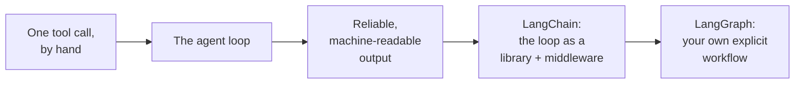
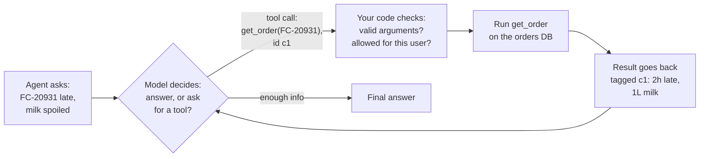
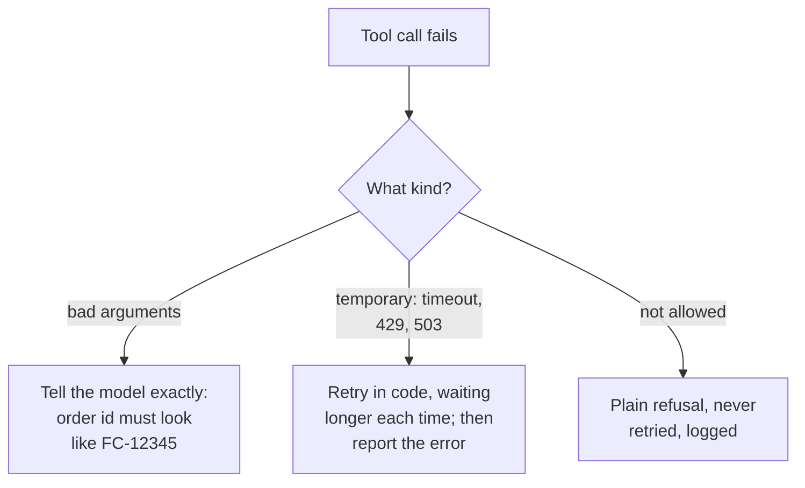
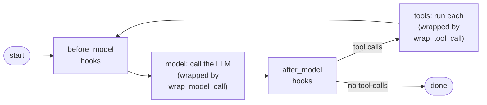
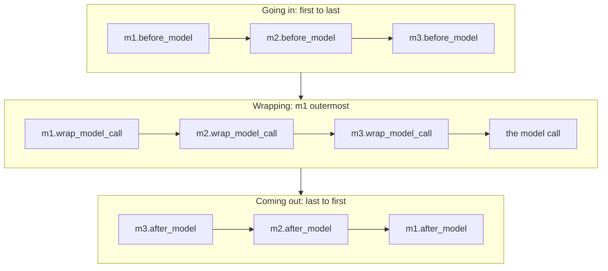
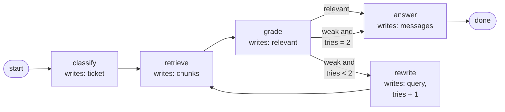
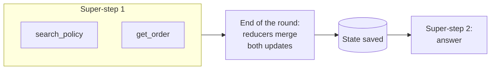

Chapter 4 ended with three requests no document can answer:

- "Where is order FC-20931 right now?"
- "Is there milk in the Kothrud warehouse?"
- "The milk was spoiled. Issue a 150 rupee credit to this customer."

The answers live in FreshCart's systems: the orders database, the inventory service, the payments API. The third request is not even a question; it asks the assistant to act. This chapter turns Ask FreshCart from an assistant that reads into an **agent** that can look things up and act, and shows where LangChain and LangGraph fit.



## 1. The model writes the order slip, your code cooks

> **Pause and think.** The tempting shortcut is to give the model a database connection and let it run queries. What could go wrong?

Everything. A model can be confused, can be tricked by text it reads (chapter 11), and cannot be held accountable. So the model never touches your systems directly. Instead, it can *ask*.

Think of a restaurant. The customer does not walk into the kitchen; they write an order on a slip, the waiter checks it ("we are out of fish"), and the kitchen cooks. With **tool calling**, the model is the customer writing slips, and your code is the waiter and the kitchen.

A **tool** is a function your code exposes, described to the model in three parts:

- a **name**: `get_order`;
- a **description** in plain words: "Look up one order's status, items and delivery times by order id, like FC-12345";
- a **schema**: the exact shape of its arguments (`order_id`: a string), written in a standard format called JSON Schema.

When the model decides a tool would help, its reply is not text but a **tool call**: the tool's name, the arguments, and an id. The model has run nothing.



What follows from "the model only asks; your code acts":

- **Safety lives in your code.** "Only issue credits under 200 rupees" written in the prompt is a suggestion. A check inside `issue_credit` is a control.
- **Arguments are untrusted input.** Treat them exactly like data from an unknown user: validate types and ranges, check this user may act on *this* order, and never paste them into SQL or shell commands unescaped.
- **Descriptions are prompts.** A tool called "orders api" gets misused. One whose description says what it does and when to use it gets used correctly.
- **Tool descriptions cost tokens** on every call, because they are sent with every request. Fewer, better tools are cheaper and more accurate.
- **Several calls at once.** One reply can request several tools; run them in parallel and return each result with its own id.

**Errors are results too.** If the orders database times out, return "error: orders service timed out" as the tool's result so the model can adapt, instead of crashing. Different errors deserve different handling:



(429 and 503 are HTTP status codes for "too many requests" and "service unavailable". Retrying with growing waits plus a little randomness, **exponential backoff with jitter**, keeps many clients from retrying at the same instant.)

**Decision point: Meera wants a "smart" assistant with 25 tools covering every FreshCart system.** Push back. Similar tools confuse the model's choice, every tool costs tokens on every request, and every tool can be misused. Support needs about five: `get_order`, `search_policy` (chapters 2 to 4), `check_stock`, `issue_credit` (behind an approval, chapter 7) and `escalate_to_human`. A good tool has one clear job named for its action, a description of when to use it, tightly typed arguments (fixed lists of allowed values, exact formats), short output (the six fields needed, not a 50 KB record), and clear error messages.

You can also steer the choice with a **tool choice** setting: `auto` (the model decides), `required` (must call some tool), a specific tool (must call exactly that one), or `none`.

## 2. Machine-readable answers: structured output

Ask FreshCart also has to sort tickets for routing (chapter 1's classifier), and its output feeds other code. "Sure! Here is the JSON:" breaks a parser. **Structured output** means getting data back in an exact shape your code can rely on. From weakest to strongest:

- asking for JSON in the prompt: sometimes adds chatter or breaks the syntax;
- **JSON mode**: guarantees valid JSON, not your fields;
- tool calling with your schema as the "tool": the model fills in arguments that are really your output;
- **strict schemas** offered by providers: the model is only allowed to produce output that fits.

Broken version:

```python
resp = llm.invoke(f"Classify this ticket as JSON: {ticket}")
data = json.loads(resp.content)      # crashes on "Sure! Here is the JSON: {..."
order_id = data["order_id"]          # KeyError when the model wrote "orderId"
```

Fixed version:

```python
class Ticket(BaseModel):
    intent: Literal["refund", "late_delivery", "missing_item", "other"]
    order_id: str | None
    urgent: bool

classify = llm.with_structured_output(Ticket)     # schema sent to the provider
try:
    t = classify.invoke(f"Classify this ticket: {ticket}")
except ValidationError as e:
    t = classify.invoke(f"Classify this ticket: {ticket}\nPrevious attempt failed: {e}")
```

`Ticket` is a **Pydantic** class. Pydantic is a Python library: you declare fields and their types as a class, and it checks incoming data against them. On failure, retry once with the error included, then fail cleanly.

Correction: valid structure is not a correct answer. The JSON can be perfect and the intent wrong. Structured output removes parsing failures, not the need to test answer quality (chapter 8).

## 3. The agent loop

One tool call is not enough for "FC-20931 late, milk spoiled, what do I do?". The model needs the order, then the policy, then maybe a credit. So you put the tool call in a loop: ask the model, run whatever it requests, give back the results, ask again, until it answers.

```python
MAX_STEPS = 8

def run_agent(client, model, question, tools, schemas, arg_models):
    messages = [{"role": "system", "content": SYSTEM}, {"role": "user", "content": question}]
    for step in range(MAX_STEPS):
        resp = client.chat(model=model, messages=messages, tools=schemas)
        messages.append(resp.message)
        if not resp.tool_calls:
            return resp.text                                  # final answer
        for call in resp.tool_calls:
            try:
                args = arg_models[call.name].model_validate_json(call.arguments)
                result = tools[call.name](**args.model_dump())
            except Exception as e:
                result = f"error: {e}"                        # the model can adapt
            messages.append({"role": "tool", "tool_call_id": call.id, "content": str(result)})
    return "Stopped: step limit reached."
```

That is an **agent**: a model in a loop that decides which tool to call next, sees the result, and decides again. Interviews often ask you to write exactly this, against a provider's official client library (its **SDK**). Notice what it already needs: a step limit, validation before running anything, errors returned as results, and each result tied to its call id.

> **Pause and think.** You will write this loop in every project, and then add the same things around it every time: retries when the provider fails, a fallback model, limits on calls, streaming words to the screen, recording a trace, pausing for approval, trimming long conversations. What would you want a library to give you?

## 4. LangChain: the loop, packaged

**LangChain** (version 1 was released in October 2025) is a library that packages this loop. Its main entry point, `create_agent`, builds exactly the loop above, and around it LangChain offers:

- one interface for chat models from any provider: `init_chat_model("provider:model-name")`, with the same `invoke` (one answer), `stream` (words as they arrive) and `batch` (many inputs at once) everywhere;
- standard message types and tools;
- structured output inside the loop through `response_format`;
- **middleware**: small hooks that run at fixed points in the loop to add controls without rewriting it (section 5);
- **LangSmith**, its tracing and evaluation service, which records every model call, tool call and step as a trace you can inspect.

What `create_agent` builds underneath is a small graph:



That graph runs on **LangGraph**, LangChain's lower-level runtime (section 6). So even a simple `create_agent` agent can save its state, pause and resume.

What changed in version 1, which interviewers use to check you are current: `create_agent` replaced the older `create_react_agent` and `AgentExecutor`; middleware is new; the old chain classes (`LLMChain` and friends) moved to a separate `langchain-classic` package. The `prompt | model | parser` pipe syntax (**LCEL**) still exists for short fixed pipelines.

Correction: answering with 2023-era LangChain ("AgentExecutor", "chains for everything") signals you have not used it recently.

Also asked: "Would you use LangChain in production?" Yes, selectively. The value is real: one interface across providers, middleware, tracing, and LangGraph's saved state underneath. The costs are layers to debug through and changes between versions. Pin versions, keep prompts in your own code, and write tools as plain functions you can test without the framework. And skip the framework when the task is one model call: a nightly job classifying 10,000 tickets needs the SDK, a retry wrapper and a Pydantic class, not an agent framework.

## 5. Middleware: production controls without rewriting the loop

Ask FreshCart goes live on `create_agent`, and real problems arrive. One conversation loops through 40 tool calls. A customer's email address appears in a trace. The model provider has an outage on a Friday evening. Long conversations get slow and expensive.

**Middleware** is code that wraps around the agent loop at fixed points, like middleware in a web framework that runs before and after every request. Two kinds of hook:

- **Node-style**: `before_agent`, `before_model`, `after_model`, `after_agent`. They run at a point in the loop, can update state, and the model hooks can redirect the run (jump to the end, to the tools, or back to the model).
- **Wrap-style**: `wrap_model_call`, `wrap_tool_call`. They wrap a call and decide what happens to it: change it, skip it, or retry it.

Built-ins mapped to FreshCart's problems:

- the 40-call loop: `ModelCallLimitMiddleware`, `ToolCallLimitMiddleware`;
- personal data in traces: `PIIMiddleware` (masks emails, card numbers and the like);
- the Friday outage: `ModelRetryMiddleware`, `ModelFallbackMiddleware` (switch to another model);
- long, slow conversations: `SummarizationMiddleware`, `ContextEditingMiddleware` (clears old bulky tool output);
- too many tools: `LLMToolSelectorMiddleware` (a small model picks the relevant ones first);
- writes that need a person: `HumanInTheLoopMiddleware` (chapter 7).

The order they run in is a favourite question. For `middleware=[m1, m2, m3]`:



So put wrappers that must see everything (logging, retries) first, and guards that must run just before the model (masking personal data) last.

**Decision point: easy questions should use a cheap model and hard ones the strong model.** No built-in does that, so you write a small `wrap_model_call` hook that inspects the request and calls `request.override(model=cheap_model)` for easy cases before passing it on.

Middleware changes requests invisibly, which is its risk: a fallback model may follow your prompt differently, a summary may drop a key fact. Test with the full middleware stack, log every time a fallback or summary fires, and alert when those rates jump.

> **Pause and think.** Meera reviews a week of conversations. Some answers about refunds never searched the policy, because the model decided it did not need to. And vague questions are answered from weak search results without the retry from chapter 4. She wants rules: always classify first, always search the policy for refund questions, grade the results, retry at most twice. Can a loop where the model decides everything guarantee that?

## 6. LangGraph: when you need the steps to be explicit

It cannot. When *you* need to decide the order of steps, you write the workflow yourself, and **LangGraph** is the runtime for that. You describe the workflow as a **graph**: boxes for steps, arrows for what runs next. Think of it as a subway map for your program: stations, lines, and switches that send a train one way or another.

Four ideas make it work:

- **State**: the run's shared whiteboard. A typed record of everything the run knows so far: the conversation `messages`, the classified `ticket`, the retrieved `chunks`, a `tries` counter.
- **Nodes**: the steps. Each is a plain function that reads the state and returns only the fields it changes. It never edits the whiteboard directly.
- **Reducers**: the rules for writing on the whiteboard. By default a new value replaces the old one. For lists you often want to append instead: `Annotated[list, operator.add]` appends, and LangGraph's `add_messages` appends messages. (`Annotated` is standard Python typing that attaches extra information, here the reducer, to a field's type.)
- **Edges**: the arrows. A fixed edge always goes to the same node. A **conditional edge** calls a small router function that reads the state and returns the next node's name.

Meera's rules as a graph:



Now the policy search cannot be skipped, because the graph has no path around it. That is chapter 4's corrective RAG, written as an explicit workflow.

### How a graph runs: super-steps

LangGraph executes in rounds called **super-steps**, an idea borrowed from Google's Pregel system. In each round, every node triggered by the previous round runs, in parallel if there are several. Their updates are merged through the reducers at the end of the round, the state is saved (chapter 6), and the edges decide the next round.



What interviewers probe:

- Parallel nodes cannot see each other's updates during the round.
- If two parallel nodes write the same field and it has no reducer, LangGraph cannot pick a winner and raises `InvalidUpdateError`. Fix: add a reducer, or give each node its own field.
- A `recursion_limit` setting caps the number of rounds and raises `GraphRecursionError` when hit.

**Decision point: one strange question made the rewrite loop run 40 times.** Four brakes: a counter in the state that the router checks; a fallback route when it runs out; `recursion_limit` as the last-resort backstop; and a budget on tokens, cost and time for the whole run.

Two more building blocks: a node can return `Command(goto="answer", update={...})` to change state and choose the next node in one move, which is neat when the node itself knows where to go next (a triage step choosing the refunds or delivery specialist). And LangGraph's **functional API** lets you write the same workflows as plain Python functions (`@entrypoint`, `@task`) instead of drawing nodes and edges.

Keep the state clean: store facts rather than formatted text, give each field one writer where possible, keep big data out of the state (it is saved at every step), and declare narrower input and output schemas so callers send only a question and receive only an answer.

## 7. Complete example: Ask FreshCart as a graph

```python
class State(TypedDict):
    messages: Annotated[list, add_messages]
    steps: int

def call_model(state: State):
    msg = model_with_tools.invoke(state["messages"])
    return {"messages": [msg], "steps": state["steps"] + 1}

def route(state: State):
    if state["messages"][-1].tool_calls and state["steps"] < 8:
        return "tools"
    return END

g = StateGraph(State)
g.add_node("model", call_model)
g.add_node("tools", ToolNode([get_order, search_policy, check_stock]))
g.add_edge(START, "model")
g.add_conditional_edges("model", route, ["tools", END])
g.add_edge("tools", "model")
app = g.compile()

app.invoke({"messages": [("user", "FC-20931 late, milk spoiled. What do I do?")], "steps": 0})
```

Expected behaviour:

- The question runs model, tools, model, tools, model: about three model calls (look up the order, search the policy, answer), then stops because the last reply asks for no tools.
- If `get_order` raises, the model receives the error as the tool's result and explains or retries; the run does not crash.
- A model that keeps asking for tools is routed to the end after 8 model calls.

## What breaks next

Ask FreshCart is a real agent now. Then production happens:

- An agent asks about FC-20931 at 10:00, steps away, and at 10:20 types "and was the bread delivered?". Ask FreshCart has no idea which order they mean: every call starts from nothing.
- The server crashes in the middle of an answer. The agent has to start over.
- After one crash and an automatic retry, a customer is credited 150 rupees *twice*.
- Long conversations get slower and more expensive with every message.

> **Pause and think.** Where should a conversation's state live so it survives a crash or a restart? If a step is retried after a crash, which actions are dangerous to repeat, and how would you make "issue a credit" safe to run twice?

That is chapter 6.
