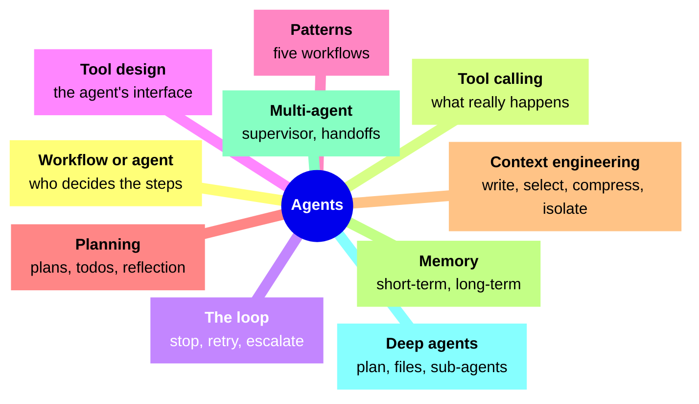
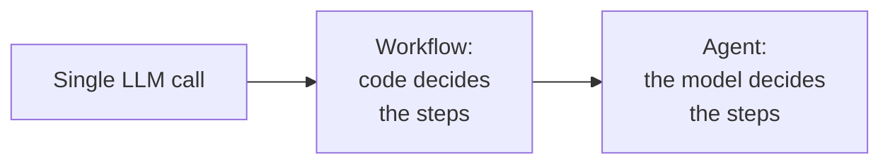
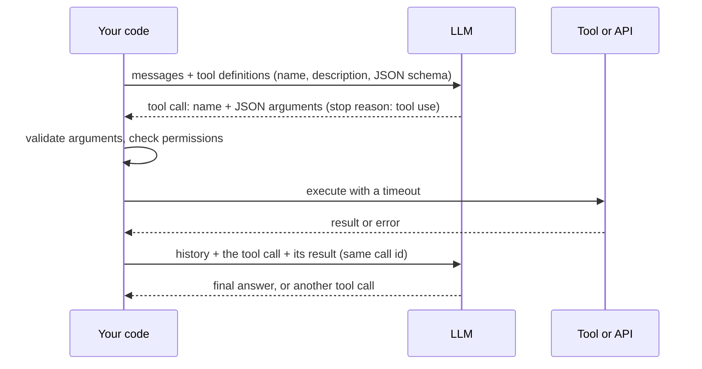
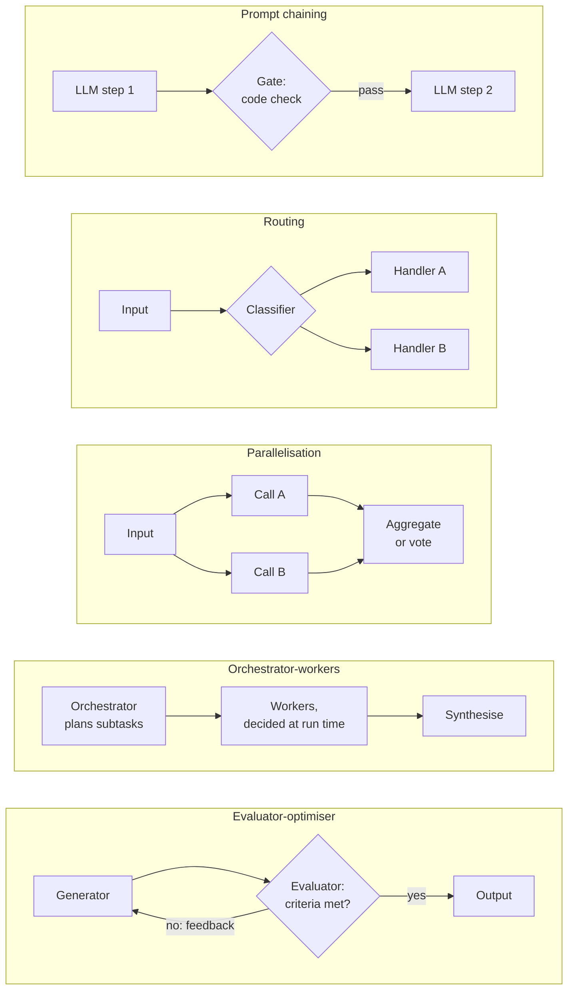
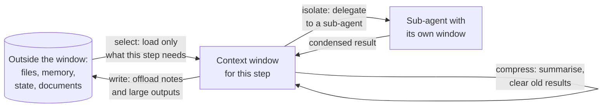
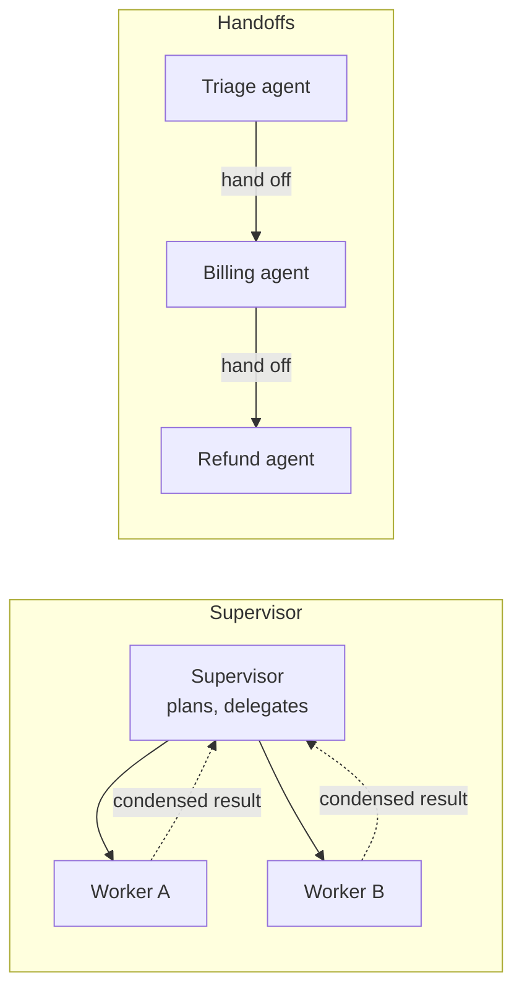
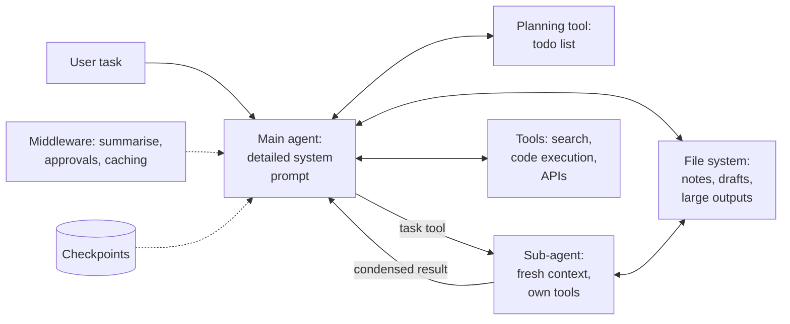

An **agent** is an LLM that decides its own next step: it calls tools, reads the results and continues until the task is done. That autonomy is both the point and the risk. It handles tasks you cannot script, and it fails in ways a script cannot. This chapter covers when autonomy is worth it, how tools and the loop really work, how to keep context and memory under control, when to use several agents, and how complex systems such as deep agents are assembled from these parts.



## 1. Workflow or agent



Moving right buys flexibility and costs predictability, money, latency and testability.

- A **workflow** orchestrates LLM calls and tools along paths written in code. It is predictable, testable and cheap, and it cannot handle what you did not anticipate.
- An **agent** lets the LLM direct its own process: it chooses tools and the next step from what it observed. It is flexible, with variable cost and latency, compounding errors and harder testing.

**Use the simplest thing that works.** Start with a single call or a workflow; add autonomy only when the steps genuinely cannot be predicted and the value pays for the cost and the risk.

- **Agent**: open-ended tasks where the number and order of steps depend on what is found (debugging, research, investigating across systems), where the environment gives feedback on progress (tests, search results, errors), and where mistakes are recoverable or reviewed.
- **Workflow**: known steps (extract, validate, store), compliance needing determinism, strict latency or cost limits.
- **Hybrid** is common: a deterministic workflow with one agentic step inside it.

Say it like this: "My default is a workflow, because code-defined steps are predictable, cheap and testable. I use an agent only when the next step genuinely depends on what was found, the environment gives feedback to check progress, and errors are recoverable, and even then I put the agent inside guard rails: budgets, scoped tools and approvals."

## 2. Tool calling: what actually happens



- **The model never executes anything.** It emits a structured request; your code decides whether and how to run it. Permissions, validation and approvals live in that gap.
- **What reaches the model** is each tool's name, description and parameter schema, rendered into its context by the provider. They cost tokens on every call and are all the model knows about the tool: **descriptions are prompts**.
- Every call has an id, and the result message references it, so parallel calls are matched correctly.
- **Parallel tool calls**: the model can request several independent calls in one turn; run them concurrently.
- **Tool choice**: let the model decide, require some tool, force a named tool (handy for structured extraction), or allow none.
- **Too many tools degrade selection**: with dozens of similar tools the model picks wrong ones and the context bloats. Use fewer, broader tools; namespace them; select the relevant tools per request (route first, or retrieve tool descriptions by similarity); or split them across specialised agents.

Say it like this: "The model sees only each tool's name, description and JSON schema. It answers with a structured call; my code validates it, checks permissions, runs it with a timeout and sends the result back with the same call id, and the loop continues until the model replies without a tool call."

## 3. The agent loop

```text
messages = [system_prompt, task]
for step in 1..MAX_STEPS:
    reply = llm(messages, tools)
    if reply has no tool calls:
        return reply.text
    for each call in reply.tool_calls (concurrently if independent):
        result = run(call) with validation, permission check, timeout
        append tool_result(call.id, result or an actionable error)
    if budget spent or the same call repeats with no new information:
        stop, summarise progress, escalate
return "stopped at the step limit" + progress summary
```

This is the **ReAct** pattern: reason, act, observe, repeat.

Stop conditions: a final answer; an explicit "finish" tool carrying the structured result; maximum steps; token, money or time budget; loop detection (the same call with the same arguments, or no new information for several steps); a human interrupt; an unrecoverable error.

**When a tool fails or times out:**

- **Transient errors** (timeouts, 429 rate limits, 503s): retry in code with exponential backoff and jitter. Do not spend a model turn on them.
- **Errors the model can fix** (bad arguments, not found, too many results): return the error as the tool result with a useful message ("no customer with that email; search by phone instead"). The model adapts.
- **Persistent failure**: stop, summarise what was done, escalate to a human.
- **Writes carry idempotency keys**, so a retried payment or email never happens twice.
- Never let an exception end the loop silently, and never feed raw stack traces to the model (noise and leaked internals).

## 4. Designing tools: the agent's interface

Tools are the agent's user interface; most agent quality problems are tool design problems.

- **Task-shaped, not API-shaped**: one `get_customer_context(customer_id)` returning what the agent needs beats five raw endpoints the model must chain correctly. Fewer, higher-level tools.
- **Names and descriptions are prompts**: what it does, when to use it, when not to, what it returns, and how it differs from similar tools.
- **Strict, typed parameters**: enums, formats, required fields; ids rather than names; absolute values rather than relative ones ("2025-03-01", not "last Monday"). Make wrong calls impossible or rejected with a clear message.
- **Concise, relevant results**: the fields the model needs, not 300 lines of JSON. Paginate, truncate with a note ("showing 20 of 340, filter by date"), offer a detail-level parameter, and prefer readable values over opaque internal ids.
- **Errors that teach**: what went wrong and what to try next.
- **Reads separate from writes**; writes idempotent, permission-checked, and approval-gated when dangerous.
- **Test tools with the model**: run the agent on realistic tasks, read the transcripts, see where it misuses a tool, rewrite the description, and track the tool-call error rate.

Say it like this: "I design tools for the model the way I'd design an API for a new engineer: few, task-shaped tools with precise descriptions, typed and validated parameters, concise results with pagination, errors that say what to do next, and writes that are idempotent and permission-checked. Then I read agent transcripts to see where it misuses them."

## 5. Five workflow patterns



1. **Prompt chaining**: a fixed sequence of calls, each consuming the previous output, with code checks (gates) between them. Use it when a task splits into known steps; it trades latency for accuracy per step.
2. **Routing**: classify the input, then send it to a specialised prompt, model or tool. Use it when categories are handled better separately (refund versus technical versus billing; easy questions to a small model, hard ones to a large one).
3. **Parallelisation**: **sectioning** runs independent subtasks at once (one call checks policy, another tone, another facts); **voting** runs the same task several times and takes a majority or a threshold, for confidence. Use it for speed, or for confidence through multiple views.
4. **Orchestrator-workers**: an LLM decides the subtasks at run time, delegates them and combines the results. Use it when the subtasks cannot be known in advance (changes across an unknown set of files, research across unknown sources).
5. **Evaluator-optimiser**: one call generates, another judges against explicit criteria and gives feedback, until accepted or out of rounds. Use it when criteria are clear and iteration measurably helps (code that must pass tests, translation nuance).

An **agent** is the general case: a model in a loop with tools and environment feedback, no fixed path.

## 6. Planning

- **Implicit planning (ReAct)**: decide one step at a time. Flexible, but short-sighted on long tasks: it forgets the goal and repeats work.
- **Plan-and-execute**: a planner writes the step list; an executor (possibly a cheaper model) runs the steps; it re-plans when a step fails or new information arrives. Long tasks stay coherent, plans can be inspected or approved, execution is cheaper. The cost: plans go stale, so re-planning needs explicit triggers.
- **The plan as a living to-do list**: the agent writes and updates a todo list through a tool. The list stays in recent context, keeping the goal in the model's attention (**recitation**), and shows progress to the user.
- **Reflection**: critique a result against the goal and criteria. It works best with an external signal (test results, validation errors); self-critique with no new information adds little.
- **Reasoning models** plan internally, so scaffold less, but still externalise the plan for long or multi-session tasks.

## 7. Context engineering

**Context engineering** is deciding exactly what enters the context window at each step: the smallest set of high-signal tokens the model needs. Prompt engineering (the instructions) is one part of it; the rest is tools, retrieved knowledge, history, tool results, memory and state across a long run.

Why agents need it: every step appends a tool call and its result, so the context grows each turn. Cost and latency grow with it and accuracy falls: **context rot**, distraction by stale results, contradictions, and **context poisoning**, where an early hallucination keeps being referenced as fact.



- **Write**: save information outside the window: scratchpads, files, state fields, long-term memory.
- **Select**: pull in only what matters now: relevant memories, relevant tools, the needed section of a file. Prefer **just-in-time** loading: keep references (paths, ids, URLs) in the context and fetch the content when needed, instead of preloading everything.
- **Compress**: summarise old turns (**compaction**), clear bulky old tool results down to a one-line stub, keep only the latest version of a file.
- **Isolate**: give sub-agents their own clean windows and accept back only condensed results, or keep heavy state in a sandbox instead of in tokens.

Rules from production agents:

- **Keep the prefix stable and append-only** so the prompt cache keeps hitting: do not edit earlier messages or reorder tools mid-run. To disable a tool, block it rather than removing its definition.
- **Keep failures in the context**: a failed attempt and its error steer the model away from repeating it.
- **Recite the goal and plan** near the end of the context on long runs.
- **Avoid repetitive patterns**: in long loops a model imitates its own recent rhythm and drifts.
- **Put large outputs in files** and pass the path.

Say it like this: "Prompt engineering is writing the instructions; context engineering is managing everything the model sees at each step over a long run. I write notes and big outputs to files, select just-in-time what each step needs, compress old history and tool results, and isolate deep work in sub-agents, while keeping the prefix stable for caching."

## 8. Memory

**Short-term memory** is the current thread: its messages and state. When it outgrows the window:

- **Trim**: keep the system prompt plus the most recent turns. Cheap; forgets early facts.
- **Summarise**: replace older turns with a running summary and keep recent turns verbatim. Keeps the gist and loses detail; a wrong summary persists; costs a call.
- **Clear tool results**: drop bulky old outputs and keep a stub.
- **Retrieve**: store every turn and pull back the relevant old ones by similarity.
- **Structured state**: keep key facts (the order id, the chosen plan) in explicit state fields rather than buried in prose. Real systems combine all of these.

**Long-term memory** persists across sessions:

- **Semantic**: facts and preferences ("prefers vegetarian", "uses Postgres 16"), stored as a profile updated in place or as a collection of items.
- **Episodic**: past experiences, such as successful earlier trajectories used as examples.
- **Procedural**: how to behave: rules and instructions the agent refines from feedback.

Writing memories:

- **In the hot path**: the agent calls a `save_memory` tool during the conversation. Immediate, but adds latency and relies on the agent's judgement.
- **In the background**: after the conversation, a separate job extracts, deduplicates and consolidates memories. No latency cost, delayed, better quality control.

Reading: search by namespace (user, organisation) plus similarity and recency, and inject only the few relevant items. Storage: a document store with namespaces plus a vector index.

What goes wrong:

- **Stale or contradictory memories** (a user moved city): needs update and overwrite semantics, timestamps, consolidation, recency weighting.
- **Over-generalisation** ("is vegetarian" from one meal): needs evidence, confidence, confirmation for important facts.
- **Privacy**: sensitive data stored without consent, which users cannot see or delete. Make memory visible and deletable, filter sensitive data, set retention limits.
- **Memory poisoning**: an injected instruction saved as a memory attacks every future session. Never store instructions from untrusted content; validate writes; record each memory's source.
- **Cross-user leakage**: the namespace must come from the authenticated identity, never from model output.
- **Irrelevant recall and unbounded growth**: use relevance thresholds, caps and decay.

Say it like this: "Short-term memory is the thread's messages in a checkpointed state, kept within the window by trimming, summarising and clearing old tool output. Long-term memory is a namespaced store of facts, experiences and rules, written in the background or by a memory tool and retrieved by relevance. The risks are staleness, contradictions, privacy, poisoning and cross-user leaks, so memories are scoped to the authenticated user, timestamped, consolidated and deletable."

## 9. Multi-agent systems

Several agents help with:

- **Breadth**: independent subtasks explored in parallel (research across many sources).
- **Context limits**: work exceeding one window; each sub-agent reads a lot and returns a summary.
- **Specialisation**: different tools, permissions or prompts per role (a read-only researcher, a writer with write access).

They cost:

- **Tokens**: Anthropic measured single agents using about 4 times the tokens of a chat, and multi-agent systems about 15 times.
- **Coordination**: a sub-agent lacks the others' context. Every action carries implicit decisions, so two sub-agents building parts of one thing make incompatible choices.
- **Debugging and evaluation** get harder, and errors compound across hand-offs.

**Default to one agent** with good tools and context management. Split only read-heavy, parallelisable work. Keep writes (code changes, transactions) in one thread of control.



- **Supervisor (orchestrator-workers)**: a central agent plans, delegates to workers (often exposed to it as tools), collects results and decides the next move. Control, visibility and easy extension; the supervisor is a bottleneck and an extra hop, and its context fills with worker output, so workers must return condensed results.
- **Handoffs (swarm)**: agents transfer control directly to each other along with the conversation, and the active agent talks to the user. Lower latency, natural for customer-service routing; harder to keep a global view and to stop agents passing the user back and forth.
- **Hierarchical**: supervisors of supervisors for large systems.

Lessons from a production multi-agent research system (Anthropic):

- A lead agent plans and launches 3 to 5 sub-agents in parallel, and each uses tools in parallel; this cut research time by up to 90% on complex questions.
- Delegation must be explicit: objective, output format, tools and sources, and boundaries. Vague tasks cause duplicated or missed work.
- Scale effort to the question: a simple fact needs one agent and a few tool calls, complex research many sub-agents. Put these rules in the prompt.
- Token spend explained most of the performance difference: multi-agent works by spending more tokens in parallel, so use it only where the task's value pays for that.
- Evaluate end states with judges and rubrics, because valid trajectories differ.

Say it like this: "I start with a single agent. I split into a supervisor and workers only for parallel, read-heavy work or when the work outgrows one context window, give each worker an explicit brief and have it return a condensed result, and keep all writes in one thread, because sub-agents don't share each other's decisions. It typically costs several times the tokens, so the task's value has to justify it."

## 10. Deep agents: how complex agents are built

A "shallow" agent, a model calling tools in a loop, fails on long tasks: it loses the plan, overflows its context and cannot divide the work. Coding agents and deep research agents add a few ingredients:



1. **A detailed system prompt**: long, specific instructions on how to plan, use each tool, delegate and verify, with examples. Most behaviour comes from here.
2. **A planning tool**: `write_todos` creates and updates a task list. It does nothing in the outside world; it keeps the plan in the context, forces decomposition and shows progress.
3. **A file system**: tools to list, read, write and edit files, either virtual (stored in the agent's state) or real (in a sandbox). The agent offloads notes, findings, drafts and large tool outputs and keeps only the paths in its context. Files are shared memory across steps and sub-agents.
4. **Sub-agents**: a `task` tool launches a sub-agent with a fresh context, a specific brief and possibly its own tools. It works for many steps and returns only a condensed result, so the main agent's window stays clean (**context quarantine**).

Around them, production layers: summarising history near the context limit and moving large tool results to files; human approval on chosen tools; checkpointed state so long runs can pause, crash and resume; sandboxed code execution; budgets; and tracing.

LangChain's **deepagents** package assembles exactly this: `create_deep_agent(...)` comes with `write_todos`, file tools (`ls`, `read_file`, `write_file`, `edit_file`), a `task` tool for sub-agents, pluggable storage backends for the files, and middleware for summarisation, prompt caching and approvals. It is built on LangGraph, so persistence, streaming and interrupts come with it.

Designing one, ask:

- What unit of work can a sub-agent do with a clean context and report back in a page?
- What must persist across steps (files, state), and what can be summarised away?
- Which actions are irreversible (approval) and which run sandboxed?
- How does the agent verify its own work (tests, checks, citations) before saying it is done?
- What are the budgets (steps, tokens, time, money), and what happens when one runs out?
- How do you observe, replay and resume a long run?

## 11. How agents fail, and the controls every production agent needs

Failure modes:

- **Loops**: the same call repeated without new information.
- **False success**: "done" without verification, or claims of actions never taken.
- **Hallucinated arguments**: invented ids, wrong units, the wrong customer.
- Wrong tool or wrong order; ignored tool errors.
- **Goal drift** on long tasks; forgotten constraints.
- Context overflow and rot; an early mistake compounding.
- **Over-eager, destructive actions**: deleting, refunding, emailing.
- **Prompt injection** through tool results, web pages, emails and documents.
- Cost and latency blowups; **non-determinism** (it worked once and fails on the rerun).

Controls, each answering some of the failures:

- **Budgets**: maximum steps, tokens, money and wall-clock time; loop detection.
- **Least privilege**: tools scoped to the user and the task, read-only by default, credentials held by the tool layer and never shown to the model.
- **Validation**: arguments checked against the schema and business rules; ids checked to exist and to belong to this user.
- **Approval**: a human approves irreversible or high-impact actions, seeing the exact action.
- **Idempotent writes**; transactions or compensating actions for multi-step changes.
- **Sandboxing**: code and shell commands run in isolated containers with no network or secrets by default.
- **Outcome verification**: after a write, re-read the system's state instead of trusting the agent's report.
- **Observability**: a trace of every step (prompts, calls, results, tokens, latency) and an audit log of actions.
- **Evaluation**: outcome and trajectory evals over repeated runs.
- **A kill switch** and per-user and per-tenant rate limits.

Say it like this: "Every production agent gets budgets on steps, tokens and time with loop detection, least-privilege tools with validated arguments, human approval on irreversible actions, idempotent writes, sandboxed execution, verification of outcomes against the real system rather than the agent's claim, full tracing, and evals over repeated runs."

## 12. Models inside agents: routing and fallbacks

- **Routing**: a cheap classifier (a small LLM with structured output, or a trained model) labels each request's type or difficulty; easy requests go to a small model, hard ones to a large or reasoning model. A **cascade** tries the small model first and escalates when validation fails or confidence is low. Measure quality per route, the misrouting rate and the savings.
- **Different models per role**: a strong model plans, cheaper models execute narrow steps, a small model summarises.
- **Fallbacks** switch to another model or provider on outages, rate limits or timeouts. They are risky because models differ in prompt sensitivity, tool-calling reliability, structured-output support, context length, refusals and quality, so the fallback can cause a **silent quality drop**. Make it safe: run the eval suite on the fallback, keep provider-specific prompts, fall back on errors only (not on answers you dislike), alert on the fallback rate, cap its duration, and consider degrading features instead (read-only mode, cached answers).

## Thinking checklist

- Could a workflow do this? What exactly requires the model to choose the next step?
- What does the model see about each tool, and could a new engineer use the tool from that description alone?
- What stops the loop, and what happens at each stop?
- What is in the context at step 30, and is every token there useful?
- What is remembered, by whom, for how long, and who can delete it?
- Which actions are irreversible, and who approves them?
- How do I verify that the agent did what it says it did?
- If I split this into several agents, what context does each one lack?
