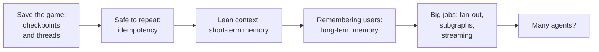
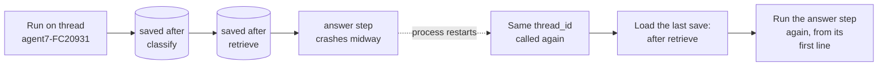
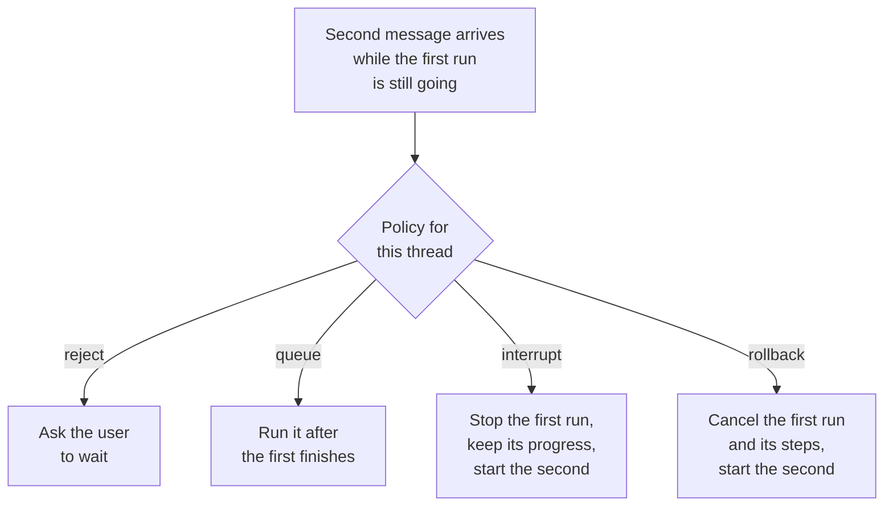
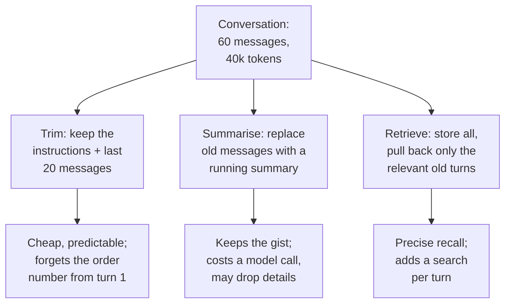
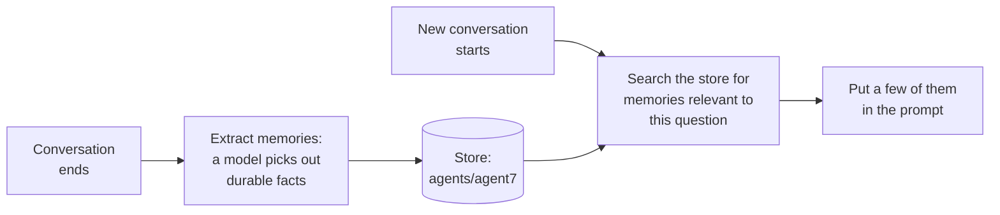
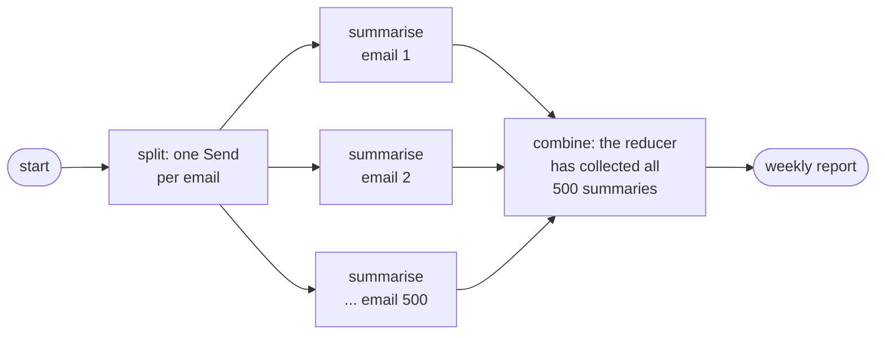
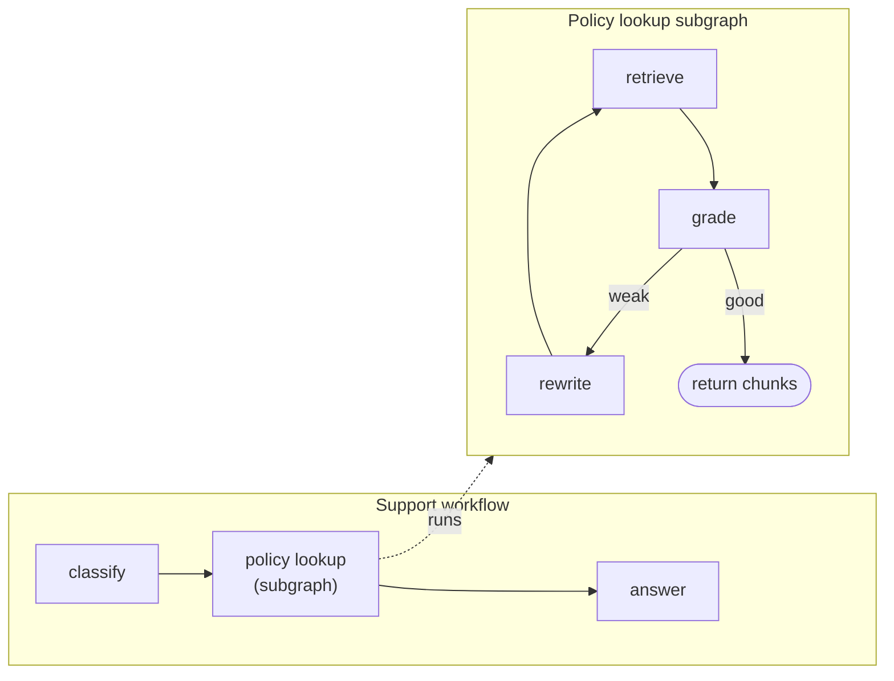
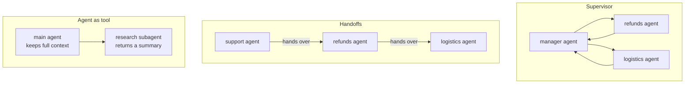
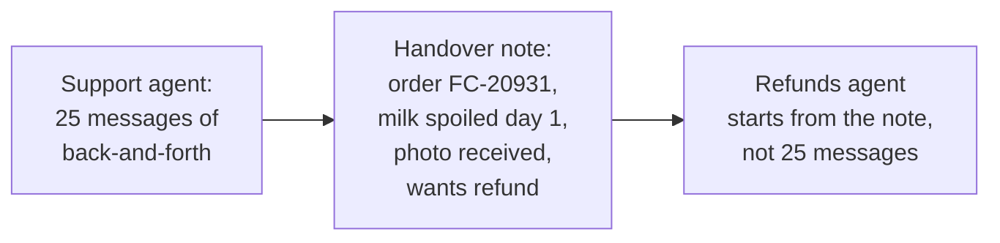

Ask FreshCart is an agent now, and production is teaching it manners. Four problems from the end of chapter 5:

- "and was the bread delivered?" at 10:20 means nothing to it; every call starts from zero.
- A crash in the middle of an answer means starting over.
- One crash plus an automatic retry credited a customer 150 rupees twice.
- Long conversations get slower and more expensive with every message.

This chapter gives the agent a memory that survives crashes, makes its actions safe to repeat, keeps its context lean, and then scales it up: big batch jobs, reusable pieces, live progress, and finally the question every team asks, "should we use several agents?".



## 1. Save the game: checkpoints and threads

Video games solved this problem long ago. You do not replay the whole game after losing a level; you load the last save. LangGraph does the same for workflows.

- A **checkpointer** is the component that saves the workflow's state to a database after every round of execution (every super-step, chapter 5). In production it is backed by a real database, for example `PostgresSaver`. `InMemorySaver` keeps saves in memory and is for tests only: everything vanishes when the process stops.
- Each save is a **checkpoint**: a snapshot of the whole state at that moment.
- A **thread** is one conversation's chain of saves, identified by a `thread_id` you choose, such as `"agent7-FC20931"`. Calling the workflow again with the same `thread_id` continues from the last save; a new `thread_id` starts empty.

That alone fixes the 10:20 question: the second message on thread `agent7-FC20931` loads the earlier conversation, so "and was the bread delivered?" knows which order it means.

It also fixes crashes:



Classify and retrieve are not repeated; only the step that was interrupted runs again.

How often to save is your choice, through the `durability` setting:

- `"exit"`: save only when the run finishes or pauses. Fastest; a crash loses the whole run's progress.
- `"async"`: save in the background while the next step runs. A sensible default.
- `"sync"`: save before the next step starts. Safest; use it for long or expensive runs, anything with side effects, and anything waiting for a person.

> **Pause and think.** Look at the last box in the diagram: the interrupted step runs *again, from its first line*. If that step was the one issuing the 150 rupee credit, what happened?

## 2. Safe to repeat: idempotency

It issued the credit twice. A step can run more than once for the same logical action: after a crash, after a pause for human approval (chapter 7), when replaying a run from an old save. Any **side effect** inside it, an action outside the workflow such as charging a card or writing a row, can happen twice.

The fix has a long name and a simple idea: make side effects **idempotent**, safe to repeat, so the second run has no extra effect. A lift button is idempotent: pressing it five times calls the lift once.

Broken version:

```python
def issue_credit(state):
    payments.credit(state["order_id"], 150)          # re-run after a crash: credited twice
    return {"credited": True}
```

Fixed version:

```python
def issue_credit(state):
    payments.credit(state["order_id"], 150,
                    idempotency_key=f"credit:{state['order_id']}:late-delivery")  # repeat = no-op
    return {"credited": True}
```

The payments service remembers every idempotency key it has processed and ignores repeats. Other ways to the same safety:

- database **upserts** keyed by something deterministic (insert, or update if the row already exists);
- each side effect in its own small step, so it is not re-run when a later step fails;
- side effects placed *after* a pause, not before it;
- wrapping the work in LangGraph's `@task`, whose result is saved and reused on resume instead of being redone.

Correction: "the checkpointer gives exactly-once execution" is wrong. It makes runs resumable. The interrupted step is redone, so effects outside LangGraph are safe only if they are idempotent.

### Living with saved state

- **Time travel.** Every checkpoint is kept, so you can list a thread's history (`get_state_history`), replay from an older checkpoint (later steps run again, model calls included), or write a corrected checkpoint with `update_state` and continue from it. Great for "what exactly did the agent see when it gave that wrong answer?".
- **Two messages at once.** An agent sends "where is FC-20931?" and, before the answer arrives, "never mind, check FC-20944". Two runs on one thread would read the same save and overwrite each other's results. Allow one active run per thread and choose a behaviour on purpose:



(LangGraph's deployment platform names these same four strategies for "double-texting".)

- **Storage grows.** Every step of every conversation saves a checkpoint. Keep full history for recent threads, trim or delete old ones, and keep big data out of the state.
- **Only plain data in the state**: dictionaries, lists, strings, numbers, messages. Database connections and clients belong in the runtime context, never in a checkpoint.

> **Pause and think.** Now that conversations are remembered, they grow. After 60 messages the prompt is 40,000 tokens; every answer is slower and costlier, and the order number from message 1 is getting buried. What would you keep, what would you drop, and what would you shrink?

## 3. Short-term memory: what goes into the window

**Context engineering** is deciding exactly what goes into the model's context window on every call: instructions, tool descriptions, retrieved documents, memories, conversation history and tool results, in what order, and what is left out. In a multi-step agent this matters far more than the wording of the instructions, because quality drops as the context fills with irrelevant text (chapter 4's "lost in the middle").

**Short-term memory** is the current conversation: the messages in the thread's state. Three ways to keep it in bounds:



The usual combination: recent messages word for word, a summary of older ones (`SummarizationMiddleware` from chapter 5 does this), and **pinned facts**, such as the order id and customer id, kept in their own state fields so they can never be trimmed away. That last part fixes the buried order number.

Tool outputs are usually the biggest consumers of context. Clear or shrink old tool results once they have been used, and keep large outputs in a store with only a reference in the conversation.

**The order of the context**, fixed parts first so prompt caching can reuse them:

- system instructions and rules;
- tool descriptions;
- a few examples;
- long-term memories (next section);
- retrieved documents, most relevant first;
- conversation summary and recent messages;
- the current question, last.

## 4. Long-term memory: remembering people across conversations

Agents are annoyed that every new conversation starts from zero. Ask FreshCart never remembers that agent7 handles only Pune, or that agent12 prefers answers in Hindi. Threads end; this needs memory that outlives them.

In LangGraph, **long-term memory** lives in the **store**: JSON documents organised under namespaces such as `("agents", "agent7")`, readable from any thread, and searchable by meaning if you configure an embedding model. Three kinds are commonly named:

- **Semantic**: facts. "agent7 handles Pune only."
- **Episodic**: past experiences. "Last time a cold-chain question came up, the answer was in runbook 17."
- **Procedural**: how to behave. Usually the instructions themselves, which some systems refine over time from feedback.



When to write memories is a design choice: **in the hot path** (the agent calls a `save_memory` tool during the conversation: immediate, but slower and relies on the model's judgement) or **in the background** (a separate job extracts memories afterwards: no added latency, better extraction, slightly delayed).

What goes wrong, and the guard for each:

- stale or wrong memories used with confidence: store a timestamp and source, let newer facts win;
- privacy: memories about people are personal data; users must be able to see and delete them, and they must never cross franchises;
- poisoned memories: text planted by an attacker (chapter 11) and saved as a memory affects every future conversation, so treat memory writes as untrusted;
- bloat: retrieve a few relevant memories, never load them all.

Correction: "the model has a million-token window, so memory is solved" is wrong. Cost and latency grow with every token, and quality falls as the context fills with irrelevant history.

> **Pause and think.** A new request: every Monday, summarise the 500 complaint emails from last week into one report. A loop that summarises them one by one takes an hour. Some summaries fail with rate-limit errors. Ops wants to watch progress live. And the retrieve-grade-rewrite loop from chapter 5 is now needed in three different workflows. Which of these can the graph handle more cleverly?

## 5. Bigger workflows: fan-out, subgraphs, streaming

### Fan-out and fan-in with Send

When work splits into many independent pieces whose number you only know at run time (500 emails this week, 312 next week), use **map-reduce**: run the same step on every piece (map), then combine the results (reduce). In LangGraph a conditional edge can return a list of `Send` objects; each `Send("node", payload)` starts one run of that node with its own input, and all of them run in the same round.



```python
class State(TypedDict):
    emails: list
    summaries: Annotated[list, operator.add]     # collects every branch's result
    report: str

def split(state):
    return [Send("summarise", {"email": e}) for e in state["emails"]]

g.add_conditional_edges(START, split, ["summarise"])
g.add_edge("summarise", "combine")
```

- Each `summarise` returns `{"summaries": [one_summary]}`; the `operator.add` reducer concatenates all 500.
- `combine` runs once, after every branch finishes. If the summaries are too long for one prompt, combine in stages (summaries of summaries).
- Cap parallelism with `max_concurrency` in the run config, below the provider's rate limit.
- Attach a **retry policy** to `summarise`, with backoff, so a rate-limit error is retried rather than fatal.
- With a checkpointer, branches that already finished are not redone if the job crashes and resumes.

### Subgraphs: reusable pieces

A **subgraph** is a whole compiled graph used as one node inside another. The retrieve-grade-rewrite loop becomes a subgraph used by support, planning and the weekly report.



The subgraph has its own state: fields it shares with the parent by name flow in and out, while its scratch fields (`tries`, rewritten queries) stay private. A node inside a subgraph can even jump to a node in the parent with `Command(graph=Command.PARENT, goto=...)`, which is how one agent hands over to another.

### Streaming progress

A slow answer feels much faster when people can watch it work. LangGraph can stream several kinds of events at once:

- `messages`: the model's words as they are generated;
- `updates`: what each step changed when it finishes, which a UI turns into status lines ("Found 5 policy passages");
- `custom`: your own events, such as "summarised 120 of 500 emails";
- `values` (the full state after each step) and `debug` (everything), mostly for development.

The server forwards these to the browser over **Server-Sent Events (SSE)**, a simple one-way stream over HTTP that browsers support natively.

> **Pause and think.** Leadership now asks for "a team of agents": a support agent, a refunds agent, a logistics agent and a manager agent coordinating them. It sounds powerful. What would each agent need to know about the others' work, and what could go wrong when they disagree?

## 6. One agent or a team?

A **multi-agent system** splits work between several agents, each with its own instructions, tools and context.



- **Supervisor**: a manager agent sees every turn, hands work to a worker, gets the result back and decides what is next. Easy to log and reason about; every step goes through the manager, adding a hop.
- **Handoffs** (also called a swarm): the active agent passes control directly to another, and the next message goes to whoever has control. Faster; harder to enforce company-wide rules.
- **Agent as tool**: specialists are tools of one main agent and return only summaries, so the main agent keeps the whole picture.

Splitting helps when the work is parallel and separable (searching ten sources at once), when one context window cannot hold all the intermediate work, or when roles need different tools and permissions. It hurts when steps depend on each other's decisions: a decision made inside one agent's context is invisible to the others, so they act on different assumptions.

The evidence cuts both ways. Anthropic's research system (a lead agent with parallel subagents) clearly beat a single agent on research tasks, but agents used about 4 times the tokens of a normal chat and the multi-agent system about 15 times. Cognition, the team behind the Devin coding agent, argues in "Don't Build Multi-Agents" that agents must share full context or not be split.

What each agent *sees* is the hardest design choice. The usual compromise is a **handover note**:



**Decision point: what do you tell leadership?** One agent with five good tools first. Split off a subagent only for a measured reason, such as researching many sources in parallel, after the single agent's failures show the need.

For long, many-step tasks ("investigate why late deliveries in Pune doubled this week"), LangChain's **Deep Agents** packages the design coding agents use: a planning tool (a to-do list the agent keeps updating), a filesystem for notes and large outputs so they stay out of the context, subagents launched for isolated subtasks that return short summaries, and a detailed system prompt explaining all of it. Agents built by different teams can also talk through **agent-to-agent protocols** such as A2A, the same idea as standard tool connections (chapter 12) applied to agents.

## 7. Complete example: a remembering, crash-safe Ask FreshCart

```python
app = g.compile(checkpointer=PostgresSaver.from_conn_string(DB_URL))

cfg = {"configurable": {"thread_id": "agent7-FC20931"}}
app.invoke({"messages": [("user", "FC-20931 late, milk spoiled. What do I do?")], "steps": 0},
           cfg, durability="async")
app.invoke({"messages": [("user", "And was the bread delivered?")]}, cfg)

history = list(app.get_state_history(cfg))       # every save on this thread, newest first
```

Expected behaviour:

- The follow-up "And was the bread delivered?" works without repeating the order id, because the same `thread_id` loads the earlier conversation.
- If the process dies during the first answer, calling `app.invoke(None, cfg)` continues from the last save instead of starting over; only the interrupted step runs again.
- `history` lists every checkpoint of the thread, so a bad answer can be inspected exactly as the agent saw it.
- A credit step with an idempotency key, retried after a crash, credits the customer once.

## What breaks next

The planning team wants an agent too. Arjun plans stock for the Pune warehouses. Every week he adjusts **safety stock** (the extra units kept so a product does not run out when demand spikes) for hundreds of products, through tickets that take days. You build **Planner Copilot**: Arjun types "Raise safety stock for milk in all Pune warehouses by 20% before Diwali", and the agent works out the change: 6 warehouses, milk SKU-881 (a **SKU** is a product code), 400 units to 480 each.

A wrong change empties shelves or wastes lakhs of rupees (a lakh is 100,000) of dairy. Planner Copilot must not write anything until Arjun approves. He might approve tomorrow morning. The service might be redeployed overnight.

> **Pause and think.** How does an agent stop in the middle of a run, show a person exactly what it is about to do, and wait for hours, with nothing running, and then continue exactly where it stopped? You already have one of the two pieces you need. Which one?

That is chapter 7.
