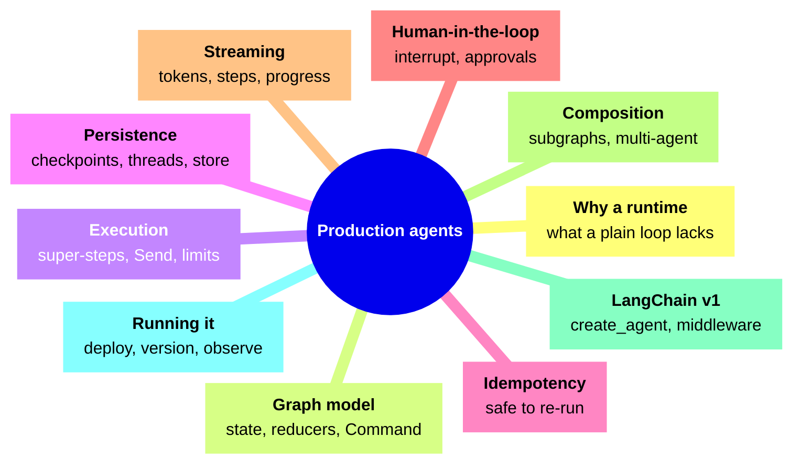
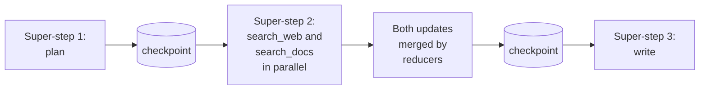
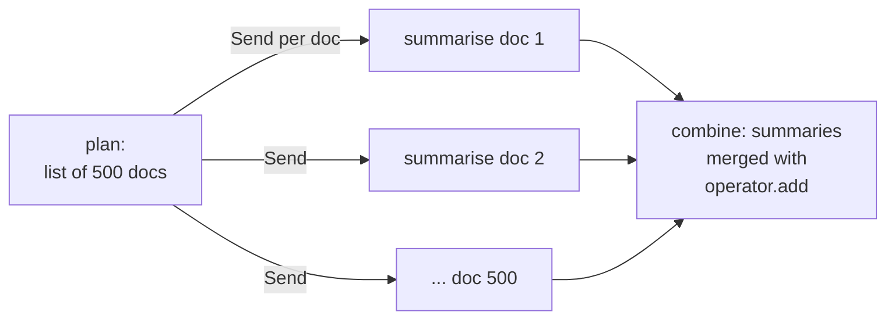
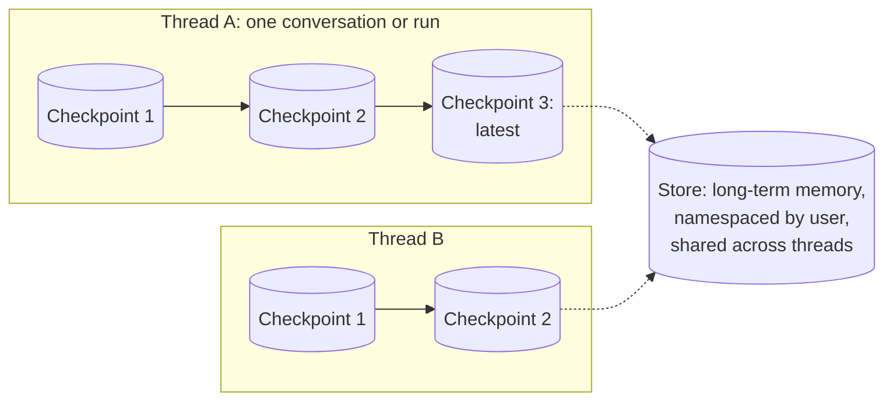
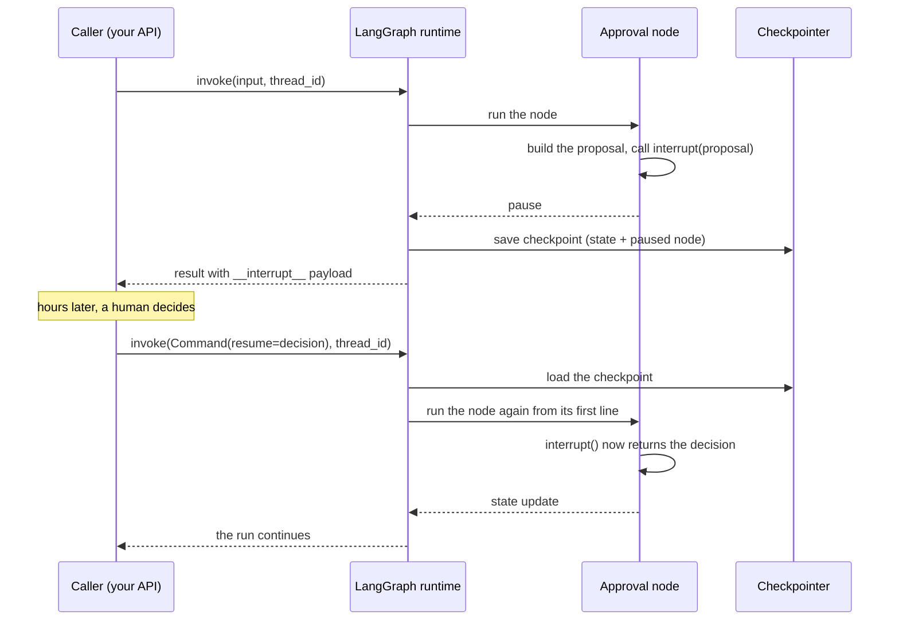
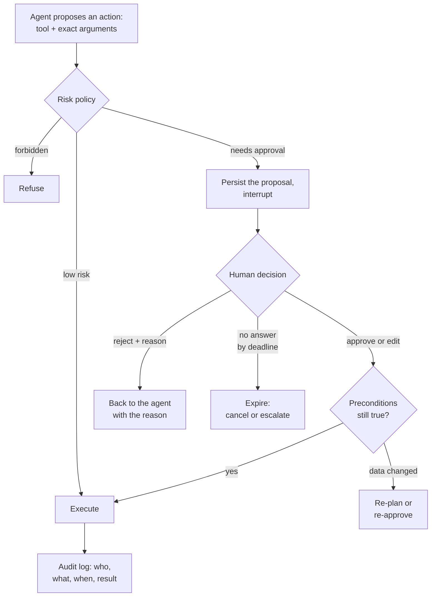
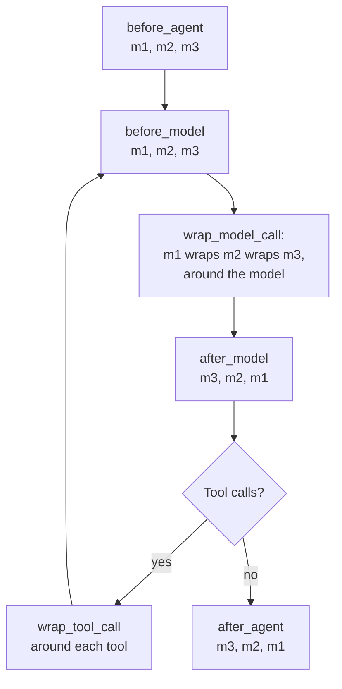

A loop of model and tool calls is a demo. A production agent must survive crashes, pause for days waiting for a human, stream progress, run branches in parallel, retry safely, and leave a trace you can replay. **LangGraph** is the runtime that provides this: agents as graphs of steps over a shared state, saved after every step. **LangChain** (version 1) sits on top with `create_agent`, middleware and integrations. This chapter is how both work underneath and the rules for using them safely.



## 1. Why a runtime, and LangChain versus LangGraph

A plain loop has no answer to:

- **Crashes**: the process dies at step 14 of 20. Without saved state, everything restarts, including side effects.
- **Waiting**: an approval takes six hours. You cannot hold a thread or a request open that long.
- **Parallel branches**, **streaming** of intermediate steps, **retries**, **replay** of a bad run, and **inspection** of what the agent saw at each step.

The pieces:

- **LangGraph**: a low-level orchestration runtime. You define nodes (steps) and edges (control flow) over a typed state; it runs them with persistence, interrupts, streaming and retries. Unopinionated about prompts.
- **LangChain v1**: the high-level layer. `create_agent` builds the standard model-and-tools loop **as a LangGraph graph**, with **middleware** for production controls, a uniform chat-model interface and integrations.
- **LangSmith**: a separate service for tracing, evaluation and deployment.

Which to use:

- **`create_agent`** for a standard tool-calling agent; middleware adds limits, approvals, summarisation, PII handling and fallbacks.
- **LangGraph directly** for custom control flow: deterministic steps mixed with agentic ones, parallel branches, approvals in the middle of a workflow, multi-agent orchestration, long-running durable jobs.
- **Neither** when the job is one or two LLM calls: plain code is clearer.

Say it like this: "LangGraph is the durable runtime: a typed state, nodes and edges, checkpoints after every step, interrupts, streaming and retries. LangChain's create_agent builds the standard agent loop on top of it and adds middleware. I use create_agent for standard agents, LangGraph when I need custom control flow, and plain code for one or two calls."

## 2. The graph model: state, nodes, edges, reducers


- **State**: a typed schema (a `TypedDict` or Pydantic model) shared by all nodes: messages, intermediate results, counters, flags.
- **Node**: a function that receives the state and returns a **partial update** (only the keys it changes).
- **Edge**: fixed (`A` always goes to `B`) or **conditional** (a routing function reads the state and returns the next node). The agent above is one conditional edge: tool calls go to `tools`, otherwise `END`.
- **Command**: a node can return `Command(update=..., goto="node")` to update the state and choose the next node in one step. Use it when the node that does the work also knows where to go next (handoffs between agents); use conditional edges when routing is a separate, visible decision.

**Reducers** decide how an update is merged into a key:

```python
class State(TypedDict):
    messages: Annotated[list, add_messages]   # append; replace by message id
    findings: Annotated[list, operator.add]   # concatenate lists
    status: str                               # no reducer: overwrite
```

- Without a reducer, a new value **overwrites** the old one.
- `add_messages` appends new messages and updates existing ones by id.
- **Two nodes running in parallel that write the same key without a reducer** fail with `InvalidUpdateError`: the runtime refuses to pick a winner. Give the key a reducer that merges.

## 3. Execution: super-steps, Send and limits

LangGraph runs a graph in **super-steps** (the Pregel / bulk-synchronous model):



- In each super-step, **every triggered node runs, in parallel**, and all of them read the **same** state snapshot.
- Their updates are applied **together at the end** of the super-step, through the reducers. Then the next nodes are chosen, and a **checkpoint** is saved.
- If one parallel node fails, the super-step fails as a whole; the updates of the nodes that succeeded are kept as **pending writes**, so on resume only the failed node runs again.

**Send: fan-out decided at run time.** When the number of parallel tasks is known only at run time (summarise every document found), a conditional edge returns a list of `Send("node", payload)`, one per item. Each runs the node with its own input, in parallel, and a reducer collects the results.



At 500 documents, also: cap concurrency (`max_concurrency` in the run config) to respect rate limits, give the summarise node a retry policy, combine hierarchically (groups of summaries, then a summary of those) so the final step fits the context window, and rely on pending writes so finished summaries are not redone after a crash.

**Stopping loops**: `recursion_limit` caps the number of super-steps per run and raises `GraphRecursionError`. Add your own guards as well: an iteration counter in the state checked by a conditional edge, token and time budgets, and an explicit "give up and explain" path. A rewrite-and-retrieve loop that ran 40 times on one odd question had no counter and no budget.

Say it like this: "LangGraph executes in super-steps: all triggered nodes run in parallel on the same snapshot, their updates merge through reducers at the end, and a checkpoint is saved. Send fans out one task per item at run time, and a reducer gathers the results. Loops are bounded by the recursion limit plus my own counters and budgets."

## 4. Persistence: checkpoints, threads and the store



- A **checkpointer** saves a **checkpoint** after every super-step: the state values, which nodes run next, any pending writes, and metadata.
- A **thread** (`thread_id` in the run config) is one conversation or job: the ordered history of its checkpoints. Invoking again with the same `thread_id` continues from the latest checkpoint.
- The **store** is long-term memory **across threads**: namespaced key-value documents (for example under the user's id) with optional semantic search, reached from nodes and tools.
- Backends: in-memory for tests; **Postgres** (or SQLite, Redis and others) in production.

What persistence gives you:

- **Crash recovery**: re-invoke the thread and it continues from the last completed super-step.
- **Multi-turn memory**: the thread keeps the conversation.
- **Human-in-the-loop**: a run can stop for days and resume.
- **Time travel**: list a thread's checkpoints, then **replay** from one (steps before it are not re-executed) or **fork** by editing the state at that checkpoint and running from there. Use it to debug a bad run, test a fix on the exact failing state, or recover from a wrong step.

**Durability modes** decide when checkpoints are written:

- **`exit`**: only when the run finishes or pauses. Fastest; no recovery from a crash mid-run. For short runs.
- **`async`** (the default): written in the background while the next step runs. Good performance; a crash can lose the latest checkpoint.
- **`sync`**: written before the next step starts. Slowest, safest. For long, valuable or side-effect-heavy runs.

Say it like this: "A thread is one conversation or job, made of checkpoints saved after every super-step; a checkpoint is the state plus what runs next; the store is cross-thread memory such as user preferences. With a Postgres checkpointer a crashed run resumes from its last completed step, and a paused run can wait for days."

## 5. Idempotency: why nodes must be safe to re-run

A resumed run restarts the interrupted node **from its first line**. Retries and crash recovery do the same. Any side effect inside that node (an API call, an email, a payment, a database write) can happen **twice**.

Rules:

- **Separate side effects from decisions**: one node decides, a later node acts. A node that pauses for approval performs no side effects before it pauses.
- **Idempotency keys**: derive a key that stays the same across re-execution (for example thread id plus step name), store it in the state, and send it with every attempt; the receiving system ignores duplicates. Many payment and messaging APIs accept such a key.
- **Upserts and unique constraints** instead of blind inserts; check-then-act where the target system supports it.
- **Record completion in the state**, and skip work already done.
- In the functional API, `@task` results are checkpointed, so a completed task is not re-executed on resume.

"A tool call timed out and the agent retried; how do you stop the write applying twice?" The timeout does not tell you whether the write happened. Generate the idempotency key once, before the first attempt, and reuse it on every retry; or query the target's status by that key before retrying.

## 6. Human-in-the-loop: interrupt and resume



- `interrupt(payload)` pauses the run. The runtime saves a checkpoint and returns the payload to the caller under `__interrupt__`. No thread or connection is held while waiting.
- Resuming means invoking the same thread with `Command(resume=value)`. The node runs **again from the beginning**, and this time `interrupt()` returns the value.

The rules interviewers check:

- **Code before `interrupt()` runs twice.** Side effects before the pause repeat on resume, so keep them out of that node or make them idempotent.
- **Several interrupts in one node are matched to resume values by their order.** Do not place interrupts inside loops whose length or order can change between runs, and do not skip them conditionally; split such logic into separate nodes.
- **Do not catch the pause.** `interrupt()` works by raising a special exception; a bare `try/except` around it swallows the pause.
- Payloads and resume values must be serialisable (JSON).
- **Static breakpoints** (`interrupt_before` and `interrupt_after` on nodes) pause before or after a node for debugging; **dynamic `interrupt()`** is for real decisions with a payload.
- **Parallel interrupts**: if two branches both pause, both payloads come back, each with an id; resume with a map from interrupt id to value.

### Designing the approval, not just the pause



- **What needs a human**: irreversible actions, high-impact ones (money over a threshold, many records), external communication, permission changes, low-confidence or novel cases. Write it as a policy with tiers: auto, notify, approve, forbid.
- **What the approver sees**: the exact tool call and arguments, a before-and-after diff, the evidence and reasoning, the estimated impact, and the options approve, edit, reject with a reason, or respond.
- **Approve the proposal, not the intent.** The human approves the concrete action that will run. Bind the approval to that exact action (store a hash of tool plus arguments); any change requires re-approval.
- **While it waits**, things change:
  - **No answer**: a deadline that expires the proposal, cancels it or escalates it. Pending proposals are staged separately (a proposal record), never written into live data.
  - **The data changed**: re-check preconditions at execution time with a version check on the target (optimistic concurrency); if it changed, re-plan or ask again.
  - **Conflicting approvals** for the same resource: the version check rejects the second write, or approvals are serialised per resource.
  - **A new graph version deployed while 200 runs are paused**: a checkpoint stores state keys and the names of the nodes to resume, so renaming or removing those nodes, or renaming state keys, breaks resumption. Add fields with defaults, keep old nodes until paused runs drain, or route old threads to the old graph version.
- **Audit**: who approved what, when, what exactly ran, and the result. **Rejections with reasons** are training and eval data: they show where the agent's proposals are wrong.

Say it like this: "interrupt() saves a checkpoint and returns a payload to the caller; resuming with Command(resume=...) re-runs the node from the top, where interrupt() now returns the human's answer. So nothing before the interrupt may have side effects, and interrupts must keep a stable order. The approval binds to the exact action, expires after a deadline, and preconditions are re-checked with a version check when it finally executes."

## 7. Retries and fault tolerance

- **Retry policies per node**: maximum attempts, backoff, and which exceptions to retry (timeouts and rate limits yes; validation errors no).
- **Timeouts** on every external call; a node that hangs blocks its run.
- **Pending writes** keep the successful parallel branches when one fails.
- **Error paths**: a conditional edge routes to a recovery or escalation node when a step's result reports failure, instead of crashing the run.
- **Durable execution**: with a persistent checkpointer, a run survives process restarts and deploys. Long runs execute as background jobs, not inside an HTTP request.

## 8. Streaming

Stream modes, combinable:

- **`messages`**: LLM tokens as they are generated, from inside any node, with metadata saying which node.
- **`updates`**: each node's state update as it finishes: drives "searching documents..." progress.
- **`values`**: the full state after each step.
- **`custom`**: anything a node or tool emits through the stream writer, such as "processed 40 of 120 files".
- **`debug`**: everything, for development.
- Add subgraph events with `subgraphs=True`.

To a web UI: send events over **server-sent events** or WebSockets: tokens into the chat bubble, updates and custom events into a progress panel. If the client disconnects, the run should continue as a background run and the client should rejoin the stream by thread or run id, or read the final state when it returns.

## 9. Composition: subgraphs and multi-agent

- A **subgraph** is a compiled graph used as a node of another graph. Use it to reuse a component (a retrieval pipeline), to give a team ownership of one part, or to give a sub-agent its own private state. If the schemas differ, call the subgraph inside a node and map the state in and out.
- **Supervisor**: a supervisor agent calls worker agents, commonly exposed to it as tools, and collects their condensed results.
- **Handoffs**: an agent returns `Command(goto="other_agent", graph=Command.PARENT)` to pass control, with the conversation, to a sibling agent in the parent graph.
- **Functional API**: `@entrypoint` and `@task` give the same persistence, interrupts and streaming with ordinary Python control flow instead of an explicit graph; task results are checkpointed.

## 10. LangChain v1: what create_agent gives you

Packages:

- `langchain-core`: messages, the Runnable interface, tools.
- `langchain`: `create_agent`, middleware, `init_chat_model`.
- Provider packages (`langchain-openai`, `langchain-anthropic` and others) and `langchain-text-splitters`.
- `langchain-classic`: the old chains and helpers, kept for compatibility.
- `langgraph` underneath; LangSmith as the service.

Building blocks:

- **Chat models**: `init_chat_model("provider:model")` gives one interface for every provider: `invoke`, `stream`, `batch` and their async versions. Messages are `SystemMessage`, `HumanMessage`, `AIMessage` (text, `tool_calls`, token usage) and `ToolMessage` (a result, linked by `tool_call_id`).
- **Runnables and LCEL**: anything runnable composes with `|` (`prompt | model | parser`) and gets streaming, batching, async and tracing for free. Fine for short fixed pipelines; loops and branches belong in LangGraph.
- **Tools**: `@tool` builds the schema from the function name, the docstring (the description the model reads) and the type hints. A parameter typed `ToolRuntime` is injected and hidden from the model, giving the tool the state, the run context (such as the user id), the store, the stream writer and the tool call id. User identity comes from that context, never from model arguments.
- **Structured output**: `model.with_structured_output(Schema)` for one call. In an agent, `create_agent(response_format=Schema)` puts the validated result in `result["structured_response"]`, using the provider's native structured output (`ProviderStrategy`) or an artificial tool the model must call (`ToolStrategy`, which retries on validation errors).
- **Retrieval components**: document loaders, text splitters, embedding models and vector stores with a retriever interface.

`create_agent(model, tools, system_prompt=..., middleware=[...], checkpointer=..., store=..., response_format=..., context_schema=...)` returns a compiled LangGraph graph: the model node and tools node loop from section 2, so threads, streaming and interrupts come with it.

**Middleware** hooks into the loop:



- For `middleware=[m1, m2, m3]`: `before_*` hooks run in list order, `after_*` hooks in reverse, and `wrap_*` hooks nest with m1 outermost.
- Built-ins: **Summarization** (compress history near a token limit), **HumanInTheLoop** (interrupt before chosen tools; allow approve, edit or reject), **PII** (redact, mask, hash or block emails, cards and other entities in inputs, outputs and tool results), **ModelCallLimit** and **ToolCallLimit** (budgets), **ModelFallback** and retry middleware, **LLMToolSelector** (pick relevant tools per call), context editing (clear old tool outputs), and a todo-list middleware.
- Custom middleware swaps models per request, rewrites the prompt dynamically, enforces policies or logs.

"A conversation loops through 40 tool calls, leaks an email address into the traces, and dies in a provider outage": add **ToolCallLimit and ModelCallLimit** for the loop, **PII middleware** applied to inputs and tool results (plus masking in the tracing layer) for the leak, and **retry plus ModelFallback** for the outage.

**Memory**: short-term is the thread's messages saved by the checkpointer under `thread_id`, kept within the window by summarisation middleware; long-term is the store, reached by tools through the runtime.

**Tracing**: setting `LANGSMITH_TRACING=true` and an API key records every run as a trace: each model and tool call with inputs, outputs, tokens, cost and latency. The same traces feed datasets and evaluations.

**Would you use LangChain in production?** Yes for `create_agent`, middleware and the LangGraph runtime, which are built for it, with conditions: pin versions, keep business logic in your own tools and services rather than inside framework abstractions, and keep provider-specific features behind your own interfaces. For a flow of one or two calls, plain code with the provider SDK is simpler.

Say it like this: "create_agent builds the model-tools loop as a LangGraph graph, so I get checkpoints, streaming and interrupts. Middleware is where production controls go: call limits, human approval on risky tools, PII redaction, summarisation and fallbacks. before hooks run in list order, after hooks in reverse, and wrap hooks nest with the first outermost."

## 11. Running it in production

- **Persistence**: Postgres checkpointer and store; a durability mode chosen per graph; retention and cleanup of old checkpoints.
- **Execution**: long runs as background jobs, not inside HTTP requests; one active run per thread, with a policy for a user sending a second message mid-run (reject, queue, interrupt the current run, or roll it back); rate limits per tenant.
- **Correctness**: idempotent nodes, retry policies with timeouts, recursion limits plus your own counters, interrupt rules respected.
- **Change management**: version graphs and state schemas; never break paused threads; deploy new versions for new threads first.
- **Observability**: traces per run (LangSmith or OpenTelemetry), metrics (step counts, tokens, cost, latency, error and interrupt rates), and audit logs for actions.
- **Quality**: offline evals before release, online evals on sampled traces, and time travel to reproduce failures.
- **Deployment**: LangSmith Deployment (formerly LangGraph Platform) runs graphs as a server with threads, runs, a task queue, persistence, streaming endpoints and scheduled runs; or host LangGraph yourself behind your own API with the same building blocks.

## Thinking checklist

- What happens if the process dies at each node? Which side effects could repeat?
- Which keys can be written by parallel nodes, and do they have reducers?
- What bounds every loop: recursion limit, counter, budget?
- Where can the run pause, what does the human see, and what is re-checked when it resumes?
- What breaks for runs paused today when tomorrow's version is deployed?
- What does the user see while a run takes two minutes, and what if they close the tab?
- Can I replay the exact failing run from its checkpoint?
