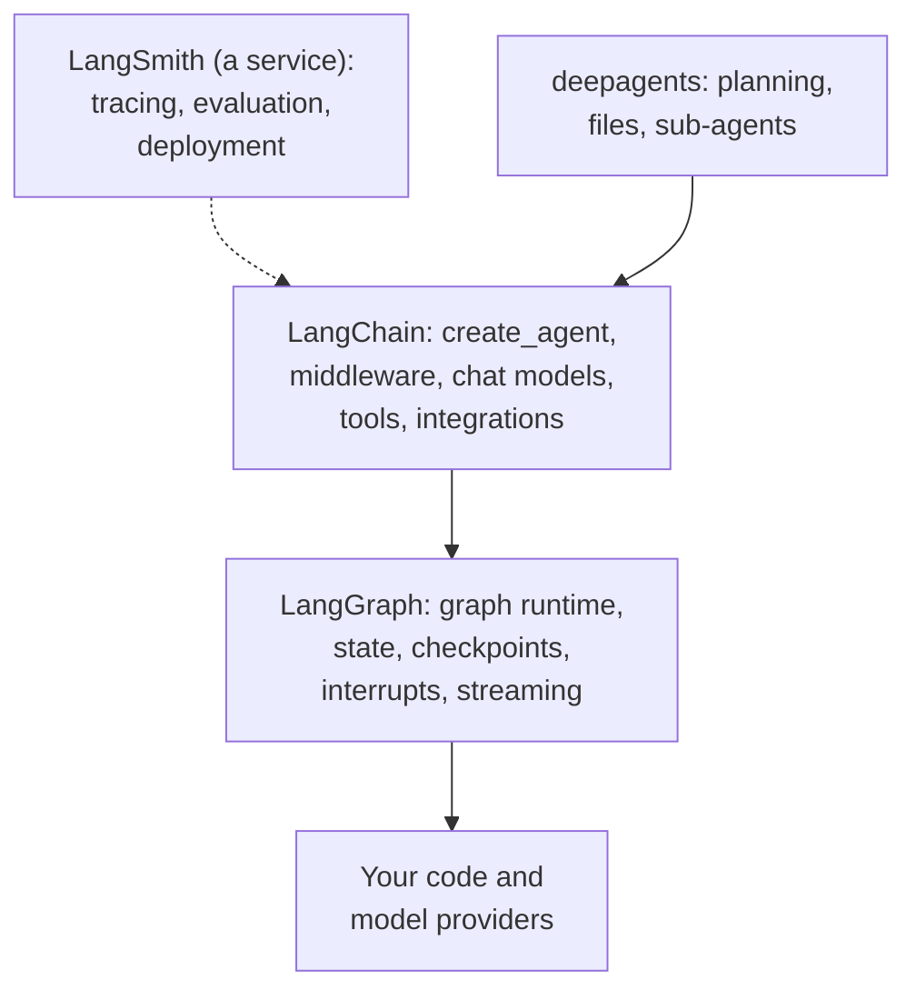
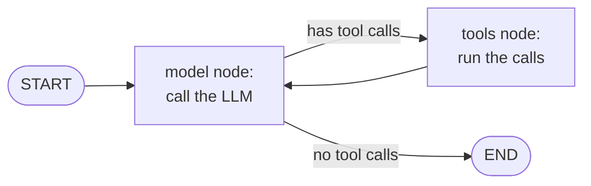
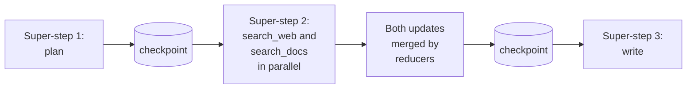
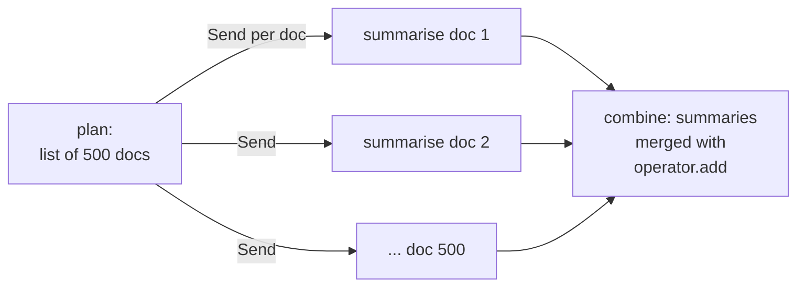
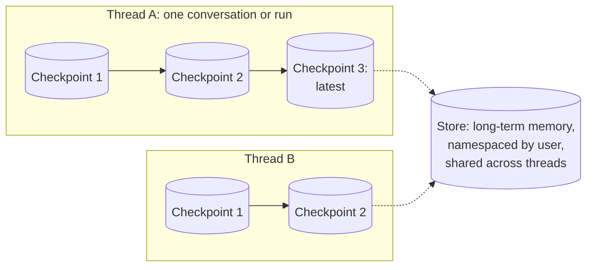
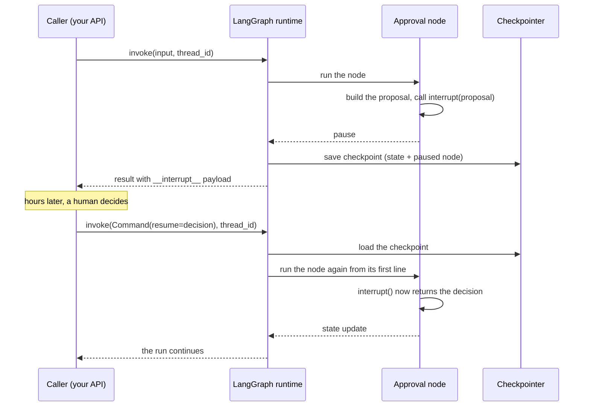
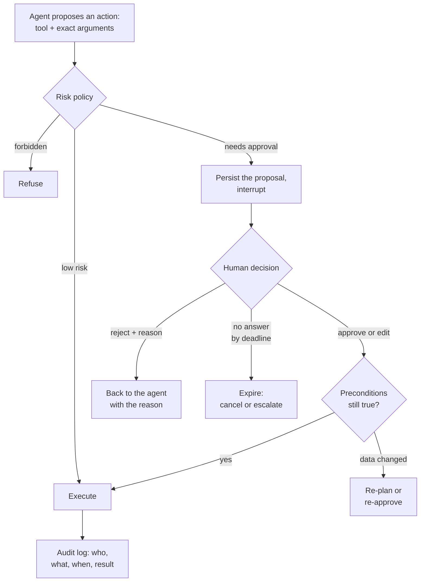
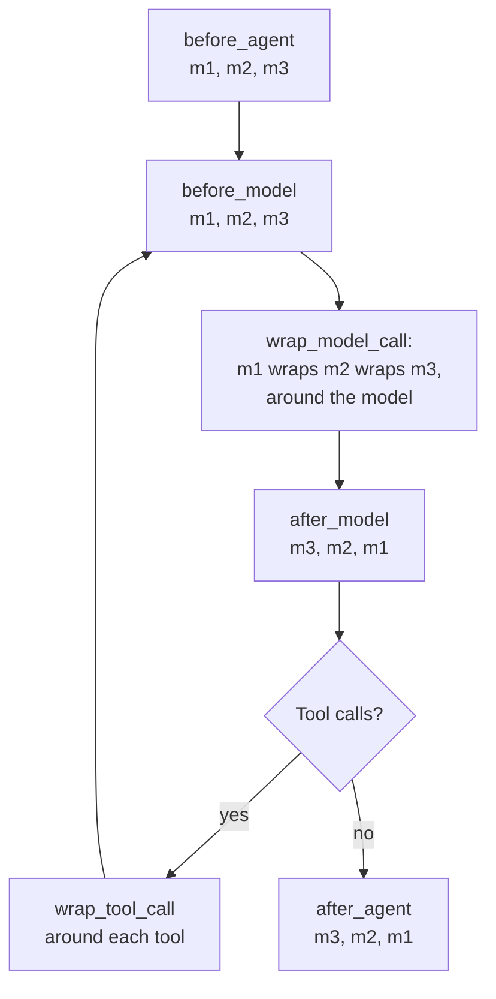

A loop of model and tool calls is a demo. A production agent must survive crashes, pause for days waiting for a human, stream progress, run branches in parallel, retry safely, and leave a trace you can replay. LangChain and LangGraph are the most widely used open-source answers to those needs in Python and JavaScript. This chapter explains what each one is, how they work underneath, and the rules for using them safely.

## 1. What LangChain and LangGraph are

**LangChain** is a framework for building applications on LLMs. It began in late 2022 as a library of "chains" (pre-built sequences of prompts and model calls) and hundreds of integrations: model providers, vector stores, document loaders, tools. It gave developers one interface to many providers and ready-made pieces for RAG and agents. Its early agent abstractions were hard to control and debug in production, which led to LangGraph. With version 1 (late 2025) LangChain was refocused: its core is now **`create_agent`**, a production-ready agent loop, plus **middleware** for controlling that loop, a uniform interface to chat models, tools and structured output, and the integrations. The old chain classes moved to a legacy package.

**LangGraph** is a lower-level **orchestration runtime** for stateful, long-running agents and workflows, released in early 2024. You describe your application as a **graph**: **nodes** are steps (a model call, a tool call, any Python function), **edges** decide what runs next, and all nodes read and write a shared, typed **state**. LangGraph executes the graph and adds what a plain loop lacks: it **saves a checkpoint after every step**, so a run can crash and resume, or **pause for a human** and continue days later; it runs branches **in parallel**; it **streams** tokens and progress; it retries failed steps; and it lets you inspect and **replay** any past step. It is unopinionated about prompts and architecture: you can build a fixed workflow, a single agent, or a team of agents with it.

**How they relate**



- **LangGraph is the engine**; `create_agent` in LangChain is a graph built on it, so every LangChain agent gets LangGraph's checkpoints, streaming and interrupts.
- **LangChain is the convenience layer**: the standard agent loop and its production controls, plus a common interface to providers and tools.
- **deepagents** builds deep agents (planning, file system, sub-agents) on top of both.
- **LangSmith** is a separate hosted service for traces, evaluation datasets and deployment; it works with or without the frameworks.

**Which to use**

- **`create_agent`** for a standard tool-calling agent: model, tools, a system prompt, and middleware for limits, approvals, summarisation, PII handling and fallbacks.
- **LangGraph directly** for custom control flow: deterministic steps mixed with agentic ones, parallel branches, approvals in the middle of a workflow, multi-agent orchestration, long-running durable jobs.
- **Neither** when the job is one or two LLM calls: plain code with the provider's SDK is clearer and has no dependency to maintain.

Say it like this: "LangChain is the high-level framework: create_agent gives a standard model-and-tools loop with middleware for production controls, plus one interface to models, tools and integrations. LangGraph is the low-level runtime underneath: an application is a graph of nodes over a typed state, checkpointed after every step, so runs can resume after crashes, pause for humans, run branches in parallel and stream. I use create_agent for standard agents, LangGraph for custom control flow, and plain code for one or two calls."

## 2. How a LangGraph graph runs



**State, nodes and edges**

- **State**: a typed schema (a `TypedDict` or Pydantic model) shared by all nodes: messages, intermediate results, counters, flags.
- **Node**: a function that receives the state and returns a **partial update**, only the keys it changes.
- **Edge**: fixed (`A` always goes to `B`) or **conditional** (a routing function reads the state and returns the next node). The agent above is a single conditional edge: tool calls go to `tools`, otherwise `END`.
- **Command**: a node can return `Command(update=..., goto="node")` to update the state and choose the next node in one step. Use it when the node doing the work also knows where to go next (handoffs between agents); use conditional edges when routing is a separate, visible decision.

**Reducers** decide how an update merges into a key:

```python
class State(TypedDict):
    messages: Annotated[list, add_messages]   # append; replace by message id
    findings: Annotated[list, operator.add]   # concatenate lists
    status: str                               # no reducer: overwrite
```

Without a reducer, a new value overwrites the old one. Two nodes running in parallel that write the same key without a reducer fail with `InvalidUpdateError`, because the runtime refuses to pick a winner; give that key a reducer that merges.

**Super-steps.** LangGraph executes in **super-steps** (the Pregel, bulk-synchronous model):



- In each super-step **every triggered node runs, in parallel**, and all of them read the **same** state snapshot.
- Their updates are applied **together at the end** of the super-step through the reducers; then the next nodes are chosen and a **checkpoint** is saved.
- If one parallel node fails, the super-step fails as a whole, but the updates of nodes that succeeded are kept as **pending writes**, so on resume only the failed node runs again.

**Send: fan-out decided at run time.** When the number of parallel tasks is known only while running (summarise every document found), a conditional edge returns a list of `Send("node", payload)`, one per item. Each runs the node with its own input, in parallel, and a reducer gathers the results.



At 500 documents also cap concurrency (`max_concurrency` in the run config) to respect rate limits, give the summarise node a retry policy, combine hierarchically (groups of summaries, then a summary of those) so the final step fits the context window, and rely on pending writes so finished summaries are not redone after a crash.

**Stopping loops**: `recursion_limit` caps the number of super-steps per run and raises `GraphRecursionError`. Add your own guards too: an iteration counter in the state checked by a conditional edge, token and time budgets, and an explicit "give up and explain" path.

Say it like this: "LangGraph runs in super-steps: all triggered nodes execute in parallel on the same snapshot, their updates merge through reducers at the end, and a checkpoint is saved. Send fans out one task per item at run time and a reducer gathers the results; loops are bounded by the recursion limit plus my own counters and budgets."

## 3. Persistence and idempotency



- A **checkpointer** saves a **checkpoint** after every super-step: the state values, which nodes run next, any pending writes, and metadata.
- A **thread** (`thread_id` in the run config) is one conversation or job: the ordered history of its checkpoints. Invoking again with the same `thread_id` continues from the latest checkpoint.
- The **store** is long-term memory **across threads**: namespaced key-value documents (for example under a user's id) with optional semantic search, reached from nodes and tools.
- Backends: in-memory for tests; **Postgres** (or SQLite, Redis and others) in production.

What persistence gives you: **crash recovery** (re-invoke the thread and it continues from the last completed super-step), **multi-turn memory**, **human-in-the-loop** (a run can stop for days), and **time travel**: list a thread's checkpoints, then **replay** from one (steps before it are not re-executed) or **fork** by editing the state at that checkpoint and running from there, to debug a bad run, test a fix on the exact failing state, or recover from a wrong step.

**Durability modes** decide when checkpoints are written: **`exit`** only when the run finishes or pauses (fastest, no recovery from a crash mid-run, for short runs); **`async`**, the default, in the background while the next step runs (good performance, a crash can lose the latest checkpoint); **`sync`** before the next step starts (slowest and safest, for long, valuable or side-effect-heavy runs).

**Idempotency: nodes must be safe to re-run.** A resumed run restarts the interrupted node **from its first line**, and retries and crash recovery do the same, so any side effect inside that node (an API call, an email, a payment, a database write) can happen **twice**.

- **Separate side effects from decisions**: one node decides, a later node acts; a node that pauses for approval performs no side effects before it pauses.
- **Idempotency keys**: derive a key that stays the same across re-execution (for example thread id plus step name), store it in the state, and send it with every attempt so the receiving system ignores duplicates.
- **Upserts and unique constraints** instead of blind inserts; check-then-act where the target supports it; **record completion in the state** and skip work already done.
- In the functional API, `@task` results are checkpointed, so a completed task is not re-executed on resume.
- "A tool call timed out and the agent retried; how do you stop the write applying twice?" The timeout does not tell you whether the write happened. Generate the key once before the first attempt and reuse it on every retry, or query the target's status by that key before retrying.

Say it like this: "A thread is one conversation or job made of checkpoints saved after every super-step; a checkpoint is the state plus what runs next; the store is cross-thread memory. With a Postgres checkpointer a crashed run resumes from its last completed step and a paused run can wait for days, but the interrupted node re-runs from the top, so side effects get idempotency keys."

## 4. Human-in-the-loop: interrupt, resume and approval design



- `interrupt(payload)` pauses the run: the runtime saves a checkpoint and returns the payload to the caller under `__interrupt__`. No thread or connection is held while waiting.
- Resuming means invoking the same thread with `Command(resume=value)`. The node runs **again from the beginning**, and this time `interrupt()` returns the value.

The rules interviewers check:

- **Code before `interrupt()` runs twice**, so side effects before the pause repeat on resume: keep them out of that node or make them idempotent.
- **Several interrupts in one node are matched to resume values by order**: never place interrupts in loops whose length or order can change between runs, and never skip them conditionally; split such logic into separate nodes.
- **Do not catch the pause**: `interrupt()` works by raising a special exception, and a bare `try/except` around it swallows the pause.
- Payloads and resume values must be serialisable (JSON).
- **Static breakpoints** (`interrupt_before` and `interrupt_after` on nodes) are for debugging; **dynamic `interrupt()`** is for real decisions with a payload.
- **Parallel interrupts**: if two branches both pause, both payloads come back with ids; resume with a map from interrupt id to value.

**Designing the approval, not just the pause**



- **What needs a human**: irreversible actions, high-impact ones (money over a threshold, many records), external communication, permission changes, low-confidence or novel cases. Write it as a tiered policy: auto, notify, approve, forbid.
- **What the approver sees**: the exact tool call and arguments, a before-and-after diff, the evidence and reasoning, the estimated impact, and the options approve, edit, reject with a reason, or respond.
- **Approve the proposal, not the intent**: the human approves the concrete action that will run, bound to it (store a hash of tool plus arguments); any change requires re-approval.
- **While it waits, things change**. With no answer, a deadline expires, cancels or escalates the proposal (pending proposals are stored as records separate from live data, never written into it). If the data changed, preconditions are re-checked at execution with a version check on the target, and the agent re-plans or asks again. Conflicting approvals for one resource are caught by the same version check or serialised per resource. A new graph version deployed while runs are paused can break them, because a checkpoint stores state keys and the names of nodes to resume: add fields with defaults, keep old nodes until paused runs drain, or route old threads to the old graph version.
- **Audit and learning**: who approved what, when, what exactly ran, and the result; rejections with reasons become eval data showing where proposals go wrong.

Say it like this: "interrupt() saves a checkpoint and hands a payload to the caller; resuming with Command(resume=...) re-runs the node from the top, where interrupt() now returns the human's answer, so nothing before it may have side effects and interrupts must keep a stable order. The approval binds to the exact action, expires after a deadline, and preconditions are re-checked with a version check when it finally executes."

## 5. LangChain v1 in practice: create_agent, middleware and the building blocks

**Packages**: `langchain-core` (messages, the Runnable interface, tools), `langchain` (`create_agent`, middleware, `init_chat_model`), provider packages (`langchain-openai`, `langchain-anthropic` and others), `langchain-text-splitters`, `langchain-classic` (the old chains, kept for compatibility), with `langgraph` underneath.

**The building blocks**

- **Chat models**: `init_chat_model("provider:model")` gives one interface for every provider: `invoke`, `stream`, `batch` and their async versions. Messages are `SystemMessage`, `HumanMessage`, `AIMessage` (text, `tool_calls`, token usage) and `ToolMessage` (a result, linked by `tool_call_id`).
- **Runnables and LCEL**: anything runnable composes with `|` (`prompt | model | parser`) and gets streaming, batching, async and tracing for free. Fine for short fixed pipelines; loops and branches belong in LangGraph.
- **Tools**: `@tool` builds the schema from the function name, the docstring (the description the model reads) and the type hints. A parameter typed `ToolRuntime` is injected and hidden from the model, giving the tool the state, the run context (such as the user id), the store, the stream writer and the tool call id. User identity comes from that context, never from model arguments.
- **Structured output**: `model.with_structured_output(Schema)` for one call. In an agent, `create_agent(response_format=Schema)` puts the validated result in `result["structured_response"]`, using the provider's native structured output (`ProviderStrategy`) or an artificial tool the model must call (`ToolStrategy`, which retries on validation errors).
- **Retrieval components**: document loaders, text splitters, embedding models and vector stores with a retriever interface.

**create_agent.** `create_agent(model, tools, system_prompt=..., middleware=[...], checkpointer=..., store=..., response_format=..., context_schema=...)` returns a compiled LangGraph graph: the model-and-tools loop from section 2, so threads, streaming and interrupts come with it.

**Middleware** hooks into that loop:



- For `middleware=[m1, m2, m3]`: `before_*` hooks run in list order, `after_*` hooks in reverse, and `wrap_*` hooks nest with m1 outermost.
- Built-ins: **Summarization** (compress history near a token limit), **HumanInTheLoop** (interrupt before chosen tools, allowing approve, edit or reject), **PII** (redact, mask, hash or block emails, cards and other entities in inputs, outputs and tool results), **ModelCallLimit** and **ToolCallLimit** (budgets), **ModelFallback** and retry middleware, **LLMToolSelector** (pick the relevant tools per call), context editing (clear old tool outputs), and a todo-list middleware.
- Custom middleware swaps models per request, rewrites the prompt dynamically, enforces policies or logs.
- "A conversation loops through 40 tool calls, leaks an email address into the traces, and dies in a provider outage": add **ToolCallLimit and ModelCallLimit** for the loop, **PII middleware** on inputs and tool results (plus masking in the tracing layer) for the leak, and **retry plus ModelFallback** for the outage.

**Memory and tracing.** Short-term memory is the thread's messages saved by the checkpointer under `thread_id`, kept within the window by summarisation middleware; long-term memory is the store, reached by tools through the runtime. Setting `LANGSMITH_TRACING=true` and an API key records every run as a trace (each model and tool call with inputs, outputs, tokens, cost and latency), and the same traces feed datasets and evaluations.

**Would you use LangChain in production?** Yes for `create_agent`, middleware and the LangGraph runtime, which are built for it, on conditions: pin versions, keep business logic in your own tools and services rather than inside framework abstractions, and keep provider-specific features behind your own interfaces. For a flow of one or two calls, the provider SDK is simpler.

Say it like this: "create_agent builds the model-tools loop as a LangGraph graph, so I get checkpoints, streaming and interrupts. Middleware is where production controls go: call limits, human approval on risky tools, PII redaction, summarisation and fallbacks; before hooks run in list order, after hooks in reverse, and wrap hooks nest with the first outermost."

## 6. Running it in production: retries, streaming, composition and deployment

**Retries and fault tolerance.** Each node gets a retry policy (maximum attempts, backoff, and which exceptions to retry: timeouts and rate limits yes, validation errors no) and timeouts on every external call. Pending writes keep the successful parallel branches when one fails. Conditional edges route to a recovery or escalation node when a step reports failure, instead of crashing the run. With a persistent checkpointer, runs survive process restarts and deploys, and long runs execute as background jobs rather than inside an HTTP request.

**Streaming.** Stream modes can be combined: **`messages`** (LLM tokens as they are generated, from inside any node, tagged with the node), **`updates`** (each node's state update as it finishes, which drives "searching documents..." progress), **`values`** (the full state after each step), **`custom`** (anything a node or tool emits through the stream writer, such as "processed 40 of 120 files") and **`debug`**; `subgraphs=True` adds events from subgraphs. To a web UI, send them over server-sent events or WebSockets: tokens into the chat bubble, updates and custom events into a progress panel. If the client disconnects, the run continues in the background and the client rejoins the stream by thread or run id, or reads the final state.

**Composition and multi-agent.**

- A **subgraph** is a compiled graph used as a node of another graph: reuse a component (a retrieval pipeline), give a team ownership of one part, or give a sub-agent private state. If the schemas differ, call the subgraph inside a node and map the state in and out.
- **Supervisor**: a supervisor agent calls worker agents, commonly exposed to it as tools, and collects their condensed results.
- **Handoffs**: an agent returns `Command(goto="other_agent", graph=Command.PARENT)` to pass control, with the conversation, to a sibling agent in the parent graph.
- **Functional API**: `@entrypoint` and `@task` give the same persistence, interrupts and streaming with ordinary Python control flow instead of an explicit graph.

**The production checklist**

- **Persistence**: a Postgres checkpointer and store, a durability mode per graph, retention and cleanup of old checkpoints.
- **Execution**: long runs as background jobs; one active run per thread, with a policy for a user sending a second message mid-run (reject, queue, interrupt the current run, or roll it back); rate limits per tenant.
- **Correctness**: idempotent nodes, retry policies with timeouts, recursion limits plus your own counters, the interrupt rules respected.
- **Change management**: versioned graphs and state schemas, never breaking paused threads; new versions for new threads first.
- **Observability**: traces per run (LangSmith or OpenTelemetry), metrics (steps, tokens, cost, latency, error and interrupt rates), audit logs for actions; time travel to reproduce failures; offline evals before release and online evals on sampled traces.
- **Deployment**: LangSmith Deployment (formerly LangGraph Platform) runs graphs as a server with threads, runs, a task queue, persistence, streaming endpoints and scheduled runs; or host LangGraph yourself behind your own API with the same building blocks.

Say it like this: "In production I run LangGraph with a Postgres checkpointer, idempotent nodes with retry policies and timeouts, bounded loops, and long runs as background jobs that stream tokens and progress over server-sent events so clients can disconnect and rejoin. Graphs and state schemas are versioned so paused threads never break, and every run is traced and replayable from its checkpoints."
