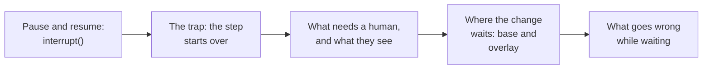
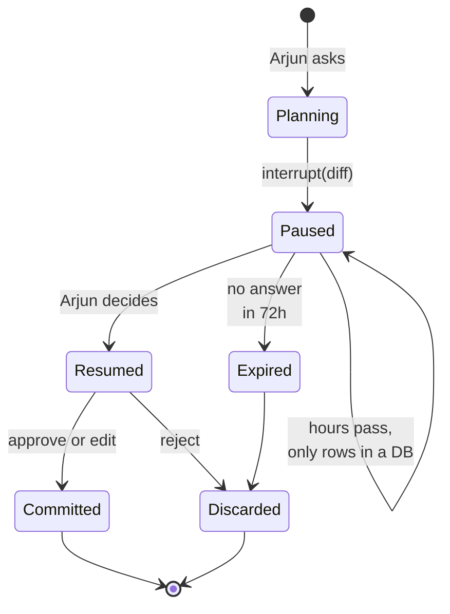
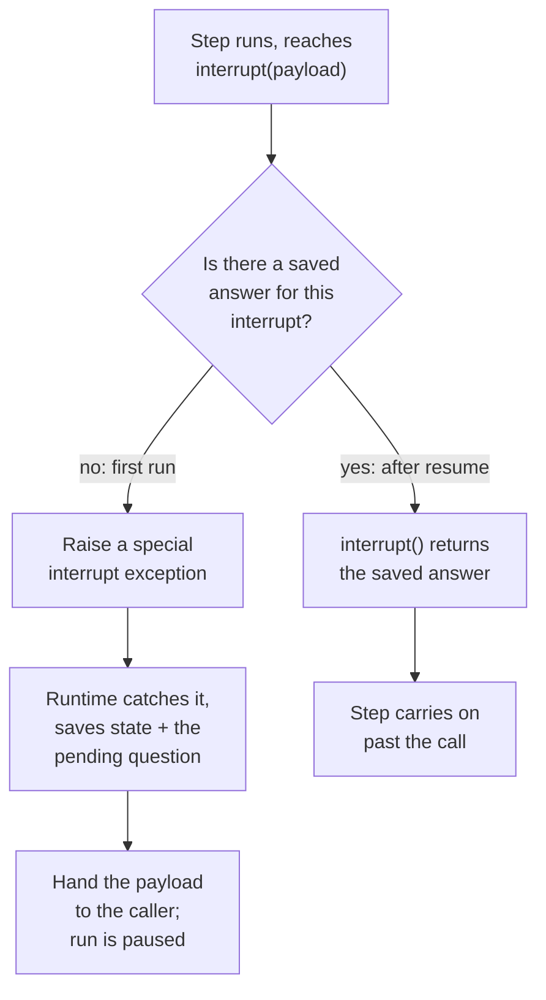
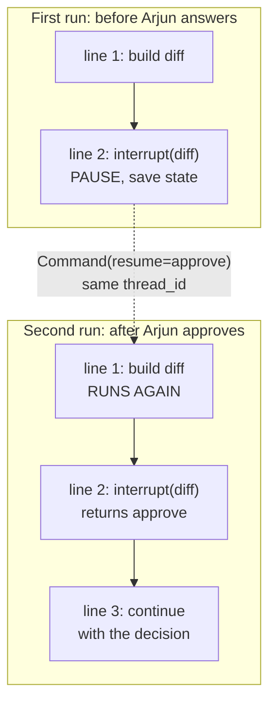
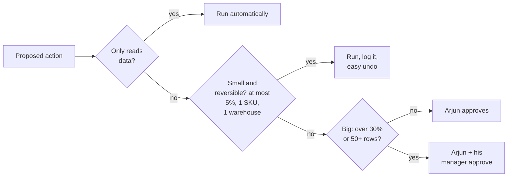
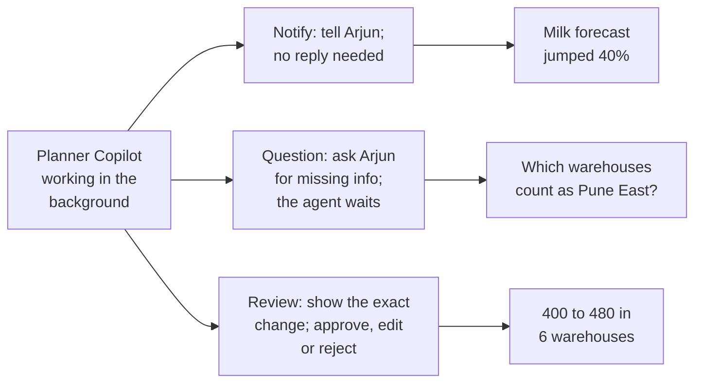
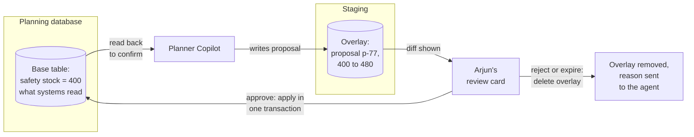
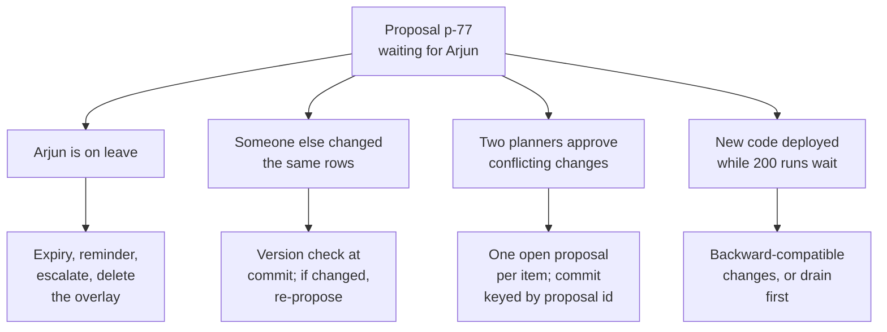

Planner Copilot has worked out its change: milk SKU-881, 6 Pune warehouses, safety stock from 400 to 480 each. Now it must stop, show Arjun exactly what it is about to do, wait (maybe until tomorrow, maybe across a deploy), and continue only with his decision.

Chapter 6 already gave you half of the answer: the **checkpointer** saves the whole run after every step, so a run can disappear from memory and come back later. The other half is a way to stop on purpose. Together they give you **human-in-the-loop (HITL)**: a design where an agent pauses at chosen points so a person can approve, edit or reject what it is about to do.



## 1. Pausing a run: interrupt() and resume

LangGraph gives you two pieces:

- `interrupt(payload)`, called inside a step, pauses the run and hands `payload` (for example the proposed change) back to whoever started the run.
- `Command(resume=value)`, passed in when the run is started again on the same thread, continues it. Inside the step, `interrupt()` now simply *returns* `value`, as if it had been an ordinary function call that took a day to answer.

The life of one proposal:



- **Planning**: the agent reads current stock and forecasts with read-only tools and builds the **diff**, the exact list of what would change from what to what.
- **Paused**: the step calls `interrupt({"diff": ...})`. The state and the pending question are saved, and the call returns to the server with the payload under `result["__interrupt__"]`. No thread, connection or process waits. The paused run is literally just rows in a database table.
- **Resumed**: Arjun clicks a decision in his screen. Any server process calls `graph.invoke(Command(resume={"type": "approve"}), config={"configurable": {"thread_id": "plan-881"}})`. LangGraph loads the saved state and carries on.
- **Expired**: nobody answered in time; a cleanup job closes it (section 6).

Underneath, it is simpler than it looks:



Two requirements follow: a checkpointer (a durable one in production: with the in-memory one, a restart silently loses every paused proposal) and a `thread_id` to find the run again.

> **Pause and think.** When Arjun approves, LangGraph has to "carry on". But a Python function cannot be frozen halfway through and thawed a day later on a different server. So where does execution actually restart?

## 2. The trap: the step starts over

It restarts from the **first line of the step** that paused. On resume, LangGraph runs the whole step again; this time `interrupt()` finds the saved answer and returns it instead of pausing.



Everything before `interrupt()` in that step runs twice. You met this in chapter 6 as idempotency; here it bites every single time.

Correction: "the run continues from the interrupt line" is wrong. It continues from the start of the step.

**Decision point: the code that saves the proposal sits before the interrupt.**

Broken version:

```python
def propose(state):
    diff = build_diff(state)
    db.execute("INSERT INTO staged_changes (plan_id, diff) VALUES (%s, %s)", (state["plan_id"], diff))
    decision = interrupt({"diff": diff})        # on resume, the INSERT runs again
    return {"decision": decision}
```

After Arjun approves, there are two saved rows for one proposal.

Fixed version: give the side effect its own step, and make it safe to repeat anyway:

```python
def stage(state):
    diff = build_diff(state)
    db.execute("""INSERT INTO staged_changes (proposal_id, diff) VALUES (%s, %s)
                  ON CONFLICT (proposal_id) DO NOTHING""", (state["proposal_id"], diff))
    return {"diff": diff}

def review(state):
    return {"decision": interrupt({"diff": state["diff"]})}    # only this step re-runs
```

`stage` finished in an earlier round, so it is not re-run on resume; and if it ever were, the insert keyed by `proposal_id` does nothing the second time.

## 3. The rules interviewers check

The mechanism above explains every rule:

- **Several interrupts in one step are matched by order.** Answers are stored in the order the calls happen. If a condition or a changing list alters how many calls run on resume, answers land on the wrong question. Work out everything that needs approval in an earlier step and interrupt once with the whole batch.
- **Never wrap `interrupt()` in a bare `try/except`.** The pause works by raising a special exception; catching everything swallows it, and the run never pauses.
- **The payload must be plain data** (dicts, strings, numbers), because it is saved in the database.
- **Two branches waiting at once** each have an interrupt id; resume both together with `Command(resume={id_a: {"type": "approve"}, id_b: {"type": "reject", "message": "wrong warehouse"}})`.
- **Breakpoints are different.** `interrupt_before=["tools"]`, set when building the graph, pauses before a step every time, with no payload, like a debugger breakpoint. Real approvals use `interrupt()` inside the step, because it pauses only when your code decides (say, only for changes over 10%) and carries the diff to the reviewer.

Two useful variations:

- **Approval inside the tool.** A tool can call `interrupt()` itself, so every agent that uses `update_safety_stock` gets the approval for free:

```python
@tool
def update_safety_stock(sku: str, warehouse: str, new_qty: int):
    """Change safety stock for one SKU in one warehouse."""
    decision = interrupt({"sku": sku, "warehouse": warehouse, "new_qty": new_qty})
    if decision["type"] == "reject":
        return f"Rejected by planner: {decision.get('reason', 'no reason given')}"
    qty = decision.get("new_qty", new_qty)          # the planner may edit the number
    apply_change(sku, warehouse, qty)
    return f"Safety stock for {sku} in {warehouse} set to {qty}"
```

- **Checking the human's answer.** People make typos: Arjun types 4800 instead of 480. Validate the resume value and, if it is invalid, ask again by looping back to the step with an edge, one `interrupt()` per run of the step, never a `while` loop of interrupts inside it.

**The same thing in `create_agent`.** LangChain's `HumanInTheLoopMiddleware` (chapter 5) pauses before chosen tools:

```python
agent = create_agent(
    model, tools=[get_stock, get_forecast, update_safety_stock],
    middleware=[HumanInTheLoopMiddleware(interrupt_on={
        "update_safety_stock": {"allowed_decisions": ["approve", "edit", "reject"]},
        "get_stock": False,
    })],
    checkpointer=PostgresSaver.from_conn_string(DB_URL),
)
```

The reviewer can `approve` (run as proposed), `edit` (run with changed arguments), `reject` (skip it and tell the model why), or `respond` (send back a message as the tool's result without running it). Resume with `Command(resume={"decisions": [{"type": "approve"}]})`.

Correction: do not use `respond` to refuse a call. The model treats a responded result as success; use `reject` with a reason.

> **Pause and think.** Version one of Planner Copilot asks Arjun to approve *everything*, including "show me milk stock in Kothrud". After a week he approves each request in two seconds without reading it. What went wrong, and what should actually need a human?

## 4. Designing the approval: what needs a human, and what they see

The approval step became theatre: it slows everyone down and catches nothing. Approvals are like a two-person rule for a bank vault: valuable precisely because they are rare and deliberate.

**Sort actions by damage and reversibility:**



The thresholds live in code, not in the prompt: a prompt can be ignored or overridden, a check in code cannot.

**Approve the exact change, not the idea.** If Arjun approves a sentence ("raise milk safety stock 20%") and the agent builds the database update afterwards, the model can still get the details wrong *after* approval: the wrong product, or all of Maharashtra instead of Pune. Arjun must approve the exact change. If he wants a different number, he edits it, and the edited change is exactly what runs.

His **review card** should let him decide in under a minute:

- **the diff**: SKU-881 milk 1L, 6 Pune warehouses, 400 to 480 each, +480 units in total;
- **why**: his request, the agent's reasoning, the forecast numbers it used;
- **risk flags**: "+20% is above the usual 10%", "forecast data is 3 days old";
- **his options**: approve, edit, or reject with a reason.

A thin card ("Approve action #42?") gets rubber-stamped. Track the approval rate and the time to decide: 100% approvals in three seconds each means the gate adds nothing.

**Not every touchpoint is an approval.** LangChain's work on background ("ambient") agents names three patterns:



Asking is better than guessing. And approval is itself an action: check that the person clicking approve is allowed to approve *this* change (their region, their limit), and that someone does not approve their own large change when policy requires a manager (**separation of duties**). Thresholds should come from data: if Arjun approves 99% of "+5% to +10%" changes without edits for a month, that tier can move to automatic-with-audit.

A useful framing from the 12-Factor Agents guide: "contact humans with tool calls". Asking for approval is just another tool the agent can call, `request_approval(diff)`, so pausing and resuming is ordinary control flow rather than a special case.

## 5. Where the change waits: base and overlay

While Arjun thinks, where does the proposed change live? Not in the live table: the ordering systems read it. The safe pattern is like a shopping cart before checkout: the items are chosen, nothing is paid for yet.

- The **base** is the real table that ordering systems read.
- The **overlay** is a staging area holding proposed changes: a separate table, or Redis (a fast in-memory data store) with an automatic expiry time.



- The agent writes its proposal to the overlay; the base does not change, so no ordering system sees anything yet.
- Approve: the overlay is applied to the base in one database transaction, so every row changes or none does.
- Edit: Arjun's values replace the proposed ones, then the same commit runs.
- Reject or expiry: the overlay is deleted, and the reason goes back to the agent as the tool's result, so it can revise its proposal in the same conversation.
- After committing, the agent reads the base back and reports success only if the new values are really there.

> **Pause and think.** Planner Copilot goes live for 60 planners. List everything that can go wrong *between* the moment a proposal is made and the moment it is committed.

## 6. What goes wrong while a proposal waits

Within a month, each of these happens. They are also the standard follow-up questions to any HITL design:



**The approver never answers.** Nothing is applied without approval, so the risk is clutter, not bad writes. Every proposal gets an expiry (24 to 72 hours depending on risk), a reminder, and an escalation to a backup approver. A cleanup job marks expired proposals, deletes their overlay (or the Redis keys simply expire) and tells the requester. Resuming an expired run returns "expired, please ask again".

**The data changed while Arjun was deciding.** Another planner raised the same warehouse's milk stock an hour later. Applying Arjun's diff now would overwrite that change with numbers computed from old data. The fix is **optimistic concurrency**: every row carries a `version` number that goes up on each change; the proposal records the versions it saw; the commit only succeeds if they are unchanged:

```sql
UPDATE safety_stock SET qty = 480, version = version + 1
WHERE id = 'pune-kothrud-881' AND version = 7;
```

If the row is now at version 8, zero rows are updated, the commit is aborted, and the agent rebuilds its proposal on fresh data.

**Two planners approve conflicting changes.** Allow only one open proposal per product and warehouse (a unique constraint on the item plus "pending" status), keep the version check so the second commit fails, and key every commit by its `proposal_id`, so a double-click or a retried request applies the change only once.

**A deploy lands while 200 runs are paused.** Each paused run was saved by the old version of the workflow: its step names, its state fields, its position. Renaming a step or changing a field can make those runs fail to resume. Keep changes backward-compatible (add optional fields, keep step names), version the workflow, or drain first: stop new proposals and let pending ones finish or expire before deploying.

**"Who changed this, and why?"** Keep an append-only audit record of every action: the request, the proposal (tool, arguments, diff, reasoning), the trace id, the approver, the decision and any edits, timestamps, the commit result, and the row versions before and after. Store it outside the agent's own state.

**Measure the human loop itself**: approval rate, edit rate and size, time to decision, the share that expire, and above all **approved changes later reverted**, which shows whether the review catches what it should.

**Test the pauses**: approve, edit and reject paths; resume after a simulated restart; resume twice with the same decision (must apply once); resume after the data changed (must abort); resume an expired proposal (must refuse); resume a checkpoint saved by the previous version of the workflow.

## 7. Complete example: Planner Copilot's approval workflow

```python
class State(TypedDict):
    request: str
    proposal_id: str
    diff: dict
    decision: dict

def propose(state):
    diff = plan_change(state["request"])                        # model + read-only tools
    pid = hashlib.sha256(json.dumps(diff, sort_keys=True).encode()).hexdigest()[:16]
    stage_overlay(pid, diff, ttl_hours=72)                       # upsert keyed by pid
    return {"proposal_id": pid, "diff": diff}

def review(state):
    return {"decision": interrupt({"proposal_id": state["proposal_id"], "diff": state["diff"]})}

def commit(state):
    d = state["decision"]
    if d["type"] == "reject":
        discard_overlay(state["proposal_id"])
        return {}
    diff = d.get("edited_diff", state["diff"])
    apply_with_version_check(state["proposal_id"], diff)        # version check, idempotent by pid
    return {}

g = StateGraph(State)
g.add_node("propose", propose)
g.add_node("review", review)
g.add_node("commit", commit)
g.add_edge(START, "propose")
g.add_edge("propose", "review")
g.add_edge("review", "commit")
g.add_edge("commit", END)
app = g.compile(checkpointer=PostgresSaver.from_conn_string(DB_URL))

cfg = {"configurable": {"thread_id": "plan-881"}}
first = app.invoke({"request": "Raise milk SKU-881 safety stock 20% in Pune"}, cfg, durability="sync")
card = first["__interrupt__"][0].value                          # shown to Arjun
app.invoke(Command(resume={"type": "approve"}), cfg)            # later, from any process
```

Expected behaviour:

- The first call returns as soon as `review` pauses. `card` holds the proposal id and the diff. The base table still says 400; the overlay holds 480.
- Restarting the server between the two calls changes nothing: the second call loads the saved state from Postgres and continues.
- On resume only `review` runs again, and immediately returns the decision. `propose` finished in an earlier round, so the overlay is not written twice.
- Approve sets the base to 480 once. Resuming twice with the same decision does not apply it twice, because the commit is keyed by `proposal_id`.
- If another planner changed one of the rows in between, the version check aborts the commit.
- Reject deletes the overlay; the base table is never touched.

## What breaks next

Ask FreshCart and Planner Copilot are both in production. Three months later, the COO forwards a screenshot: Ask FreshCart told an agent that bakery items can be refunded within 48 hours. The policy says 12. Her message has one line: "Is this thing actually working, and how would we even know?"

The honest answer, right now, is "agents seem to like it". That is not an answer.

> **Pause and think.** How would you *prove* that an AI assistant works, when its answers are free text that varies from run to run, and there is no unit test for "a good answer"? Where would you even start: with a metric, with a library, or with something else?

That is chapter 8.
