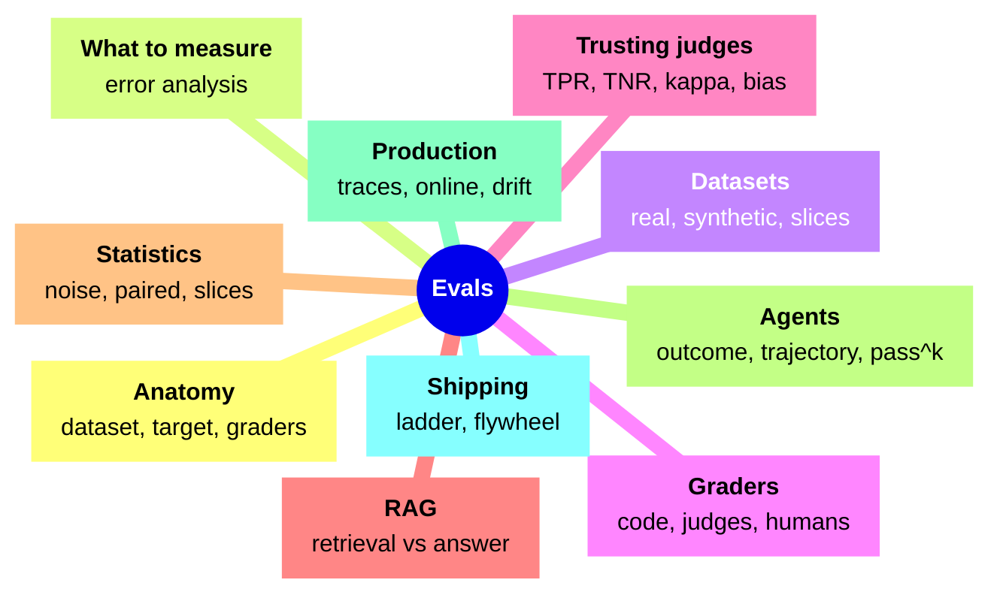
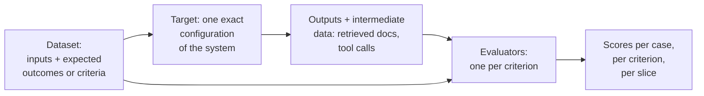
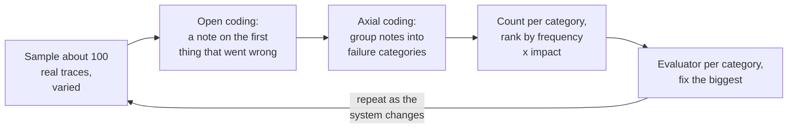
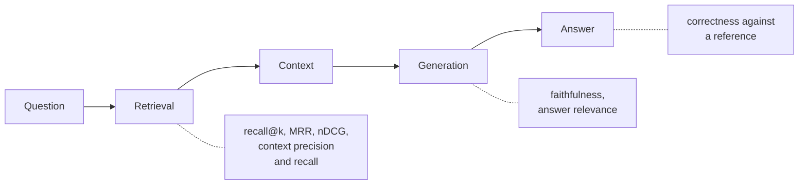
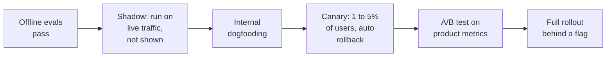
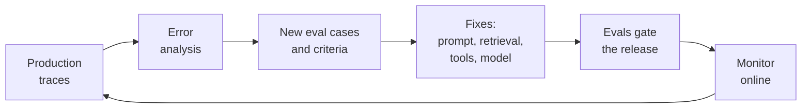

An LLM system has no specification you can execute. The same input can produce different outputs, a correct answer can be worded a thousand ways, and every change (a prompt edit, a model upgrade, a new document in the index) can fix some cases while silently breaking others. **Evals turn "it seems to work" into a measured claim.** They are the test suite, the definition of "good" and the early-warning system of an AI product, and the clearest interview signal of production experience: anyone can call an API; few can say how they know it works and how they would know it stopped working.



## 1. Anatomy of an eval



- **Dataset**: the cases. Each is an input plus what the grader needs: a reference answer, facts that must appear, the documents that should be retrieved, or just criteria.
- **Target**: the exact system under test, identified by a **configuration version** (prompt version, model snapshot, retrieval settings, tools, index version). A score without its configuration means nothing.
- **Outputs**: record intermediate artefacts (retrieved chunks, tool calls) as well as the final answer; many graders need them.
- **Evaluators**: functions that score one output on one criterion: `evaluate(inputs, outputs, reference) -> score`.
- **Aggregation**: per criterion and per **slice** (a subgroup: question type, language, customer tier). One run of a dataset against a target is an **experiment**; decisions come from comparing experiments.

Distinctions to name:

- **Offline vs online**: offline evals run a fixed dataset before release ("is this version good enough to ship?"); online evals grade sampled live traffic after release ("is what is running still good?").
- **Reference-based vs reference-free**: the first compares with a known-good answer (correctness); the second judges the output on its own or against its inputs (groundedness, relevance, format). Production traffic has no references, so online evals are reference-free.
- **Capability vs regression**: capability evals hold hard cases the system cannot yet do reliably, and their pass rate starts low; regression evals hold what already works and should stay near 100%, and a drop blocks release. A capability case that becomes reliable graduates to the regression suite.
- **Component vs end-to-end**: component evals test one stage (retrieval, a classifier, one tool call); end-to-end evals test the whole request. End-to-end tells you whether users are served; component evals tell you what to fix.

Say it like this: "An eval is a dataset, a pinned configuration of the system, evaluators that each score one criterion, and results aggregated per criterion and slice. Offline evals gate releases with regression and capability suites; online evals score sampled production traffic without references."

## 2. Deciding what to measure: error analysis

The common mistake is to start from metrics: install a library, compute "helpfulness" and "coherence", report averages. Generic metrics rarely match how **your** system fails, so they move without meaning. **Measure your failures, not someone's list of qualities.**



1. **Sample traces**: about 100 complete records (input, intermediate steps, output), varied across types and time. Without traffic, generate realistic inputs (section 3) and run them.
2. **Open coding**: read each trace and write a short, specific note on the **first** thing that went wrong. Later errors are often consequences of the first.
3. **Axial coding**: group the notes into **failure categories** and count them. Keep reading until new traces stop producing new categories (**saturation**).
4. **Prioritise** by frequency times impact. The top categories become your first evaluators, and often your first fixes: many failures are found and fixed by reading, before any metric exists.

Rules that make it work:

- A **domain expert** reads; one person owns the definition of good.
- Judgements are **binary per category**: the failure is present or not.
- Re-do it after major changes; failure categories shift.

"An LLM feature has no evals today; where do you start?": run error analysis on about 100 traces, turn the top failure categories into binary criteria, build a small dataset around them, grade with code wherever possible and with calibrated judges elsewhere, wire it into CI, then add online monitoring.

## 3. Datasets

Sources, best first:

- **Production traces**, sampled across slices and time, especially failures, complaints and escalations.
- **Failure cases from error analysis**, each kept forever as a regression case.
- **Synthetic cases to fill gaps**: list the dimensions that matter (user type, intent, difficulty, language, edge condition), combine them, and have an LLM write realistic inputs for each combination. Generating from dimensions gives coverage; "generate 50 questions" gives 50 near-duplicates.
- **Adversarial cases**: injections, out-of-scope requests, abusive input.
- **Unanswerable cases**: questions whose answer is not in the data, to test abstention.

Labels, as needed per criterion: reference answers, must-include facts, relevant document ids, expected tool calls, rubrics.

Size: start with 50 to 100 targeted cases, grow to hundreds, with enough cases in every slice you will make decisions on. Hygiene: version the dataset, deduplicate, keep eval cases out of prompts and few-shot examples, refresh from production, and keep a held-out set you never tune on.

"Your golden set is 50 synthetic questions; what can't it tell you?":

- How real users phrase things, the real mix of question types, messy or multi-turn inputs, and failure modes nobody imagined.
- Synthetic questions generated from a passage reuse its words, so retrieval looks better than it will be in production.
- At 50 cases, a difference of a few points is noise (section 7).

## 4. Graders

- **Code**: exact match, regex, JSON schema validation, numeric tolerance, running generated code against tests, executing generated SQL and comparing result sets, checking that a required tool was called with the right arguments. Cheap, fast, deterministic: use code wherever the criterion allows.
- **LLM judges**: for semantic or subjective criteria such as groundedness, relevance, tone and policy compliance. Flexible and scalable, but they must be validated (section 5).
- **Humans**: domain experts produce gold labels, calibrate judges and grade high-stakes or ambiguous cases. Slow and expensive; the ground truth everything else is checked against.

**Binary pass/fail beats 1 to 5 scores.** Binary forces a precise definition of good, is easier for people and judges to agree on, and aggregates into an interpretable rate. Scales drift, middle values are ambiguous, and annotators disagree on what a 3 is. If you need nuance, use several binary criteria.

## 5. LLM judges, and how to trust them

Designing a judge:

- **One criterion per judge**, with a precise definition and examples of a pass and a fail.
- **Give it what it needs**: the question, the context, the answer and the reference, as relevant.
- **Critique first, verdict last**: a short reasoning field, then a binary verdict, in structured output, at low temperature.
- Prefer a **different model family** from the generator.

A groundedness judge, in outline:

```text
You check whether an answer is supported by the provided context.
PASS: every factual claim in the answer is stated in or directly implied by the context.
FAIL: any claim is missing from the context, contradicts it, or adds specifics
(numbers, names, dates) the context does not contain.
"Not in the documents" answers are PASS when the context lacks the answer.
Return JSON: {"critique": "<which claims are or are not supported>", "verdict": "PASS" | "FAIL"}
<context>...</context> <question>...</question> <answer>...</answer>
```

### Calibrating a judge against people

1. A domain expert labels 100 to 200 examples, with both passes and fails.
2. Split them into a development set (to improve the judge prompt) and a test set (to measure it once).
3. Measure on the test set:
   - **TPR (true positive rate)**: of the cases people passed, the fraction the judge passed.
   - **TNR (true negative rate)**: of the cases people failed, the fraction the judge failed. Judges tend to be lenient, so TNR is usually the weak number.
   - Raw accuracy hides this when most cases pass.
4. **Cohen's kappa** measures agreement beyond chance: `kappa = (po - pe) / (1 - pe)`, where po is the observed agreement and pe the agreement expected by chance. With 40 items, agreement on 34 gives po = 0.85; if the human and the judge each label half as pass, pe = 0.5 x 0.5 + 0.5 x 0.5 = 0.5, so kappa = (0.85 - 0.5) / 0.5 = 0.70: substantial agreement.

**Correcting a measured rate for an imperfect judge**: if the judge reports a pass rate p_obs, the true rate is approximately `(p_obs + TNR - 1) / (TPR + TNR - 1)`. With p_obs = 0.80, TPR = 0.90 and TNR = 0.85: (0.80 + 0.85 - 1) / (0.90 + 0.85 - 1) = 0.65 / 0.75, about 0.87.

### Judge biases and their fixes

- **Position bias** (in pairwise comparisons, prefers the first or second answer): run both orders and count only consistent verdicts.
- **Verbosity bias** (prefers longer answers): say length is not quality; compare at similar lengths.
- **Self-preference** (prefers outputs of its own model family): use a different family.
- **Leniency and agreeableness** (passes what it is shown): measure TNR; include clear fail examples in the prompt.
- **Anchoring on the reference** (fails correct answers worded differently): define equivalence explicitly.

"Your production grounding check uses the same model family as the generator; what is the risk?": correlated blind spots. Both models make the same kind of unsupported inference, so the checker approves exactly the errors it exists to catch. Use another family, or prove its TNR on known-bad examples.

Say it like this: "I trust a judge only after calibrating it against an expert's labels: a dev set to tune the prompt, a test set to report TPR and TNR, because judges are lenient and accuracy hides that, plus Cohen's kappa for agreement beyond chance. I control position, verbosity and self-preference bias, use a different model family from the generator, and correct measured rates for the judge's error rates."

## 6. Evaluating RAG



Score each stage separately so a failure points to its stage.

**Retrieval metrics** (need labels saying which chunks are relevant to each question):

- **recall@k**: the fraction of the relevant chunks found in the top k.
- **precision@k**: the fraction of the top k that is relevant.
- **MRR (mean reciprocal rank)**: 1 / rank of the first relevant result, averaged over questions.
- **nDCG@k**: rewards relevant results more the higher they rank (each hit is discounted by log2(rank + 1)), normalised by the best possible ordering.

Worked example: three relevant chunks sit at ranks 2, 7 and 11.

- recall@5 = 1/3 = 0.33; recall@10 = 2/3 = 0.67.
- MRR = 1/2 = 0.5.
- nDCG@10 with binary relevance: DCG = 1/log2(3) + 1/log2(8) = 0.631 + 0.333 = 0.964. The ideal order puts the three at ranks 1 to 3: 1 + 0.631 + 0.5 = 2.131. nDCG@10 = 0.964 / 2.131 = 0.45.

**Answer metrics**:

- **Faithfulness (groundedness)**: the fraction of the answer's claims supported by the retrieved context. Reference-free.
- **Answer relevance**: does the answer address the question? Reference-free.
- **Context precision**: are the relevant chunks ranked at the top of the context? Needs relevance labels or a reference answer (a reference-free variant judges against the generated answer).
- **Context recall**: does the context contain everything the reference answer needs? Needs a reference.
- **Correctness**: does the answer match the reference? Needs a reference.

**Reading them together**: faithfulness is not correctness. "Faithfulness is 0.95 but users say the answers are wrong" means the model is faithfully repeating the wrong evidence: stale or superseded documents, the wrong section, an incomplete context, or a misunderstood question. Measure context recall and correctness against references, check document versions and freshness, slice by topic, and check that the faithfulness judge itself is not lenient.

## 7. Reading results without fooling yourself

- **Noise**: the standard error of a pass rate is `sqrt(p x (1 - p) / n)`. At p = 0.8 with n = 51 it is about 0.056, so the 95% interval is about plus or minus 0.11. A 0.02 difference on 51 questions is noise; trust it only with far more questions or a paired analysis.
- **Paired comparison**: run both versions on the same questions and look at the **discordant pairs**, questions where one passes and the other fails. A bootstrap over questions, or McNemar's test, says whether the difference is real. Pairing removes question-difficulty noise.
- **Non-determinism**: run each case several times and report the mean and the spread.
- **Slices**: an average can rise while an important slice regresses. Report per slice, and set guardrails per slice.
- **Look at the examples that changed**, not just the numbers.
- **Overfitting**: a prompt tuned on the eval set scores well on it. Keep a held-out set.
- **One primary metric plus guardrail metrics** (quality up, while latency, cost and safety stay within limits).

## 8. Running evals in the workflow

- **On every change** (prompt, model, retrieval settings, tools): run the fast regression suite in CI with blocking thresholds per slice against the current baseline.
- **Nightly or before release**: the larger suite with judges and capability cases.
- Track experiments by configuration version; keep outputs so graders can be re-run without regenerating.
- Control eval cost: cache outputs, sample, and screen with cheaper judges before expensive ones.

## 9. Evaluating agents

Agents are harder to evaluate: many steps, tools with side effects, many valid paths, non-determinism and state.

Three levels:

- **Outcome**: was the goal achieved? Check the **final state of the environment**, not the agent's claim: the refund exists with the right amount, the tests pass, the record changed correctly.
- **Trajectory**: the path: required tools called, forbidden ones not, arguments correct, order respected where it matters, steps within budget.
- **Single step**: given this exact state, was the next action right? Unit tests for decisions, cheap and precise.

**Trajectory evaluation: exact match is too strict.** There are many valid orders and harmless extra steps. Check instead: required calls present (subset match), forbidden calls absent, ordering constraints only where they matter (verify before refund), argument correctness, step count within budget, and an LLM judge with a rubric for reasonableness.

**Environments**: sandboxed copies of the tools and data with seeded state (test databases, mock services), reset before every trial, so outcome checks are deterministic. For multi-turn agents, a **simulated user**: an LLM playing a persona with a goal and private information it reveals only when asked; grade the final state of the database and the conversation's policy compliance.

**Reliability: pass@k and pass^k.** With per-trial success probability p:

- **pass@k** = 1 - (1 - p)^k: the chance that **at least one** of k tries succeeds. Fits tasks where a person or a verifier picks the best of several attempts (code generation with tests).
- **pass^k** = p^k: the chance that **all** k tries succeed: consistency. Fits customer-facing agents, where every customer gets one attempt.
- At p = 0.8: pass@3 = 1 - 0.2^3 = 0.992, while pass^3 = 0.8^3 = 0.512. An agent that "works 80% of the time" handles three customers in a row correctly only half the time.

**Multi-turn conversational agents**: simulated users across personas and goals, including users who change their minds, give partial information or go off topic; grade per turn (policy, tool use) and per conversation (goal completed, turns to resolution, recovery from misunderstandings, context carried across turns).

Agent failure categories to score: wrong tool, wrong arguments, loops, premature "done", policy violations, ignored tool errors, claimed actions that never happened.

Say it like this: "For a tool-using agent I build a sandboxed environment with seeded state and a simulated user, grade the final state of the environment rather than the agent's claim, check trajectories with required and forbidden calls instead of exact match, and run each task several times to report pass^k, because a customer-facing agent has to be right every time, not once in three tries."

## 10. Production: traces, online evals and drift

**Log for every request**: request and session ids, user or tenant, prompt, model and configuration versions, inputs, retrieved document ids and scores, every tool call with arguments, results and errors, the output, finish reason, input, cached and output tokens, cost, latency (time to first token and total), guardrail outcomes and user feedback. Mask sensitive data and set retention.

**Online evals**: run reference-free evaluators (groundedness, policy, PII, format) on a sample of live traffic, and track implicit signals:

- thumbs-down and regenerate rates;
- escalations to humans;
- abandonment, and users rephrasing the same question;
- conversation length to resolution;
- refusal rate;
- format and validation errors;
- tool error rate;
- latency and cost per resolved task.

Explicit feedback is sparse and biased toward the unhappy, so implicit signals matter more.

**Drift** comes from three places: inputs (new topics, languages, user types), data (the corpus changed), and the model (a provider update behind the same name).

"The provider silently updated the model; how do you find out before users do?": pin dated model snapshots where offered; run a scheduled canary eval suite against the live endpoint every day; watch output statistics (length, refusal rate, format errors, judge scores) for shifts; alert on change and investigate before users report it.

## 11. Shipping safely



- Each rung adds real-world exposure while limiting the damage; any rung can roll back.
- For agents that act, ladder the **autonomy** too: suggest-only, then act with approval, then act alone for low-risk actions.

"A stakeholder wants to launch, but the eval evidence is weak": state what is measured and how uncertain it is, then offer a bounded launch (a canary or one segment, human review or suggest-only mode, monitoring, a kill switch and agreed success criteria) plus a time-boxed plan to strengthen the evals. Neither block blindly nor launch blindly.

## 12. The flywheel, and how evals fail



Every production failure becomes an eval case; every fix is proven on the evals; every release is monitored. The dataset grows from reality, which is why mature teams improve quickly.

How evals fail:

- **Vibes**: a few hand-tried prompts instead of a dataset.
- **Generic metrics** unrelated to the real failures.
- **Unvalidated judges** with unknown TPR and TNR.
- **Unrepresentative or stale datasets**; synthetic-only sets.
- **Overfitting** to the eval set; leakage of eval cases into prompts.
- **Too few cases** to detect the differences claimed.
- **Averages only**, hiding slice regressions.
- **Final answers only** for agents, ignoring trajectories and side effects.
- **Ignoring cost and latency** in the quality decision.
- **No re-run after model updates**, and nobody owning the eval set.

## Thinking checklist

- What are this system's top failure categories, from reading real traces?
- Which criteria can code check, which need a judge, and has each judge been calibrated?
- Is the dataset made of real traffic, with every slice I decide on represented?
- Is the difference I see larger than the noise for this sample size?
- For an agent: am I checking the real end state, and how consistent is it over repeated runs?
- What online signal would show me tomorrow that quality dropped, and who gets the alert?
