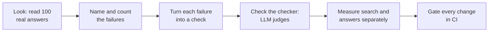
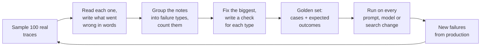
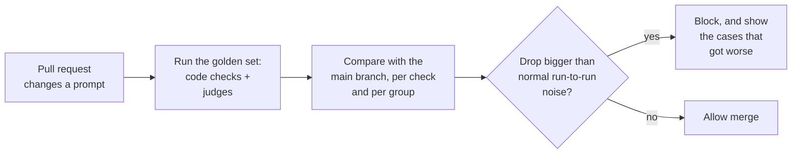
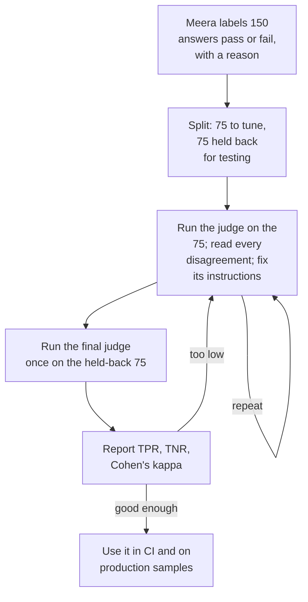
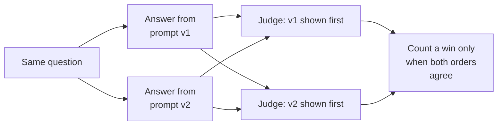
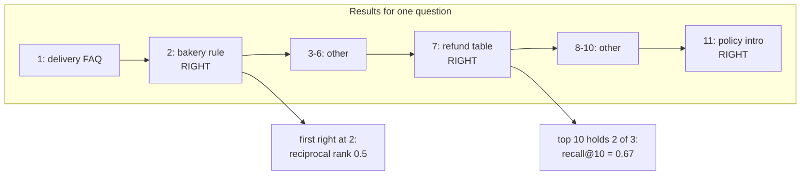
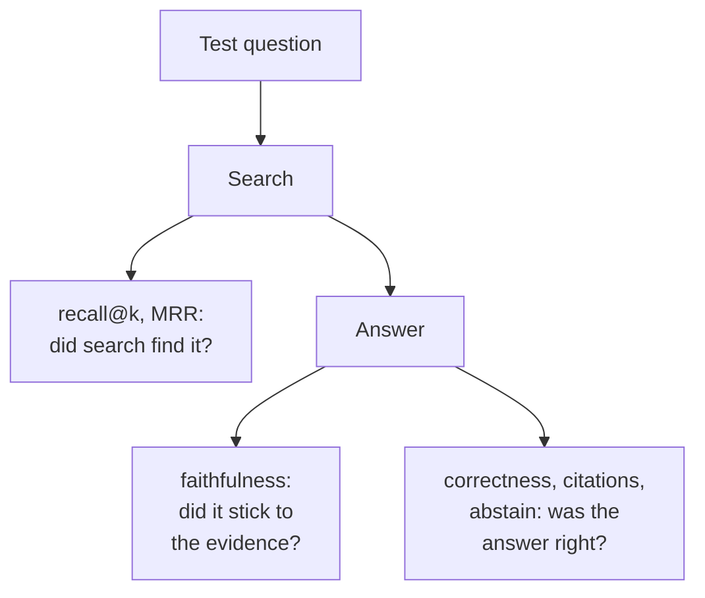

The COO's question sits in your inbox: "Is this thing actually working, and how would we even know?" Attached is the screenshot: Ask FreshCart said bakery items can be refunded within 48 hours. The policy says 12.

The tempting first move is to install an evaluation library, run it, and report "helpfulness: 4.1 out of 5". That number would tell the COO nothing: not what is wrong, how often, or what to fix. This chapter does it the way the best practitioners do (Hamel Husain and Shreya Shankar's widely taught approach, and Anthropic's guide to agent evals): look first, name the failures, count them, and only then measure, with instruments you have checked.



## 1. What an eval is

An **eval** (evaluation) is a test for an AI system: give it an input, then grade its output. Think of an exam rather than a unit test. A unit test checks `add(2, 3) == 5`. An answer like "Bakery items can be refunded within 12 hours if reported with a photo" has many correct wordings, so "grading" can mean an exact check in code, a judgement by another model, or a person's verdict.

Two words you will use constantly:

- A **trace**: the full record of one request, which you met in chapter 4: the question, the chunks retrieved and their scores, any tool calls, the final prompt, the answer, the time and the tokens.
- A **golden set**: a fixed, versioned collection of test cases with their expected outcomes, run against every change to the system.

## 2. Look before you measure: error analysis

A doctor does not prescribe before reading the charts. Week one:



1. **Sample 100 traces** from production, spread across question types and days.
2. **Open coding**: read each trace and write a short note in plain words: "cited the 2023 bakery policy", "never searched, answered from memory", "right chunk found, wrong number in the answer", or "fine".
3. **Axial coding**: group the notes into categories and count them. FreshCart's result:

| Failure category | Count of 100 |
|---|---|
| Outdated document version retrieved | 11 |
| Right chunk retrieved, answer contradicts it | 6 |
| Order question answered without looking up the order | 5 |
| Answer too long for agents to read on a call | 4 |

Now you know what to fix first, and it is not a prompt problem: the biggest category is old chunks that were never deleted when policies changed (chapter 2, section 6). That is the bakery bug.

Correction: generic metrics ("helpfulness", text-similarity scores, a library's default score) rarely track whether a product works. Checks built from your own failure categories do.

> **Pause and think.** You have four failure categories. For each one, how would you check automatically whether a new answer has that problem? Which of the four could plain code check, and which need judgement?

## 3. Turning failures into checks

**Code first**, because code checks are cheap, fast and never disagree with themselves:

- "every cited chunk is the latest version of its document";
- "the order tool was called whenever the question contains an order id";
- "the answer is under 120 words".

**A model as judge** only where code cannot decide, such as "is the answer actually supported by the chunks it cites?" (section 4). **People** to label examples, so the judge itself can be checked.

**Pass or fail, not 1 to 5.** People, and models, disagree about whether an answer is a 3 or a 4. They agree far more on "does it cite the correct policy: yes or no?". A failed yes/no check also tells you exactly what to fix; "3.4 average" does not. Capture nuance as several separate yes/no checks, each with a short written reason.

**Two kinds of test suite:**

- **Capability evals** ask "can it do this hard thing yet?": questions about several orders at once, questions in Marathi. The pass rate starts low and you work to raise it.
- **Regression evals** ask "does it still do what it did yesterday?": tasks it reliably passes. The pass rate should stay near 100%, and a drop blocks the change. Once a capability task is reliably solved, it moves into the regression suite.

Keeping them apart stops a noisy capability score from blocking every deploy, and stops a real regression hiding inside an average.

**Building a golden set that means something:**

- **Size**: start with 50-100 cases; grow towards a few hundred. Anthropic's guide suggests 20-50 tasks drawn from real failures is already enough to start.
- **Spread**: cover every question type, city, language and difficulty, so you can report results per group, not just one average.
- **Awkward cases**: unanswerable questions, ambiguous ones, adversarial ones (instructions hidden in a document), questions about recently changed policies.
- **Synthetic data, carefully**: when real data is thin, have a model generate cases from a grid (question type x city x difficulty x persona) rather than "write 100 questions", which yields 100 near-copies. Review every generated case.
- **Label the outcome**, not just an answer: the correct source chunks, the facts the answer must contain, and anything it must not say.

**Decision point: your golden set is 50 questions you wrote while reading the documents. What can it not tell you?** How agents really ask (shorter, messier, several questions at once, typos; questions written from a document reuse its words, which makes search look better than it is). Small differences (one question flipping is 2%). Failures you never imagined. Fix: sample real production questions, label the failures, grow the set every week.

**Gate changes in CI** (continuous integration, the automatic checks that run on every code change). Model outputs vary between runs, so make the gate reliable:



Compare against the main branch rather than a fixed number; run unstable cases more than once; show *which* cases changed; cache model responses for unchanged inputs to control cost.

> **Pause and think.** "Is every claim in this answer supported by the cited chunks?" needs judgement, so you ask another model to grade it. The COO immediately asks the question every interviewer asks next: "And who checks the judge?"

## 4. LLM judges, and checking the checker

**LLM-as-judge** means using a language model to grade another model's output against written criteria. Three setups: one output graded pass or fail against a criterion; an output compared with a known-good reference answer; or two outputs compared to pick the better one (**pairwise**).

A judge is a measuring instrument. A kitchen scale that always reads 200 grams too low is worse than no scale, because you trust it. So you calibrate the judge against people before trusting it:



- **Labels** come from the person who knows the policies best, covering every failure category.
- The **held-back** 75 are used once, at the end, so the reported number has not been tuned to.
- **TPR** (true positive rate): of the answers Meera passed, the share the judge also passed. **TNR** (true negative rate): of the answers Meera failed, the share the judge also failed. TNR matters most: a judge that misses failures gives false comfort, and a judge that never fails anything has a TNR of zero.
- Re-check whenever the judge's model or instructions change.

**Cohen's kappa** measures agreement after removing the agreement that pure chance would produce. Two people flipping coins agree half the time; that is not skill. `kappa = (observed agreement - chance agreement) / (1 - chance agreement)`. Worked example: 40 answers; you and the judge agree on 34; each of you marks 20 as pass.

- Observed agreement = 34 / 40 = 0.85.
- Chance agreement: both pass 0.5 x 0.5 = 0.25, both fail 0.25, total 0.5.
- kappa = (0.85 - 0.5) / (1 - 0.5) = 0.70, usually read as substantial agreement.

**How judges go wrong:**

- **Position bias** (pairwise): prefers whichever answer is shown first. Run both orders and count only consistent verdicts.
- **Verbosity bias**: prefers longer answers. Write criteria about content, not length.
- **Self-preference**: prefers answers from its own model family. Judge with a different family, especially when the judge checks the same model that wrote the answer, which would share its blind spots.
- **Leniency**: passes too much. Include failing examples in its instructions, ask for its reasoning before its verdict, and watch TNR.
- **Vague criteria**: "is it helpful?" produces noise. One narrow criterion per judge.

Shreya Shankar's research ("Who Validates the Validators?") found **criteria drift**: grading real outputs changes what people think the criteria should be. Expect to rewrite the rubric after labelling; that is normal.

A judge prompt that works:

```text
Check one property: is every factual claim in ANSWER supported by CONTEXT?
Supported means stated in, or directly implied by, the context. Ignore style.
1. List each claim. 2. For each, quote the supporting context or write NONE.
Then output JSON: {"critique": "...", "grounded": true or false}.
grounded is false if any claim is NONE.
<two passing and two failing examples, each with its critique>
CONTEXT: ...
ANSWER: ...
```

One criterion, the reasoning before the verdict, a yes/no output, examples of failure as well as success, and structured output.

**Correcting a rate measured by an imperfect judge.** The judge says 82% of production answers are grounded. You know its TPR is 0.90 and its TNR is 0.80. The true rate is not 82%:

`true rate = (observed rate + TNR - 1) / (TPR + TNR - 1)` = (0.82 + 0.80 - 1) / (0.90 + 0.80 - 1) = 0.62 / 0.70 = about 0.89.

(This is the Rogan-Gladen correction from medical testing. It only works when TPR + TNR is clearly above 1, another reason to measure them.)

**Choosing between two prompt versions** is best done pairwise: show the judge both answers to the same question, in both orders, and count a win only when both orders agree.



Judges cost a model call per graded answer. In CI the golden set is small enough to judge fully; in production, judge a random 2-5% of traffic, plus every thumbs-down, plus extra samples of rare groups you care about.

> **Pause and think.** The bakery failure was a *search* problem (the wrong version was found). "Right chunk retrieved, answer contradicts it" is an *answer* problem. To fix the right half, you need numbers that separate the two. What would you measure for search, and what for the answer?

## 5. Measuring search and answers separately

### Search metrics

These need, for each test question, the ids of the chunks that actually answer it (the **relevant** chunks).

- **recall@k**: of all relevant chunks, the share that appear in the top k. "Did we find it?"
- **precision@k**: of the top k, the share that are relevant. "How much noise came with it?"
- **hit rate@k**: did at least one relevant chunk appear in the top k?
- **MRR** (mean reciprocal rank): for each question, 1 divided by the position of the first relevant chunk (1 if first, 0.5 if second, 0.33 if third), averaged. It rewards putting the right chunk at the very top.
- **nDCG@k** (normalised discounted cumulative gain): every relevant chunk earns credit, less the lower it sits. DCG adds up `1 / log2(position + 1)` for each relevant chunk; dividing by the DCG of the perfect order gives a score from 0 to 1.

Worked example. For "bakery refund window", three chunks are relevant, and search returns them at positions 2, 7 and 11:



- recall@5 = 1/3 = 0.33 (only position 2 is in the top 5); recall@10 = 2/3 = 0.67.
- Reciprocal rank = 1/2 = 0.5.
- DCG@10 = 1/log2(3) + 1/log2(8) = 0.631 + 0.333 = 0.964. Perfect DCG@10 (three relevant at positions 1-3) = 1 + 0.631 + 0.5 = 2.131. nDCG@10 = 0.964 / 2.131 = 0.45.
- Reading: the right material is found but ranked poorly. The next step is a reranker (chapter 3).

### Answer metrics

Four metrics popularised by the RAGAS library cover the answer side. They are usually scored by a judge, so the judge needs checking as above.

- **Faithfulness**: the share of the answer's claims supported by the retrieved chunks. "Did it stick to the evidence?" Needs no reference answer.
- **Answer relevance**: does the answer address the question asked? Needs no reference.
- **Context precision**: are the relevant chunks ranked near the top of what was retrieved? Needs relevance labels.
- **Context recall**: of the facts in a known-good reference answer, the share present in the retrieved chunks. "Did search bring back everything needed?" Needs a reference.

Add answer-level checks the business actually cares about: **correctness** against a reference, fact by fact; **citation accuracy** (every cited chunk exists, was retrieved, and supports its sentence); **abstain accuracy** (declines on unanswerable questions, does not decline on answerable ones); **completeness** for multi-part questions.



Low context recall means fix search. High context recall with low faithfulness means fix generation.

**Decision point: faithfulness is 0.95, but agents still say answers are wrong.** Faithfulness only means "agrees with the chunks it was given". So suspect the chunks: an outdated document (exactly the bakery bug), the wrong document (check context recall), or a misread question (answer relevance). Or the judge is lenient: check its TNR.

Correction: faithful is not the same as correct. An answer perfectly faithful to an outdated policy is still wrong.

Also asked: "You report recall@10 on 51 questions. Do you trust a 0.02 improvement?" No: 0.02 of 51 is about one question changing. Look at which questions improved and which got worse, use a paired test across questions (a bootstrap or a sign test), or grow the set to a few hundred.

**Building a RAG test set quickly**: sample chunks across document types, cities and dates; have a model write a realistic question each chunk answers, plus the short answer; review every pair; mix in real questions from production; add unanswerable and multi-chunk questions. Generated questions borrow the chunk's words and overstate quality, so real questions keep the set honest.

You can build all of this with plain scripts. Common tools: **LangSmith** and **Langfuse** (tracing, datasets, experiments, online grading), **promptfoo** (prompt tests in config files, easy in CI), **DeepEval** (test-style assertions), **Ragas** (RAG metrics). The method matters more than the tool.

## 6. Complete example: the metrics and the gate

```python
import math

def recall_at_k(ranked, relevant, k):
    return len(set(ranked[:k]) & relevant) / len(relevant)

def reciprocal_rank(ranked, relevant):
    for i, cid in enumerate(ranked, start=1):
        if cid in relevant:
            return 1 / i
    return 0.0

def ndcg_at_k(ranked, relevant, k):
    dcg = sum(1 / math.log2(i + 1) for i, c in enumerate(ranked[:k], start=1) if c in relevant)
    ideal = sum(1 / math.log2(i + 1) for i in range(1, min(len(relevant), k) + 1))
    return dcg / ideal

def cohens_kappa(human, judge):
    n = len(human)
    p_o = sum(h == j for h, j in zip(human, judge)) / n
    ph, pj = sum(human) / n, sum(judge) / n
    p_e = ph * pj + (1 - ph) * (1 - pj)
    return (p_o - p_e) / (1 - p_e)

def gate(results, thresholds):
    failed = {name: score for name, score in results.items() if score < thresholds[name]}
    return ("BLOCK", failed) if failed else ("PASS", {})
```

Expected behaviour:

- With `ranked = ["faq", "bakery", "x3", "x4", "x5", "x6", "table", "x8", "x9", "x10", "intro"]` and `relevant = {"bakery", "table", "intro"}`: `recall_at_k(..., 5)` is 0.33, `recall_at_k(..., 10)` is 0.67, `reciprocal_rank` is 0.5, `ndcg_at_k(..., 10)` is about 0.45.
- `cohens_kappa` on 40 labels where the two agree on 34 and each marks 20 as pass returns 0.70.
- `gate({"recall@10": 0.81, "faithfulness": 0.88}, {"recall@10": 0.80, "faithfulness": 0.90})` returns `("BLOCK", {"faithfulness": 0.88})`.

## What breaks next

Ask FreshCart now has a golden set, a calibrated judge and a CI gate. The bakery bug cannot come back silently. Two new problems appear:

- **Planner Copilot will not fit these tests.** It takes a dozen steps, calls tools, changes data, and does not behave the same way twice. It can write "Done!" while having updated the wrong warehouse. A golden set of questions and answers cannot see that.
- **Production moves under you.** One Tuesday, answers suddenly get longer and a few start refusing. Nothing in your code changed. The model provider quietly updated the model.

> **Pause and think.** If an agent's final message can claim success without having succeeded, what should you check instead? If it succeeds 8 times in 10, is that "working"? And how would you notice a change you did not make, before the agents do?

That is chapter 9.
