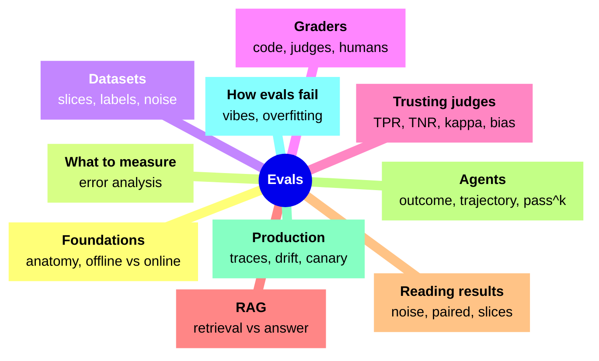
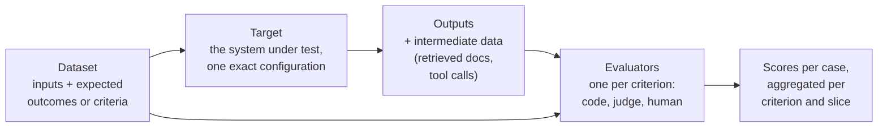
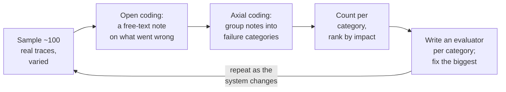
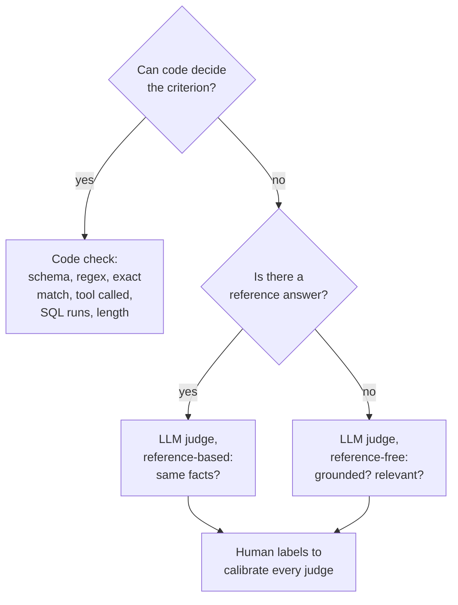
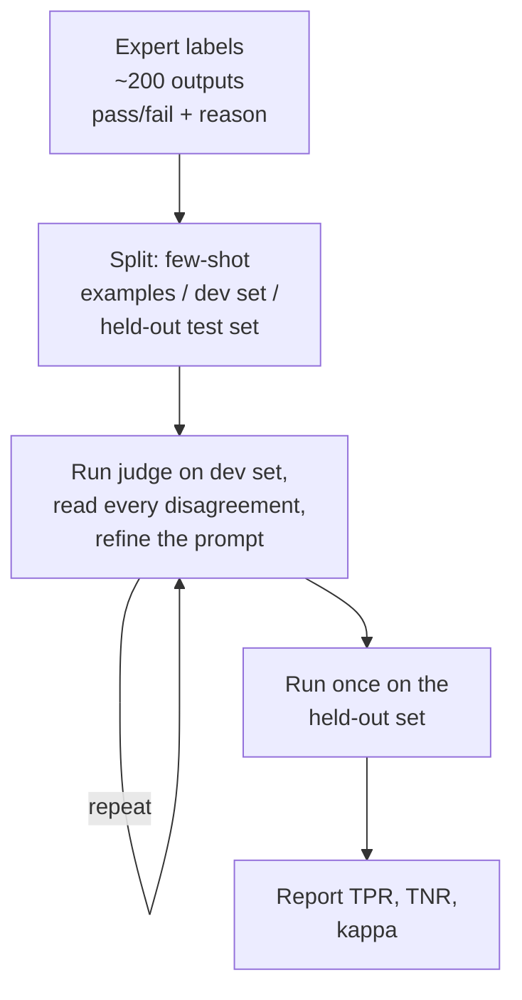
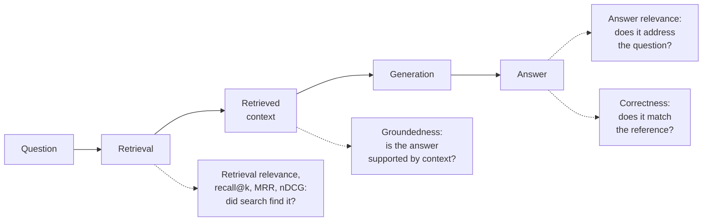
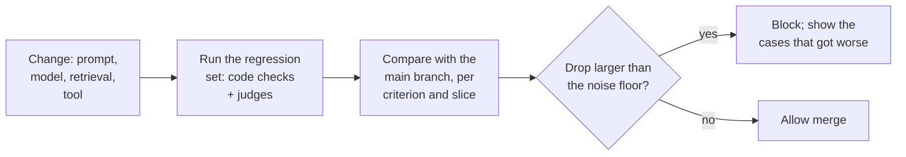

An LLM system has no specification you can run. The same input can produce different outputs, a correct answer can be worded a thousand ways, and every change (a prompt edit, a model upgrade, a new document in the index) can improve some cases while silently breaking others. **Evals are how you turn "it seems to work" into a measured claim.** They are the test suite, the definition of "good", and the early-warning system of an AI product, all at once.

This chapter covers the foundations: what an eval is, how to decide what to measure, how to build the dataset, how graders work (code, LLM judges, people), how to trust a judge, how to measure RAG, how to read results without fooling yourself, and how evals themselves fail. Chapter 9 extends them to agents and production.

## Why evals matter

- **They make change safe.** Without evals, every prompt or model change is a gamble judged by a few hand-tried inputs. With them, a change is a measured experiment, and teams iterate faster because they can see what broke.
- **They define quality.** Writing an eval forces you to say precisely what a good output is. Most "the model is bad" complaints turn out to be undefined requirements.
- **They separate causes.** A good eval tells you not just *that* quality dropped but *where*: retrieval, generation, a tool, one slice of users.
- **They catch what you did not change.** Providers update models, data drifts, users ask new things. Evals running continuously notice before customers do.
- **They are the interview signal.** Anyone can call an API. Being able to say how you know it works, and how you would know it stopped working, is what distinguishes production experience.

Say it like this: "Evals are the test suite and the spec for a non-deterministic system. They turn quality into numbers I can compare across versions, they localise failures to a component, and run continuously they catch regressions I didn't cause."

## The map of this section



## 1. Anatomy of an eval

An **eval** runs a system on a set of inputs and grades what it produces. It has five parts:



- **Dataset**: the cases. Each case is an input plus whatever the grader needs: a reference answer, a list of facts that must appear, the documents that should be retrieved, or just the criteria.
- **Target**: the exact thing under test, identified as one **configuration version** (prompt version, model snapshot, retrieval settings, tools, index version). An eval result without its configuration is meaningless.
- **Outputs**: not only the final answer. Record intermediate artifacts (retrieved chunks, tool calls) because many graders need them.
- **Evaluators**: functions that score one output on one criterion. A typical signature is `evaluate(inputs, outputs, reference) -> score`; reference-free evaluators omit the reference.
- **Scores and aggregation**: per case, then per criterion and per **slice** (a subgroup: question type, language, customer tier). One run of a dataset against a target is an **experiment**; comparing experiments is how you decide.

The distinctions you must be able to name:

- **Offline vs online.** Offline evals run on a fixed dataset before release (in CI). Online evals grade a sample of live production traffic after release. Offline asks "is this version good enough to ship?"; online asks "is what is running still good?".
- **Reference-based vs reference-free.** Reference-based graders compare the output with a known-good answer (correctness). Reference-free graders judge the output on its own or against its inputs (groundedness, relevance, format). Production traffic has no references, so online evals are reference-free.
- **Capability vs regression.** Capability evals measure hard things the system cannot yet do reliably; their pass rate starts low and you work to raise it. Regression evals contain what already works; their pass rate should stay near 100%, and a drop blocks a release. A capability case that becomes reliable graduates into the regression suite. Keeping them separate stops a noisy capability score from blocking deploys and stops a real regression hiding in an average.
- **Component vs end-to-end.** Component evals test one stage in isolation (retrieval, a classifier, one tool call). End-to-end evals test the whole request. You need both: end-to-end tells you whether users are served; component evals tell you which part to fix.

Say it like this: "An eval is a dataset, a target configuration, evaluators that each score one criterion, and aggregation by criterion and slice. Offline evals gate releases; online evals monitor production, reference-free."

## 2. Deciding what to measure: error analysis

The most common mistake is to start from metrics: install a library, compute "helpfulness" and "coherence" scores, and report averages. Generic metrics rarely correspond to how *your* system fails, so they move without meaning and stay flat while users suffer. **Measure your failures, not someone's list of qualities.**

**Error analysis** is how you find them:



1. **Sample traces**: about 100 full records of real requests (input, intermediate steps, output), spread across types and time. If there is no traffic yet, generate realistic inputs (section 3) and run them.
2. **Open coding**: read each trace and write a short, specific note on the first thing that went wrong, in plain words. No predefined categories yet.
3. **Axial coding**: group the notes into **failure categories** and count them. Keep reading until new traces stop producing new categories (**saturation**).
4. **Prioritise** by frequency times impact. The top categories become your first evaluators, and often your first fixes: many failures are found and fixed by reading, before any metric exists.

Rules that make it work:

- **A domain expert does the judging.** The person who knows what a correct answer is (a lawyer, a support lead, a doctor) labels, not whoever is free. One accountable expert beats a committee for consistency.
- **Look at the data yourself, regularly.** Error analysis is not a one-off; repeat it after major changes and on fresh production samples.
- **One evaluator per failure mode.** "Answer is good" is not a criterion. "Cites a document that is no longer current" is.

Correction: "We need an evaluation framework first." You need to have read your traces first. Tools only run the checks; error analysis decides which checks are worth running.

## 3. Datasets

The dataset decides what your eval can see. A perfect grader on an unrepresentative dataset produces confident wrong conclusions.

**Sources**, best first:

1. **Production traces**, especially failures, complaints and escalations. They reflect how users actually phrase things.
2. **Cases from error analysis**, one or more per failure category.
3. **Synthetic cases**, when real data is thin. Generate them from explicit **dimensions** (for example task type x difficulty x user persona), one combination at a time, rather than asking a model for "100 test questions", which yields near-duplicates in the model's own style. Review every generated case.
4. **Adversarial and edge cases**: unanswerable questions, ambiguous ones, very long inputs, inputs containing instructions (prompt injection), recently changed facts.

**What a case contains.** Label the **outcome**, not just one answer string: the facts that must appear, anything that must not appear, the documents that should be retrieved, the tool that should be called, or whether the system should decline. Outcome labels survive rewording; an exact reference answer does not.

**Coverage and slices.** Tag every case with its slice (type, language, tier, difficulty) so results are reported per slice. An average over everything hides a collapse in a small but important slice.

**Size and noise.** A pass rate measured on n cases has a standard error of `sqrt(p(1-p)/n)`. At an 80% pass rate on 100 cases that is 0.04, so the 95% interval is roughly 72% to 88%: two versions scoring 80% and 84% are indistinguishable. Rough guidance: 20 to 50 well-chosen cases are enough to start and catch big breaks; a few hundred are needed to detect differences of a few points.

**Hygiene:**

- **Version the dataset** like code; results reference the dataset version.
- **Keep a held-out set** you never tune on. Repeatedly fixing prompts until a fixed set passes overfits to it, the same way training on the test set does.
- **Refresh it.** Add new production failures every week; retire cases that no longer reflect the product. A stale set measures last quarter's users.
- **Check the references.** Wrong reference answers silently penalise correct outputs; audit cases that the system "fails" repeatedly.

Correction: "Generated questions are as good as real ones." Questions generated from a document reuse its wording, which makes retrieval look better than it is on real, messier queries. Mix in real traffic.

## 4. Graders

Pick the cheapest grader that can decide the criterion reliably.



**Code checks** are deterministic, free and instant: valid JSON against a schema, required fields present, the right tool called with the right arguments, generated SQL executes and returns the expected rows, a citation id exists, length within bounds, no forbidden phrase. Use them for everything they can decide.

**Similarity metrics** (exact match, token F1, BLEU, ROUGE, embedding cosine similarity) compare text with a reference. They are cheap but weak for open-ended output: a correct answer phrased differently scores low, and a fluent wrong answer that shares words scores high. Use exact match for short closed answers (a label, a number, an id); avoid surface similarity as a quality measure for free text.

**LLM-as-judge** uses a model to grade an output against written criteria. It handles meaning ("same facts, different words") where code cannot. It is an instrument that must be calibrated (section 5).

**Human review** is the ground truth that calibrates everything else, and the right grader for high-stakes or subjective criteria. It is slow and expensive, so humans label samples, not everything.

**Binary over scales.** Prefer pass/fail per criterion with a written reason over 1-to-5 scores. People and models disagree constantly on whether something is a 3 or a 4, averages of Likert scores hide what broke, and a failed binary check says exactly what to fix. Capture nuance as several separate binary criteria.

Say it like this: "Code checks first, because they're free and deterministic. LLM judges only for criteria that need meaning, each judge checking one binary criterion. And human labels to calibrate the judges."

## 5. LLM judges, and how to trust them

**Three setups:**

- **Single output, criterion-based**: "Is every claim in this answer supported by these documents? true/false." Reference-free; works online.
- **Reference-based**: "Does this answer state the same facts as the reference, with nothing contradicting it?" Needs labelled data; offline.
- **Pairwise**: "Which of these two outputs better satisfies the criterion?" Best for comparing two versions, where absolute scores are unstable.

**A judge prompt that works** has: one narrow criterion; a precise definition of pass and fail; a few labelled examples including failures; the reasoning requested **before** the verdict; and structured output.

```text
Criterion: every factual claim in ANSWER is supported by CONTEXT.
Supported = stated in, or directly implied by, CONTEXT. Ignore style and length.
Steps: list each claim; for each, quote the supporting text or write NONE.
Return JSON: {"explanation": "...", "pass": true|false}. pass is false if any claim is NONE.
<2 passing and 2 failing examples, each with its explanation>
CONTEXT: ...
ANSWER: ...
```

Use the provider's structured-output mode (a schema with an `explanation` string and a boolean), not string matching on free text: a judge that answers "Correct." instead of "CORRECT" must not flip the score. Temperature 0 reduces, but does not remove, variance.

### Calibrating a judge

A judge is a measuring instrument. An uncalibrated one is worse than none, because you trust it.



Taking "pass" as the positive class:

- **TPR** (true positive rate): of outputs the expert passed, the share the judge passed.
- **TNR** (true negative rate): of outputs the expert failed, the share the judge failed. **TNR matters most**: a judge that misses failures gives false comfort, and a judge that passes everything has perfect TPR and zero TNR.
- **Raw agreement** is misleading when classes are imbalanced: if 95% of outputs pass, a judge that always says pass agrees 95% of the time and catches nothing.
- **Cohen's kappa** corrects agreement for chance: `kappa = (observed - chance) / (1 - chance)`, where chance agreement is `p_expert_pass x p_judge_pass + p_expert_fail x p_judge_fail`. If both pass half the outputs, chance is 0.5; observed agreement of 0.85 gives kappa (0.85 - 0.5) / 0.5 = 0.70, usually read as substantial agreement.

Re-calibrate whenever the judge's model or prompt changes. Expect **criteria drift**: labelling real outputs changes what experts think the criteria should be, so the rubric is usually rewritten after the first labelling pass. That is normal.

### Judge biases and their fixes

- **Position bias** (pairwise): favours the first (or second) output shown. Run both orders; count a win only when both agree.
- **Verbosity bias**: favours longer outputs. Criteria about content, never length; examples where the shorter answer wins.
- **Self-preference**: favours outputs from its own model family, and shares its blind spots. Judge with a different family where possible.
- **Leniency**: passes too much. Failing examples in the prompt, reasoning before verdict, and watch TNR.
- **Vague criteria**: "helpful" produces noise. One narrow, defined criterion per judge.
- **Inconsistency**: the same input graded differently on reruns. Temperature 0, structured output, and measure the rerun disagreement rate.

### Correcting a rate measured by an imperfect judge

If the judge reports an observed pass rate `q`, and you know its TPR and TNR, the estimated true rate is:

`true = (q + TNR - 1) / (TPR + TNR - 1)`

With q = 0.82, TPR = 0.90, TNR = 0.80: (0.82 + 0.80 - 1) / (0.90 + 0.80 - 1) = 0.62 / 0.70 = about 0.89. (This is the Rogan-Gladen correction from diagnostic testing. It is only usable when TPR + TNR is well above 1.)

**Cost.** A judge is a model call per graded output per criterion. Judge the whole offline set; online, judge a sample (a few percent of traffic, plus every negative-feedback case, plus oversampled rare slices). A smaller, cheaper model can be the judge if its calibration numbers hold.

Say it like this: "I treat an LLM judge as an instrument: one binary criterion, reasoning before verdict, structured output, then calibrated against expert labels on a held-out set, reporting TPR, TNR and kappa, with TNR the number I watch. I swap order for pairwise judgments and use a different model family to avoid self-preference."

## 6. Evaluating RAG

A RAG system has two stages that fail independently, so measure them separately. Otherwise a retrieval bug and a generation bug look identical: "wrong answer".



### Retrieval metrics (need labels: which chunks are relevant for each question)

- **recall@k**: of all relevant chunks, the share that appear in the top k. "Did we find it?" Usually the most important retrieval number, since the generator cannot use what was not retrieved.
- **precision@k**: of the top k, the share that are relevant. "How much noise came with it?"
- **hit rate@k**: whether at least one relevant chunk is in the top k.
- **MRR** (mean reciprocal rank): per question, 1 / rank of the first relevant chunk, averaged. First relevant at ranks 1, 2 and 4 on three questions gives (1 + 0.5 + 0.25) / 3 = 0.58.
- **nDCG@k**: each relevant chunk earns `1 / log2(rank + 1)`, summed (DCG), divided by the DCG of the perfect ordering. One relevant chunk at rank 2 gives 0.63 / 1 = 0.63; at rank 1 it would be 1.0. It rewards ranking relevant chunks high, and supports graded relevance.

Without labels, an LLM judge can grade **retrieval relevance** (are the retrieved chunks related to the question?), reference-free.

### Answer metrics

- **Groundedness (faithfulness)**: the share of the answer's claims supported by the retrieved context. Reference-free. This is the hallucination detector.
- **Answer relevance**: does the answer address the question asked? Reference-free.
- **Correctness**: does the answer state the same facts as the reference, with no contradictions? Needs a reference.
- **Context recall**: of the facts in the reference answer, the share present in the retrieved context. Needs a reference; measures retrieval from the answer's point of view.
- **Citation accuracy**: every cited chunk exists, was retrieved, and supports its sentence.
- **Abstention accuracy**: declines when the answer is not in the documents, and does not decline when it is.

### Reading them together

| Correct | Grounded | Retrieval relevant | Diagnosis |
|---|---|---|---|
| yes | yes | yes | working |
| yes | no | no | retrieval failed; the model answered from its own training. Right today, a hallucination risk tomorrow |
| no | yes | no | retrieval brought the wrong or outdated document; generation faithfully used it |
| no | no | yes | generation failed: the right context was ignored or contradicted |
| no | yes | yes | reference may be wrong, or the context itself is outdated: check the data |

Correction: "faithful" is not "correct". An answer perfectly faithful to an outdated document is still wrong. And a correct answer can hide a broken retriever, which is why correctness alone is never enough for RAG.

Say it like this: "For RAG I measure retrieval and generation separately: recall@k and MRR for search, groundedness and answer relevance reference-free, correctness against a reference. Low recall means fix search; good recall with low groundedness means fix generation; correct but ungrounded means retrieval failed and the model got lucky."

## 7. Reading results without fooling yourself

LLM outputs vary between runs, datasets are small, and averages hide structure. Before acting on a number:

- **Know the noise floor.** Run the same configuration twice; the difference between runs is the smallest change you can claim. Use the standard error from section 3 to put an interval on every rate.
- **Compare paired.** Two versions run on the same cases are paired data. Look at the cases that flipped: how many went fail-to-pass and pass-to-fail. A test on the discordant pairs (McNemar's test, or a bootstrap over cases) is far more sensitive than comparing two averages.
- **Repeat unstable cases.** Run flaky cases several times and use the pass rate per case, not one sample.
- **Slice everything.** Report per criterion and per slice. A version can improve the average while breaking one language or one customer tier.
- **Read the changed cases.** Numbers say *that* something moved; the transcripts of the cases that flipped say *why*.

## 8. Running evals in the workflow

**Experiments.** Each eval run is an experiment: dataset version x configuration version -> scores. Platforms store experiments and show them side by side, so "prompt v13 vs v14" or "model A vs model B" is a comparison of two experiments on the same dataset.

**The CI gate.** Every change to a prompt, model, retrieval setting or tool runs the regression suite:



Compare against the current baseline rather than a fixed threshold, gate on the drop beyond noise, show the changed cases, and cache outputs for unchanged inputs to control cost and time.

**Tools.** LangSmith (datasets, experiments, `evaluate` with custom evaluators, comparison views, online evaluators on traces), Langfuse (open-source tracing, datasets, scores), promptfoo (config-driven prompt tests, easy in CI), DeepEval (test-style assertions), Ragas (RAG metrics), OpenAI Evals. All of them run evaluators over datasets and store results; **the method matters more than the tool**, and everything here can be built with plain scripts.

## 9. How evals fail

Evals are software and measurement at the same time, and they fail in both ways. Knowing these is what separates someone who has run evals from someone who has read about them.

- **Vibe checks**: trying a few inputs by hand and shipping. Feels fast, misses every regression outside those inputs.
- **Generic metrics**: helpfulness, coherence or similarity scores that do not map to real failures. They move without meaning.
- **No error analysis**: evaluators invented before reading traces measure imagined problems.
- **Likert scales**: 1-to-5 scores that drift and hide what broke. Use binary criteria.
- **Uncalibrated judges**: an LLM judge trusted without TPR/TNR, often lenient, producing high scores and false confidence.
- **Same-model judging**: the judge shares the generator's blind spots and prefers its style.
- **Overfitting the golden set**: tuning until a fixed set passes, so the score rises while real quality does not. Keep a held-out set; keep adding fresh cases.
- **Stale or unrepresentative data**: last quarter's questions, only easy cases, only synthetic phrasing.
- **Wrong references**: the label is wrong, and the system is penalised for being right.
- **Small n, big claims**: celebrating a 2-point gain on 50 cases, which is one case.
- **Averages hiding slices**: the mean improves while one segment collapses.
- **Grading the claim, not the effect**: checking the final message ("done!") instead of the actual state (chapter 9).
- **Metric gaming (Goodhart's law)**: once a metric becomes the target, the system learns to satisfy the metric instead of the user (longer answers to please a verbose judge).
- **Ignoring cost and latency**: a version that wins on quality at three times the cost or latency may still be the wrong release. Track them as guardrail metrics.
- **Evals nobody runs**: a suite outside CI, too slow or too expensive, decays and is ignored. Fast, automatic and visible is a feature.

**Before the next chapter:** from memory, draw the five parts of an eval, the error-analysis loop, and the RAG diagnosis table, and say which grader you would use for groundedness, for valid JSON, and for "is this better than the old version".
