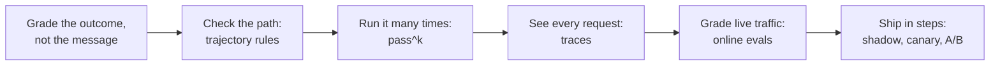
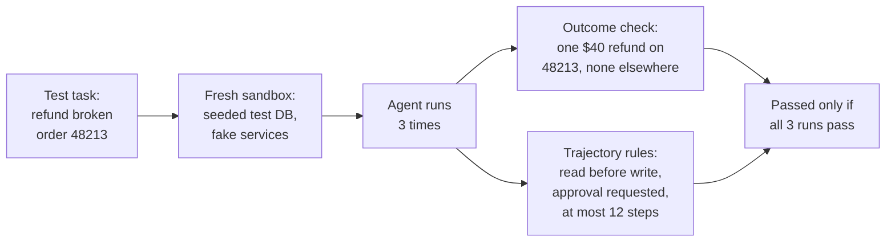
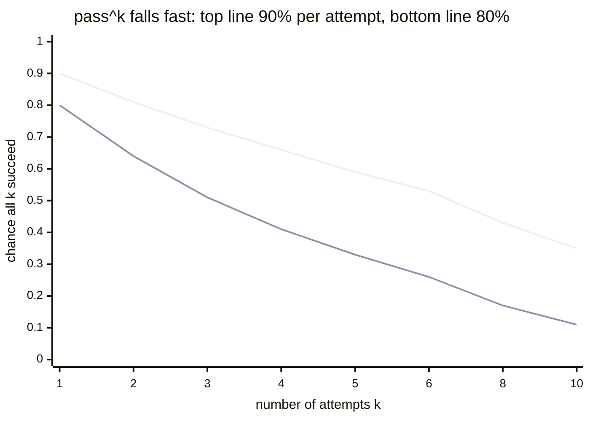
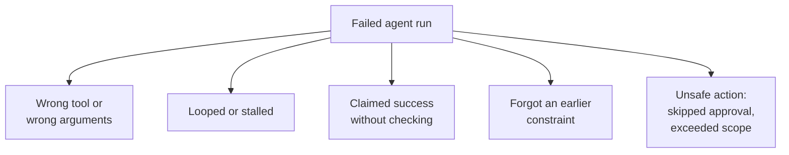
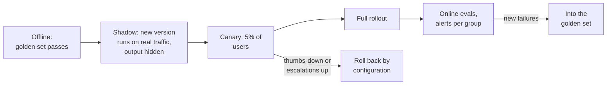
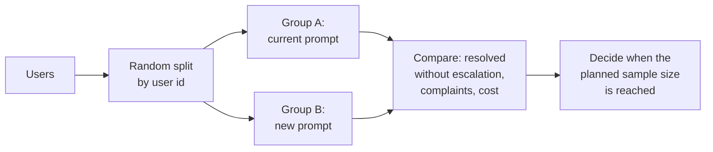

Chapter 8 built a safety net for the support chatbot: a golden set, a calibrated judge, a gate in CI. Two things slip through it. The store's refund agent wrote "Done! Refund issued for order 48213" while the refund went to order 48231, and one Tuesday the answers change although nobody changed any code. This chapter extends the net to agents, and then out into production.



## 1. Grade what happened, not what the agent says

An agent's final message is a claim. The truth lives in the **system of record**: the database or service that actually holds the data. Testing an agent happens at three levels:

- **Final outcome**: did the task really succeed? After "refund order 48213, it arrived broken", does the payments system hold exactly one $40 refund on order 48213, and none on any other order?
- **Trajectory**: the sequence of tool calls the agent made, checked against rules. Did it read the order before refunding? Did it request approval before any refund over the limit? Did it never call a delete tool? Did it finish within 12 steps? Rarely demand an exact sequence: there are usually several valid paths, and rigid matching punishes good runs.
- **Single step**: given this exact state, is the next tool call the right one? Useful for finding *where* a run goes wrong.



Every run starts in a fresh **sandbox**: a test database seeded with known data, and fake versions of external services, so runs cannot interfere with each other or with real systems.

> **Pause and think.** The refund agent passes a task 8 times out of 10. Is that good? Think about the customers: each one sends a request once, and thousands arrive every day.

## 2. One success is not reliability: pass^k

Run the same task k times:

- **pass@k**: the chance that *at least one* of k attempts succeeds. Fits tools where a person picks the best of several attempts, such as code suggestions.
- **pass^k** (read "pass to the power k"): the chance that *all* k attempts succeed, roughly the single-attempt rate raised to the power k. Fits anything facing customers or changing data, because each real request gets exactly one attempt.



At 80% per attempt, pass^3 = 0.8 x 0.8 x 0.8 = 0.51: an agent that "works 80% of the time" handles three customers' requests in a row correctly only about half the time. That is the argument for working on consistency, not just capability. (pass^k comes from tau-bench, a benchmark of customer-service agents talking to simulated users.)

**Testing conversations**: for agents that hold multi-turn conversations, a **simulated user** stands in for a person: a model plays the customer from a scenario card (their goal, the facts they know, when they give up) and chats with the agent until the task is done or a turn limit is reached. Then grade the outcome and the conversation. Read a sample of transcripts by hand; an unrealistic simulated user produces misleading scores.

**Measuring where it goes wrong**: tool selection accuracy (right tool on steps with a known right tool), argument accuracy (right order id, right amount), steps and cost per successful task, and recovery rate (after a tool error, did it recover or give up?). When reviewing failed runs, the same categories recur; tag them like chapter 8's failure categories:



Weekly counts tell you whether to fix tool descriptions, loop limits, verification steps, memory, or guardrails.

You will hear about public agent benchmarks: SWE-bench (fixing real code issues), tau-bench, GAIA. They help compare models in general and say little about your store's orders and refunds. Use them as a shortlist; decide with your own tasks.

> **Pause and think.** Tuesday morning: answers are suddenly longer, a few start refusing simple questions, and nobody deployed anything. What would you need to have *already* been recording to find out what changed, and where?

## 3. See every request: traces and observability

**Observability** means being able to answer "what happened in this request, and why?" after the fact. Its core is the trace: one record per request with a nested entry for every model call, search and tool call. Tools such as LangSmith and Langfuse store and display them; OpenTelemetry has standard conventions for them.

What each trace must hold:

- the model and its exact version, and the prompt template version;
- the input messages (personal data masked);
- retrieved chunk ids and scores; tool calls with arguments, results and errors;
- the answer, tokens in and out, time to first word and total time, cost;
- who asked (customer or support rep, workspace, conversation id), and the thumbs up or down that arrives later.

Decide retention and masking rules up front: traces often contain sensitive data.

## 4. Grade live traffic: online evals

**Online evals** run checks on a sample of real production traces, continuously. They must work without a known-good answer, since live questions have none: code checks (citations valid, format right) and calibrated judges (grounded or not). Chart the results **per group** (customer plan, region, question type) and alert on drops: an average across everything hides a regression in one area.

Signals worth watching alongside them: thumbs-down rate; how often an answer is regenerated or the same question asked again in other words; escalations; format failures; refusals; answer length; time and cost per request.

**Decision point: the provider silently updated the model. How do you catch it before your users do?**

- **Pin dated model versions**, so updates happen when you choose.
- **Run the regression suite daily** against the live model.
- **Watch the signals that move instantly** when a model changes: answer length, refusal rate, format failures, token counts. Tuesday's longer answers and new refusals were exactly that.
- **Keep the previous version one configuration switch away.**

Make feedback easy and useful: one click on every answer, an optional reason from a short list ("wrong", "outdated", "too long", "did not answer"), implicit signals (copying is good, rephrasing is bad), and a weekly review in which real failures go into the golden set. Feedback that only feeds a dashboard teaches nothing.

## 5. Ship in steps



- **Offline**: the golden set must pass before anything ships.
- **Shadow**: the new version answers real questions in parallel, but users still see the old answers; you compare without risk.
- **Canary**: a small group gets the new version. The success metric (resolved without escalation) and the **rollback triggers** (thumbs-down rate, escalations) are written down *before* it starts.
- **Full rollout**, then online evals; every new failure becomes a golden-set case.
- Rolling back is a configuration change, not a redeploy, so it takes seconds.

**A/B tests** answer a different question: not "does it break?" but "is it better?". Split users randomly into two groups, old version and new, and compare a metric chosen in advance:



Split by person, not by request, so each user sees one consistent version; pick one primary metric plus guardrail metrics that must not get worse; fix the sample size in advance (stopping as soon as it looks good produces false wins); and run long enough to see past novelty.

**Version everything together.** A change in behaviour can come from the prompt, the model, the search settings, the tools or the index. Record them as one **configuration version** on every trace (for example `refund-agent@2026-11-03.2`: prompt v14, model snapshot, reranker on, index v7). Then every score, experiment and incident maps to an exact configuration, and rolling back means switching to an earlier one.

Also asked: "A stakeholder wants to launch, but the evidence is weak." Do not just say no. State what the evals do and do not show, propose a shadow run or a small canary with a written success metric and rollback trigger, review a daily sample by hand, and set a date to decide from the data.

## 6. Complete example: pass^k and trajectory rules

```python
def pass_hat_k(results_by_task):
    # results_by_task: {task_id: [True, True, False, ...]} from k runs each
    return sum(all(runs) for runs in results_by_task.values()) / len(results_by_task)

def check_trajectory(calls, max_steps=12):
    names = [c["name"] for c in calls]
    problems = []
    if len(calls) > max_steps:
        problems.append("too many steps")
    if "issue_refund" in names and "get_order" not in names[: names.index("issue_refund")]:
        problems.append("refunded without reading the order")
    if "issue_refund" in names and "request_approval" not in names[: names.index("issue_refund")]:
        problems.append("refunded without approval")
    if "delete_order" in names:
        problems.append("called a forbidden tool")
    return problems
```

Expected behaviour:

- `pass_hat_k({"t1": [True, True, True], "t2": [True, False, True]})` returns 0.5: task t2 is not reliable, even though it passed 2 of 3 times.
- A trajectory `get_order, search_policy, request_approval, issue_refund` returns no problems.
- A trajectory that calls `issue_refund` before `request_approval` returns `["refunded without approval"]`, even if the payments system ended up correct, because the path broke a safety rule.

## What breaks next

The company wants its document assistant for every customer: 500 customer companies, a million questions a day. Each company must see only its own private documents plus the shared product documentation. Leadership wants a 45-minute design review of "Ask, for every customer", and the questions they will ask are the questions of an LLM system design interview: how does it scale, how do you keep customers apart, what happens when the model provider is down, what does it cost?

> **Pause and think.** Before drawing a single box: what would you need to know, and what would you need to decide, to design this well? Write down your first five questions.

That is chapter 10.
