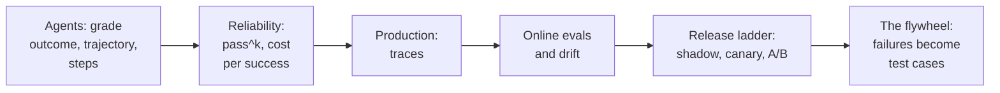
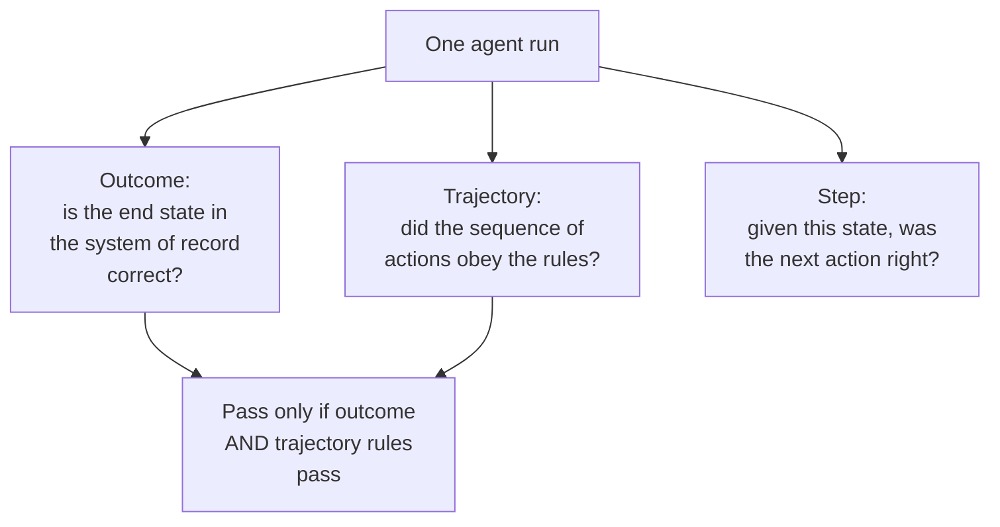
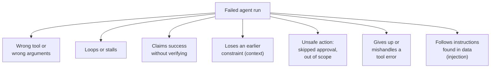
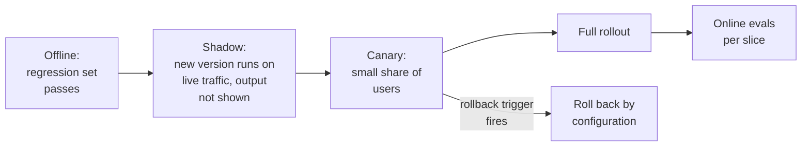
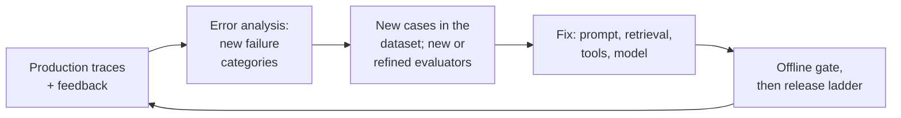

Chapter 8 evaluated a single response: one input, one output, graded. Two things break that model. **Agents** take many steps, call tools that change real data, and behave differently on every run, so the final message is a claim rather than evidence. And **production** moves on its own: users ask new things, data changes, and providers update models, so a system that passed every offline eval can still degrade next Tuesday. This chapter covers evaluating agents, then evaluating continuously in production, then shipping changes safely.

## 1. Why agents need different evals

An agent runs a loop: read the state, choose a tool, call it, read the result, repeat until done. Four properties make single-response grading insufficient:

- **Side effects.** Tools write to databases, send messages, move money. What matters is the state of the world afterwards, not what the agent says about it. An agent can report success it did not achieve.
- **Many valid paths.** The same goal can be reached by different sequences of tool calls. Demanding one exact sequence fails good runs.
- **Compounding error.** Each step can go wrong, and an early mistake (a wrong id) poisons every later step.
- **Non-determinism across steps.** Small variations early produce different trajectories, so one successful run proves little.

## 2. What to grade: three levels

**Outcome.** Check the **system of record**, the database or service that actually holds the result, after the run. The right record changed, exactly once, with the right values, and nothing else changed. This is the primary grade, because it is what the user experiences. The agent's final message is graded separately (is it accurate about what happened?).

**Trajectory.** The ordered list of tool calls with their arguments. Grade it with **rules**, not exact matching:

- **must**: a required read before a write; an approval before an irreversible action;
- **must not**: forbidden tools, actions outside the user's scope, writes to the wrong entity;
- **bounds**: at most N steps, at most M tool errors, no repeated identical calls (a loop signature).

When you do have a reference trajectory, match it loosely: **in-order subset** (the required calls appear in this order, others allowed), **any-order** (the required calls appear), or **exact** only when the process genuinely has one valid path. Rigid matching punishes valid alternatives; rule-based checks capture what actually matters, safety and correctness.

**Step.** Freeze the state at one point of a run and ask: is the next action right? Measured as **tool selection accuracy** (right tool chosen when there is a known right tool) and **argument accuracy** (right ids, amounts, filters). Step evals localise where runs go wrong and are cheap to run, because they need one model call, not a whole episode.

Also measure the **final response**: whether what the agent tells the user matches the actual outcome. "Claims success without checking" is one of the most common agent failures.

Say it like this: "For agents I grade the outcome in the system of record first, then the trajectory against must and must-not rules rather than an exact path, and use step-level checks of tool selection and arguments to find where runs break."

## 3. Environments for agent evals

Agent evals need somewhere safe to act:

- **Sandbox**: an isolated environment with test databases and fake or recorded versions of external services. Agents in evals must never touch production systems.
- **Seeded, known state**: every run starts from the same fixture data, so outcomes can be checked exactly.
- **Reset between runs**: no run sees another's writes. Without isolation, results depend on run order.
- **Deterministic tools where possible**: recorded responses for external APIs, fixed clocks, so variance comes from the agent and not the environment.
- **Simulated users** for multi-turn agents: a model plays the user from a scenario card (goal, facts it knows, when it gives up) until the task ends or a turn limit is reached. Grade the outcome and the conversation. Review a sample of transcripts by hand: an unrealistic simulated user (too cooperative, too precise) inflates scores.

## 4. Reliability: pass@k and pass^k

Run each task k times. With a per-attempt success rate p, assuming independent attempts:

- **pass@k** = `1 - (1 - p)^k`: the probability that **at least one** of k attempts succeeds. Right when a person or a verifier picks the best attempt (code generation with tests, drafts a user chooses from).
- **pass^k** (pass hat k) = `p^k`: the probability that **all** k attempts succeed. Right for anything that acts once per request on behalf of a user, because each real request gets exactly one attempt and users return repeatedly.

At p = 0.9 and k = 3: pass@3 = 0.999, pass^3 = 0.73. The same agent looks nearly perfect by one metric and fails a returning user one time in four by the other. **For customer-facing and data-changing agents, report pass^k.** Consistency, not peak capability, is what production needs.

Measured from data rather than assumed: for each task, run n trials and count the successes c. The unbiased estimates are pass@k = `1 - C(n - c, k) / C(n, k)` and pass^k = `C(c, k) / C(n, k)` (C is "n choose k"), averaged across tasks. With n = k, pass^k for a task is simply 1 if every trial passed and 0 otherwise.

**Efficiency metrics** belong next to success: steps, tokens, cost and latency **per successful task**, and **recovery rate** (after a tool error, did the agent recover?). A version that succeeds slightly more often at twice the cost may be the wrong one.

## 5. How agents fail

Tag failed runs with categories, the same error-analysis method as chapter 8. The categories that recur:

Each category points at a different fix: tool descriptions and schemas, step limits and loop detection, a verification step before reporting success, memory and summarisation, guardrails in code, error handling in tools, and treating tool output as data rather than instructions. Count them weekly to know which to fix first.

**Public benchmarks** (SWE-bench for code changes, tau-bench for customer-service agents, GAIA for general assistants, WebArena for web tasks) compare models on standard tasks. They help shortlist models and say little about your tools and data; some are partly contaminated (present in training data). Decide with your own tasks.

## 6. Production: traces and observability

Offline evals cover what you anticipated. Production shows what you did not. **Observability** means being able to answer "what happened in this request, and why?" after the fact, and its unit is the **trace**: one record per request, a tree of **spans**, one per model call, retrieval and tool call.

What a trace must hold:

- the **configuration version** (prompt version, model and its exact snapshot, retrieval settings, tool versions);
- inputs and outputs of every span, with personal data masked;
- retrieved document ids and scores; tool calls with arguments, results and errors;
- tokens in and out, latency per span and time to first token, cost;
- identifiers (user, session, tenant) and the user feedback that arrives later, linked back to the trace.

LangSmith and Langfuse store and display traces; OpenTelemetry defines semantic conventions for generative-AI spans so traces are portable between backends. Decide retention and masking up front: traces contain user data.

## 7. Online evals and drift

**Online evals** run graders continuously on a sample of production traces. They must be **reference-free** (live requests have no reference answers): code checks (valid format, citations exist, required tool called) and calibrated judges (grounded, relevant, safe).

- **Sampling**: a random few percent of traffic for unbiased rates; plus every trace with negative feedback; plus oversampling of rare but important slices.
- **Slices and alerts**: chart each criterion per slice and alert on drops relative to a baseline. A global average hides a regression in one segment.
- **Signals beyond graders**: explicit feedback (thumbs, reasons) is sparse and biased toward unhappy users; implicit signals are abundant: retries, rephrasing the same question, abandoning the session, escalation to a human, copying the answer. Operational signals move first when something changes: output length, refusal rate, format failures, tokens, latency, cost.

**Evals vs guardrails.** A guardrail runs **inline** and blocks or modifies a response before the user sees it (PII filter, schema validation, policy check), so it must be fast and precise. An online eval runs **after the fact** on a sample to measure quality. The same check can be both; the difference is whether it blocks.

**Drift.** Quality can change with no deploy of yours:

- **Model drift**: the provider updates the model behind an alias. Pin dated model snapshots so upgrades happen when you choose, and run the regression suite on every upgrade.
- **Input drift**: users start asking different things (a new product, a new market). Watch the distribution of request types and the share of inputs unlike anything in the dataset.
- **Data drift**: documents, prices or policies change, so retrieved context changes. Correct-yesterday answers become wrong today.

The defence is the same for all three: run the regression suite on a schedule against what is live, watch the fast-moving operational signals, and keep the previous configuration one switch away.

Say it like this: "In production I trace every request with its configuration version, run reference-free graders on a sample per slice, watch implicit and operational signals that move first, pin model snapshots, and run the regression suite on a schedule so drift I didn't cause still gets caught."

## 8. Shipping safely: the release ladder

- **Offline gate**: the regression suite passes in CI (chapter 8).
- **Shadow**: the new version processes real traffic in parallel and its outputs are graded but never shown. Real inputs, zero user risk. (For agents with side effects, shadow runs must use sandboxed tools.)
- **Canary**: a small share of users get the new version. The success metric and the **rollback triggers** (thresholds on graders, feedback, escalations, latency, cost) are written down before it starts.
- **Full rollout**, followed by online evals.
- **Rollback is a configuration switch**, not a redeploy, so it takes seconds. That requires every behaviour-affecting setting (prompt, model, retrieval, tools, index) to be versioned together as one configuration.

**A/B tests** answer a different question: not "does it break?" but "is it better for users?". Randomly split users between the current and the new configuration and compare a metric chosen in advance:

- randomise **by user**, not by request, so each person gets a consistent experience;
- one **primary metric** (task resolved, conversion, retention) plus **guardrail metrics** that must not get worse (cost, latency, complaints, safety flags);
- fix the **sample size in advance** from the effect size you care about; stopping as soon as the result looks good (**peeking**) produces false wins;
- run long enough to get past **novelty effects** and weekly cycles.

Offline evals and A/B tests answer different questions and can disagree: a version that wins offline on your criteria may not change user behaviour, and a user-preferred version may score worse on a strict judge. Use offline evals to decide what is safe to test, and A/B results to decide what users actually prefer.

## 9. The flywheel

Evals are not a project with an end. They are a loop that compounds:

Every production failure becomes a test case, so the same failure can never return silently, and the dataset grows to reflect real use. What keeps the loop alive: a clear owner, a regular cadence (a weekly review of sampled traces), an eval budget (judge calls cost money), and fast feedback (an eval suite that takes hours stops being run).

## 10. How agent and production evals fail

- **Grading the message, not the state**: trusting "done" without checking the system of record.
- **Exact trajectory matching**: valid alternative paths marked as failures, so the score punishes good behaviour.
- **One run per task**: reporting a lucky success as reliability. Use pass^k.
- **Leaky sandboxes**: shared state between runs, or evals touching real systems.
- **Unrealistic simulated users** that are too cooperative, inflating scores.
- **Online graders never calibrated** against expert labels, or calibrated once and never rechecked after the judge changed.
- **Only explicit feedback**: thumbs are rare and skewed; implicit signals are ignored.
- **Unpinned models**: behaviour changes with no deploy and no way to tell when.
- **Unversioned configuration**: a regression appears and nobody can say which prompt, model or index produced it.
- **Peeking at A/B tests**, or randomising by request, or no guardrail metrics.
- **Production failures that never reach the dataset**, so the same failure keeps returning.

Say it like this, the whole section in one breath: "I start with error analysis on real traces to find how the system actually fails, write one evaluator per failure, code checks first and calibrated LLM judges for meaning, on a versioned dataset with slices. For RAG I separate retrieval and generation metrics. For agents I grade the outcome in the system of record and the trajectory against rules, and report pass^k. In production I trace everything, run reference-free graders on samples, watch for drift, ship through shadow and canary with written rollback triggers, and turn every production failure into a test case."

**Before the next chapter:** compute pass@3 and pass^3 for p = 0.8, then list the five things a trace must contain and the four rungs of the release ladder with what each one protects against.
