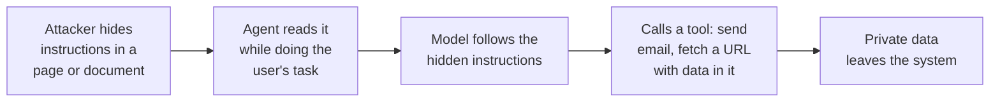
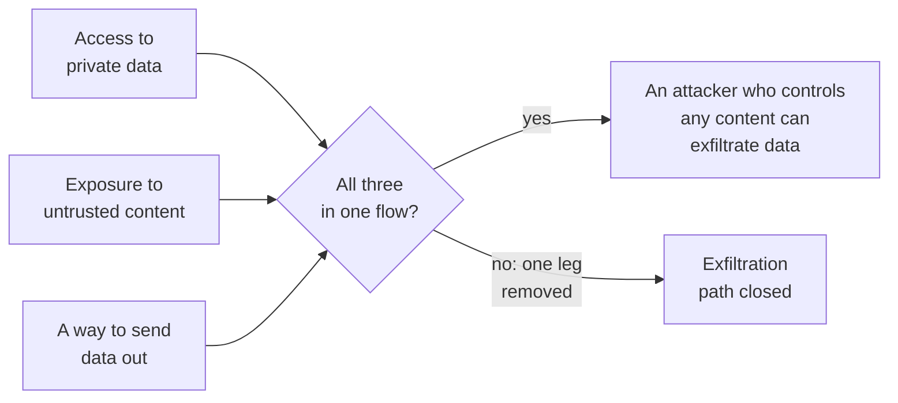
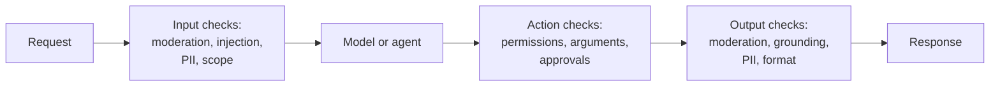
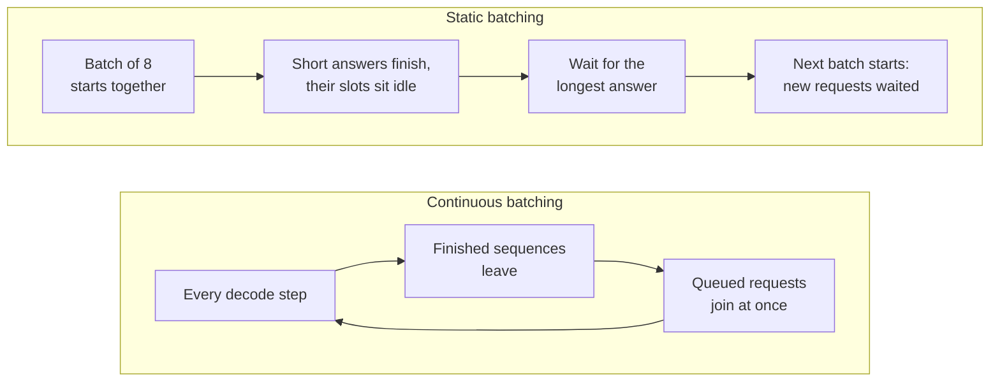

A system that answers well can still leak data, take a harmful action, cost more than it earns, or be too slow to use. This chapter covers the production constraints (security, cost, latency, reliability and observability) and how models are served, because serving mechanics explain most of the latency and cost behaviour you will be asked about.

## 1. Threats, prompt injection and the lethal trifecta

**The threat model: OWASP Top 10 for LLM applications (2025)**

1. **Prompt injection**: input, direct or hidden in content, changes the model's behaviour.
2. **Sensitive information disclosure**: private data, other users' data or secrets revealed.
3. **Supply chain**: compromised models, datasets, plugins or packages.
4. **Data and model poisoning**: manipulated training, fine-tuning or retrieval data.
5. **Improper output handling**: model output passed unchecked into SQL, shells, HTML or APIs.
6. **Excessive agency**: too many tools, permissions or autonomy.
7. **System prompt leakage**: secrets or sensitive logic placed in prompts get exposed.
8. **Vector and embedding weaknesses**: access-control gaps in retrieval, poisoned documents, recovering text from embeddings.
9. **Misinformation**: confident false output trusted by people or systems.
10. **Unbounded consumption**: runaway cost, denial of service, model extraction through unlimited queries.

For every feature ask three questions: what can untrusted input reach, what can the model touch, and where does its output go?

**Prompt injection**

- **Direct**: the user types instructions that override yours (role-play, "ignore previous instructions", encoded text). In 2023 a car dealership's chatbot was talked this way into "agreeing" to sell a new SUV for $1. Jailbreaks target the model's safety rules; injection targets your application's instructions and tools.
- **Indirect**: instructions hidden in content the system processes (a web page, a retrieved document, an email, a PDF, a code comment, text in an image, a tool result). The user may be the victim, not the attacker.

Two real cases show the shape. In 2024, researchers showed that a message planted in a public Slack channel could make Slack AI, answering another user's question, produce a link that carried data from that user's private channels to the attacker, and the planted message was not even cited as a source. In 2025, "EchoLeak" (CVE-2025-32711, rated 9.3 out of 10) showed that a single crafted email could make Microsoft 365 Copilot exfiltrate data from a user's context without the user clicking anything; it got past Microsoft's injection classifiers and link redaction, and was fixed on the server side.

**Why it cannot be fully fixed inside the model**: instructions and data arrive in the same token stream, the model is trained to follow instructions wherever they appear, and detectors are probabilistic while attackers adapt. Treat injection as a permanent property to design around.

**The lethal trifecta**

An agent combining **private data**, **untrusted content** and **external communication** (sending email, calling web APIs, even rendering an image or link whose URL carries data, as in the Slack AI and EchoLeak cases) can be made to leak that data by anyone who controls content it reads. **Remove at least one leg in every flow**: no outbound actions in sessions that read untrusted content, no private data in agents that browse, or a human approving every outbound action.

**Defences that work, in layers**

- **Least privilege**: tools act with the user's own permissions, read-only by default, scoped to the task; credentials stay in the tool layer.
- **Human approval** for consequential actions, showing exactly what goes where.
- **Control egress**: allowlist domains for fetches; never render arbitrary links or images from model output; sandbox code with no network.
- **Treat model output as untrusted input**: parameterised SQL, escaped HTML, never a shell or `eval`; validate every tool argument against schema and policy.
- **Separate trusted from untrusted processing**: the **dual LLM** pattern (a privileged model plans and calls tools but never reads untrusted text; a quarantined model reads untrusted text and returns only constrained outputs such as labels, extracted fields or references); **plan, then execute** (fix the plan and tool calls from the trusted request before reading untrusted content, so content cannot add actions); **data-flow tracking** (values carry their origin, and policies block untrusted-derived data from reaching sensitive tools).
- **Detection layers**: injection and jailbreak classifiers, moderation, marking and delimiting untrusted content. Useful signals, never the only control, as EchoLeak showed.
- **Monitoring and red-teaming**: log every tool call, alert on unusual outbound actions, test against known injection sets, and add every successful attack to the evals.

Say it like this: "I assume indirect prompt injection will sometimes succeed, so I limit what a hijacked model can do: tools run with the user's own permissions, retrieved content is delimited and never treated as instructions, outbound actions need approval or are impossible in sessions that read untrusted content, and output is never rendered or executed unchecked. Classifiers are only an extra layer. The rule is never to combine private data, untrusted content and an exfiltration channel in one flow."

## 2. Protecting data, safe SQL and guardrails

**Protecting data**

- **Permissions** are enforced in retrieval and tools, never in the prompt.
- **PII**: detect (patterns plus entity recognition) and redact or tokenise before sending to providers and before logging; use reversible tokenisation when the answer needs the real value back.
- **Provider terms**: no training on your data, zero or limited retention, regional processing for data residency.
- **Tenant isolation** in everything derived from data: caches, memory, vector indexes, logs, eval datasets.
- **System prompts are not secret**: no credentials or sensitive URLs; assume extraction.
- **Traces hold prompts and outputs**: access control, masking and retention limits; scan outputs for secrets and PII on sensitive systems.

**Letting a model write SQL, safely.** Controls live in the database and the execution layer, not in the prompt:

- A **read-only role** that sees only approved schemas, views or a semantic layer; never write credentials.
- **Parse the SQL** into a syntax tree: one `SELECT` only; reject DDL, DML, multiple statements, dangerous functions, and writes hidden inside CTEs.
- **Row-level security and column masking** enforced by the database for tenant and PII rules, with the user's identity set as a session value by your code, never a model-written `WHERE` clause.
- **Limits**: statement timeout, row cap, a cost estimate (`EXPLAIN` or a dry run) before running, and a replica or warehouse with resource quotas.
- **Audit** every query with the user and the original question; ask for confirmation on expensive or sensitive queries.

Correction: "Tell the model never to run DROP TABLE." A prompt is not a control; a read-only role is.

**Guardrails**

- Every guardrail costs latency and money and has **false positives** (good requests blocked) and **false negatives**; measure both, like any classifier.
- Run input checks **in parallel** with the main call and cancel generation if a check fails; run cheap checks first.
- **Streaming** complicates output checks: check sentence by sentence with a small buffer, or buffer fully for high-risk content.
- Decide per check whether to **fail open or fail closed** when the guardrail service itself is down.

Say it like this: "The model only ever runs as a read-only database role scoped to approved views; I parse the SQL and allow a single SELECT, row-level security enforces tenant access with the identity set by my code, and timeouts, row limits and cost checks stop expensive queries. Around the model, guardrails check inputs, actions and outputs, each measured for false positives and negatives."

## 3. Cost: the math, the levers and semantic caching

`cost = uncached input tokens x input price + cached input tokens x cached price + output tokens x output price`. Reasoning tokens bill as output.

Worked estimate, with illustrative prices: 1 million requests a day, 3,000 input and 300 output tokens each, so 3 billion input and 0.3 billion output tokens a day.

- At $3 per million input and $15 per million output tokens: $9,000 + $4,500 = **$13,500 a day**, about $400,000 a month.
- At $0.15 and $0.60 (a small model): $450 + $180 = **$630 a day**, about $19,000 a month. Model choice alone is a 20 times difference.
- If 2,000 of the 3,000 input tokens are a shared cached prefix billed at 10% of the input price, the large model's input falls from $9,000 to $3,000 + $600 = $3,600 a day.
- Batch APIs (results within 24 hours) typically halve prices for offline work.

**Cost per resolved task** = total spend (every call, retry, tool and human escalation) / tasks actually resolved. It beats cost per request because agents take variable numbers of steps, and a cheap model that fails and escalates often can cost more per resolved task than an expensive one.

**The levers, in order**

1. **Measure**: token and cost accounting per feature, tenant, model and step.
2. **Trim input**: shorter system prompts, fewer and better retrieved chunks, summarised history, trimmed tool outputs.
3. **Prompt caching**: a stable prefix first; track the cache hit rate.
4. **Limit output**: concise formats, `max_tokens`, structured output instead of prose.
5. **Right-size models**: routing and cascades; small models for classification, extraction and summarisation.
6. **Fewer calls**: merge steps, shorten agent loops, skip optional stages when confidence is high.
7. **Response caching**: exact-match first, semantic where safe.
8. **Batch APIs** for offline work; **reasoning effort** set per task.
9. **Distil or self-host** at high, steady volume.

**Semantic caching.** Embed the incoming question, search a cache of earlier questions, and if one is similar enough return its stored answer; otherwise call the model and store the result. What goes wrong:

- **False hits**: near-identical wording with a different meaning ("cancel my order" versus "cancel my subscription", May versus June, a negation). The threshold trades hit rate against wrong answers.
- **Personalisation and permissions**: an answer built from one user's data served to another; key the cache by tenant, user (if personalised) and permission scope.
- **Staleness**: answers outlive their source documents; use TTLs and invalidate on source changes.
- **Context dependence**: follow-ups depend on the conversation; cache only standalone, rewritten questions.

Use it for FAQ-like, non-personalised, slowly changing answers. Start with exact matching on normalised questions, add semantic matching with a conservative threshold, and measure the false-hit rate on labelled pairs.

Say it like this: "I estimate cost as requests times tokens times price, separating input, cached input and output tokens, and judge it by cost per resolved task, because a cheaper model that fails more can cost more per outcome. Semantic caching is dangerous because similar wording can mean different things and answers can leak across users or go stale, so I scope keys by tenant and permissions, invalidate on source changes, and tune the threshold against a measured false-hit rate."

## 4. Latency

A request's latency is network + queueing + retrieval + guardrails + **time to first token** (prefill, which grows with the prompt) + **output tokens x time per output token**; tool calls add their own time, and an agent multiplies all of it by its number of steps.

- **Time to first token** depends on prompt length, queueing at the provider or your servers, prefix-cache hits, model size and region.
- **Total time** depends on output length and the number of **sequential** model calls.

**Levers**

- **Stream**, so perceived latency becomes time to first token.
- **Shorter outputs and fewer sequential calls**; run independent work (retrieval, guardrails, sub-tasks) in parallel.
- **Smaller, faster models** for intermediate steps; routing.
- **Prompt caching** for long shared prefixes; trim retrieved context.
- **Start work early**: retrieve while classifying; prefetch likely tool results.
- **Nearby regions and provisioned throughput** for steady latency.
- **Go asynchronous** for long tasks: acknowledge, run in the background, notify.

"Quality improved, but p95 latency doubled and cost tripled; what do you do, in order?": break latency and cost down per stage from traces and find which change caused the increase; quantify the quality gain on the eval set, per slice; apply the expensive path only where it helps (route the hard queries) and cache, trim, parallelise or use smaller models for sub-steps; re-measure quality, latency and cost together; then decide with the product owner against explicit budgets, a latency target and a cost per resolved task.

## 5. Serving models yourself

**KV cache memory** per token = 2 (keys and values) x layers x KV heads x head dimension x bytes per value. For an 8B model with 32 layers, 8 KV heads, head dimension 128 and 16-bit values: 2 x 32 x 8 x 128 x 2 bytes = **128 KB per token**, so one 8,000-token sequence holds about 1 GB. KV cache memory, not compute, usually limits how many requests run at once; **grouped-query attention** (several query heads sharing one KV head) exists to shrink it.

**Batching**

- **Static batching** runs a batch from start to finish together: finished sequences leave their slots idle until the longest completes, and new requests wait for the next batch.
- **Continuous (in-flight) batching** re-forms the batch at every decode step: finished sequences leave and waiting ones join immediately. The GPU stays full, so throughput is far higher. vLLM, TGI, TensorRT-LLM and SGLang work this way.

**PagedAttention** (vLLM) stores the KV cache in small fixed-size blocks allocated on demand and mapped through a block table, like virtual-memory pages. Earlier servers reserved contiguous memory for each request's maximum length and wasted most of it to fragmentation and over-reservation; paging cuts the waste to a few percent, so many more sequences fit and throughput rises. Sequences with a common prefix share blocks (copy-on-write), which also enables **prefix caching**.

**Quantisation** stores weights (and optionally the KV cache) in fewer bits: 8-bit (int8 or FP8) or 4-bit (methods such as GPTQ and AWQ). Less memory and memory traffic means faster decoding, larger batches and bigger models on fewer GPUs; the cost is some quality, larger at 4 bits and on math, code and long-context tasks, so evaluate on your own tasks.

**Speculative decoding**: a small draft model proposes several tokens; the large model checks them all in one forward pass, keeping the longest prefix it agrees with plus one token of its own. The output distribution is unchanged, and decoding speeds up 2 to 3 times when the draft is usually right.

**Also asked**: **FlashAttention** computes exact attention in tiles held in fast on-chip memory, cutting memory traffic; **tensor parallelism** splits each layer across GPUs for models too large for one; **chunked prefill** splits long prompts into chunks interleaved with decode steps, so one long prompt does not freeze everyone's token stream; **prefill and decode on separate GPU pools** (disaggregation); and bigger batches raise throughput and cost efficiency but slow each request, so batch limits come from the latency target.

"Time to first token jumped from 400 ms to 4 s at peak; what do you check?": queueing first (queue length, KV cache utilisation near 100%, preemptions), then a shift to longer prompts, a lower prefix-cache hit rate, saturated GPUs with slow autoscaling (model load time), and provider rate limits causing retries. Fixes: scale out ahead of the peak, admission control and priority queues, per-request context caps, chunked prefill, a separate pool for long prompts, and overflow to a backup provider.

**API or self-host**: self-host when volume is high and steady (GPUs stay busy), when data must stay on your infrastructure, or when you need fine-tuned open models or full control of latency. Otherwise use APIs: no operations, frontier quality, elastic capacity.

Say it like this: "Continuous batching re-forms the batch at every decode step, so finished requests leave and queued ones join immediately and the GPU never idles. PagedAttention allocates the KV cache in small blocks on demand instead of reserving each request's maximum length, so far more sequences fit. Both exist because KV cache memory, not compute, limits how many requests a server can run at once."

## 6. Reliability and observability

**Reliability**

- **Timeouts** on every call, separately for time to first token and total; **retries** with exponential backoff and jitter on 429 and 5xx responses, honouring `Retry-After`; **idempotency keys** on retried actions.
- **Rate limits**: providers enforce requests and tokens per minute; use a token bucket per tenant plus a global client-side limiter, and queue non-interactive work.
- **Circuit breakers** stop hammering a failing provider and probe before trusting it again.
- **Fallbacks**: a tested secondary model or provider, and graceful degradation when everything fails (show retrieved sources without a generated answer, serve cached answers, read-only mode, "try again shortly").
- **Dependency failures**: vector store down, fall back to keyword search or cached results; permission service down, **fail closed**.
- **Mid-stream failures**: the client can retry cleanly, and actions never execute twice.
- **Overload**: load shedding, priority classes, multi-region deployment.

**Observability**

- **Traces** per request with a span per stage (retrieval, reranking, each model call, each tool call, guardrails): inputs, outputs, model and prompt versions, input, cached and output tokens, cost, latency, errors and finish reasons. OpenTelemetry defines semantic conventions for generative-AI spans.
- **Dashboards**: cost by feature, tenant and model; latency percentiles and time to first token; error, fallback and refusal rates; cache hit rates; guardrail trigger rates; tool error rates; online eval scores.
- **Alerts**: cost spikes per tenant (a runaway agent), latency SLO breaches, error rates, spikes in refusals or format errors.
- For agents, trace the **full trajectory** (each step's context or a reference to it, the model output, tool calls with arguments and results, state changes, approvals, versions and timing) so a bad run can be replayed.
- Telemetry holds sensitive data: masking, access control, retention.

**Failures to design for in any LLM system**: provider outages, rate limits and latency spikes; truncated, malformed or refused output; hallucination and stale retrieval; prompt injection and data leakage; tool failures and duplicate actions; cost runaway and abuse; quality regressions after model or prompt changes.

Say it like this: "Every model call has timeouts, retries with backoff before the first byte, a circuit breaker and an evaluated fallback, and the product degrades gracefully when everything fails. Every request is traced per stage with versions, tokens, cost and latency, with alerts on cost spikes, SLO breaches and refusal or format-error spikes, and agent runs are traced fully enough to replay."
