Three requests close the story, and each needs something new:

- The ticket classifier runs 300,000 times a day on a large model: 95% accurate, but 1.2 seconds and too expensive per ticket. Marketing wants push notifications in "FreshCart's voice", and prompting never quite gets there.
- Legal asks whether customer data could stay entirely inside FreshCart's own cloud account, which means running a model yourself.
- The warehouse team wants its inventory system usable from Ask FreshCart, Planner Copilot *and* the engineers' coding assistant, without three separate integrations.

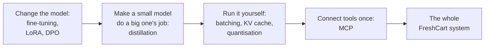

## 1. Fine-tuning: changing the model itself

Chapter 1 said fine-tuning is the wrong tool for FreshCart's policies. Here is why it is the right tool now.

**Fine-tuning** means continuing to train an existing model on your own examples, so its internal numbers (its weights) change and it behaves differently. Think of the difference between handing a new employee the policy manual and training them for a week on one specific job. The manual (RAG) is for facts: always current, easy to update, and you can point at the page. The training (fine-tuning) is for skills and habits: a format, a style, a narrow task done the same way every time.

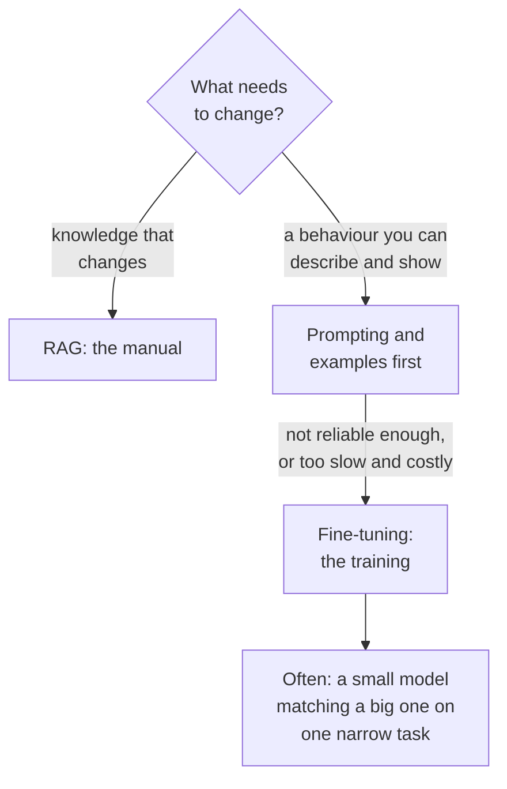

The classifier and the brand voice are both behaviour, not knowledge. So they are fine-tuning problems.

### Supervised fine-tuning

**Supervised fine-tuning (SFT)** trains on input-output pairs: a ticket and its correct label; a product update and the notification marketing approved. The model learns to produce outputs like the examples.

- **Data**: hundreds to a few thousand high-quality examples for a narrow task. Quality matters far more than quantity: inconsistent labels teach inconsistency.
- **A held-out test set**, never trained on.
- **A baseline**: the best prompt on the original model. A fine-tune that does not beat it is not worth owning.

### LoRA: sticky notes instead of rewriting the book

Updating all of a model's billions of weights needs a lot of GPU memory and produces a full copy of the model for every task. **LoRA (low-rank adaptation)** avoids both. Instead of rewriting the textbook, you add sticky notes to a few pages.

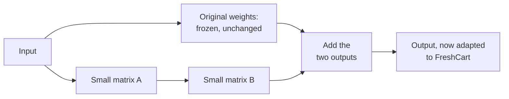

- The original weights are frozen.
- Next to chosen weight matrices, LoRA adds two small matrices whose product acts as a correction. Only those are trained, often well under 1% of the model's parameters.
- Training needs far less memory, and the result is a small **adapter** file. One base model can serve many adapters (the classifier, the brand voice), swapped per request.
- **QLoRA** does the same on a base model stored with 4-bit numbers (quantisation, section 2), so even large models can be fine-tuned on a single GPU.

### Preference tuning: RLHF and DPO

"Which of these two notifications sounds more like FreshCart?" is easier to answer than "write the perfect one". **Preference tuning** learns from such comparisons (it is also how chat models became helpful, chapter 1):

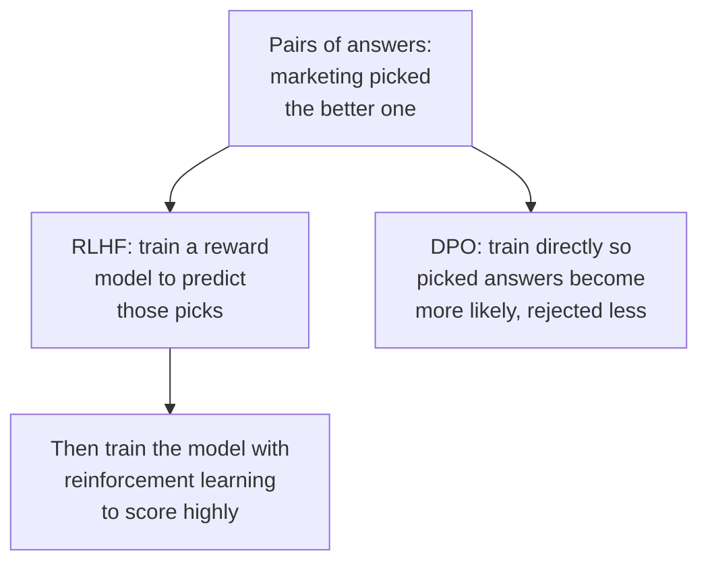

- **RLHF (reinforcement learning from human feedback)**: a separate **reward model** learns to predict people's preferences, then the main model is trained by trial and reward to produce answers the reward model scores highly, with a penalty for drifting too far from the original. Powerful, and complex to run.
- **DPO (direct preference optimisation)**: skips the reward model and the reinforcement learning, training directly on (preferred, rejected) pairs. Simpler and more stable, and widely used.

### Distillation: the answer to the classifier

**Distillation** trains a small model to imitate a large one on one specific task.

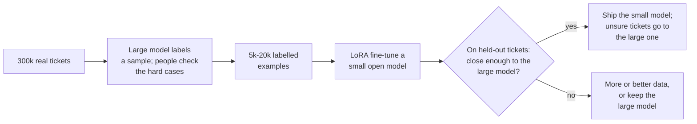

- The large model (plus human review of hard cases) produces the training labels.
- A small model fine-tuned on them can come close on this narrow task at a fraction of the cost and latency.
- A **cascade** keeps quality: the small model handles confident cases; uncertain ones go to the large model.
- Check the provider's terms before training on another model's outputs.

**What fine-tuning costs you**: ownership (you host, version, monitor and retrain a model), drift (new product lines and complaint types make it stale, so retrain on fresh labels), forgetting (training hard on one task can weaken general abilities; LoRA reduces this, but test broadly), and the same evaluation discipline as everything else.

**Decision point: someone again proposes fine-tuning on all 12,000 policy documents.** Still no. That is knowledge, not behaviour: the model would answer from a blurred memory, cite nothing, and need retraining with every policy change. RAG stays; fine-tuning is for the classifier and the brand voice.

> **Pause and think.** The distilled classifier is ready, and legal wants it running inside FreshCart's own cloud. One GPU serving one request at a time would be idle most of the time between tokens. How would you keep it busy serving many requests at once, and what would run out first?

## 2. Running your own model

A **serving engine** (vLLM, SGLang, TensorRT-LLM, Hugging Face TGI and others) loads a model onto GPUs and turns requests into tokens as efficiently as possible. Every request goes through two very different phases:

- **Prefill**: process the whole prompt at once. Heavy computation, fast per token, and it produces the first output token. It decides **time to first token (TTFT)**.
- **Decode**: generate the remaining tokens one by one. Light computation per token, but limited by memory speed, because the model's weights and the KV cache (chapter 1) must be read for every single token. It decides **time per output token**.

### Batching: the bus, not the taxi

A GPU generating one token for one user leaves most of its capacity unused, like a bus carrying one passenger. Processing many requests together, a **batch**, uses the same pass through the weights for all of them.

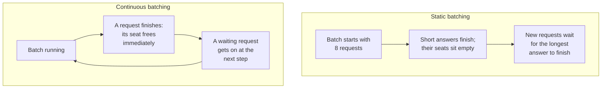

**Continuous batching** lets requests get on and off at every generation step, like a bus that never waits at the terminus. It is standard in modern engines and one of the biggest throughput gains in practice. Bigger batches mean more total tokens per second (throughput) but a little more waiting per request (latency); engines let you tune the balance.

### The KV cache and PagedAttention

The KV cache, the stored attention keys and values of every token so far, grows with every token of every active request, and it is usually what fills GPU memory and limits how many requests fit in a batch. Early engines reserved one large block of memory per request, sized for the longest possible answer, and wasted most of it. **PagedAttention** (introduced by vLLM) manages the cache the way an operating system manages memory: small fixed-size pages, handed out as needed. Little is wasted, many more requests fit, and requests that share a prompt prefix (the same system prompt) can share its pages, which is what makes prefix caching cheap.

### Quantisation: smaller numbers

A model's weights are normally 16-bit numbers. A 70-billion-parameter model needs about 140 GB for the weights alone. **Quantisation** stores weights with fewer bits, like saving a photo at lower quality:

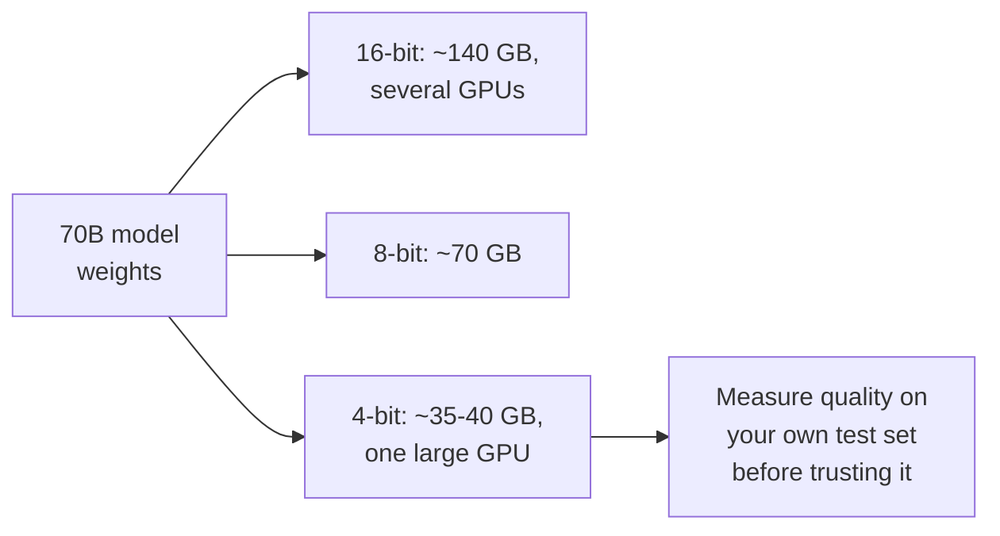

8-bit usually loses very little; 4-bit (methods such as GPTQ and AWQ, or the GGUF format for laptop-class tools) loses a little more. Less memory means fewer GPUs, more room for the KV cache, and faster decoding.

### More speed-ups worth knowing

- **Speculative decoding**: a small, fast "draft" model guesses the next few tokens; the big model checks them all in one pass and keeps the ones it agrees with. When the draft is often right, generation is much faster with exactly the same output.

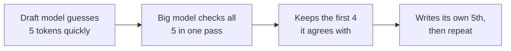

- **Tensor parallelism**: split each layer across several GPUs when the model does not fit on one, at the cost of communication between them.
- **Prefill-decode separation**: run the two phases on different GPU pools, since they stress hardware differently, so long prompts do not stall everyone's decoding.

**Decision point: at peak, time to first token jumps from 400 ms to 4 seconds. What do you look at?** Queueing first (are requests waiting for batch slots? check queue length and GPU use; add replicas or adjust batch limits). Then long prompts (a few very long prompts slow everyone's prefill; cap prompt length, use prefix caching, or separate prefill from decode). Then KV cache pressure (if memory is full, the engine pauses or evicts requests; quantise, cap output length, or add GPUs). Track TTFT, time per output token, throughput and cost per million tokens together, scale on queue length rather than CPU, and keep warm capacity, because loading a large model takes minutes.

Correction: "self-hosting is cheaper than an API" is only true at high, steady utilisation. Idle GPUs cost the same as busy ones, and someone has to operate the stack (chapter 11).

> **Pause and think.** The warehouse team's request: one inventory system, three AI applications. You know how tools work (chapter 5). If each application defines its own `get_stock` tool, what happens when the inventory API changes, and when a fourth application arrives?

## 3. MCP: connect a tool once, use it everywhere

Each application would carry its own copy of the integration, and every change means updating all of them: three integrations today, more with every new app and every new system. Before USB, every device had its own cable. **MCP (Model Context Protocol)** is the USB-C port for AI applications: an open standard for connecting them to tools and data.

A system is wrapped once as an **MCP server**. Any application that speaks MCP (the **host**, through its built-in **client**) can connect and use what the server offers:

- **Tools**: actions the model can call, such as `get_stock(sku, warehouse)`. The model decides when.
- **Resources**: data the application can read into the context, such as `inventory://pune/kothrud`. The application decides when.
- **Prompts**: reusable templates a person can pick, such as "summarise today's stock-outs". The user decides when.

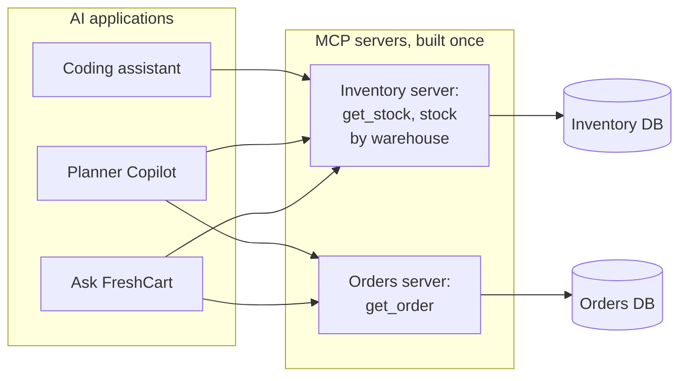

With N applications and M systems you build N + M pieces instead of N x M integrations.

Correction: MCP does not replace tool calling. The model still asks for tools exactly as in chapter 5; MCP standardises how the application *discovers* those tools and invokes them on the server.

**What happens when a client connects:**

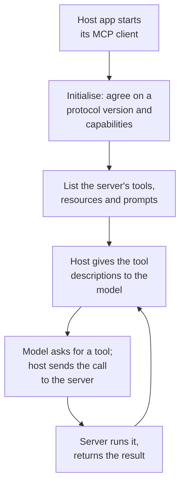

Servers talk over one of two **transports**: **stdio**, where the server runs as a local program started by the application (simple, nothing exposed on the network), or **Streamable HTTP**, where it runs as a remote service shared by many applications (needing authentication, encryption and normal service hardening). Remote servers use OAuth, the standard flow behind "allow this app to access your account" screens, so a person grants access explicitly and the server acts with that person's permissions rather than a shared admin key.

**The security catch.** A third-party server's tool descriptions and outputs go straight into the model's context, so they are untrusted input: a channel for prompt injection (chapter 11). A malicious or compromised server can hide instructions in a description, or change it after you approved it.

**Decision point: an engineer wants to install a popular community MCP server that both reads and sends email.** That one server holds two legs of the lethal trifecta. Install only reviewed servers, pin their versions, give each its own narrowly scoped credentials, require approval for sensitive tools, and never let one workflow combine a server that reads private data with one that can send data out.

**Building FreshCart's inventory server**: a few well-designed tools, not one per database table; read-only by default, writes behind approval in the host; the caller's identity and permissions checked inside the server on every call; short, structured results; stable, versioned tool descriptions. In LangChain, MCP servers load as ordinary tools (from version 1.4, through `langchain.mcp`), so they pass through the same validation, permissions and approval middleware as any other tool.

## 4. Complete example: the distilled classifier with a cascade

```python
def classify(ticket, small_model, large_model, threshold=0.85):
    label, confidence = small_model.predict(ticket)        # fine-tuned, fast, cheap
    if confidence >= threshold:
        return label, "small"
    return large_model.classify(ticket), "large"           # rare, slow, expensive

def cascade_cost(n, share_small, cost_small, cost_large):
    return n * (share_small * cost_small + (1 - share_small) * (cost_small + cost_large))
```

Expected behaviour:

- A clear ticket ("no bread in my bag") is answered by the small model in milliseconds.
- An unclear one ("late again, this is the third time, sort it out") falls below the threshold and is passed to the large model.
- `cascade_cost(300_000, 0.9, 0.0001, 0.002)` is about 90 dollars a day, against 600 dollars a day with the large model alone (`300_000 * 0.002`), if 90% of tickets are confident; the threshold is tuned on held-out tickets so the combined accuracy matches the large model's.

## The whole system

Twelve chapters ago, FreshCart had a plain chat model and three confused questions. Here is everything it has now, and the chapter that built each piece:

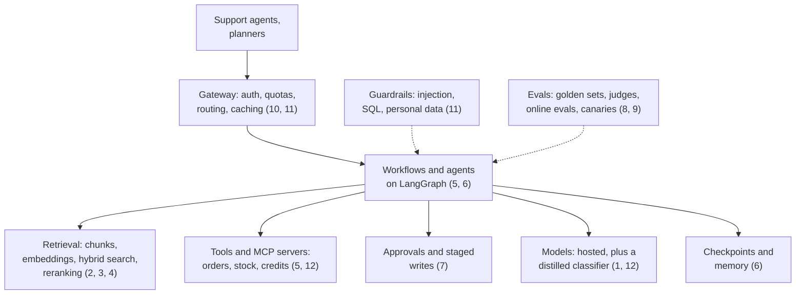

Every interview question in the drills below each chapter is a question about one of these boxes, or about the arrows between them.

> **Pause and think.** Close the book and redraw this diagram from memory. Then pick any box and explain, out loud, the problem that forced it to exist. If you can do that for every box, you are ready for the interview.
