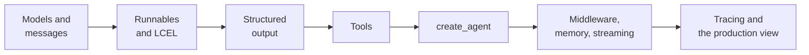
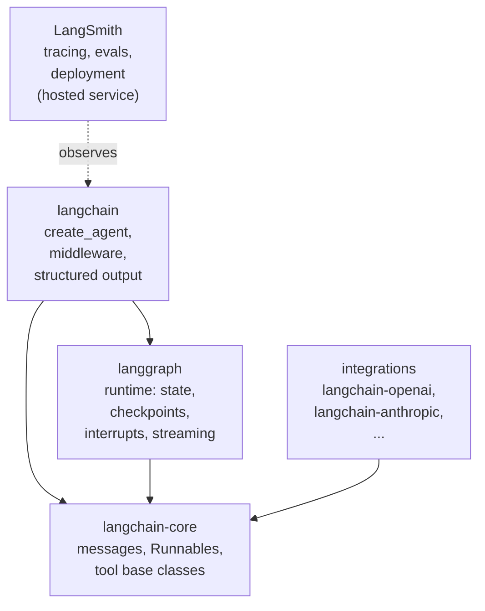
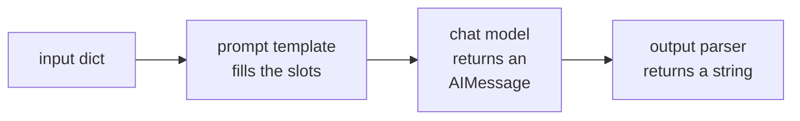
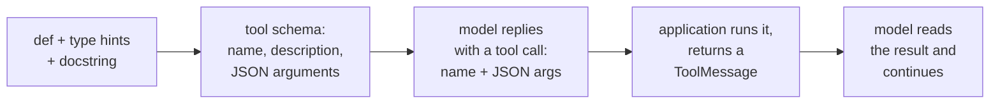
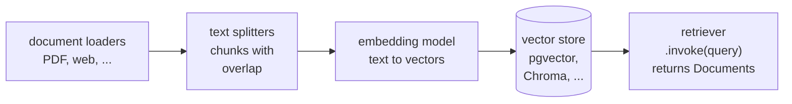
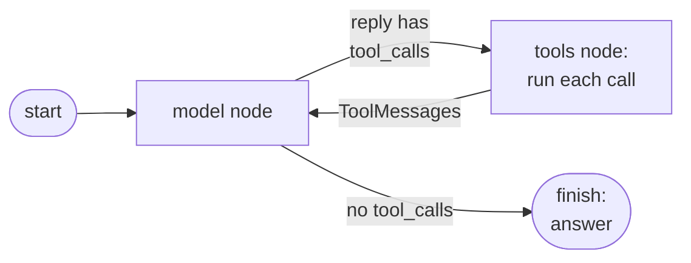
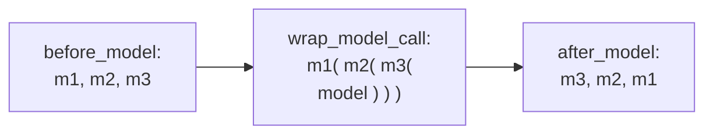

LangChain is the most widely used framework for building applications on language models. This chapter describes it layer by layer, from the bottom up: the package structure, the model and message abstractions, the Runnable interface, structured output, tools, retrieval components, the agent loop, middleware, memory, streaming and observability. For each layer it covers what the abstraction is, the problem it solves, how it works underneath, and when a lower-level or framework-free approach is the better choice. API names follow LangChain v1 (October 2025).



## 1. What LangChain is, and its package structure

LangChain is an open-source Python and JavaScript library. It was first known for "chains": fixed pipelines of prompt, model and output parser. Version 1, released in October 2025, narrowed its purpose to **building agents on one interface that works across model providers**, with LangGraph (chapter 14) as the runtime underneath.

It is a family of packages with distinct responsibilities:



- **langchain-core** defines the shared abstractions: message types, the Runnable interface, and base classes for chat models, tools, retrievers and embeddings. It has no provider-specific code.
- **Integration packages** (`langchain-openai`, `langchain-anthropic`, `langchain-google-genai`, `langchain-postgres` and many others) each implement the core interfaces for one provider. They are versioned independently, so a provider feature can ship without a LangChain release.
- **langchain** provides the high-level agent API: `create_agent`, middleware and structured output strategies.
- **langgraph** is the lower-level runtime every LangChain agent compiles into: state, persistence, interrupts and streaming.
- **langchain-classic** preserves the pre-v1 chains and agents (`LLMChain`, `RetrievalQA`, `AgentExecutor`) for existing code.
- **LangSmith** is a separate hosted product for tracing, datasets, evaluation and deployment. LangChain does not require it.

The layering matters in design discussions: application code depends on `langchain-core` interfaces, a provider is a replaceable implementation, and orchestration lives in LangGraph.

Correction: "LangChain is a chains library." That describes its early versions. In v1 the center is `create_agent`, middleware and the LangGraph runtime; the old chains live in `langchain-classic`.

Say it like this: "LangChain is a standard interface over models, tools and retrievers, plus create_agent and middleware for building agents. It runs on LangGraph, which provides state, persistence, interrupts and streaming, and LangSmith is the optional service for tracing and evaluation."

## 2. Chat models and messages

**The chat model abstraction.** Every chat model, from every provider, implements the same interface. A model can be created from a `"provider:model"` string:

```python
from langchain.chat_models import init_chat_model

model = init_chat_model("anthropic:claude-sonnet-4-5", temperature=0, timeout=30, max_retries=3)

reply = model.invoke("Summarise the following text: ...")   # one AIMessage
for chunk in model.stream("Explain vector indexes"):         # message chunks as generated
    print(chunk.text, end="")
replies = model.batch(["input 1", "input 2"])                # many inputs, concurrently
reply = await model.ainvoke("...")                           # async variants of all three
```

Changing provider is a change of string (for example `"openai:gpt-5"`), provided the integration package is installed. The model becomes configuration rather than a code dependency.

**Messages.** A conversation is a list of messages, each with a role:

- `SystemMessage`: instructions that set the model's behaviour and constraints.
- `HumanMessage`: user input, which may include images, audio or files.
- `AIMessage`: the model's output. It holds text, optional `tool_calls` (structured requests to run tools), and `usage_metadata` with token counts.
- `ToolMessage`: the result of a tool execution, linked to the request by `tool_call_id`.

**Standard content blocks.** Providers return different structures for reasoning traces, citations, images and tool calls. `message.content_blocks` exposes one provider-independent view of all of them, so code that reads model output does not change when the provider does.

**Portability in practice.** A provider-independent interface is necessary for switching models but not sufficient. The same prompt on a different model is a behaviour change, so a switch should be gated on the evaluation set (chapter 8), and prompts should avoid provider-specific tricks. For resilience to outages, any model can be wrapped with fallbacks (`model.with_fallbacks([backup])`), or, inside an agent, `ModelFallbackMiddleware` (section 8).

Say it like this: "Every chat model implements the same invoke, stream and batch interface over typed messages, and content blocks normalise provider-specific output. That makes the model a configuration value; switching still requires re-running evaluations, because a new model is a behaviour change."

## 3. Runnables and LCEL

**The Runnable interface.** In LangChain, everything executable (a prompt template, a model, an output parser, a retriever, an agent) is a **Runnable**, exposing the same `invoke`, `stream`, `batch` and async methods. A uniform interface means any component can be composed with any other, and every composition is itself a Runnable.

**LCEL.** The LangChain Expression Language is the composition syntax: the pipe operator `|` connects Runnables so that one's output is the next one's input.

```python
from langchain_core.prompts import ChatPromptTemplate
from langchain_core.output_parsers import StrOutputParser

prompt = ChatPromptTemplate.from_messages([
    ("system", "Classify the text into one of: {labels}. Reply with the label only."),
    ("human", "{text}"),
])
classify = prompt | model | StrOutputParser()

classify.invoke({"labels": "a, b, c", "text": "..."})
classify.batch([{"labels": "a, b, c", "text": t} for t in texts])   # the whole pipeline, concurrently
```



Because the composed pipeline is a Runnable, it can be streamed, batched, run asynchronously and traced end to end without extra code. The composition primitives:

- `RunnableParallel`: runs several Runnables on the same input and returns a dict of their outputs.
- `RunnablePassthrough`: passes the input through unchanged, typically alongside a retriever.
- `RunnableLambda`: wraps an arbitrary Python function.
- `.with_retry()` and `.with_fallbacks()`: available on any Runnable.

**When to use LCEL.** It suits short, fixed, linear pipelines, where streaming, batching and tracing come free. It is a poor fit for loops, branches and persistent state: long LCEL expressions are hard to read and debug. Control flow of that kind belongs in a LangGraph graph (chapter 14).

## 4. Structured output

**The problem.** Free text is for people. Code that consumes model output needs a typed object whose shape is guaranteed, or it breaks the first time the model phrases an answer differently.

**Schema as instruction and validator.** A Pydantic model (or a TypedDict or JSON schema) defines the expected output:

```python
from typing import Literal
from pydantic import BaseModel, Field

class Classification(BaseModel):
    category: Literal["billing", "technical", "account"]
    priority: int = Field(ge=1, le=5, description="5 = urgent")
    reference: str | None = Field(description="An identifier mentioned in the text, if any")

classifier = model.with_structured_output(Classification)
result = classifier.invoke("...")      # a Classification instance
```

Field names, types, enums (`Literal`) and descriptions are converted into a JSON schema the model is asked to fill, and the reply is parsed back into the class. Invalid output fails validation loudly instead of propagating.

**Structured output in an agent.** `response_format` asks for the agent's *final* answer in a schema, produced after it has finished using tools:

```python
agent = create_agent(model, tools=[...], response_format=Classification)
result = agent.invoke({"messages": [("user", "...")]})
result["structured_response"]          # a Classification
```

**Enforcement strategies.** LangChain chooses how to obtain schema-conforming output:

- **`ProviderStrategy`** uses the provider's native structured-output mode, which constrains generation to the schema. It is the most reliable where supported.
- **`ToolStrategy`** presents the schema as a tool the model must call. It works with any model that supports tool calling. `ToolStrategy(Schema, handle_errors=True)` returns the validation error to the model and asks again.

**Handling failures.** Prefer native structured output where available; validate at the boundary; on failure, return the validation error to the model for a small, bounded number of retries; and record the failure rate as a metric, since a rising rate is an early signal of a prompt or model regression.

## 5. Tools

**What a tool is.** A tool is a function the model may *request*; the application decides whether and how to execute it. Tools are how a model reads live data and acts on external systems.

```python
from typing import Literal
from langchain.tools import tool

@tool
def search_records(query: str, status: Literal["open", "closed", "any"] = "any", limit: int = 5) -> list[dict]:
    """Search records by keyword, newest first. Use this before answering any question about a record."""
    return records_db.search(query, status, limit)
```

**How the schema is built.** From the function, LangChain derives what the model sees: the **name**, the **description** (from the docstring) and a **JSON schema** of the arguments (from type hints; `Literal` becomes an enum, defaults make arguments optional). That schema is the model's entire knowledge of the tool, so **the docstring is part of the prompt**: it must state what the tool does, when to use it, and what it returns.



**Runtime injection: values the model must not choose.** Any argument in the schema is chosen by the model, and therefore by whatever text influenced the model, including prompt injection. Security-relevant values (the caller's identity, tenant, permissions) must come from the application. A parameter typed `ToolRuntime` is injected by LangChain at call time and excluded from the schema, so the model can neither see nor set it:

```python
from dataclasses import dataclass
from langchain.tools import tool, ToolRuntime

@dataclass
class RequestContext:
    user_id: str
    tenant_id: str

@tool
def my_records(runtime: ToolRuntime[RequestContext], status: Literal["open", "closed", "any"] = "any") -> list[dict]:
    """List the current user's records, newest first."""
    ctx = runtime.context                      # supplied by the application, never by the model
    return records_db.for_user(ctx.tenant_id, ctx.user_id, status, limit=5)
```

`ToolRuntime` also exposes `runtime.state` (the agent's current state), `runtime.store` (long-term memory), `runtime.stream_writer` (progress events to the client) and `runtime.tool_call_id`. A tool can update the agent's state by returning `Command(update={...})`. Pre-v1 code achieved the same with `InjectedState` and `InjectedToolArg`.

**Tool design principles.**

- **Few, meaningful tools.** One tool per real operation, not one per table or endpoint. Each extra tool adds choice the model can get wrong.
- **Arguments the model can fill reliably**: identifiers and enums rather than free-form text.
- **Small results**: the fields the model needs, not whole records that consume context.
- **Errors as actionable text** ("no record with that id; ask for the id again"), not stack traces.
- **Authorization in code.** Whether the caller may perform an operation is checked inside the tool, never delegated to the model.

Say it like this: "A tool is a typed, documented function; LangChain turns it into a schema the model sees, the model requests a call with JSON arguments, and my code runs it. Anything security-relevant, such as who the user is, is injected at runtime and hidden from the model."

## 6. Retrieval components

Retrieval-augmented generation (chapters 2 to 4) has a fixed set of stages, and LangChain defines a standard interface for each, so loaders, embedding models and vector stores can be replaced independently:



```python
from langchain_community.document_loaders import PyPDFLoader
from langchain_text_splitters import RecursiveCharacterTextSplitter
from langchain_openai import OpenAIEmbeddings
from langchain_postgres import PGVector

pages = PyPDFLoader("handbook.pdf").load()
chunks = RecursiveCharacterTextSplitter(chunk_size=800, chunk_overlap=100).split_documents(pages)
store = PGVector.from_documents(chunks, OpenAIEmbeddings(), connection=DB_URL, collection_name="handbook")
retriever = store.as_retriever(search_type="mmr", search_kwargs={"k": 5})
```

- A **`Document`** is `page_content` plus `metadata` (source, page, section). Metadata is what makes citations and filtered retrieval possible.
- A **retriever** is any Runnable that maps a query string to a list of Documents; a vector store is one implementation, and keyword, hybrid or reranking retrievers share the interface.
- `search_type="mmr"` (maximal marginal relevance) trades some relevance for diversity, reducing near-duplicate chunks in the context.

**Two ways to use retrieval.**

- **Two-step RAG**: always retrieve, then generate. One model call, predictable latency and cost, easy to evaluate. The right default when every request needs the corpus.
- **Agentic RAG**: expose the retriever as a tool and let the agent decide whether, what and how often to search. Better for mixed workloads where some requests need documents, some need live data and some need both; it costs more calls and is less predictable.

## 7. create_agent: the agent loop

**The loop.** A tool-using agent repeats one cycle: call the model; if its reply contains tool calls, execute them and append the results; call the model again; stop when it replies without tool calls. `create_agent` builds this loop.

```python
from langchain.agents import create_agent
from langgraph.checkpoint.postgres import PostgresSaver

agent = create_agent(
    model="anthropic:claude-sonnet-4-5",
    tools=[my_records, search_handbook],
    system_prompt="Answer using the tools. Be brief. Say so when the tools do not contain the answer.",
    context_schema=RequestContext,                        # per-run data the model never chooses
    checkpointer=PostgresSaver.from_conn_string(DB_URL),  # conversation state per thread
    middleware=[...],                                     # section 8
)

config = {"configurable": {"thread_id": "thread-1"}}
agent.invoke({"messages": [("user", "...")]}, config,
             context=RequestContext(user_id="u1", tenant_id="t1"))
```

**What it builds.** The result is a compiled LangGraph graph with two nodes:



Each iteration appends to the message list: an `AIMessage` with tool calls, one `ToolMessage` per call, and eventually a final `AIMessage`. The number of model calls is one more than the number of tool-calling rounds, which is the main driver of latency and cost.

**What it inherits.** Because the agent is a LangGraph graph, it gets LangGraph's runtime features without extra code: checkpointed state per thread, streaming of every step, and interrupts for human approval. `create_agent` replaces both `create_react_agent` from `langgraph.prebuilt` and the classic `AgentExecutor`.

**Where it stops fitting.** In this loop the model decides every step. When steps must happen in a fixed order, in parallel, or only after approval, the control flow should be a graph designed explicitly (chapter 14), with the model used inside chosen nodes.

Say it like this: "create_agent builds the standard tool-calling loop as a LangGraph graph: a model node and a tools node, looping until the model answers without requesting a tool. Because it is a graph, it gets persistence, streaming and interrupts, and middleware adds controls around each step."

## 8. Middleware

**The problem.** Production agents need cross-cutting controls: context-size management, human approval for sensitive actions, removal of personal data, limits on runaway loops, retries and fallbacks. Building each into the loop would couple unrelated concerns. **Middleware** attaches them at fixed points instead, the same separation web frameworks use for authentication or logging.

**Hook types.**

- **Node-style hooks** run at a point in the loop and may modify state or jump elsewhere: `before_agent`, `before_model`, `after_model`, `after_agent`.
- **Wrap-style hooks** surround a call and control it: `wrap_model_call` and `wrap_tool_call` can modify the request, retry it, short-circuit it or substitute another.

**Ordering.** For `middleware=[m1, m2, m3]`, `before_*` hooks run m1, m2, m3; `wrap_*` hooks nest with m1 outermost; `after_*` hooks run m3, m2, m1.



**Built-in middleware.**

- `SummarizationMiddleware`: summarises older messages when the conversation approaches a token threshold.
- `HumanInTheLoopMiddleware(interrupt_on={...})`: pauses before the named tools run, until a person approves, edits or rejects the call.
- `PIIMiddleware`: detects personal data (emails, card numbers and custom patterns) and redacts, masks, hashes or blocks it.
- `ModelCallLimitMiddleware` and `ToolCallLimitMiddleware`: cap calls per run or per thread, ending runaway loops.
- `ModelFallbackMiddleware`: switches to backup models on errors. `ModelRetryMiddleware` and `ToolRetryMiddleware`: retry transient failures with backoff.
- `LLMToolSelectorMiddleware`: pre-selects relevant tools when many are registered. `ContextEditingMiddleware`: clears old tool outputs from the context.

**Custom middleware** is a decorated function or a subclass of `AgentMiddleware`:

```python
from langchain.agents.middleware import dynamic_prompt, wrap_model_call

@dynamic_prompt
def tiered_prompt(request) -> str:
    if request.runtime.context.tenant_id in priority_tenants:
        return BASE_PROMPT + "\nThis tenant has priority support."
    return BASE_PROMPT

@wrap_model_call
def small_model_first(request, handler):
    if len(request.messages) < 4:                               # short exchanges
        return handler(request.override(model=small_model))     # route to a cheaper model
    return handler(request)
```

**A correctness hazard: retries and interrupts.** In LangGraph, a pause for human input is raised as a special exception. A retry layer that catches every exception will retry the pause itself, and the approval request never reaches a person. Retry logic must be limited to transient errors (timeouts, rate limits, server errors).

Say it like this: "Middleware wraps the agent loop at fixed points, before and after the model and around model and tool calls, so production controls such as summarisation, PII redaction, human approval, call limits and fallbacks are layers I add, not changes to the loop."

## 9. Memory

**Short-term memory** is the state of one conversation, chiefly its message list. The **checkpointer** persists that state under a `thread_id`; invoking the agent again with the same thread id resumes with the full history. `InMemorySaver` is for development; production uses a durable checkpointer (`PostgresSaver`, or SQLite) so a conversation survives restarts and any server instance can continue it.

**Context management.** Message history grows without bound while the context window does not. Two strategies keep it in budget: **trimming** (keep the most recent N messages or tokens) and **summarisation** (`SummarizationMiddleware`), which also keeps cost per turn roughly flat.

**Long-term memory** is information that persists across conversations: user preferences, facts learned in earlier sessions, prior outcomes. It lives in a **store**, organised by namespace tuples such as `("users", user_id)`, read and written by tools through `runtime.store`, and optionally searchable by semantic similarity. It is a separate system from the checkpointer, with its own retention and privacy requirements.

## 10. Streaming

**Why stream.** Perceived latency is set by the time to first visible output, not total time. Streaming shows tokens and progress as they happen.

**Stream modes.**

- `"messages"`: model tokens as they are generated, with metadata.
- `"updates"`: each step's state change, for progress indicators.
- `"custom"`: arbitrary events a tool emits through `runtime.stream_writer`.
- `"values"`: the full state after each step, mainly for debugging.

```python
for token, meta in agent.stream({"messages": [("user", "...")]}, config,
                                stream_mode="messages", context=ctx):
    print(token.text, end="")
```

Several modes can be combined (`stream_mode=["updates", "messages"]`). Behind an HTTP API, the stream is typically forwarded to the browser as Server-Sent Events.

## 11. Tracing and evaluation

**Why tracing is required.** An agent's behaviour emerges from many calls: the prompt actually sent, the chunks retrieved, the tools chosen with their arguments and results. When an output is wrong, the cause is in one of those steps, and without a record of them it cannot be found.

**Traces.** With `LANGSMITH_TRACING=true` and an API key, every run is recorded as a **trace**: a tree of spans in execution order, each model call with its full input and output, each tool call with arguments and result, token counts, cost and latency. A trace turns "the model behaved badly" into a specific, fixable step: a missing instruction, a poor retrieval, a misleading tool description.

**Evaluation.** The same service stores **datasets** (inputs with expected outcomes) and runs **evaluations** over them with code checks or LLM judges (chapter 8), so prompt and model changes are compared before release.

**Vendor independence.** Tracing does not require the rest of LangChain, and LangChain does not require LangSmith: open-source tools such as Langfuse, or any OpenTelemetry-based pipeline, fill the same role.

## 12. When to use LangChain

**Advantages:** one interface across providers; tool calling, structured output and middleware already implemented and tested; LangGraph's persistence, interrupts and streaming underneath; and tracing of every step.

**Costs:** extra layers to debug through; abstractions that can obscure the exact prompt sent; and a history of breaking changes, much reduced since v1.

**Practices that keep it manageable:** pin versions; keep prompts and business rules in application modules rather than framework configuration; write tools as plain, unit-testable functions; trace every run; and do not use the framework where it adds nothing. A batch job that classifies documents with one model call each needs the provider SDK, a schema and a retry policy, not an agent.

**Choosing the level of abstraction:**

- **Provider SDK**: single calls, batch jobs, latency-critical paths.
- **`create_agent` with middleware**: a standard tool-calling agent that needs production controls.
- **LangGraph directly**: workflows whose control flow must be designed explicitly (chapter 14).

Say it like this: "I'd use create_agent and middleware for a standard tool-calling agent that needs production controls, LangGraph directly when I need my own control flow, and the plain SDK for single calls. Either way, prompts and tools live in my own code, versions are pinned, and every run is traced."

## What comes next

`create_agent` is a graph whose every step the model decides. Workflows where some steps must always run, in a fixed order, in parallel, or only after human approval, need a graph designed explicitly, with the model used only inside chosen steps. That is LangGraph, chapter 14.
