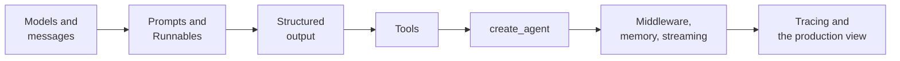
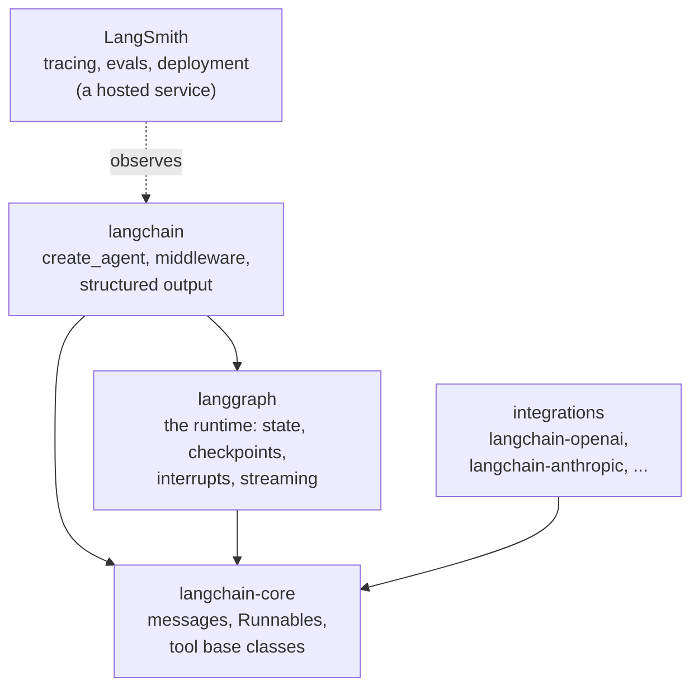
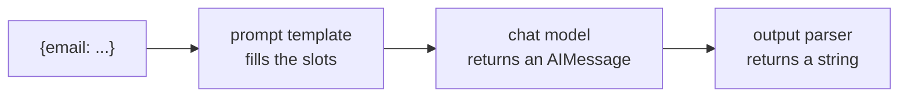
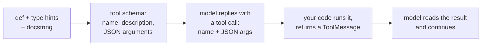
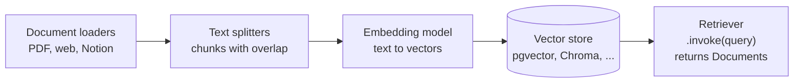
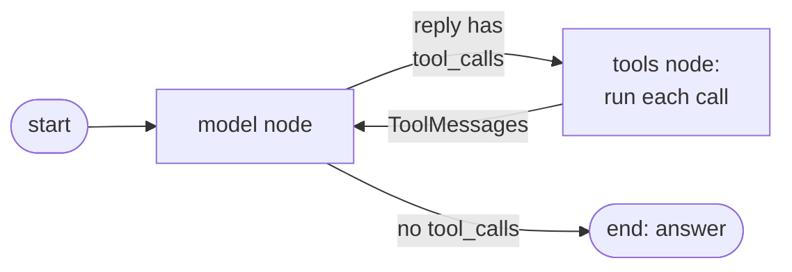
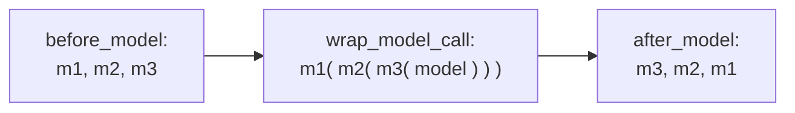

Kart, an online store, wants a support assistant by the end of the month. Customers should be able to ask "where is my order?", "can I return these shoes?" and "why was I charged twice?", and get correct answers drawn from live order data and the returns policy. Refunds above $100 must never be promised. Your lead says: "Use LangChain, everyone does. But I want you to be able to explain every layer of it."

This chapter builds that assistant, ShopBot, one LangChain piece at a time, in the order you would meet them on a real project. Each piece answers a question the project raises: how do I talk to any model? how do I get data my code can use? how does the model act on the world? how do I keep it safe, cheap and debuggable? By the end you can say what each layer does, why it exists, and when you would not use LangChain at all.



## 1. What LangChain is today

LangChain is an open-source Python and JavaScript library for building applications on language models. It was first known for "chains", pipelines of prompt, model and parser. Version 1, released in October 2025, narrowed it to one job: **building agents quickly, on one interface that works with every model provider**, with LangGraph as the engine underneath.

It is a family of packages, and knowing which does what is the first thing interviewers check:



- **langchain-core** holds the shared building blocks: message types, the Runnable interface, and the base classes for tools and retrievers.
- **Integration packages** (`langchain-openai`, `langchain-anthropic`, `langchain-google-genai`, `langchain-postgres` and many more) wrap one provider each. They are versioned separately, so a provider's new feature ships without waiting for a LangChain release.
- **langchain** is the part you import most: `create_agent`, middleware, structured output.
- **langgraph** is the lower-level runtime that every LangChain agent compiles into (chapter 14).
- **langchain-classic** keeps the old chains (`LLMChain`, `RetrievalQA`, `AgentExecutor`) for code that still uses them.
- **LangSmith** is a separate hosted product for traces, datasets, evaluations and deployment. LangChain works without it.

Correction: "LangChain is a chains library." That describes 2023. In version 1 the center is `create_agent`, middleware, and LangGraph underneath; the old chains moved to `langchain-classic`.

Say it like this: "LangChain is a standard interface over models, tools and retrievers, plus `create_agent` and middleware for building agents. It runs on LangGraph, which provides state, persistence, interrupts and streaming, and LangSmith is the optional service for tracing and evaluation."

## 2. One interface for every model

ShopBot's first decision is the model, and Kart's lead wants to be able to change it later without a rewrite. LangChain gives every chat model, from every provider, the same methods:

```python
from langchain.chat_models import init_chat_model

model = init_chat_model("anthropic:claude-sonnet-4-5", temperature=0, timeout=30, max_retries=3)

reply = model.invoke("What is your returns window?")          # one answer: an AIMessage
for chunk in model.stream("Explain our returns policy"):       # tokens as they arrive
    print(chunk.text, end="")
answers = model.batch(["question 1", "question 2"])            # many inputs, concurrently
reply = await model.ainvoke("...")                              # async versions of all three
```

Switching to another provider is a string change (`"openai:gpt-5"`), provided its integration package is installed. That makes the model a configuration value, not a code dependency.

A conversation is a list of **messages**, each with a role:

- `SystemMessage`: your instructions ("You are Kart's support assistant. Never promise refunds over $100.").
- `HumanMessage`: what the customer said, which can include images or files.
- `AIMessage`: the model's reply. It holds text, and/or `tool_calls` (requests to run tools), plus `usage_metadata` with token counts.
- `ToolMessage`: the result of a tool your code ran, linked to the request by `tool_call_id`.

Providers return different shapes (reasoning blocks, citations, tool calls), so messages also expose **standard content blocks** (`message.content_blocks`): one provider-independent view of text, reasoning, images and tool calls. Code that reads replies keeps working when the provider changes.

The interview question this answers: "How would you switch from OpenAI to Anthropic, or survive an outage?" Keep the model in configuration with `init_chat_model`; keep prompts free of provider-specific tricks; run your evaluation set on both models before switching (chapter 8), because "same prompt, different model" is a behaviour change; and for outages, configure a fallback (`model.with_fallbacks([backup])`, or `ModelFallbackMiddleware` in an agent).

## 3. Prompts and the Runnable interface

Before building an agent, Kart wants a small job: classify each incoming email into billing, delivery or returns. That is a fixed three-step pipeline: fill a prompt, call the model, parse the reply.

In LangChain, everything that can be run (a prompt template, a model, a parser, a retriever, a whole agent) is a **Runnable**, with the same `invoke`, `stream`, `batch` and async methods. The pipe operator `|` connects Runnables so one's output becomes the next one's input. This composition syntax is **LCEL**, the LangChain Expression Language.

```python
from langchain_core.prompts import ChatPromptTemplate
from langchain_core.output_parsers import StrOutputParser

prompt = ChatPromptTemplate.from_messages([
    ("system", "Classify the customer email as billing, delivery or returns. Reply with one word."),
    ("human", "{email}"),
])
classify = prompt | model | StrOutputParser()

classify.invoke({"email": "My parcel says delivered but nothing arrived"})   # 'delivery'
classify.batch([{"email": e} for e in todays_emails])                        # the whole pipeline, concurrently
```



Because the pipeline is itself a Runnable, it can be streamed, batched, run asynchronously and traced end to end with no extra code. The helpers you will meet: `RunnableParallel` (run several branches on the same input and return a dict), `RunnablePassthrough` (pass the input along, often beside a retriever), `RunnableLambda` (wrap any Python function), and `.with_retry()` and `.with_fallbacks()` on any Runnable.

**Is LCEL still worth learning?** For short, fixed pipelines like this one, yes: you get streaming, batching, async and tracing for free. For anything with loops, branches or state, write a LangGraph graph instead (chapter 14). Long LCEL expressions are hard to read and harder to debug.

## 4. Structured output: answers your code can use

The classifier returns a word, and one day the model answers "This looks like a delivery issue." and the code that expected `delivery` breaks. Free text is for people. Code needs a **typed object**.

```python
from typing import Literal
from pydantic import BaseModel, Field

class Triage(BaseModel):
    category: Literal["billing", "delivery", "returns"]
    urgency: int = Field(ge=1, le=5, description="5 = customer is angry or money is at stake")
    order_id: str | None = Field(description="The order number if the email mentions one")

triage = model.with_structured_output(Triage)
t = triage.invoke("You charged me twice for order 48213 and nobody replies!!")
# Triage(category='billing', urgency=5, order_id='48213')
```

The Pydantic model is both the instruction and the validator: field names, types, enums (`Literal`) and descriptions become a JSON schema the model is asked to fill, and the reply is parsed back into the class, so invalid output fails loudly instead of slipping through.

Inside an agent, you ask for the final answer in a schema with `response_format`, and get it after the agent has finished using its tools:

```python
agent = create_agent(model, tools=[find_orders], response_format=Triage)
result = agent.invoke({"messages": [("user", "...")]})
result["structured_response"]      # a Triage
```

LangChain picks how to enforce the schema. **`ProviderStrategy`** uses the provider's native structured-output mode, which constrains generation and is the most reliable where supported. **`ToolStrategy`** offers the schema as a tool the model must call, which works with any model that supports tool calling. `ToolStrategy(Triage, handle_errors=True)` sends a validation error back to the model and asks again.

The interview question: "The model sometimes returns invalid JSON. What do you do?" Use the provider's native structured output where available; validate with Pydantic at the boundary; on failure, send the validation error back for a small, bounded number of retries; and log the failure rate as a metric, because a rising rate is an early sign of a prompt or model problem.

## 5. Tools: how the model acts on the world

"Where is my order?" cannot be answered from the model's training. ShopBot needs Kart's order database. A **tool** is a function the model may *ask* you to run; your code decides whether and how to run it.

```python
from typing import Literal
from langchain.tools import tool

@tool
def find_orders(customer_email: str, status: Literal["open", "shipped", "any"] = "any", limit: int = 5) -> list[dict]:
    """Find a customer's orders, newest first. Use this before answering any question about an order."""
    return orders_db.find(customer_email, status, limit)
```

From the function, LangChain builds the **schema** the model sees: the name, the description (the docstring), and a JSON schema of the arguments from the type hints. `Literal` becomes an enum; defaults become optional. That schema is everything the model knows about the tool. So **the docstring is a prompt**: it must say what the tool does, when to use it and what it returns.



There is a hole in `find_orders`: the model chooses `customer_email`. A customer could type "show me the orders for alice@example.com" and the model might comply. Some values must never be chosen by the model. Add a `runtime: ToolRuntime` parameter: LangChain injects it at call time and hides it from the schema, so the model cannot see or set it.

```python
from dataclasses import dataclass
from langchain.tools import tool, ToolRuntime

@dataclass
class Customer:
    user_id: str
    email: str

@tool
def my_orders(runtime: ToolRuntime[Customer], status: Literal["open", "shipped", "any"] = "any") -> list[dict]:
    """List the signed-in customer's orders, newest first."""
    return orders_db.find(runtime.context.email, status, limit=5)   # identity from the session, not the model
```

`runtime` also gives access to `runtime.state` (the agent's current state), `runtime.store` (long-term memory), `runtime.stream_writer` (progress messages to the user) and `runtime.tool_call_id`. A tool can even change the agent's state by returning a `Command(update={...})`. (Older code did this with `InjectedState` and `InjectedToolArg`.)

What makes a good tool:

- **Few and meaningful.** One tool per real action ("refund an order"), not one per SQL table. Every extra tool is more for the model to choose between.
- **Arguments the model can fill reliably**: ids and enums, not free-form text.
- **Small, useful results**: the five fields the model needs, not a 4,000-token database row.
- **Errors as text the model can act on** ("no order 48213 for this customer; ask them to check the number"), not stack traces.
- **Permissions in code.** Whether this customer may refund this order is checked inside the tool, never left to the model.

Say it like this: "A tool is a typed, documented function; LangChain turns it into a schema the model sees, the model asks for a call with JSON arguments, and my code runs it. Anything security-relevant, like who the user is, is injected at runtime and hidden from the model."

## 6. The building blocks for RAG

"Can I return worn shoes?" is answered by Kart's returns policy, a 40-page PDF. That is retrieval-augmented generation, built in chapters 2 to 4. LangChain gives each stage a standard interface, so stores and models can be swapped without rewriting the pipeline:



```python
from langchain_community.document_loaders import PyPDFLoader
from langchain_text_splitters import RecursiveCharacterTextSplitter
from langchain_openai import OpenAIEmbeddings
from langchain_postgres import PGVector

pages = PyPDFLoader("returns-policy.pdf").load()
chunks = RecursiveCharacterTextSplitter(chunk_size=800, chunk_overlap=100).split_documents(pages)
store = PGVector.from_documents(chunks, OpenAIEmbeddings(), connection=DB_URL, collection_name="policy")
retriever = store.as_retriever(search_type="mmr", search_kwargs={"k": 5})
```

A `Document` is `page_content` plus `metadata` (source file, page number), which is what lets ShopBot cite "Returns policy, page 12".

There are two ways to use the retriever, and choosing between them is a common interview question:

- **Two-step RAG**: always retrieve, then answer. One model call, predictable, easy to evaluate. The right default when every question needs the documents.
- **Agentic RAG**: wrap the retriever as a tool and let the agent decide whether, and how often, to search. Better when questions are mixed (some need the policy, some need order data, some need both); costs more calls and is less predictable.

ShopBot's questions are mixed, so the policy search becomes one tool among several.

## 7. create_agent: the loop, built for you

ShopBot now has a model, tools and a retriever. Something must run the conversation: call the model, run the tools it asks for, feed the results back, repeat until it answers. That is the **agent loop**, and `create_agent` builds it.

```python
from langchain.agents import create_agent
from langgraph.checkpoint.postgres import PostgresSaver

agent = create_agent(
    model="anthropic:claude-sonnet-4-5",
    tools=[my_orders, search_policy, request_refund],
    system_prompt="You are Kart's support assistant. Be brief. Never promise a refund over $100; "
                  "for larger amounts, say a specialist will review it.",
    context_schema=Customer,          # per-run data the model never chooses
    checkpointer=PostgresSaver.from_conn_string(DB_URL),   # conversation memory per thread
    middleware=[...],                 # section 8
)

config = {"configurable": {"thread_id": "conv-7781"}}
agent.invoke({"messages": [("user", "Where are my shoes?")]}, config,
             context=Customer(user_id="u7", email="asha@example.com"))
```

What `create_agent` builds is a LangGraph graph with two nodes:



One turn of "Where are my shoes?": the model reads the question and replies with a tool call `my_orders(status="any")`; the tools node runs it and adds a `ToolMessage` with the orders; the model reads that and answers "Your shoes shipped on Tuesday and arrive Friday." Three messages added, two model calls.

Because the agent is a LangGraph graph, it inherits LangGraph's features for free: saved state per thread, streaming of every step, and interrupts for human approval. `create_agent` replaces both `create_react_agent` from `langgraph.prebuilt` and the old `AgentExecutor`.

Say it like this: "`create_agent` builds the standard tool-calling loop as a LangGraph graph: a model node and a tools node, looping until the model answers without asking for a tool. Because it's a graph, it gets persistence, streaming and interrupts, and middleware lets me add controls around each step."

## 8. Middleware: production controls around the loop

The demo works. Production brings new requirements, each a classic interview follow-up:

- Conversations grow, and after 60 messages the context is full and every call costs a fortune.
- A refund must be approved by a human before it is issued.
- Customers paste card numbers into the chat, which must not reach the model or the logs.
- One bad prompt sent the agent into a loop of 40 tool calls.
- The provider had a 20-minute outage last week.

Rewriting the loop for each of these would be a mess. **Middleware** hooks into fixed points of the loop instead:

- **Node-style hooks** run at a point and may change the state or jump elsewhere: `before_agent`, `before_model`, `after_model`, `after_agent`.
- **Wrap-style hooks** surround a call and control it: `wrap_model_call` and `wrap_tool_call` can change the request, retry it, skip it or substitute another.

The order matches web middleware. For `middleware=[m1, m2, m3]`, the `before_*` hooks run m1, m2, m3; the `wrap_*` hooks nest with m1 outermost; the `after_*` hooks run m3, m2, m1.



The built-ins cover ShopBot's list almost exactly:

- `SummarizationMiddleware` summarises old messages when the conversation nears a token limit.
- `HumanInTheLoopMiddleware(interrupt_on={"request_refund": True})` pauses before the refund tool runs, until a person approves, edits or rejects the call.
- `PIIMiddleware` detects card numbers, emails and similar data, and redacts, masks or blocks them.
- `ModelCallLimitMiddleware` and `ToolCallLimitMiddleware` stop runaway loops.
- `ModelFallbackMiddleware` switches to a backup model on errors; `ModelRetryMiddleware` and `ToolRetryMiddleware` retry transient failures.
- `LLMToolSelectorMiddleware` pre-selects the relevant tools when there are many; `ContextEditingMiddleware` clears old tool outputs from the context.

Custom middleware is a decorated function:

```python
from langchain.agents.middleware import dynamic_prompt, wrap_model_call

@dynamic_prompt
def by_membership(request) -> str:
    if request.runtime.context.user_id in premium_members:
        return BASE_PROMPT + "\nThis customer is a premium member: offer free return shipping."
    return BASE_PROMPT

@wrap_model_call
def cheap_first(request, handler):
    if len(request.messages) < 4:                                # a simple opening question
        return handler(request.override(model=small_model))      # use the cheaper model
    return handler(request)
```

One design warning from real systems: retry middleware must never retry an **interrupt**. In LangGraph a pause for human approval is raised as a special exception; a retry layer that catches "any exception" would retry the pause away, and the approval would never reach a person. Retry only transient errors (timeouts, rate limits, server errors).

Say it like this: "Middleware wraps the agent loop at fixed points, before and after the model, and around model and tool calls, so production controls like summarisation, PII redaction, human approval, call limits and fallbacks are layers I add, not changes to the loop."

## 9. Memory: within a conversation and across them

**Short-term memory** is the conversation so far. It lives in the agent's state, and the **checkpointer** saves it under a `thread_id`. Call the agent again with the same thread id and it continues where it left off ("And the second item?" makes sense). `InMemorySaver` is for development; production uses `PostgresSaver` (or SQLite), so a conversation survives a restart and any server can continue it.

The context window fills up, so long threads need managing: **trimming** (keep the last N messages) or **summarising** (`SummarizationMiddleware`), which also keeps cost per turn flat.

**Long-term memory** is what ShopBot should remember about Asha across conversations: her shoe size, that she prefers email updates, that she had a damaged delivery last month. That lives in a **store**, organised by namespace such as `("customers", user_id)`, read and written by tools through `runtime.store`, and optionally searched by meaning. It is a separate system from the checkpointer, with its own retention and privacy rules.

## 10. Streaming

A support answer that appears after eight seconds of spinner feels broken; the same answer streaming in after half a second feels fast. Agents stream in several modes:

- `"messages"`: the model's tokens as they are generated, for the typing effect.
- `"updates"`: each step's state change, for progress lines like "Looking up your order...".
- `"custom"`: anything a tool sends through `runtime.stream_writer`, such as "Checked 3 of 5 warehouses".
- `"values"`: the full state after each step, mostly for debugging.

```python
for token, meta in agent.stream({"messages": [("user", "Where are my shoes?")]}, config,
                                stream_mode="messages", context=customer):
    print(token.text, end="")
```

Several modes can be streamed together (`stream_mode=["updates", "messages"]`). Behind a web API, forward them to the browser as Server-Sent Events.

## 11. Tracing and evaluation

Two weeks after launch, a customer complains that ShopBot promised a $150 refund. Which prompt did the model see? Which tools ran, with which arguments, and what did they return? Without traces, nobody can say.

Set `LANGSMITH_TRACING=true` and an API key, and every run is recorded as a **trace**: each model call with its full prompt and reply, each tool call with arguments and result, token counts, cost and latency, nested in the order they happened. The trace shows the system prompt, the policy chunk retrieved, and the exact turn where the model ignored the rule, which turns "the model is bad" into a specific fix.

The same service keeps **datasets** (real questions with expected outcomes) and runs **evaluations** over them with code checks or LLM judges (chapter 8), so a prompt or model change can be compared before release. Tracing works without the rest of LangChain, and LangChain works without LangSmith: open-source options such as Langfuse, or anything based on OpenTelemetry, do the same job.

## 12. Should you use LangChain? The production view

This is the question senior interviewers actually ask, and there is a balanced answer.

**For it:** one interface across providers; tools, structured output and middleware already solved and tested; LangGraph's persistence, interrupts and streaming underneath; and tracing that shows every step.

**Against it:** layers to debug through; abstractions that can hide the exact prompt sent to the model; and a history of breaking changes, much calmer since version 1.

How teams use it well: pin versions; keep prompts and business rules in your own modules; write tools as plain, testable functions; trace everything; and skip the framework when the job is a single model call. A nightly job that classifies 10,000 emails needs the provider SDK, a Pydantic schema and a retry, not an agent.

Say it like this: "I'd use `create_agent` and middleware for a standard tool-calling agent that needs production controls, LangGraph directly when I need my own control flow, and the plain SDK for single calls. Either way, prompts and tools live in my own code, versions are pinned, and every run is traced."

## 13. Complete example: ShopBot handles a refund

Setup: the agent from section 7 with three tools (`my_orders`, `search_policy`, `request_refund`) and middleware `[PIIMiddleware("credit_card", strategy="redact"), SummarizationMiddleware(model=small_model, ...)` (configured to summarise past a few thousand tokens), `HumanInTheLoopMiddleware(interrupt_on={"request_refund": True}), ModelCallLimitMiddleware(run_limit=10)]`, a Postgres checkpointer, and Asha signed in as `Customer(user_id="u7", email="asha@example.com")`.

Asha writes: "The shoes from my last order hurt. Can I return them? My card is 4111 1111 1111 1111 if you need it."

Expected behaviour:

1. `PIIMiddleware` redacts the card number before the model ever sees it; the stored conversation holds `[REDACTED_CREDIT_CARD]`.
2. The model calls `my_orders()`. The email comes from `runtime.context`, so it can only see Asha's orders. The tool returns order 48213: running shoes, $89, delivered 9 days ago.
3. The model calls `search_policy("return worn shoes")`. The retriever returns the policy chunk: "Shoes may be returned within 30 days if worn indoors only."
4. The model calls `request_refund(order_id="48213", amount=89)`. `HumanInTheLoopMiddleware` pauses the run before the tool executes; the run is saved under `conv-7781`, and the caller receives the pending action for a support agent to review.
5. A support agent approves. The run resumes from the checkpoint, `request_refund` executes once, and the model answers: "You can return them: shoes worn indoors are accepted within 30 days (Returns policy, p.12). I've started a refund of $89 to your original payment method."
6. The trace shows all of it in order: the redaction, three tool calls with arguments, the pause, the approval, the token counts per call.

If Asha had asked about a $150 jacket, the system prompt tells the model not to promise it, the approval step catches any refund call anyway, and the call limit guarantees the run ends even if the model misbehaves. Each safety property is enforced by code, not left to the prompt.

## What comes next

`create_agent` is a graph you did not have to draw: the model decides every step. Kart's next project, an automated returns desk where some steps must always happen in a fixed order, in parallel, or only after a person approves, needs a graph you design yourself. That is LangGraph, chapter 14.
