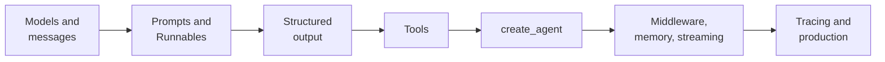
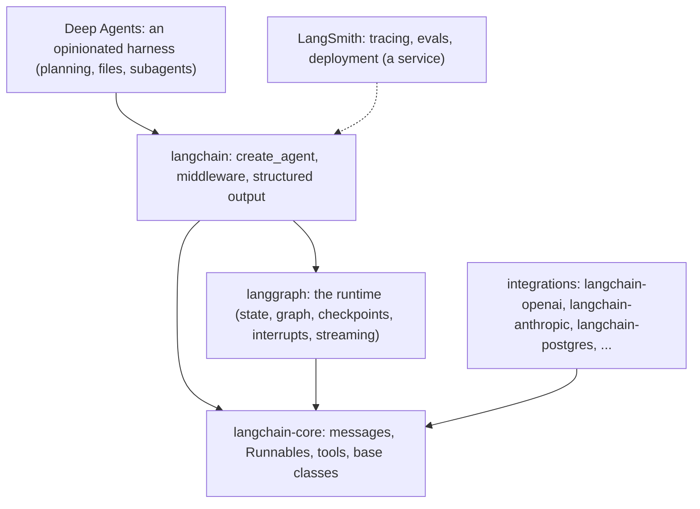
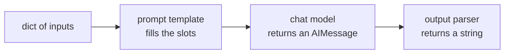
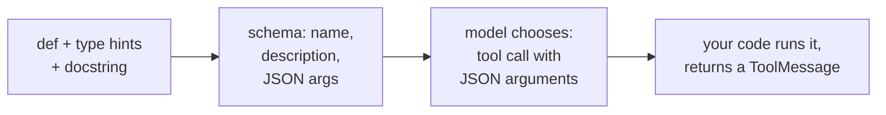
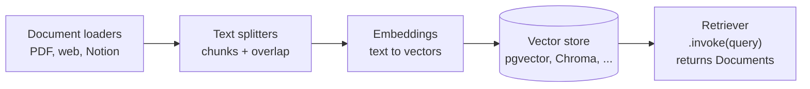
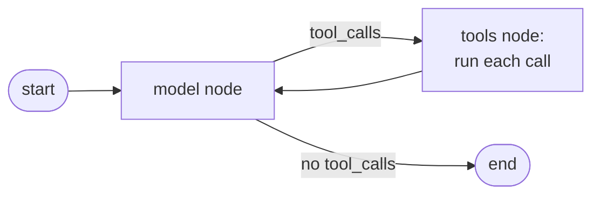
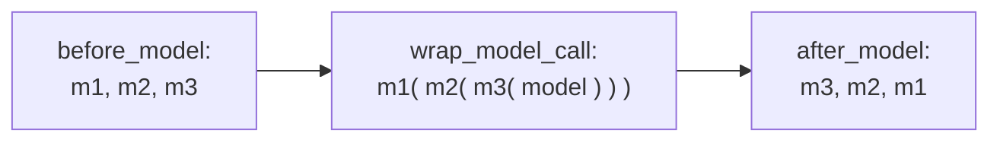

Chapter 5 used LangChain as one tool among many. This chapter goes through LangChain itself, topic by topic, in the order you would meet it in a real project and in an interview: what the library is today, models and messages, prompts and the Runnable interface, structured output, tools, the pieces for RAG, `create_agent`, middleware, memory, streaming, tracing, and finally when to use it at all. Each section gives the idea first, then the code, then the questions interviewers ask about it.



## 1. What LangChain is today

LangChain is a Python (and JavaScript) library for building applications on language models. Version 1, released in October 2025, narrowed it to one job: **building agents quickly on a common interface**. It is now a family of packages, and knowing which does what is the first thing interviewers check.



- **langchain-core**: the shared building blocks: message types, the Runnable interface, tool and retriever base classes.
- **Integration packages** (`langchain-openai`, `langchain-anthropic`, `langchain-google-genai`, `langchain-postgres`, ...): one package per provider, versioned separately, so a provider's change does not wait for a LangChain release.
- **langchain**: `create_agent`, middleware, structured output.
- **langgraph**: the lower-level runtime that `create_agent` compiles to (chapter 14).
- **langchain-classic**: the old chains (`LLMChain`, `RetrievalQA`, `AgentExecutor`) for code that still uses them.
- **LangSmith**: a hosted service for traces, datasets, evaluations and deployment. Not required, but the reason many teams use the stack.

Correction: "LangChain is a chains library" describes 2023. In version 1 the center is `create_agent`, middleware and LangGraph underneath; the old chains live in `langchain-classic`.

## 2. Models and messages: one interface for every provider

Every chat model, from any provider, is used the same way:

```python
from langchain.chat_models import init_chat_model

model = init_chat_model("anthropic:claude-sonnet-4-5", temperature=0, max_retries=3, timeout=30)

reply = model.invoke("What is a vector database?")         # one answer (an AIMessage)
for chunk in model.stream("Explain RAG in one line"):     # tokens as they arrive
    print(chunk.text, end="")
answers = model.batch(["q1", "q2", "q3"])                 # many inputs, run concurrently
reply = await model.ainvoke("...")                        # async versions of all three
```

Changing provider is a string change: `"openai:gpt-5"` instead of `"anthropic:..."`, provided the integration package is installed.

A conversation is a list of **messages**, each with a role:

| Message | Who | Holds |
|---|---|---|
| `SystemMessage` | you | instructions, persona, rules |
| `HumanMessage` | the user | the question (text, images, files) |
| `AIMessage` | the model | text, and/or `tool_calls`, plus `usage_metadata` (tokens) |
| `ToolMessage` | your code | a tool's result, linked by `tool_call_id` |

Messages also expose standard **content blocks** (`message.content_blocks`): text, reasoning, images and tool calls in one provider-independent shape, so code that reads a reply does not depend on which provider wrote it.

Interview angle: "How would you switch from OpenAI to Anthropic, or fall back when one is down?" Use `init_chat_model` so the model is configuration, keep prompts free of provider-specific tricks, run your eval set on both before switching, and use `with_fallbacks` (or `ModelFallbackMiddleware` in an agent) for outages.

## 3. Prompts and the Runnable interface (LCEL)

Everything you can run in LangChain (a model, a prompt template, a retriever, a parser, a whole agent) is a **Runnable**: it has `invoke`, `stream`, `batch` and their async versions. The pipe operator `|` connects Runnables so the output of one becomes the input of the next. This syntax is called **LCEL**, the LangChain Expression Language.

```python
from langchain_core.prompts import ChatPromptTemplate
from langchain_core.output_parsers import StrOutputParser

prompt = ChatPromptTemplate.from_messages([
    ("system", "You answer in {language}, in at most two sentences."),
    ("human", "{question}"),
])
chain = prompt | model | StrOutputParser()

chain.invoke({"language": "English", "question": "What is an embedding?"})
chain.batch([{...}, {...}])                 # the whole pipeline, batched
for piece in chain.stream({...}): ...       # and streamed, end to end
```



Helpers you will see: `RunnableParallel` (run several branches on the same input, return a dict), `RunnablePassthrough` (pass the input through, often next to a retriever), `RunnableLambda` (wrap any function), `.with_retry()` and `.with_fallbacks([...])`.

Is LCEL still relevant? For **short, fixed pipelines** (prompt, model, parser; a two-step RAG chain) yes: you get streaming, batching, async and tracing for free. For anything with loops, branches or state, write a LangGraph graph instead (chapter 14); long LCEL expressions are hard to read and to debug.

## 4. Structured output: answers your code can use

Two ways to get a typed object instead of text.

**On a model**, for a single call:

```python
from pydantic import BaseModel, Field

class Ticket(BaseModel):
    category: Literal["billing", "bug", "how-to"]
    urgency: int = Field(ge=1, le=5)
    summary: str

classifier = model.with_structured_output(Ticket)
ticket = classifier.invoke("The app charged me twice and support isn't answering!")
# Ticket(category='billing', urgency=4, summary='Double charge, no reply from support')
```

**In an agent**, after it has used its tools, with `response_format`:

```python
agent = create_agent(model, tools=[search_orders], response_format=Ticket)
result = agent.invoke({"messages": [("user", "...")]})
result["structured_response"]          # a Ticket
```

Passing the schema directly lets LangChain choose the strategy: **`ProviderStrategy`** (the provider's native structured output, when the model supports it) or **`ToolStrategy`** (the schema offered as a tool the model must call, which works with any model that can call tools). `ToolStrategy(schema, handle_errors=True)` feeds a validation error back to the model and asks again.

Interview angle: "The model sometimes returns invalid JSON. What do you do?" Validate with Pydantic at the boundary, use the provider's structured-output mode where available, feed the validation error back for a bounded number of retries, and log the failure rate.

## 5. Tools: how the model learns what it can do

A tool is a function the model may ask you to run. The `@tool` decorator turns a typed, documented function into a tool:

```python
from langchain.tools import tool, ToolRuntime

@tool
def search_orders(customer_email: str, status: Literal["open", "shipped", "any"] = "any", limit: int = 5) -> list[dict]:
    """Find a customer's orders, newest first. Use before answering any question about an order."""
    return db.find_orders(customer_email, status, limit)
```

From this, LangChain builds the **schema** the model sees: the name (`search_orders`), the description (the docstring), and a JSON schema of the arguments from the type hints (`Literal` becomes an enum, defaults become optional). That schema is all the model knows about the tool, so **the docstring is a prompt**: say what it does, when to use it, and what it returns.



Tools often need things the model must not choose: the current user, a database handle, the conversation so far. Add a parameter `runtime: ToolRuntime`. LangChain injects it at call time and hides it from the schema:

```python
@tool
def my_orders(runtime: ToolRuntime[UserContext]) -> list[dict]:
    """List the current user's open orders."""
    return db.find_orders(runtime.context.user_id, "open", 5)   # the model can't pick another user
```

`runtime` also gives `runtime.state` (the agent's state), `runtime.store` (long-term memory), `runtime.stream_writer` (progress updates) and `runtime.tool_call_id`. A tool can even update the agent's state by returning a `Command(update={...})`. (Older code used `InjectedState` and `InjectedToolArg` for this.)

Good tools: few, clearly named, each doing one meaningful job; arguments the model can fill reliably (ids and enums, not free text); small, useful results; errors returned as text the model can act on ("no order 48213 for this customer") rather than exceptions; and permission checks in code, never trusted to the model.

## 6. The pieces for RAG

LangChain has a standard interface for each stage of retrieval (chapters 2 to 4), so stores and models can be swapped:



```python
splitter = RecursiveCharacterTextSplitter(chunk_size=800, chunk_overlap=100)
chunks = splitter.split_documents(PyPDFLoader("handbook.pdf").load())
store = PGVector.from_documents(chunks, OpenAIEmbeddings(), connection=DB_URL)
retriever = store.as_retriever(search_type="mmr", search_kwargs={"k": 5})
```

A `Document` is just `page_content` plus `metadata` (source, page), which is what citations are built from.

Two ways to use the retriever:

- **Two-step chain**: always retrieve, then answer. Predictable, one model call, the right default for document Q&A.
- **Agentic RAG**: wrap the retriever as a tool and give it to an agent, which decides whether and how often to search. Better for mixed questions; costs more calls and is less predictable.

## 7. create_agent: the loop, built for you

```python
from langchain.agents import create_agent
from langgraph.checkpoint.memory import InMemorySaver

agent = create_agent(
    model="anthropic:claude-sonnet-4-5",
    tools=[search_orders, my_orders, refund_order],
    system_prompt="You are a support agent for an online store. Never promise refunds over $100.",
    context_schema=UserContext,          # per-run data: user id, plan, locale
    checkpointer=InMemorySaver(),        # short-term memory per thread (Postgres in production)
    middleware=[...],                    # section 8
)

config = {"configurable": {"thread_id": "conv-42"}}
agent.invoke({"messages": [("user", "Where is my last order?")]}, config, context=UserContext(user_id="u7"))
```

What it builds is the agent loop as a LangGraph graph: call the model; if the reply asks for tools, run them and add the results; call the model again; stop when it answers without asking for tools.



Because it is a graph, a `create_agent` agent inherits LangGraph's features: saved state per thread, streaming, interrupts for approvals. `create_agent` replaced `create_react_agent` (from `langgraph.prebuilt`) and the old `AgentExecutor`.

## 8. Middleware: controls around the loop

Middleware hooks into fixed points of the loop, so you can add production controls without rewriting it.

- **Node-style hooks** run at a point and may update state or jump: `before_agent`, `before_model`, `after_model`, `after_agent`.
- **Wrap-style hooks** surround a call and decide what happens to it: `wrap_model_call`, `wrap_tool_call` (change the request, retry, skip, fall back).

For `middleware=[m1, m2, m3]`: `before_*` hooks run m1, m2, m3; `wrap_*` hooks nest with m1 outermost; `after_*` hooks run m3, m2, m1. Same as web middleware: the first one listed is the outermost layer.



Built-ins worth naming: `SummarizationMiddleware` (summarise old messages near the context limit), `HumanInTheLoopMiddleware` (pause before chosen tools), `PIIMiddleware` (mask or block personal data), `ModelCallLimitMiddleware` and `ToolCallLimitMiddleware` (stop runaway loops), `ModelFallbackMiddleware` and `ModelRetryMiddleware` (outages), `LLMToolSelectorMiddleware` (pre-select relevant tools), `ContextEditingMiddleware` (clear old tool output).

Custom middleware is a decorated function:

```python
from langchain.agents.middleware import before_model, wrap_model_call, dynamic_prompt

@dynamic_prompt
def by_plan(request) -> str:
    plan = request.runtime.context.plan
    return BASE_PROMPT + ("\nOffer priority shipping." if plan == "pro" else "")

@wrap_model_call
def cheap_first(request, handler):
    if len(request.messages) < 4:
        return handler(request.override(model=small_model))   # easy turn: cheaper model
    return handler(request)
```

## 9. Memory

- **Short-term memory** is the conversation so far, kept in the agent's state and saved by the **checkpointer** under a `thread_id`: call again with the same thread id and the agent continues the conversation. `InMemorySaver` for development; `PostgresSaver` (or SQLite) in production so it survives restarts.
- The window fills up, so long threads need **trimming** (keep the last N messages) or **summarisation** (`SummarizationMiddleware`) to stay under the context limit and keep costs down.
- **Long-term memory** (facts about a user across conversations: preferences, past issues) lives in a **store**, organised by namespace, e.g. `("users", user_id)`, read and written by tools through `runtime.store`, optionally searched by meaning.

## 10. Streaming

Users should see progress, not a spinner. Agents stream in modes:

| `stream_mode` | You get | Use for |
|---|---|---|
| `"messages"` | the model's tokens as they are generated | the chat UI's typing effect |
| `"updates"` | each step's state change ("called search_orders") | progress lines: "Looking up your order..." |
| `"values"` | the full state after each step | debugging |
| `"custom"` | anything a tool sends with `runtime.stream_writer` | "Searched 3 of 10 sources" |

```python
for token, meta in agent.stream({"messages": [...]}, config, stream_mode="messages"):
    print(token.text, end="")
```

Several modes can be streamed at once (`stream_mode=["updates", "messages"]`). Behind an API, forward them as Server-Sent Events.

## 11. Tracing and evaluation with LangSmith

Set `LANGSMITH_TRACING=true` and an API key, and every run is recorded as a **trace**: each model call with its full prompt and reply, each tool call with arguments and result, tokens, cost and latency, nested in the order they happened. That is how you answer "why did the agent do that?".

The same service holds **datasets** (inputs with reference outputs or criteria) and runs **evaluations** over them with code checks or LLM judges (chapter 8), so a prompt or model change can be compared before release. You can trace without the rest of LangChain, and use LangChain without LangSmith; the open-source alternatives (Langfuse, OpenTelemetry-based tools) work too.

## 12. Should you use it? The production view

**For**: one interface across providers; tools, structured output and middleware already solved; LangGraph's persistence, interrupts and streaming underneath; tracing that shows every step.

**Against**: layers to debug through; abstractions that can hide the exact prompt sent; a history of breaking changes (much calmer since version 1).

How teams use it well: pin versions; keep prompts and business logic in your own modules; write tools as plain, testable functions; trace everything; and skip the framework when the job is a single model call (a nightly classification job needs the SDK, Pydantic and a retry, not an agent).

So the rule: `create_agent` and middleware for a standard tool-calling agent that needs production controls; LangGraph directly for custom control flow; the raw SDK for single calls. In every case, prompts and tools stay in your own code, versions are pinned, and every run is traced.

## What comes next

`create_agent` is a graph you did not have to draw. When the steps must be yours (fixed order, parallel branches, approvals at chosen points, several agents), you draw it yourself. That is LangGraph, chapter 14.
