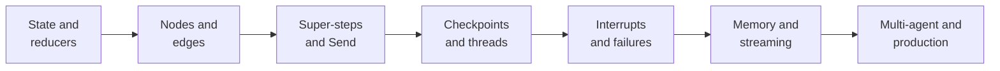
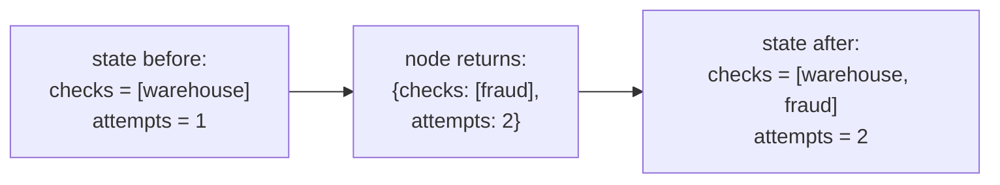
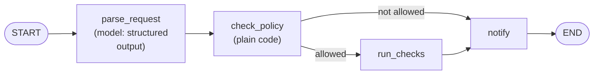
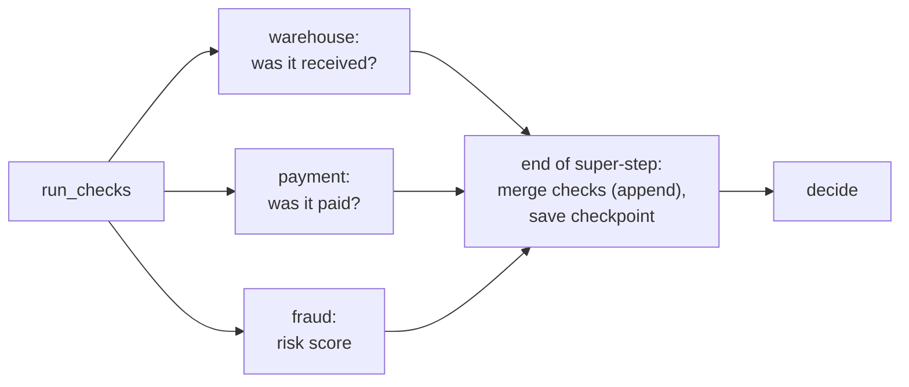
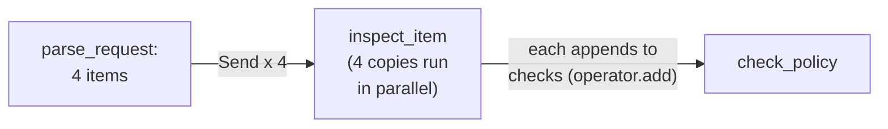
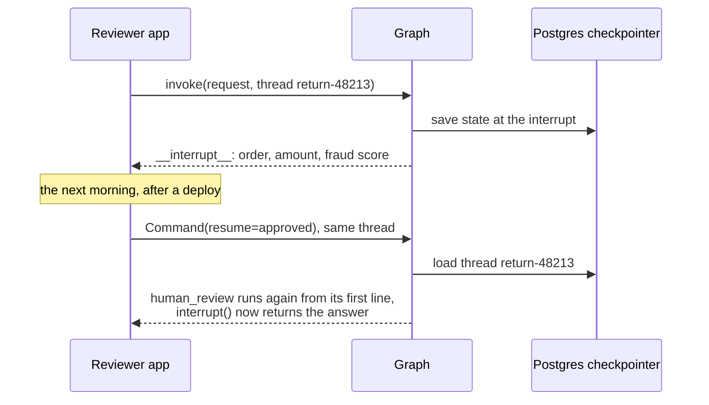
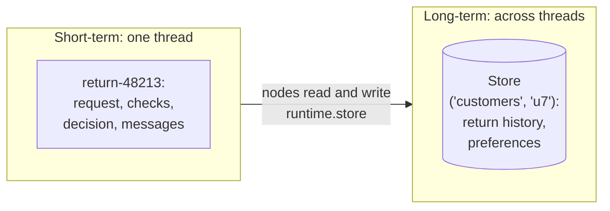
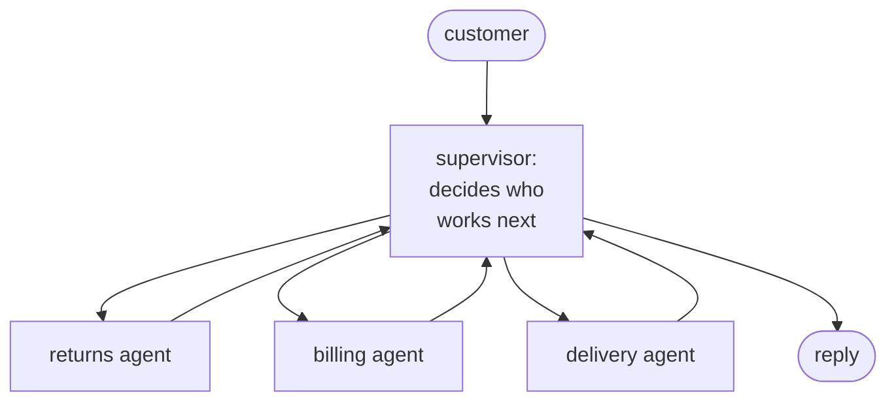
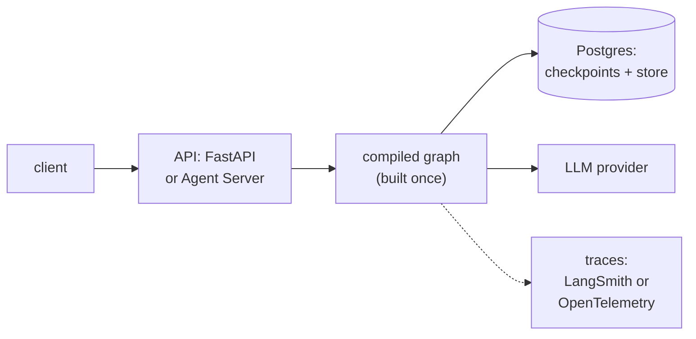

ShopBot from chapter 13 answers questions well. Kart's next request is different: automate the **returns desk**. Every return request must be classified; the order must be checked against the policy; the warehouse, the payment system and the fraud service must all be consulted; refunds over $100 must wait for a person, possibly overnight; and the customer must be told the outcome. Some of these steps must always happen, in a fixed order. Some should run in parallel. One must survive a server restart in the middle of a wait.

An agent that lets the model decide every step is the wrong shape for this: the model could skip the fraud check, or issue the refund before approval. You need a workflow whose structure you decide, with the model used inside chosen steps. That is what LangGraph is for. This chapter builds the returns desk with it, one feature at a time.



## 1. Why LangGraph exists

An agent loop (chapter 13) gives the model full control: at every step it chooses which tool to call, or whether to stop. That flexibility is the problem in a business process. Kart's compliance team needs guarantees: the fraud check always runs before money moves, a person always approves large refunds, and the process never loops forever.

**LangGraph** is a low-level runtime for writing such processes as a **graph**: **nodes** are steps (plain functions, which may call a model), **edges** decide what runs next, and a typed, shared **state** carries everything the run knows. On top of "run these steps", it provides what long-running AI workflows need and ordinary code does not:

- the state is **saved after every step**, so a run can resume after a crash, continue a conversation days later, or be replayed;
- a run can **pause for a human** and continue when they answer, even after a deploy;
- every step can be **streamed** to a UI as it happens.

LangGraph and LangChain are not rivals. `create_agent` compiles into a LangGraph graph, and an agent can be one node inside a bigger graph. The choice is about **who decides the steps**: the model (`create_agent`), or you (a graph you design, using the model at the points you choose).

Say it like this: "LangGraph is a runtime for stateful workflows as graphs: nodes are steps, edges decide what runs next, and a typed state is checkpointed after every step. I use it when the control flow must be mine, with fixed steps, branches, parallel work, approvals or several agents, and I need persistence and pause-and-resume."

## 2. State and reducers: the run's shared whiteboard

Every node of the returns desk reads and writes the same **state**, defined as a typed schema, usually a `TypedDict` (a Pydantic model or a dataclass also works):

```python
import operator
from typing import Annotated, TypedDict
from langgraph.graph.message import add_messages

class ReturnState(TypedDict):
    messages: Annotated[list, add_messages]        # the conversation: append, or replace by id
    request: dict                                  # the parsed return request: overwrite
    checks: Annotated[list[dict], operator.add]    # results from parallel checks: append
    decision: str                                  # "approve", "reject", "review": overwrite
    attempts: int
```

A node never mutates the state. It **returns a partial update**: a dict with only the keys it changed. LangGraph merges that update in, key by key, using each key's **reducer**:

- **No reducer**: the new value **replaces** the old one (`decision`, `request`).
- `operator.add`: lists are **concatenated**, so updates accumulate (`checks`).
- `add_messages`: new messages are **appended**, and a message whose id already exists **replaces** the old one, which is how you edit or delete a message.



Reducers matter most when nodes run in parallel. The returns desk runs the warehouse, payment and fraud checks at the same time, and all three write `checks`. With `operator.add`, all three results are kept. Without a reducer, LangGraph cannot choose a winner and raises `InvalidUpdateError`: concurrent writes to a key need a rule for combining them. The fix is a reducer, or a separate key per node.

Keep the state **small and factual**: ids, decisions and short results, not formatted prompts or whole documents, because it is saved at every step. You can also give the graph narrower **input and output schemas**, so callers send only a request and receive only the outcome, while internal keys stay private.

`MessagesState` is a ready-made state with one `messages` key using `add_messages`; subclass it to add your own fields.

## 3. Nodes and edges: drawing the process

A **node** is a function that takes the state and returns a partial update. An **edge** says what runs next.

```python
from langgraph.graph import StateGraph, START, END

def parse_request(state: ReturnState):
    req = parser_model.with_structured_output(ReturnRequest).invoke(state["messages"][-1].content)
    return {"request": req.model_dump()}

def check_policy(state: ReturnState):
    ok = policy.allows(state["request"])            # plain code: 30 days, unworn, not final sale
    return {"decision": "continue" if ok else "reject"}

def route_policy(state: ReturnState) -> str:
    return "run_checks" if state["decision"] == "continue" else "notify"

g = StateGraph(ReturnState)
g.add_node("parse_request", parse_request)
g.add_node("check_policy", check_policy)
g.add_node("run_checks", run_checks)
g.add_node("notify", notify)
g.add_edge(START, "parse_request")
g.add_edge("parse_request", "check_policy")
g.add_conditional_edges("check_policy", route_policy, ["run_checks", "notify"])
g.add_edge("notify", END)
app = g.compile()
```



Notice which steps use a model and which do not. Parsing a free-text message into a structured request needs a model. Checking "within 30 days and unworn" is a rule, so it is plain code: cheaper, faster, testable, and impossible to talk out of. Using the model only where judgement is needed is one of the most important design habits in agent systems.

The kinds of edges:

- A **normal edge** always goes to the same node.
- A **conditional edge** calls a router function that reads the state and returns the next node's name, or a list of names to run several.
- A node can route itself by returning a **`Command`**: `return Command(update={"decision": "review"}, goto="human_review")` updates the state and chooses the next node in one move. Use it when the node doing the work also knows where to go.

`compile()` validates the graph (no dangling nodes, every edge pointing at a real node) and returns an app with `invoke`, `stream`, `batch` and async versions.

## 4. How a graph runs: super-steps

To reason about parallelism and saving, you need the execution model. LangGraph runs in rounds called **super-steps**, an idea taken from Google's Pregel system for large graph processing:

1. Every node scheduled for this round runs. Several nodes in one round run **in parallel**.
2. They all read the state as it was **at the start of the round**; none sees another's update during the round.
3. At the end of the round, all their updates are merged through the reducers, and the state is **checkpointed**.
4. The edges decide which nodes run in the next round. When nothing is scheduled, the run ends.

The returns desk's checks show why this matters:

```python
g.add_edge("run_checks", "warehouse")
g.add_edge("run_checks", "payment")
g.add_edge("run_checks", "fraud")
g.add_edge(["warehouse", "payment", "fraud"], "decide")   # decide waits for all three
```



A **fan-out** is one node with edges to several nodes: they run together in one super-step. A **fan-in** is several edges into one node: it runs once, after all of them finish. Three checks that take 2 seconds each finish in about 2 seconds, not 6.

**Loops need brakes.** Suppose `parse_request` loops back to ask the customer for a missing order number. A confused customer could keep it going forever. Every run has a **`recursion_limit`**, a cap on super-steps set in the config, and raises `GraphRecursionError` when it is reached. The default has changed between versions, so set your own. Better still, put the brake in the state: an `attempts` counter the router checks (after 3 tries, hand over to a person), or the `RemainingSteps` managed value, so the graph ends gracefully with a useful message instead of an error.

## 5. Fan-out decided at run time: Send

Some returns cover several items: a customer returns 4 items from one order, each needing its own condition check. The number of parallel tasks is only known at run time. A router can return a list of **`Send`** objects, one per task, each with its own small input:

```python
from langgraph.types import Send

def per_item(state: ReturnState):
    return [Send("inspect_item", {"item": it}) for it in state["request"]["items"]]

g.add_conditional_edges("parse_request", per_item, ["inspect_item"])
g.add_edge("inspect_item", "check_policy")      # waits for every copy
```



Each copy of `inspect_item` sees only its own input and writes into a key with an appending reducer, so the four results add up instead of overwriting each other. This is **map-reduce** inside a graph. In production, cap the fan-out (a return of 300 items must not fire 300 model calls at once), and decide what one failed copy means for the whole run.

## 6. Checkpoints and threads: the run survives

A refund over $100 waits for a person, and that person may answer tomorrow, after two deploys. The run's state must live somewhere other than memory. Compile with a **checkpointer**, and LangGraph saves a **checkpoint** (the state plus what runs next) after every super-step:

```python
from langgraph.checkpoint.postgres import PostgresSaver

app = g.compile(checkpointer=PostgresSaver.from_conn_string(DB_URL))
config = {"configurable": {"thread_id": "return-48213"}}
app.invoke({"messages": [("user", "I want to return the running shoes from order 48213")]}, config)
```

- A **thread** is one sequence of runs that share state, named by a `thread_id`: one conversation, one return case, one job. Same thread id, same state.
- Checkpointers: `InMemorySaver` for development (lost on restart), `SqliteSaver`, and `PostgresSaver` for production, where any server can continue any thread.
- **Durability** is a per-run choice (`durability="sync"`, `"async"` or `"exit"`): save each step before continuing (safest), save in the background (faster, a crash can lose the last step), or save only when the run ends (fastest, for short runs).
- `app.get_state(config)` returns the latest snapshot and `app.get_state_history(config)` lists every checkpoint. You can **replay** from an earlier checkpoint by passing its `checkpoint_id`, or **fork**: write a corrected state with `app.update_state(config, values)` and continue from there. This "time travel" is how you debug a bad run: fix one step's output and see what would have happened.

Checkpoints are the foundation for the next three sections: pausing for a person, recovering from failures, and memory.

Say it like this: "With a checkpointer, LangGraph saves the state after every super-step under a thread id. That's what lets a run pause for a human, resume on another server after a restart, continue a conversation, or be replayed and forked for debugging."

## 7. Human-in-the-loop: interrupt and resume

The approval step for large refunds:

```python
from langgraph.types import interrupt, Command

def human_review(state: ReturnState):
    answer = interrupt({                                   # pause here; send this to the reviewer
        "order": state["request"]["order_id"],
        "amount": state["request"]["amount"],
        "fraud_score": next(c["score"] for c in state["checks"] if c["type"] == "fraud"),
    })
    return {"decision": "approve" if answer["approved"] else "reject"}

def issue_refund(state: ReturnState):                      # a separate node, after the approval
    payments.refund(state["request"]["order_id"], idempotency_key=state["request"]["order_id"])
    return {"messages": [("ai", "Your refund has been issued.")]}
```

Calling `interrupt(value)` inside a node **pauses the run**: LangGraph saves the state and returns the value to the caller under `__interrupt__`. The reviewer's app shows it. Hours later, the reviewer approves, and the caller resumes the same thread with `Command(resume=...)`:

```python
out = app.invoke({"messages": [...]}, config)        # stops; out["__interrupt__"] holds the payload
# ... the next morning ...
app.invoke(Command(resume={"approved": True}), config)
```



The rule interviewers check: **on resume, the node runs again from its first line.** This time `interrupt()` returns the resume value instead of pausing. So any code *before* `interrupt()` in that node runs twice. If `human_review` had charged a card or sent an email before the interrupt, the customer would get it twice. That is why the refund lives in its own node after the approval, and why it carries an idempotency key. If a node contains several interrupts, they must happen in the same order every time, because resume values are matched by position. And a checkpointer is required: the paused run has to be stored somewhere.

Say it like this: "`interrupt()` pauses the graph and saves its state; the caller resumes the same thread with `Command(resume=value)`. On resume the node re-runs from its start and `interrupt()` returns the value, so side effects go after the interrupt or in a separate node, and they're idempotent."

## 8. When things fail: retries and durable execution

The payment service times out now and then. The returns desk must not give up, and must not refund twice.

- **Retry policies per node**: `g.add_node("payment", check_payment, retry_policy=RetryPolicy(max_attempts=3))` retries a failing node with backoff. Use it for transient errors (timeouts, rate limits, 5xx), not for bad input.
- **Resuming after a crash**: if the server dies mid-run, invoke the same thread with `None` as the input (`app.invoke(None, config)`), and the run continues from its last checkpoint. Nodes that already finished in the interrupted super-step are not re-run, because their results were saved.
- **Side effects are the danger.** A node that crashed after calling `payments.refund` but before its update was saved will run again on resume. Two defences: an **idempotency key** on the external call, so the payment service ignores the duplicate, or wrapping the call in a `@task` (the functional API, section 11), whose result is saved and reused instead of being redone.
- **Node caching** (`cache_policy=CachePolicy(ttl=...)` on a node, with a cache passed to `compile`) skips a node whose inputs were seen recently, for expensive deterministic steps.

The general principle, worth saying in any interview: **checkpoints make a workflow resumable; idempotency makes it safe to resume.**

## 9. Memory: one case, and across cases

- **Short-term memory** is the thread's state, saved by the checkpointer: everything about this one return case. For long conversations, trim or summarise old messages to stay within the context window.
- **Long-term memory** is a **store**, shared across threads: "this customer has returned 9 of their last 10 orders", "prefers store credit". Pass it to `compile(store=...)` (`InMemoryStore` in development, a Postgres-backed store in production). Items live under a namespace such as `("customers", user_id)`, with `put`, `get` and `search` (by meaning, if the store has an embedding index). Nodes reach it through `runtime.store`.
- **Per-run settings** that are not state (which customer, which model, feature flags) go in a **context schema**: `StateGraph(ReturnState, context_schema=Ctx)`, passed as `context={...}` when invoking, and read in a node that declares a `runtime: Runtime[Ctx]` parameter.



## 10. Streaming the process to the UI

The support dashboard should show a case moving: "Parsed request", "Checking warehouse, payment, fraud", "Waiting for approval". A run can stream in several modes:

- `"updates"`: each node's update with the node's name, for progress steps.
- `"messages"`: model tokens from any node, with metadata saying which node produced them, for live text.
- `"custom"`: anything a node sends with `get_stream_writer()` (or `runtime.stream_writer`), such as "Checked 3 of 4 items".
- `"values"`: the full state after each super-step.
- `"debug"`: everything, for debugging.

Pass a list to get several at once, and `subgraphs=True` to include events from inside subgraphs. Behind a web API, forward them to the browser as Server-Sent Events.

## 11. Subgraphs, multi-agent designs and the functional API

**Subgraphs.** The fraud check grew into its own workflow, owned by the risk team. A compiled graph can be a node in another graph. If parent and child share state keys, add the compiled subgraph as a node directly; if their schemas differ, call it inside a node and translate the state in and out. Each team can build, test and version its piece separately, and keep private keys private.

**Multi-agent designs** are built from the same pieces:



- **Supervisor**: one coordinating node or agent routes work to specialists and collects their results. Specialists may be subgraphs with their own tools and prompts. Easier to control, trace and evaluate.
- **Handoffs (swarm)**: agents pass control to each other directly, for example with `Command(goto="billing_agent", graph=Command.PARENT)`. Fewer hops, harder to reason about.

Split into several agents only when the parts need genuinely different tools or instructions, or can work in parallel. Otherwise one agent with good tools is cheaper, faster and easier to evaluate.

**The functional API** expresses the same workflows as ordinary Python: an `@entrypoint` function calls `@task` functions, each returning a future (call `.result()`). It keeps checkpointing, interrupts and streaming without drawing a graph, and each task's result is saved, so a resumed run reuses it instead of redoing it. It suits mostly linear code; the graph API suits processes whose structure you want explicit and visible.

## 12. Running LangGraph in production



- **Compile once** at startup, not per request. The compiled graph holds no run data; runs live in the checkpointer.
- **One thread per conversation or case**, with the thread id generated by your system and tied to the user, so nobody can resume someone else's thread.
- **Postgres** for the checkpointer and store, so any instance can continue any thread after a restart or deploy.
- **Serving**: your own FastAPI app streaming over SSE, or LangGraph's Agent Server (configured by `langgraph.json`, run locally with `langgraph dev`, hosted through LangSmith Deployment), which adds a task queue, background runs, cron jobs and handling of **double-texting**: a user sending a new message while the previous run is still going, which you can reject, queue, interrupt or roll back.
- **Caps everywhere**: an attempts counter in the state, a recursion limit, token and cost budgets per run, timeouts on every external call.
- **Observability**: traces of every run, and evaluations on whole trajectories (did the fraud check run before the refund?), not only final answers.

## 13. Complete example: one return, start to finish

Setup: the graph from this chapter (`parse_request`, `check_policy`, the three parallel checks, `decide`, `human_review`, `issue_refund`, `notify`), a Postgres checkpointer, `RetryPolicy(max_attempts=3)` on `payment`, and a router that sends refunds over $100 to `human_review`.

Asha writes: "I want to return the jacket from order 48213, it doesn't fit." The jacket cost $150.

Expected behaviour:

1. Super-step 1: `parse_request` uses structured output to produce `{order_id: "48213", items: ["jacket"], amount: 150, reason: "fit"}`. Checkpoint saved.
2. Super-step 2: `check_policy`, plain code, finds the order is 12 days old and the item is not final-sale: `continue`. Checkpoint saved.
3. Super-step 3: `warehouse`, `payment` and `fraud` run in parallel. `payment` times out once and succeeds on its retry. All three results are appended to `checks`. Checkpoint saved.
4. Super-step 4: `decide` sees $150 > $100 and routes to `human_review`, which calls `interrupt(...)`. The run pauses; the reviewer dashboard shows the order, the amount and the fraud score of 0.03.
5. The server is redeployed overnight. Nothing is lost: the paused run is in Postgres.
6. In the morning the reviewer approves. The caller invokes `Command(resume={"approved": True})` on thread `return-48213`. `human_review` re-runs from its first line, `interrupt()` returns the approval, and the decision becomes `approve`.
7. `issue_refund` calls the payment service with the order id as idempotency key. Even if this step were retried after a crash, the customer is refunded once.
8. `notify` writes "Your return is approved and $150 is on its way to your card." The stream showed every step to the dashboard as it happened, and the trace records the full path for audit.

Every guarantee the compliance team asked for is in the structure, not in a prompt: the checks always run, large refunds always wait for a person, the wait survives deploys, and money moves once.

## What comes next

Between chapters 13 and 14 you have the framework layer: LangChain for models, tools and the standard agent loop; LangGraph for the workflows you design yourself, with persistence, interrupts and streaming. The remaining question is the one every interviewer ends on: given a problem, which of the two, if either, would you reach for, and why.
