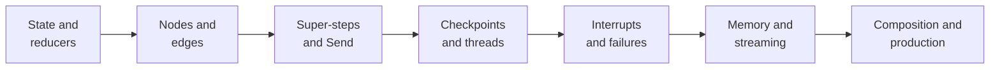
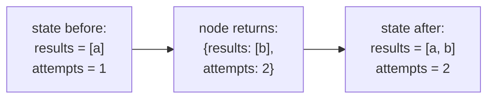
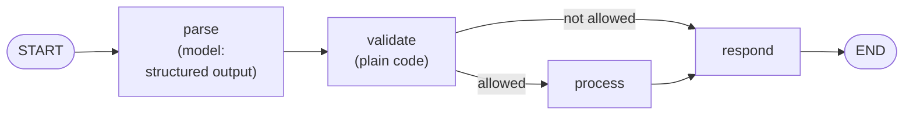
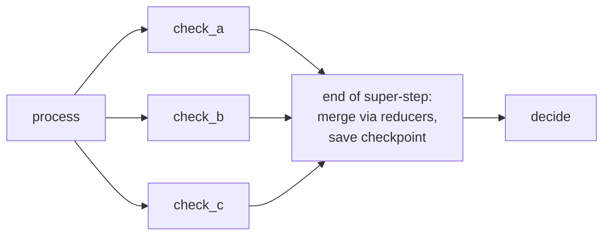
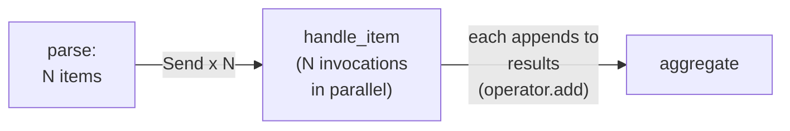
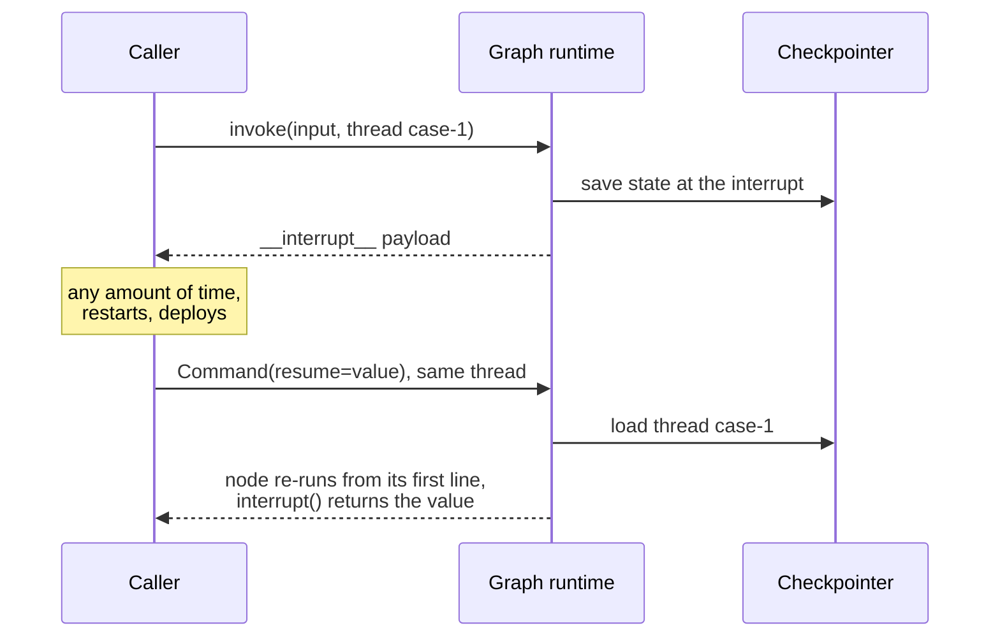
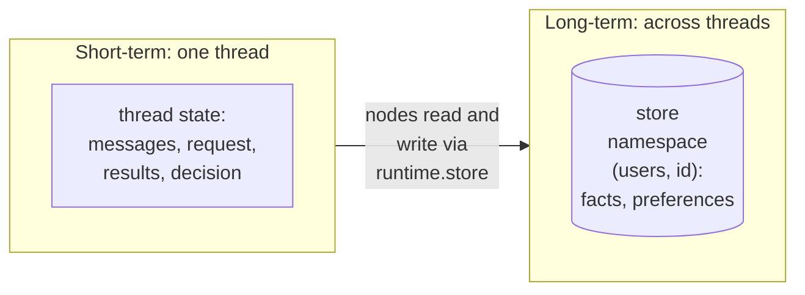
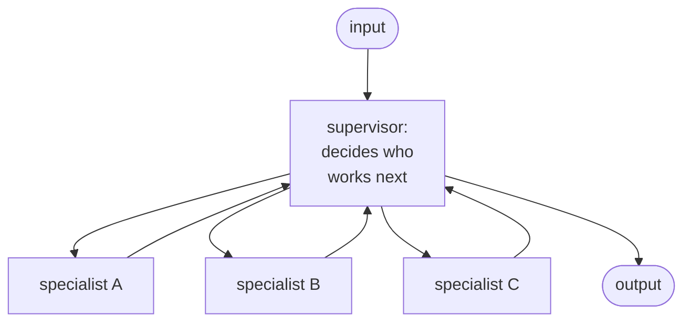
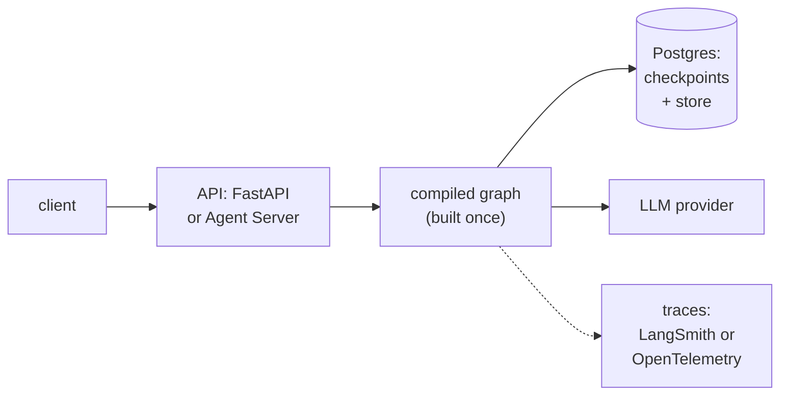

LangGraph is a low-level runtime for stateful, long-running workflows built around language models. This chapter describes its concepts in dependency order: state and reducers, nodes and edges, the super-step execution model, dynamic fan-out, persistence, interrupts, fault tolerance, memory, streaming, composition and deployment. For each concept it covers what it is, why it exists, how it works internally, its guarantees, and when to use it instead of the alternatives. API names follow LangGraph v1 (October 2025).



## 1. What LangGraph is, and why it exists

**The problem.** In an agent loop (chapter 13) the model chooses every step: which tool to call, and when to stop. That flexibility is a liability for processes with requirements such as "this check always runs before that action", "a person always approves this category of decision", or "the process always terminates". A prompt can ask for these properties; only code can guarantee them.

**The model.** LangGraph expresses a workflow as a **graph**:

- **State**: a typed, shared record of everything the run knows.
- **Nodes**: steps, each a function from state to a partial state update. A node may call a model, a tool, an API or plain code.
- **Edges**: rules that decide which nodes run next.

**What the runtime adds** beyond ordinary function calls, and what long-running AI workflows specifically need:

- **Persistence**: state is checkpointed after every step, so a run can resume after a crash, continue days later, or be replayed.
- **Human-in-the-loop**: a run can pause indefinitely for human input and resume, even on a different server.
- **Streaming**: every step's output, and model tokens from inside nodes, can be streamed as they happen.

**Relationship to LangChain.** They are layers, not competitors. `create_agent` compiles to a LangGraph graph, and an agent can be one node of a larger graph. The design choice is **who owns the control flow**: the model (`create_agent`), or the developer (an explicit graph that uses the model inside chosen nodes).

Say it like this: "LangGraph is a runtime for stateful workflows as graphs: nodes are steps, edges decide what runs next, and a typed state is checkpointed after every step. I use it when the control flow must be mine, with fixed steps, branches, parallel work, approvals or several agents, and I need persistence and pause-and-resume."

## 2. State, channels and reducers

**The state schema.** A graph's state is declared as a typed schema, usually a `TypedDict` (a dataclass or Pydantic model also works). Each key is a **channel**: an independently updated slot with its own merge rule.

```python
import operator
from typing import Annotated, TypedDict
from langgraph.graph.message import add_messages

class WorkflowState(TypedDict):
    messages: Annotated[list, add_messages]        # append; replace by message id
    request: dict                                  # overwrite
    results: Annotated[list[dict], operator.add]   # concatenate: parallel writers accumulate
    decision: str                                  # overwrite
    attempts: int                                  # overwrite
```

**Updates, not mutation.** A node never mutates the state it receives. It **returns a partial update**: a dict containing only the keys it changed. The runtime merges the update into the state key by key, using each key's **reducer**:

- **No reducer**: the new value **replaces** the old one.
- `operator.add`: lists are **concatenated**, so updates accumulate.
- `add_messages`: new messages are **appended**, and a message whose id already exists **replaces** the old one, which is how messages are edited or removed.
- Any function `(old, new) -> merged` can be a custom reducer.



**Why reducers exist: concurrent writes.** When several nodes run in the same step and write the same key, the runtime needs a deterministic rule to combine their values. With a reducer, all updates are merged. Without one, there is no correct winner, and LangGraph raises `InvalidUpdateError`. The fix is a reducer on that key, or a separate key per writer.

**State design principles.**

- **Small and factual**: identifiers, decisions and short results, not rendered prompts or whole documents. State is serialised at every checkpoint, so its size is a cost on every step.
- **Input and output schemas** can be narrower than the internal state: callers send only the input keys and receive only the output keys, while intermediate keys stay private.
- `MessagesState` is a predefined state with a single `messages` key using `add_messages`; subclass it to add fields.

## 3. Nodes, edges and Command

**Nodes.** A node is a function (sync or async) that takes the state, and optionally a `config` or `runtime` argument, and returns a partial update.

**Edges.**

- A **normal edge** always transfers control to the same node.
- A **conditional edge** calls a router function that reads the state and returns the next node's name, or a list of names to run several in parallel.
- **`START`** and **`END`** are the virtual entry and exit nodes.

```python
from langgraph.graph import StateGraph, START, END

def parse(state: WorkflowState):
    req = model.with_structured_output(Request).invoke(state["messages"][-1].content)
    return {"request": req.model_dump()}

def validate(state: WorkflowState):
    ok = rules.allows(state["request"])          # deterministic business rule: plain code
    return {"decision": "continue" if ok else "reject"}

def route(state: WorkflowState) -> str:
    return "process" if state["decision"] == "continue" else "respond"

g = StateGraph(WorkflowState)
g.add_node("parse", parse)
g.add_node("validate", validate)
g.add_node("process", process)
g.add_node("respond", respond)
g.add_edge(START, "parse")
g.add_edge("parse", "validate")
g.add_conditional_edges("validate", route, ["process", "respond"])
g.add_edge("process", "respond")
g.add_edge("respond", END)
app = g.compile()
```



**Design principle: use the model only where judgement is needed.** Turning free text into a structured request requires a model. Checking a deterministic business rule does not; as plain code it is cheaper, faster, testable, and cannot be argued out of its decision by input text. Graphs make this split explicit.

**Command: update and route in one return.** A node can return `Command(update={...}, goto="node_name")` to update state and choose the next node together. It suits nodes whose own work determines the destination, and removes the need for a separate router. `Command(goto=..., graph=Command.PARENT)` routes to a node in the parent graph (section 11).

**Compilation.** `compile()` validates the structure (every edge targets an existing node, no orphaned nodes) and returns a Runnable application with `invoke`, `stream`, `batch` and async variants. Checkpointers, stores, caches and static interrupt points are attached at compile time.

## 4. The execution model: super-steps

**Background.** LangGraph's runtime follows the **bulk synchronous parallel** model of Google's Pregel system for large-scale graph processing. Execution proceeds in discrete rounds called **super-steps**.

**One super-step:**

1. Every node scheduled for this round executes. Nodes in the same round run **in parallel**.
2. All of them read the state **as it was at the start of the round**; no node sees another's update within the round.
3. At the end of the round, all updates are applied through the reducers, and the state is **checkpointed**.
4. Edges are evaluated to schedule the next round. When no node is scheduled, the run ends.

These rules make parallel execution deterministic: the result does not depend on which parallel node finishes first.

**Fan-out and fan-in.**

```python
g.add_edge("process", "check_a")
g.add_edge("process", "check_b")
g.add_edge("process", "check_c")
g.add_edge(["check_a", "check_b", "check_c"], "decide")   # decide waits for all three
```



A **fan-out** is a node with edges to several nodes: they execute together in one super-step, so three independent calls of 2 seconds each complete in about 2 seconds rather than 6. A **fan-in** is several edges into one node; with the list form above, the target runs once, after all sources have completed.

**Termination.** Graphs may contain cycles (retry loops, clarification loops), so termination must be enforced. Every run has a **`recursion_limit`**, the maximum number of super-steps, set in the run config; exceeding it raises `GraphRecursionError`. The default has changed between versions, so set it explicitly. A more graceful design puts the bound in the state: an `attempts` counter checked by the router, or the `RemainingSteps` managed value, so the graph exits through a defined path instead of an exception.

## 5. Dynamic fan-out: Send

**The problem.** Static edges fix the number of parallel branches when the graph is built. Many workloads only know the number of parallel tasks at run time: one task per item in a list, per document, per sub-question.

**Send.** A conditional edge's router can return a list of **`Send(node, input)`** objects. Each creates one invocation of the target node with its own private input, and all of them run in the same super-step:

```python
from langgraph.types import Send

def per_item(state: WorkflowState):
    return [Send("handle_item", {"item": it}) for it in state["request"]["items"]]

g.add_conditional_edges("parse", per_item, ["handle_item"])
g.add_edge("handle_item", "aggregate")      # runs after every copy has finished
```



Each invocation sees only its `Send` payload and writes to a key with an appending reducer, so the results accumulate rather than overwrite. This is **map-reduce** inside a graph: `Send` is the map, the reducer and the downstream node are the reduce.

**Production considerations.** Bound the fan-out (an input with thousands of items must not trigger thousands of simultaneous model calls; batch or cap concurrency with `max_concurrency` in the config), and define what one failed invocation means for the whole run.

## 6. Persistence: checkpoints and threads

**Checkpoints.** A graph compiled with a **checkpointer** saves a **checkpoint** after every super-step: the full state, the nodes scheduled next, and metadata. This one mechanism underlies interrupts, fault recovery, conversation memory and debugging.

```python
from langgraph.checkpoint.postgres import PostgresSaver

app = g.compile(checkpointer=PostgresSaver.from_conn_string(DB_URL))
config = {"configurable": {"thread_id": "case-1"}}
app.invoke({"messages": [("user", "...")]}, config)
```

**Threads.** A **thread** is a sequence of runs that share state, identified by `thread_id`: one conversation, one case, one job. Invoking with the same thread id continues from that thread's latest checkpoint.

**Checkpointer implementations.** `InMemorySaver` for development and tests (lost on restart); `SqliteSaver` for single-process use; `PostgresSaver` for production, where any instance can continue any thread.

**Durability modes.** Each run chooses when checkpoints are written, trading safety against latency:

- `durability="sync"`: each checkpoint is written before the next step starts. Safest.
- `durability="async"`: checkpoints are written in the background while the next step runs. Faster; a crash can lose the latest step.
- `durability="exit"`: state is written only when the run finishes or pauses. Fastest; suited to short runs where mid-run recovery is unnecessary.

**Inspection and time travel.** `app.get_state(config)` returns the latest snapshot and `app.get_state_history(config)` lists every checkpoint. Passing a `checkpoint_id` in the config **replays** from that point. `app.update_state(config, values)` writes a corrected state and creates a **fork**: execution continues from the modified checkpoint, leaving the original history intact. This is the primary debugging tool for agent workflows: change one step's output and observe what follows.

Say it like this: "With a checkpointer, LangGraph saves the state after every super-step under a thread id. That is what lets a run pause for a human, resume on another server after a restart, continue a conversation, or be replayed and forked for debugging."

## 7. Human-in-the-loop: interrupt and resume

**Mechanism.** Calling `interrupt(value)` inside a node suspends the run. The runtime saves the state and returns `value` to the caller under the `__interrupt__` key. The run stays suspended, consuming no compute, for as long as needed. The caller resumes it by invoking the same thread with `Command(resume=...)`:

```python
from langgraph.types import interrupt, Command

def review(state: WorkflowState):
    answer = interrupt({"request": state["request"], "results": state["results"]})   # suspend here
    return {"decision": "approve" if answer["approved"] else "reject"}

def act(state: WorkflowState):                  # side effect in its own node, after approval
    external_api.execute(state["request"], idempotency_key=state["request"]["id"])
    return {"messages": [("ai", "Done.")]}

out = app.invoke({"messages": [...]}, config)          # stops; out["__interrupt__"] holds the payload
app.invoke(Command(resume={"approved": True}), config) # later, possibly on another server
```



**Re-execution semantics, the critical rule.** On resume, **the interrupted node runs again from its first line**; this time `interrupt()` returns the resume value instead of suspending. Consequences:

- Any code before `interrupt()` in that node executes twice. Side effects (payments, emails, writes) must therefore come after the interrupt, or better in a separate node, and must be idempotent.
- If a node contains several `interrupt()` calls, resume values are matched to them **by position**, so their order must be deterministic across executions.
- A checkpointer is required: the suspended state must be stored somewhere.

**Common patterns.** Approve or reject an action; edit the state before continuing; review and correct a tool call's arguments; collect missing input. `HumanInTheLoopMiddleware` (chapter 13) packages the tool-approval pattern for `create_agent`. Static breakpoints (`interrupt_before` / `interrupt_after` at compile time) also exist, mainly for debugging.

Say it like this: "interrupt() pauses the graph and saves its state; the caller resumes the same thread with Command(resume=value). On resume the node re-runs from its start and interrupt() returns the value, so side effects go after the interrupt or in a separate node, and they are idempotent."

## 8. Fault tolerance: retries and durable execution

**Retry policies.** A node can be registered with a retry policy: `g.add_node("call_api", call_api, retry_policy=RetryPolicy(max_attempts=3))` retries with exponential backoff and jitter. By default it retries common transient exceptions; `retry_on` narrows it. Retries are for transient faults (timeouts, rate limits, 5xx responses), not for invalid input.

**Resuming after a crash.** If a process dies mid-run, invoking the same thread with `None` as input (`app.invoke(None, config)`) continues from the last checkpoint. Within an interrupted super-step, nodes that had already completed are not re-executed: their outputs are stored as **pending writes** and reapplied.

**Side effects are the residual risk.** A node that performed an external action but crashed before its update was saved will run again on resume. Two defences:

- An **idempotency key** on the external call, so the remote system recognises and ignores the duplicate.
- Wrapping the action in a **`@task`** (the functional API, section 11), whose result is persisted and reused instead of recomputed.

**Node caching.** `cache_policy=CachePolicy(ttl=...)` on a node, with a cache passed to `compile`, skips re-execution when the node's input has been seen within the TTL. It suits expensive, deterministic steps.

The principle: **checkpoints make a workflow resumable; idempotency makes it safe to resume.**

## 9. Memory and run context

- **Short-term memory** is the thread's state, persisted by the checkpointer: everything about one conversation or case. Long message histories are trimmed or summarised to stay within the context window.
- **Long-term memory** is a **store** shared across threads, passed as `compile(store=...)` (`InMemoryStore` in development, a Postgres-backed store in production). Items are addressed by a namespace tuple such as `("users", user_id)` and a key, with `put`, `get` and `search` (semantic search when the store has an embedding index). Nodes access it through `runtime.store`.
- **Run context** carries per-run configuration that is not state (the caller's identity, model choice, feature flags). Declare it with `StateGraph(WorkflowState, context_schema=Ctx)`, pass it as `context={...}` on invoke, and read it in a node that takes a `runtime: Runtime[Ctx]` parameter. Context is not checkpointed and not visible to the model unless a node passes it on.



## 10. Streaming

A run can stream in several modes:

- `"updates"`: each node's update, tagged with the node name, for step-by-step progress.
- `"messages"`: model tokens from inside any node, with metadata identifying the node.
- `"custom"`: arbitrary events a node emits with `get_stream_writer()` (or `runtime.stream_writer`).
- `"values"`: the full state after each super-step.
- `"debug"`: detailed execution events.

A list of modes streams several at once, and `subgraphs=True` includes events from nested graphs. Behind an HTTP API, events are usually forwarded as Server-Sent Events.

## 11. Composition: subgraphs, multi-agent systems and the functional API

**Subgraphs.** A compiled graph can be used as a node of another graph. When parent and child share state keys, the compiled subgraph is added as a node directly; when their schemas differ, a node invokes the subgraph and maps state in and out. Subgraphs let separate teams build, test and version components independently, and keep internal keys private.

**Multi-agent architectures** are built from the same primitives:



- **Supervisor**: a coordinating node routes work to specialist agents (often subgraphs with their own tools and prompts) and collects their results. Centralised control is easier to trace, test and evaluate.
- **Handoffs (swarm)**: agents transfer control directly to each other, for example with `Command(goto="other_agent", graph=Command.PARENT)`. Fewer hops, but the global behaviour is harder to reason about.

Splitting into multiple agents is justified when the parts need genuinely different tools or instructions, or can work in parallel. Otherwise a single agent with well-designed tools is cheaper, faster and easier to evaluate.

**The functional API** expresses workflows as ordinary Python: an `@entrypoint` function calls `@task` functions, each returning a future (`.result()` waits for it). It keeps checkpointing, interrupts and streaming without declaring a graph, and each task's result is persisted, so a resumed run reuses completed tasks. It suits mostly linear logic; the graph API suits processes whose structure should be explicit and inspectable.

## 12. Running LangGraph in production



- **Compile once** at startup, not per request. A compiled graph holds no run data; runs live in the checkpointer.
- **Thread ownership.** Thread ids are generated by the application and bound to the authenticated user, so no caller can read or resume another user's thread.
- **Durable shared storage.** A Postgres checkpointer and store let any instance continue any thread after a restart or deploy.
- **Serving.** Either an application server (for example FastAPI streaming over SSE) or LangGraph's Agent Server (configured by `langgraph.json`, run locally with `langgraph dev`, hosted through LangSmith Deployment). The Agent Server adds a task queue, background runs, scheduled runs, and policies for **double-texting**, a new input arriving while a run on the same thread is still active: reject, enqueue, interrupt or roll back.
- **Bounds everywhere**: attempt counters in state, a recursion limit, token and cost budgets per run, and timeouts on every external call.
- **Observability and evaluation**: traces of every run, and evaluations of whole **trajectories** (did the required check run before the action?), not only final outputs.

## What comes next

Chapters 13 and 14 together form the framework layer: LangChain for model, tool and retrieval abstractions and the standard agent loop; LangGraph for workflows whose control flow is designed explicitly, with persistence, interrupts and streaming. The remaining question is the one interviews usually end on: for a given problem, which of the two, if either, is the right tool, and why.
