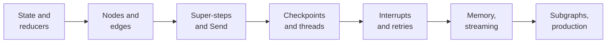
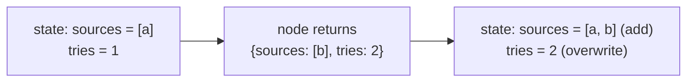
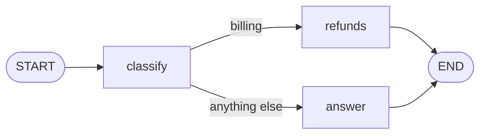
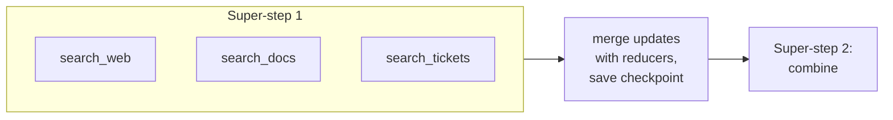
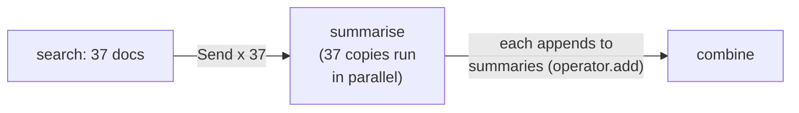
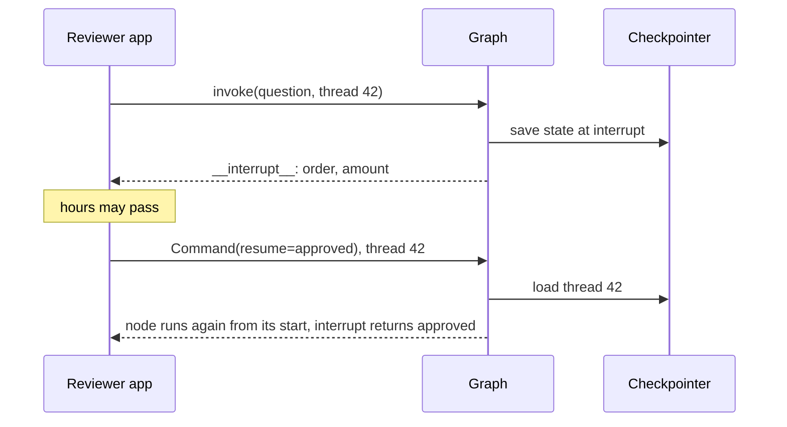
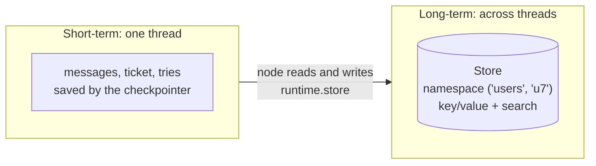
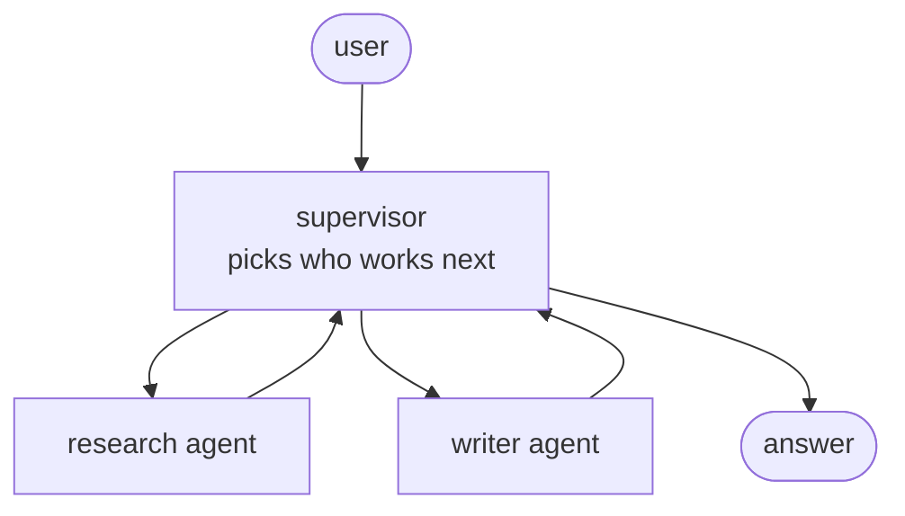
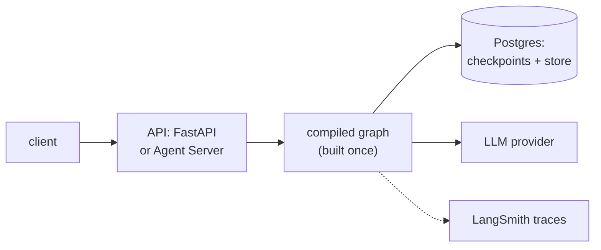

Chapters 5 to 7 used LangGraph to build agents that save their state and wait for approvals. This chapter is LangGraph itself, topic by topic: why it exists, state and reducers, nodes and edges, how a graph actually runs, fan-out with `Send`, checkpoints and threads, interrupts, failures and retries, memory, streaming, subgraphs and multi-agent designs, the functional API, and running it in production. Each section gives the idea first, then the code, then what interviewers ask.



## 1. Why LangGraph exists

An agent loop lets the model decide every step. That is flexible, and it is also the problem: the model can skip the policy search, call tools in the wrong order, or loop forever. Many real systems need some steps to be **fixed by you**: always classify first, always check permissions before a refund, always ask a human before sending money, run three searches in parallel and then merge.

**LangGraph** is a low-level runtime for writing such workflows as a **graph**: nodes are steps, edges say what runs next, and a shared, typed **state** carries everything the run knows. It adds the things long-running AI workflows need and plain code does not give you: the state saved after every step (resume after a crash, continue a conversation), pausing for a human, streaming every step, and a way to replay or fork a run.

| | LangChain `create_agent` | LangGraph |
|---|---|---|
| Who decides the steps | the model, in a loop | you, in a graph (the model can still decide at chosen points) |
| Effort | a few lines | you design state, nodes and edges |
| Use for | a standard tool-calling agent | fixed pipelines, branches, parallel work, approvals, several agents |

They are not rivals: `create_agent` compiles to a LangGraph graph, and an agent can be one node inside a bigger graph.

## 2. State and reducers

The **state** is the run's shared whiteboard: a typed schema, usually a `TypedDict` (a Pydantic model or dataclass also works).

```python
from typing import Annotated, TypedDict
import operator
from langgraph.graph.message import add_messages

class State(TypedDict):
    messages: Annotated[list, add_messages]     # append, or replace by message id
    sources: Annotated[list[str], operator.add] # append
    ticket: dict                                # no reducer: overwrite
    tries: int
```

A node never edits the state. It **returns a partial update**, a dict with only the keys it changed, and LangGraph merges it in using each key's **reducer**:

- no reducer: the new value **replaces** the old one;
- `operator.add`: lists are **concatenated**;
- `add_messages`: new messages are **appended**, and a message with an existing id **replaces** that one (which is how you edit or remove messages).



`MessagesState` is a ready-made state with one `messages` key using `add_messages`; subclass it to add fields.

Interview angle: "Two nodes running in parallel both write `sources`. What happens?" With `operator.add` both lists are kept. With no reducer LangGraph cannot choose a winner and raises `InvalidUpdateError`. Fix: give the key a reducer, or give each node its own key.

Keep the state small and factual: store ids and facts, not formatted prompts or whole documents, because it is saved at every step. You can also give the graph narrower **input and output schemas** so callers send only a question and get back only the answer, while internal keys stay private.

## 3. Nodes and edges

A **node** is a function `state -> partial update`. An **edge** says what runs next.

```python
from langgraph.graph import StateGraph, START, END

def classify(state: State):
    return {"ticket": classifier.invoke(state["messages"][-1].content).model_dump()}

def route(state: State) -> str:
    return "refunds" if state["ticket"]["category"] == "billing" else "answer"

g = StateGraph(State)
g.add_node("classify", classify)
g.add_node("refunds", refunds)
g.add_node("answer", answer)
g.add_edge(START, "classify")
g.add_conditional_edges("classify", route, ["refunds", "answer"])
g.add_edge("refunds", END)
g.add_edge("answer", END)
app = g.compile()
```



- A **normal edge** always goes to the same node.
- A **conditional edge** calls a router function that reads the state and returns the next node's name (or a list of names to run several).
- A node can also route itself by returning a **`Command`**: `return Command(update={"ticket": t}, goto="refunds")`, which updates the state and chooses the next node in one move. Use it when the node that does the work also knows where to go (a triage step handing off to a specialist).
- `compile()` checks the graph (no dangling nodes) and returns a runnable app with `invoke`, `stream`, `batch` and async versions.

## 4. How a graph runs: super-steps

LangGraph runs in rounds called **super-steps** (from Google's Pregel model for graph processing):

1. Every node scheduled for this round runs; several run **in parallel**.
2. They all read the state as it was at the start of the round; none sees another's update during the round.
3. At the end of the round, all updates are merged through the reducers, and the state is **checkpointed**.
4. The edges decide which nodes run in the next round. When nothing is scheduled, the run ends.



So a **fan-out** is just one node with edges to several nodes (they run together), and a **fan-in** is several edges into one node, which runs once, after all of them have finished.

Loops need a brake. Each run has a **`recursion_limit`** (a cap on super-steps, set in the config; current versions default to a very high number, so set your own) and raises `GraphRecursionError` when it is hit. Better brakes are in the state: a `tries` counter the router checks, or the `RemainingSteps` managed value, so the graph can end gracefully with a fallback answer instead of an error.

## 5. Fan-out you only know at run time: Send

When the number of parallel tasks depends on the data (summarise each of the 37 documents a search returned), a router returns a list of **`Send`** objects, one per task, each with its own input:

```python
from langgraph.types import Send

def fan_out(state: State):
    return [Send("summarise", {"doc": d}) for d in state["docs"]]

g.add_conditional_edges("search", fan_out, ["summarise"])
g.add_edge("summarise", "combine")      # combine waits for all of them
```



Each copy of `summarise` gets only its own small input, and writes into a key with an appending reducer, so the results add up instead of overwriting each other. This is **map-reduce**. Cap the fan-out (rate limits, cost), and decide what happens if one copy fails.

## 6. Persistence: checkpoints and threads

Compile with a **checkpointer** and LangGraph saves a **checkpoint**, a snapshot of the state plus what runs next, after every super-step:

```python
from langgraph.checkpoint.postgres import PostgresSaver

app = g.compile(checkpointer=PostgresSaver.from_conn_string(DB_URL))
config = {"configurable": {"thread_id": "conv-42"}}
app.invoke({"messages": [("user", "Refund order 48213")]}, config)
app.invoke({"messages": [("user", "And the second item?")]}, config)   # continues the same thread
```

- A **thread** is one sequence of runs that share state, named by `thread_id`: one conversation, one ticket, one job. Same thread id, same memory.
- Checkpointers: `InMemorySaver` (development; lost on restart), `SqliteSaver`, `PostgresSaver` (production).
- **Durability** (`durability="sync"`, `"async"` or `"exit"` when you run the graph) trades safety for speed: save each step before continuing, save in the background, or save only when the run ends.
- `app.get_state(config)` returns the latest snapshot; `app.get_state_history(config)` lists every checkpoint. You can **replay** from an old checkpoint (pass its `checkpoint_id`), or **fork** by writing a corrected state with `app.update_state(config, values)` and continuing from there. This is "time travel": debugging a bad run by changing one step and running on.

Checkpoints are what make the next three sections possible: memory, pausing for a human, and resuming after a crash.

## 7. Human-in-the-loop: interrupt and resume

`interrupt(value)` inside a node **pauses the run**, saves it, and returns `value` to the caller (what the human should review). Later, the caller resumes the same thread with `Command(resume=answer)`, and `interrupt` returns that answer inside the node.

```python
from langgraph.types import interrupt, Command

def approve_refund(state: State):
    decision = interrupt({"order": state["ticket"]["order_id"], "amount": state["ticket"]["amount"]})
    if decision["approved"]:
        return {"messages": [("ai", "Refund approved.")]}
    return Command(goto="explain_denial")

out = app.invoke({"messages": [...]}, config)     # stops; out["__interrupt__"] holds the payload
app.invoke(Command(resume={"approved": True}), config)
```



The rule interviewers check: **on resume, the node runs again from its first line**; `interrupt()` then returns the resume value instead of pausing. So anything before `interrupt()` in that node runs twice: keep side effects (charging, emailing) **after** the interrupt or in a separate node, make them idempotent, and keep several interrupts in one node in the same order every time. A checkpointer is required, because the paused run has to live somewhere.

## 8. When things fail: retries and durable execution

- **Retry policies** per node: `g.add_node("call_api", call_api, retry_policy=RetryPolicy(max_attempts=3))` retries a failing node with backoff, for transient errors.
- **Resuming after a crash**: run again on the same thread with `None` as input (`app.invoke(None, config)`), and the run continues from the last checkpoint. Nodes that had already finished in an interrupted super-step are not re-run, because their writes were saved.
- **Side effects inside a node** are the danger: a node that crashed after charging a card will charge again when it re-runs. Make such actions idempotent (an idempotency key) or wrap them in `@task` (functional API, section 11), whose result is saved and reused instead of being redone.
- **Node caching** (`cache_policy=CachePolicy(ttl=...)`, with a cache passed to `compile`) skips a node whose inputs were seen recently.

## 9. Memory: short-term and long-term



- **Short-term memory** is the thread's state, kept by the checkpointer. Trim or summarise old messages so the context stays within limits.
- **Long-term memory** is a **Store** (`InMemoryStore` for development, a Postgres store in production), passed to `compile(store=...)`. Items live under a namespace such as `("users", user_id)` with `put`, `get` and `search` (by meaning, if the store has an embedding index). Nodes reach it through `runtime.store`.
- **Per-run settings** that are not state (the user id, the model to use) go in a **context schema**: `StateGraph(State, context_schema=Ctx)`, passed as `context={...}` when you invoke, read as `runtime.context` in a node with a `runtime: Runtime[Ctx]` parameter.

## 10. Streaming

A graph run can stream in several modes:

| `stream_mode` | Emits |
|---|---|
| `"values"` | the full state after each super-step |
| `"updates"` | each node's update, with the node's name |
| `"messages"` | LLM tokens from any node, with metadata about which node produced them |
| `"custom"` | anything a node sends with `runtime.stream_writer` (or `get_stream_writer()`) |
| `"debug"` | everything, for debugging |

Pass a list to get several, and `subgraphs=True` to include events from inside subgraphs. In a web API, forward them to the browser as Server-Sent Events: tokens for the typing effect, updates for "checking your order...".

## 11. Subgraphs, multi-agent designs and the functional API

A compiled graph can be a **node** in another graph. If parent and child share state keys, add the compiled subgraph directly; if their schemas differ, call it inside a node function and translate the state in and out. Subgraphs let a team own and test a piece separately, and can keep their own private keys.

Multi-agent systems are built from this:



- **Supervisor**: one coordinating node (or agent) routes to specialists and collects their results; specialists may be subgraphs. Easier to control and debug.
- **Handoffs / swarm**: agents pass control to each other directly with `Command(goto="writer", graph=Command.PARENT)`. Fewer hops, harder to reason about.

Split into several agents only when the parts need different tools or instructions, or can run in parallel; otherwise one agent with good tools is cheaper and easier to evaluate (chapter 6).

The **functional API** writes the same workflows as ordinary Python: an `@entrypoint` function that calls `@task` functions (each returns a future; call `.result()`). It keeps checkpointing, interrupts and streaming without drawing a graph, and suits workflows that are mostly linear code. Use the graph API when you want the structure to be explicit and visible.

## 12. LangGraph in production



- **Compile once** at startup, not per request; the graph is stateless, and the state lives in the checkpointer.
- **A thread per conversation or job**; the thread id comes from your system, so a user can only reach their own threads.
- **Postgres** checkpointer and store, so any server instance can continue any thread after a restart.
- Serving: your own FastAPI app streaming over SSE, or LangGraph's Agent Server (`langgraph.json`, `langgraph dev` locally, LangSmith Deployment in the cloud), which adds task queues, background runs, cron jobs and handling of **double-texting** (a user sending a new message while the previous run is still going: reject, queue, interrupt or roll back).
- Caps everywhere: a loop counter in the state, a recursion limit, token and cost budgets, timeouts on every tool.
- Tracing in LangSmith or OpenTelemetry, and evaluations on whole trajectories, not only final answers (chapter 8).

## What comes next

Between chapters 13 and 14 you have the whole framework layer: LangChain for models, tools and the standard agent; LangGraph for the workflows you design yourself. The interview drill below goes through the questions both are asked about.
