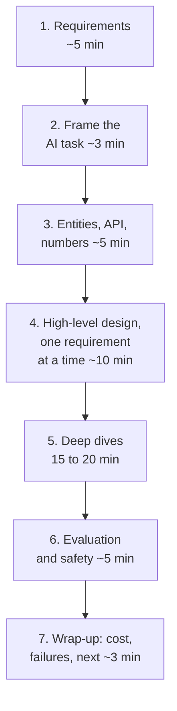
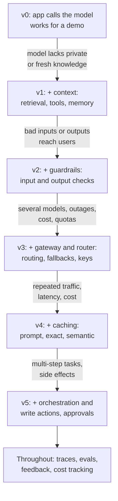
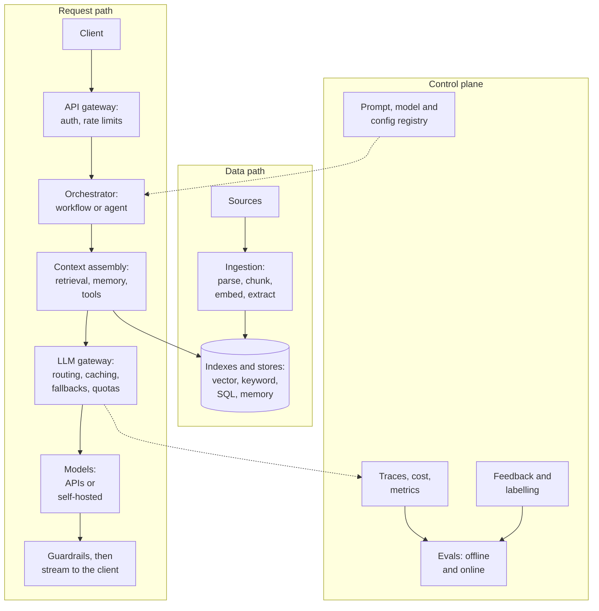
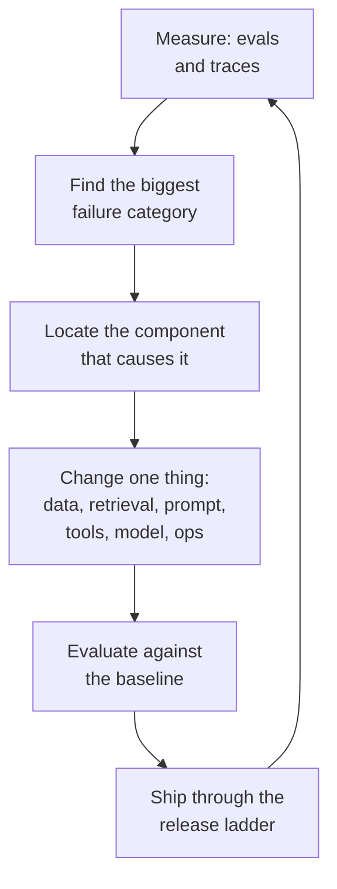

AI system design rounds test two things at once: classic system design (APIs, data, scale, failure) and the AI layer (where quality comes from, how it is measured, how the model fails, what it costs). Weak answers draw a box labelled "LLM" and stop. Strong answers frame the AI task precisely, grow the architecture one justified component at a time, go deep on the riskiest parts with honest trade-offs, and quantify cost, latency and quality. This page is the framework to run every time, plus the tools for critiquing and improving any AI system.

## 1. The framework, and requirements



Requirements anchor everything after them, so write them on the board in this shape:

```text
Functional (core, 3 to 5)
1. Users should be able to ask questions about company documents and get cited answers.
2. Users should be able to ask follow-up questions.
3. Users should only see answers built from documents they can open.
Below the line (out of scope)
- Editing documents, analytics over databases, voice.
Non-functional (top 3 to 5, quantified)
- The system should stream the first token within 2 s at p95.
- The system should reflect revoked access within 5 minutes.
- The system should never leak across tenants or permissions.
- The system should cost under $0.01 per answered question.
```

- **Functional** requirements are user-facing ("Users should be able to..."). Keep the core list short and say explicitly what is **below the line**: it shows judgement and protects your time.
- **Non-functional** requirements are system qualities ("The system should..."). Quantify them ("p95 under 2 s", not "fast") and pick the 3 to 5 that matter from: latency (time to first token and total), the quality bar, scale, cost per request or task, freshness, data sensitivity and tenancy, availability, and the safety of actions.
- The AI-specific questions that change the design:
  - What does a good result look like, and **what does a wrong result cost compared with no result**?
  - Where does the knowledge live, how fresh must it be, and **who may see what**?
  - Can it take actions, and which are reversible?
  - What exists already: data, labels, traffic, an earlier version?
  - Which providers are allowed; on-premises or data-residency constraints?
- **Given a half-built system to extend**, spend the first minutes on the goal and users, what exists and works, what is failing and how that is known, and the constraints; then state your assumptions and plan.

## 2. Framing the AI task, and the numbers

**Say exactly what the model must do** before drawing anything. Most candidates skip this; it is where AI rounds are won.

- **The model's job**, one or more of: classify, extract, generate, retrieve and answer, plan and act.
- **Inputs and outputs**: what goes in (a question plus documents, a ticket, a page image) and what comes out (text with citations, a JSON object with a schema, a tool call).
- **The approach ladder**, cheapest and most predictable first: rules or code; classic ML or search; a single prompt; retrieval; tools in a fixed workflow; an agent; fine-tuning. Pick the lowest rung that meets the quality bar and say why the rungs below fail.
- **Is an LLM needed at all?** Exact lookups, deterministic business rules and high-volume ranking are often better without one. Saying so is a strong signal.
- **Workflow or agent**: default to a workflow. Choose an agent only where the next step depends on what was found, the environment gives feedback, and mistakes are recoverable or reviewed, and name its controls in the same breath: budgets, scoped tools, approvals, idempotent writes, outcome checks, traces.

**Entities and API.** A first draft of the nouns (documents and chunks, conversations and messages, runs and tool calls, proposals and approvals, feedback, eval cases) and a few endpoints, for example `POST /conversations/{id}/messages` streamed with server-sent events. **User and tenant identity come from the auth token**, never from the request body and never from model output.

**Numbers, only where they change a decision.** In AI designs these usually do:

- **Tokens and cost per request** decide model choice and routing: requests x tokens x price, input and output separately.
- **Tokens per minute against the provider quota** decide batch APIs, quota requests, extra providers or self-hosting.
- **Concurrency = arrival rate x duration** (Little's law): 350 requests per second each streaming for 4 s is about 1,400 open streams; this decides the streaming infrastructure.
- **Vector storage** (chunks x dimensions x 4 bytes) decides index type, quantisation and sharding.
- **Ingestion throughput** (documents x tokens / embedding or extraction rate) decides pipeline parallelism and the initial load plan.
- Requests per second = daily requests / 86,400, times a peak factor of 2 to 3.

## 3. Building the design

**One requirement at a time.** Take the functional requirements in order. For each, add only the components it needs and narrate a numbered flow: who calls whom, what is read or written, what state changes. Park complexity ("this is where a cache goes; I'll come back to it"): a working end-to-end design first, hardening later.

**How AI systems grow.** Most designs climb the same staircase, and each layer is added because of a specific failure of the one before. Use it to build your answer in a sensible order and to spot what any design is missing:



The full reference architecture, with every layer in place:



- **Request path**: authenticate and rate-limit, run the workflow or agent, assemble context, call models through a gateway, check outputs, stream back.
- **Data path**: turns sources into what the request path needs. It runs continuously and decides most of the quality.
- **Control plane**: traces and cost, offline and online evals, versioned prompts, models and configuration, and the feedback that turns production failures into eval cases.

**The product layer: design for being wrong.** Models will be wrong some of the time, so the interface is part of the design: set expectations about what the assistant can do; show the evidence (citations, the quoted span, the data behind a number) so users verify in one click; ask a clarifying question rather than guess; make suggestions easy to dismiss, edit and undo, and confirm the exact action before anything irreversible; keep a visible path to a human; stream and show progress for anything slow; and capture feedback by design, explicit (thumbs, regenerate, corrections) and implicit (accepted, edited, ignored, rephrased), wired into the evals.

## 4. Deep dives, evaluation and wrap-up

**Choosing deep dives**: the non-functional requirement most at risk, the component most likely to fail or leak, and whatever the interviewer probes. Propose them yourself rather than waiting to be asked.

**Presenting each one**: phrase it as a question, then climb from a naive solution to a strong one, naming the challenge that pushes you up each rung. **Bad**: the obvious approach and why it breaks. **Good**: a reasonable approach and the challenge that remains. **Great**: what you would build, its cost, and how you would validate it. For "how does a user never see a document they cannot open?":

- **Bad**: tell the model not to reveal restricted content. Once text is in the context it can be repeated, and injected instructions override the rule.
- **Good**: retrieve, then drop results the user cannot access. Narrow-access users get empty answers, and stale permissions still leak.
- **Great**: store access principals on every chunk and filter inside the search, propagate permission changes within minutes, re-check sensitive results against the source, and scope caches by permission.

This climb is what interviewers mean by "discussing trade-offs": it shows you know why the simple thing fails.

**Evaluation and safety**: the offline eval set (where cases come from, the criteria, code checks and calibrated judges) and the release gate; online signals and the release ladder (shadow, canary, A/B); the threat model (what untrusted input can reach, what the model can touch, where output goes) and the guardrails and approvals that follow.

**Wrap-up**: cost per request and per resolved task with the biggest lever; what saturates first (provider quotas, GPUs, index memory, ingestion); how each dependency fails and how the system degrades; what you would build next.

## 5. Critiquing and improving any system

Run these lenses over any design, yours or the interviewer's, to find failure cases and improvements:

1. **Data**: where does knowledge come from, how fresh and clean, what does parsing lose, who may see it?
2. **Quality**: what is "good", how is it measured, what are the top failure categories, which component causes each?
3. **Failure**: for each component, what if it is slow, down, wrong, fed malicious input, or expensive? Blast radius, detection, recovery?
4. **Security**: what can untrusted input reach, what can the model touch, where does output go? Are private data, untrusted content and a way out combined in one flow?
5. **Cost**: tokens per task, the dominant cost, the cheapest lever.
6. **Latency**: the critical path, sequential model calls, time to first token versus generation.
7. **Scale**: what saturates first?
8. **Operations**: versioning of prompts, models and indexes; rollout and rollback; on-call signals.
9. **Humans**: where people review, approve and label, and how their decisions flow back.
10. **Evolution**: what changes with new models or ten times the data, and what is designed to be swapped?



Fixes usually pay off in this order: data and ingestion, retrieval, prompt and context, tools and workflow structure, model choice and routing, fine-tuning or distillation, then operational levers such as caching and batching. Every fix is proven on the evals before it ships.

**Common mistakes**: jumping to an agent or multi-agent design for a task a workflow handles; treating the model as the source of truth for permissions, prices, policies or ids; "we'll use an LLM judge" with no calibration; no numbers (tokens, cost, quotas, latency); no timeouts, retries, fallbacks, idempotency or degradation; assuming outputs are deterministic and well-formed; designing every box before anything works end to end; talking over the interviewer instead of checking which deep dive they care about.

## 6. The common prompts, and the twist each one hides

| Prompt | What the interviewer is waiting for |
| --- | --- |
| Enterprise document Q&A | Permissions enforced in retrieval, freshness and deletes, verifiable citations, multi-tenancy |
| Support agent that takes actions | Policy in code, approvals, idempotent writes, verified outcomes, handoff to humans |
| ChatGPT-style assistant | Streaming at scale, context budget and memory, fair limits in tokens, abuse |
| Coding agent | Sandboxed execution, a repository larger than the context, verification by tests |
| LLM gateway | Per-tenant token limits, routing and fallbacks, caching dangers, cost attribution |
| Batch pipeline over millions of documents | Throughput against rate limits, resumable idempotent work, cost, quality by sampling |
| Text-to-SQL | Read-only safety and row-level security, schema linking, evaluation by comparing results |
| Document processing with human review | Confidence-based review, evidence for every value, a workflow engine, reliable delivery |
| Conversational product search | LLM off the hot path at high query rates, filters extracted from text, multi-turn refinement |
| Deep research agent | Parallel sub-agents, verified citations, injection from web pages, cost caps |
| Voice assistant | Latency budget per turn, streaming speech in and out, interruptions |


Say it like this: "I'll pin down requirements and what a wrong answer costs, frame exactly what the model does and the simplest approach that can work, size the numbers that drive decisions, then build the design one requirement at a time. After that I'll go deep on the two riskiest parts, from naive to strong solutions, and finish with evaluation, security, cost and failure modes."
