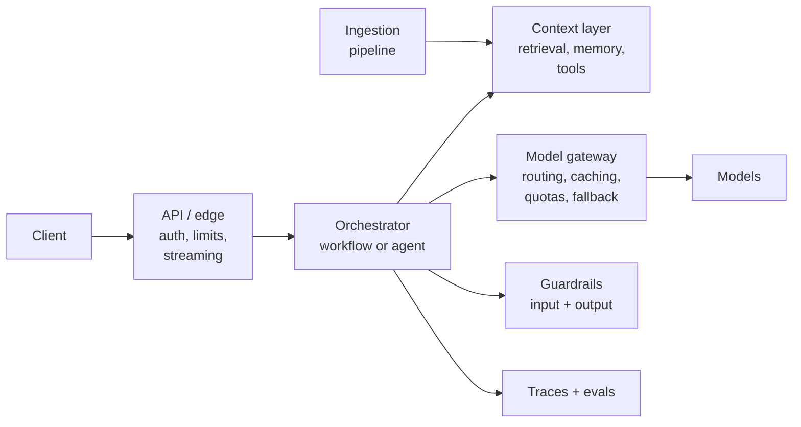
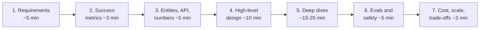

Every AI system design question, whatever the product, has the same skeleton: a request path that assembles context and calls a model, a data path that prepares what the model needs, and a control layer that keeps it safe, cheap and measurable. If you carry that skeleton in your head, a new prompt is never new: you are filling in the same boxes with different contents. This page is that skeleton plus the delivery script: what to **say** and what to **draw** at each step, in order, out loud.

Use it before every practice question. The ten designs that follow (DP-01 to DP-10) all use exactly this structure, so by the end the order becomes automatic.

## Why AI design interviews feel different

A classic design interview asks "can you build a system that stores and moves data reliably at scale?". An AI design interview asks that **and** four extra questions:

1. **Where does the model get the right information?** (retrieval, memory, tools, context)
2. **What is the model allowed to do?** (actions, permissions, human approval)
3. **How do you know it is right?** (evals, grounding, monitoring)
4. **What does each answer cost, and how long does it take?** (tokens, latency, routing, caching)

Most candidates fail by treating the model as magic ("the LLM figures it out") or by treating the design as a plain CRUD system with an API call bolted on. The interviewer wants both halves: solid backend and deliberate LLM decisions.

## The reference architecture: draw this first, every time



What each box is responsible for:

- **API / edge**: authentication (who is asking, which tenant), rate limits and quotas, and streaming the response back (Server-Sent Events).
- **Orchestrator**: the brain of the request. Either a **workflow** (fixed steps you wrote) or an **agent** (a loop where the model chooses tools). It builds the prompt, calls tools and the model, and holds the run's state.
- **Context layer**: everything the model needs to know that it does not already know: retrieved documents, user memory, conversation history, live data through tools.
- **Model gateway**: one place for every model call: picks the model, caches, enforces token budgets, retries and falls back when a provider fails, records cost.
- **Guardrails**: checks on what goes into the model (injection, PII, abuse) and what comes out (policy, format, grounding), and permission checks on any action.
- **Ingestion pipeline**: the asynchronous path that prepares data: connectors, parsing, chunking, embedding, indexing, keeping it fresh.
- **Traces and evals**: every request recorded step by step; offline test sets before release; online graders on live samples after.

**Say:** "Let me sketch the general shape first: an API layer, an orchestrator that builds context and calls the model, a context layer for retrieval and memory, a model gateway, guardrails, an ingestion pipeline that feeds the context layer, and tracing for evals. Then I'll fill in what this problem needs in each box."

Not every problem uses every box. A batch pipeline has no client streaming; a gateway problem *is* the gateway box. But starting from this picture means you never forget evals, guardrails or the data path.

## The delivery framework, step by step

A 45-60 minute round. Times are guides; the interviewer may pull you into a deep dive early, and that is fine. Two things you never skip, even when short of time: **a sentence on evaluation** and **a sentence on cost**.



### Step 1: Requirements (about 5 minutes)

**Say first:** "Before I design anything, let me make sure I understand what we're building and for whom."

Ask, then **write down** two short lists.

**Functional requirements**: the 3 or 4 things the system must do, phrased as "users can...". Explicitly push extras "below the line" so the scope is yours to control.

**Non-functional requirements**: classic ones (scale, availability, durability) plus the AI-specific questions that change the design:

| Ask about | Why it changes the design |
|---|---|
| Quality bar: can it be wrong? | Decides grounding, citations, abstention, human review |
| Actions: does it only answer, or also change things? | Decides tool permissions, approvals, idempotency |
| Latency: interactive or background? | Decides streaming, model size, whether it can be a job |
| Freshness: how current must the data be? | Decides sync design and caching |
| Data sensitivity and tenancy | Decides isolation, where models run, logging rules |
| Budget per request or per user | Decides model choice, caching, routing |

**When the prompt is vague or half-built** (you are handed an existing system to extend), do this before anything else:

1. **Restate and draw what exists**: "So today we have X and Y. I'm adding Z. Is that right?"
2. **Ask what is missing or broken**, not what to build.
3. **State assumptions instead of waiting**: "I'll assume 10,000 users a day and a 2-second budget. Tell me if that's off."
4. **Check in every 10 minutes**: "Does this match what you had in mind, or should I go deeper here?"

Interviewers score how you handle ambiguity. Silence while waiting for clarity reads as being stuck; decisive, stated assumptions read as seniority.

### Step 2: Success metrics (about 3 minutes)

**Say:** "Let me define what success means, because it decides what we evaluate."

Name one or two in each layer:

- **Business**: resolution rate, conversion, time saved, analyst acceptance.
- **Quality**: correctness, groundedness, citation accuracy, task success (pass^k for agents).
- **System**: time to first token, end-to-end latency, availability, cost per request.
- **Guardrail metrics** (must not get worse): wrong-action rate, data leakage incidents, refusal rate, cost.

This step is small but it is what most candidates skip, and it makes your later eval section concrete.

### Step 3: Core entities, API and the numbers (about 5 minutes)

**Core entities**: the nouns the system stores (conversation, document, chunk, job, action request...). One line each.

**API**: the 2-4 endpoints that matter, with what comes from the session (user, tenant) versus the body. **Say:** "The user and tenant come from the auth token, never from the request body."

**Estimation**: only the numbers that change the design. For AI systems, tokens matter more than requests:

```text
tokens per request   = system prompt + retrieved context + history + user input + output
tokens per day       = requests per day x tokens per request
cost per day         = input tokens x input price + output tokens x output price
concurrent streams   = requests per second x average stream duration (seconds)
vector storage       = chunks x dimensions x bytes per dimension
throughput limit     = provider tokens-per-minute / tokens per item  (for batch jobs)
```

Three quick conversions worth knowing: 1 million requests a day is about **12 per second** on average (peak is often 3-10x); 1,000 tokens is roughly **750 English words**; output tokens usually cost **several times** more than input tokens, so long answers are expensive.

If self-hosting comes up: model weights need about **parameters x bytes per parameter** of GPU memory (2 bytes at FP16, 1 at INT8, 0.5 at 4-bit). An 8-billion-parameter model at FP16 is about 16 GB; a 70-billion one about 140 GB, so it spans two 80 GB GPUs before counting the KV cache. Throughput per GPU you measure on your serving stack; say so rather than inventing it.

**Say:** "Two million questions a day at about 4,000 input tokens each is 8 billion input tokens a day, so generation cost dominates. That tells me context size and caching are real design levers."

### Step 4: High-level design (about 10 minutes)

Build the design **one functional requirement at a time**, drawing as you go. Start with the **simplest thing that works**: often one retrieval step and one model call. Add an agent, extra model calls or more services only when a requirement forces you to, and say why.

**Say:** "I'll start with the simplest version that meets requirement 1, then extend it for each of the others."

Decisions to state explicitly at this step, each with its reason:

| Decision | Default | Choose the other when |
|---|---|---|
| Workflow or agent | Workflow (fixed steps) | The steps genuinely depend on what the model discovers |
| Sync or async | Sync with streaming for chat | Work takes longer than ~30 s, or needs human review: a job with status |
| RAG, long context or fine-tuning | RAG for knowledge | Fine-tune for style, format or a narrow task at scale; long context for small, bounded document sets |
| Hosted API or self-hosted | Hosted | Data cannot leave, volume is high and steady, or latency needs a small dedicated model |
| One model or routing | One strong model to start | Clear easy/hard split in traffic, with evals proving the cheap model is good enough |
| Human in the loop | Only for high-impact actions | Mistakes are costly or irreversible |

### Step 5: Deep dives (15 to 20 minutes)

Pick the 2-3 hardest parts of **this** problem (or follow the interviewer). For each one, walk the ladder out loud:

- **Bad**: the obvious approach, and the specific way it fails.
- **Good**: a fix that works but has a limit you can name.
- **Great**: the design that handles the limit, with its trade-off.

**Say:** "The obvious approach is X. It breaks when Y. A better version is Z, which still struggles with W, so in production I'd do V."

The deep-dive menu by archetype (each design page goes through its own):

| Archetype | The usual deep dives |
|---|---|
| Retrieval and knowledge | permissions at retrieval, freshness and deletes, retrieval quality (hybrid, rerank), citations and abstaining |
| Chat products | streaming at scale, context window management, memory, token-based limits |
| Agents | tool safety and permissions, durable state and human approval, loops and budgets, sandboxing, reliability (pass^k) |
| Pipelines | throughput under rate limits, idempotency and resume, quality sampling, cost |
| Generation over structured data | grounding in a schema, validation before execution, safe execution |
| Platforms | quotas, routing and fallback, caching, high availability |

### Step 6: Evaluation and safety (about 5 minutes)

Never leave this out; it is the clearest signal of production experience.

**Say:** "Here's how I'd know it works before and after launch."

- **Offline**: a test set built from real failures, with code checks first and calibrated LLM judges for meaning; measure each component separately (retrieval vs generation; outcome vs trajectory for agents); gate every prompt, model or index change on it.
- **Online**: trace every request; run reference-free graders on a sample; watch feedback and operational signals (latency, refusals, format errors, cost); alert per slice.
- **Safety**: treat retrieved text and tool output as data, not instructions (prompt injection); enforce permissions and policy in code; human approval for risky actions; PII handling.

### Step 7: Cost, scale, failures and trade-offs (about 3 minutes)

**Say:** "Let me close with cost, scale and what fails."

- **Cost per request** and the levers: smaller models for easy steps, caching (provider prompt caching for stable prefixes, exact caches), shorter context, batch APIs for offline work.
- **Scale**: what you would shard or partition, and where the bottleneck moves next.
- **Failures**: provider outage (fallback), slow model (timeouts on time to first token), bad output (validation, retry, human review), data drift (re-evaluation).
- **One or two trade-offs** you made on purpose, and what would make you revisit them.

End with a 20-second summary of the whole design. Interviewers remember the last minute.

## What separates levels

- **Mid-level**: a working pipeline: retrieval or tools, a model call, streaming, basic error handling. Mentions evals when asked.
- **Senior**: drives requirements and success metrics; uses the simplest design that works and justifies each addition; designs data freshness, permissions, idempotency and durable state; separates component evals; budgets latency and cost with numbers.
- **Staff**: frames everything around risk and economics: what can go wrong and how costly it is, where humans belong, how quality is measured and kept from drifting, how the system degrades under failure, and how the design evolves as usage grows.

## The ten practice designs

| # | Design | Archetype | What it trains |
|---|---|---|---|
| DP-01 | Enterprise document Q&A | Retrieval | permissions at retrieval, freshness, grounding |
| DP-09 | Conversational product search | Retrieval + ranking | structured filters from language, latency, ranking |
| DP-03 | ChatGPT-style assistant with memory | Chat | streaming, context budget, memory, limits |
| DP-02 | Customer-support agent with actions | Agent | safe actions, approval, idempotency |
| DP-10 | Deep research agent | Long-running agent | planning, parallel sub-agents, citations, cost caps |
| DP-04 | Coding agent | Long-running agent | sandboxing, repo context, verification |
| DP-08 | Document extraction pipeline | Pipeline + human review | OCR, evidence, confidence routing, delivery |
| DP-06 | Batch LLM pipeline | Pipeline | throughput, idempotency, cost at scale |
| DP-07 | Text-to-SQL | Structured generation | schema grounding, safe execution |
| DP-05 | LLM gateway | Platform | quotas, routing, caching, availability |

How to practise each one: read the prompt, close the page, and do the whole framework **out loud for 45 minutes on paper**. Only then read the page and note what you missed. The gaps between your attempt and the page are your real study notes.

**Before the first design:** without looking, draw the reference architecture and say one sentence per box, then list the seven steps with their rough times.
