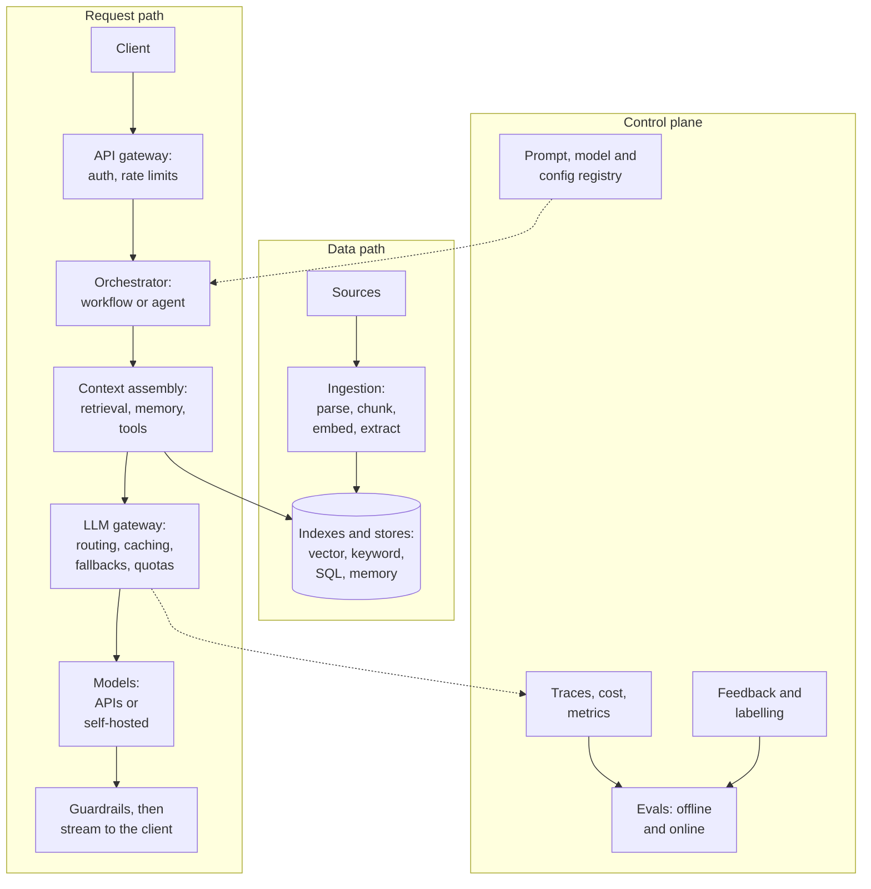
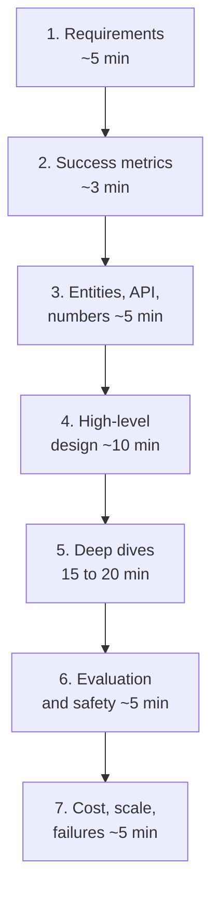
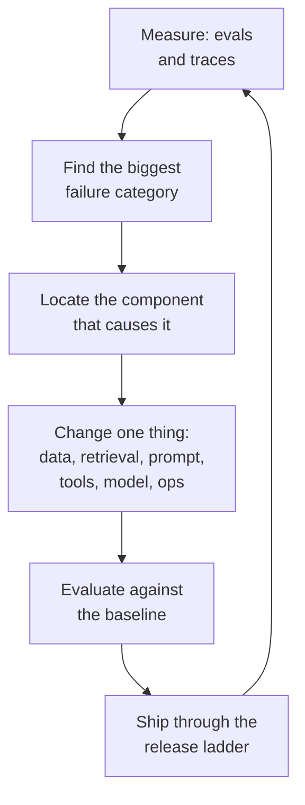

AI system design rounds test two things at once: classic system design (APIs, data, scale, failure) and the AI layer (where quality comes from, how it is measured, how the model fails, what it costs). Weak answers draw a box labelled "LLM" and stop. Strong answers spend their time on data, evaluation, failure, security and cost, and quantify all of it. This page is the framework to run every time, the architecture to draw first, and the lenses for critiquing and improving any AI system.

## 1. The reference architecture: draw this first

- **Request path**: authenticate and rate-limit, run the workflow or agent, assemble context (retrieval, memory, tool results), call models through a gateway, check outputs, stream back.
- **Data path**: turn sources into what the request path needs: indexes, extracted fields, memory. It runs continuously and decides most of the quality.
- **Control plane**: traces and cost, offline and online evals, versioned prompts, models and configuration, and the feedback that turns production failures into eval cases.

Every design in this section is this picture specialised. Drawing it first shows you think in systems, not prompts.

## 2. The delivery framework

### Step 1: Requirements

Functional: who the users are; what they ask or do; inputs and outputs; channels; languages; **answers only, or actions too**.

Non-functional: latency target (time to first token and total), availability, scale (users, requests per second, corpus size), cost budget per request or per task, data sensitivity and compliance, tenancy, and the human role.

The AI-specific questions that change the design:

- What does a good result look like, and **what does a wrong result cost compared with no result**?
- Where does the knowledge live, how fresh must it be, and **who may see what**?
- Can it take actions? Which are reversible?
- What exists already: data, labels, traffic, an earlier version?
- Constraints on models: providers allowed, on-premises, data residency?

State what is out of scope. **Given a half-built system to extend**, spend the first five minutes on: the goal and users, what exists and works, what is failing and how that is known (metrics, complaints), the constraints, then your assumptions and a plan.

### Step 2: Success metrics

- **Product**: task success or resolution rate, deflection, satisfaction, time saved, adoption.
- **Quality**: correctness on the eval set, groundedness, citation accuracy, pass^k for agents, escalation precision.
- **System**: p95 time to first token and total latency, availability, cost per resolved task.
- **Safety**: policy violations, data leaks, red-team injection success rate.

Pick one north-star metric and a few guardrails it must not break.

### Step 3: Entities, API and the numbers

- **Entities**: the nouns: documents and chunks, conversations and messages, runs and tool calls, proposals and approvals, feedback, eval cases.
- **API**: a few endpoints, for example `POST /conversations/{id}/messages` (streamed with server-sent events), `GET /runs/{id}`, `POST /feedback`, `POST /documents`.
- **Numbers**, done out loud:
  - Requests per second = daily requests / 86,400, times a peak factor of 2 to 3. 10 million requests a day is about 116 per second on average and about 350 at peak.
  - **Concurrency = arrival rate x duration** (Little's law): 350 requests per second each streaming for 4 seconds is about 1,400 open streams.
  - Tokens per request and per day, and the cost: requests x tokens x price, input and output separately.
  - Provider limits: tokens per minute needed versus the quota you have.
  - Storage: chunks x dimensions x 4 bytes for float32 vectors.
  - Ingestion time: documents x tokens / embedding or extraction throughput.

### Step 4: High-level design

Specialise the reference architecture. Walk one request end to end and say who does what at each step; walk the data path; name the model choice and why; and **say whether it is a workflow or an agent, and why**.

### Step 5: Deep dives

Choose two or three where the risk is: retrieval quality, permissions, freshness, agent actions and approvals, long-running execution, evaluation, latency, cost, multi-tenancy, ingestion at scale. For each: the problem, two or three options with trade-offs, your choice, and how you would validate it.

### Step 6: Evaluation and safety

The offline eval set (sources, criteria, graders, calibrated judges), online monitoring signals, and the release ladder; the threat model (injection, data leakage, excessive agency) and the guardrails.

### Step 7: Cost, scale, failures and trade-offs

Cost per request and per resolved task, and the biggest lever; what saturates first (provider quotas, GPUs, index memory, ingestion, the database); how each dependency fails and how the system degrades; and what you would build next.

## 3. Workflow or agent: decide out loud

Default to a workflow: code-defined steps are predictable, cheap and testable. Use an agent only where the next step genuinely depends on what was found, the environment gives feedback, and mistakes are recoverable or reviewed. When you choose an agent, name its controls in the same breath: budgets, scoped tools, approvals on irreversible actions, idempotent writes, verification of outcomes, traces.

## 4. Lenses for critiquing and improving any AI system

Run these over any design, yours or the interviewer's, to find failure cases and improvements:

1. **Data**: where does knowledge come from, how fresh and clean is it, what does parsing lose, who may see it?
2. **Quality**: what is "good", how is it measured, what are the top failure categories, and which component causes each?
3. **Failure**: for every component, what if it is slow, down, wrong, fed malicious input, or expensive? What is the blast radius, how is it detected, how does it recover?
4. **Security**: what can untrusted input reach, what can the model touch, where does output go? Is the lethal trifecta present? Is tenant isolation complete?
5. **Cost**: tokens per task, the dominant cost, the cheapest lever.
6. **Latency**: the critical path, the number of sequential model calls, time to first token versus generation, streaming.
7. **Scale**: what saturates first?
8. **Operations**: versioning of prompts, models and indexes; rollouts and rollback; the signals on-call watches.
9. **Humans**: where people review, approve and label, and how their decisions flow back.
10. **Evolution**: what changes in six months (new models, ten times the data or tenants), and what is designed to be swapped?

**The improvement loop**, in the order that usually pays most:

Typical order of fixes: data and ingestion, then retrieval (hybrid search, reranking, query rewriting), then prompt and context, then tools and workflow structure, then model choice and routing, then fine-tuning or distillation, then operational levers (caching, batching). Every fix is proven on the evals before it ships.

## 5. The common prompts, and the twist each one hides

| Prompt | What the interviewer is waiting for |
| --- | --- |
| Enterprise document Q&A | Permissions enforced in retrieval, freshness and deletes, citations you can verify, multi-tenancy |
| Support agent that takes actions | Policy in code, approvals, idempotent writes, verifying outcomes, handoff to humans |
| ChatGPT-style assistant | Streaming at scale, context budget and memory, fair rate limits in tokens, abuse |
| Coding agent | Sandboxed execution, understanding a repository larger than the context, verification by tests |
| LLM gateway | Per-tenant token limits, routing and fallbacks, caching dangers, cost attribution |
| Batch pipeline over millions of documents | Throughput against rate limits, resumable idempotent work, cost, quality by sampling |
| Text-to-SQL | Read-only safety and row-level security, schema linking, evaluation by comparing results |
| Document processing with human review | Confidence-based review, evidence for every value, a workflow engine, reliable delivery |
| Conversational product search | LLM off the hot path at high query rates, filters extracted from text, multi-turn refinement |
| Deep research agent | Parallel sub-agents, verified citations, injection from web pages, cost caps |
| Voice assistant | Latency budget per turn, streaming speech in and out, interruptions |

## 6. What separates levels

- **Weak**: boxes and arrows with an LLM in the middle; no numbers; no evals; failures not discussed.
- **Solid**: a sound pipeline with RAG, caching and some evaluation.
- **Strong**: turns requirements into metrics; quantifies tokens, cost, latency and throughput; deep-dives the riskiest parts with real trade-offs; has a calibrated evaluation plan; brings a threat model, failure modes and graceful degradation; plans the rollout; and says when **not** to use an LLM or an agent.

Say it like this: "I'll clarify requirements and what a wrong answer costs, fix the success metrics, size it with rough numbers, draw the request path, data path and control plane, then go deep on the two riskiest parts, and finish with evaluation, security, cost and failure modes."
