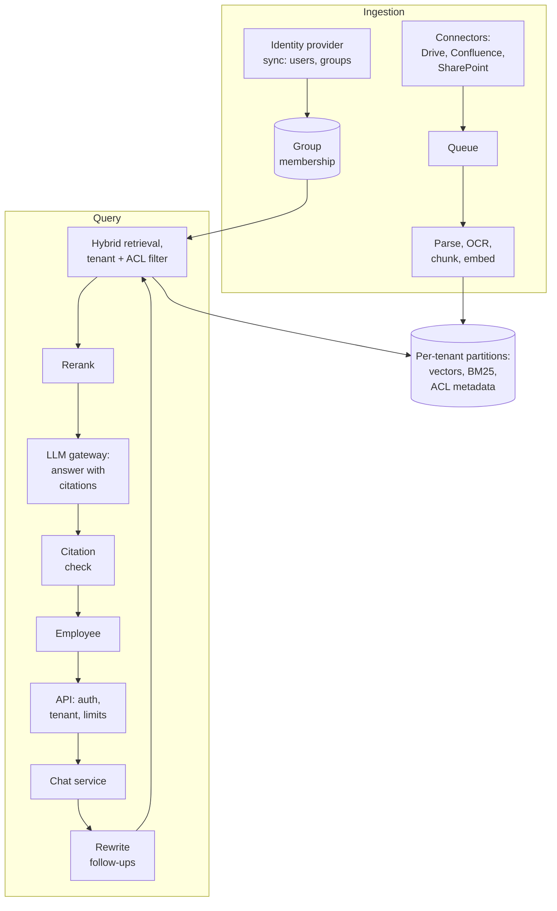
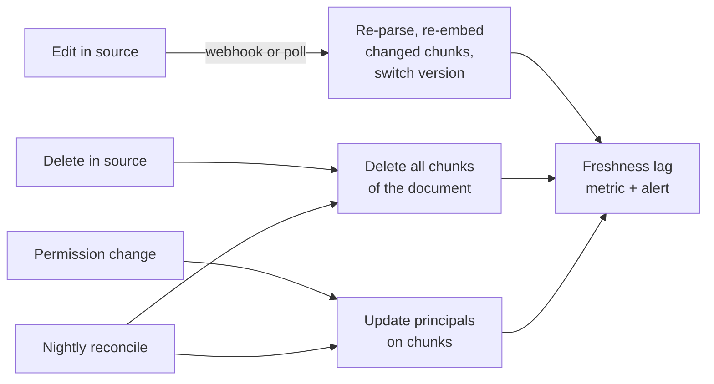

**The prompt:** "Design a Q&A assistant over a company's internal documents. Employees ask questions in plain language and get answers with citations. We sell it to many companies."

The most common AI design question. The model call is the easy part; the interview is about three things: **an employee must never see an answer built from a document they cannot open**, **answers must reflect the documents as they are now** (edits, deletions, revoked access), and **every claim must be traceable to a source**, all across hundreds of tenants.

## 1. Requirements

Functional:

- Connect sources per company: Google Drive, Confluence, SharePoint, ticketing systems, uploaded files.
- Chat interface: questions, follow-ups, answers with citations that open the exact page or section.
- Answers respect each source's permissions, per user.
- "Not found" when the documents do not contain the answer.
- Admin console: connectors, sync status, usage, feedback.

Non-functional (state them as assumptions):

- 500 tenants, 10 million documents in total, 50,000 daily active users.
- p95 time to first token under 2 s; answers streamed.
- Freshness: edits searchable within 15 minutes; deletions and access revocations effective within 5 minutes.
- Strict tenant isolation, audit logs, encryption, data residency options; no training on customer data.

Out of scope: write actions in source systems, structured analytics over databases (route those elsewhere).

## 2. Success metrics

- **Quality**: answer correctness and groundedness on the eval set, citation accuracy (cited source supports the sentence), correct abstention on unanswerable questions.
- **Security**: zero cross-permission leaks in automated permission tests (a hard gate, not a percentage).
- **Product**: questions answered without escalation, thumbs-up rate, weekly active users per tenant.
- **System**: p95 time to first token, freshness lag (edit to searchable), cost per answered question.

## 3. Entities, API and numbers

Entities: Tenant, Connector, Document (id, version, source URL, ACL, status), Chunk (text, vector, document id, version, section path, page, ACL principals, tenant), User and Group memberships, Conversation, Message, Citation, Feedback.

API:

- `POST /conversations/{id}/messages`: streamed answer with citations (server-sent events).
- `POST /feedback`: rating and comment for a message.
- Admin: `POST /connectors`, `GET /connectors/{id}/status`.

Numbers:

- 10 million documents x about 10 chunks = **100 million chunks**. At 1,024 dimensions in float32 that is about 410 GB of vectors; with int8 quantisation about 100 GB plus the HNSW graph, so a sharded cluster, partitioned by tenant.
- 50,000 users x 10 questions a day = **500,000 questions a day**: about 6 per second on average, about 20 at peak. Low query load; the work is in ingestion and correctness.
- Initial embedding: 100 million chunks x 400 tokens = 40 billion tokens. At around $0.02 per million tokens that is about $800: embedding is cheap; parsing, OCR and throughput limits dominate the initial load.
- Generation: 4,000 input tokens (rules plus sources) and 400 output tokens per question. With illustrative prices of $3 and $15 per million tokens for a large model, that is $6,000 + $3,000 = $9,000 a day; with $0.15 and $0.60 for a small model, $420 a day. Sending 80% of questions to the small model gives about 0.8 x 420 + 0.2 x 9,000 = $2,136 a day. Routing is the main cost lever.

## 4. High-level design

Data path:

1. Each connector authenticates to the source with the tenant's credentials, detects changes (webhooks where available, polling by modified time otherwise, plus a periodic full crawl) and enqueues changed documents with their permissions.
2. Workers parse (layout-aware; OCR for scans; tables kept whole), chunk along document structure, add contextual headers (title and section path), embed, and upsert chunks into the tenant's partition with the document's access principals.
3. Group memberships are synced from the identity provider (SCIM or its API), with nested groups flattened.

Request path:

1. The API authenticates the user, resolves the tenant and applies rate limits.
2. A follow-up is rewritten into a standalone question using the conversation.
3. Hybrid search (vectors plus BM25) runs **inside the tenant's partition**, filtered to chunks whose access principals overlap the user's identity and groups; about 50 candidates come back.
4. A cross-encoder reranks them; if the best score is below a threshold, the answer is "not found", with links to the closest documents.
5. The top 5 to 8 passages that fit the budget go into the prompt with ids, titles and dates; the model answers with a citation per claim, streamed.
6. Citations are checked: every cited id must have been supplied, and a judge or entailment check samples claims for support.

Workflow, not agent: the steps are fixed and latency matters. An agentic multi-hop mode can be added later for complex questions.

## 5. Deep dives

### 5.1 Permissions

- **Model**: every document carries the principals (users and groups) allowed to read it, copied from the source. Users' group memberships come from the identity provider. Store a precomputed list of principal ids on each chunk as an indexed keyword field.
- **Enforcement point**: the filter runs inside the search. Never retrieve broadly and filter afterwards (users with narrow access get empty results), and never rely on the prompt to hide content.
- **Propagation**: a permission change in the source arrives as a connector event and updates the principals on that document's chunks: a metadata update, no re-embedding, within minutes. A nightly reconciliation compares source permissions with the index.
- **Late binding** for sensitive tenants: before showing the final passages, re-check each document's access against the source system (cached for a few minutes). It costs latency and closes the propagation window.
- **Group explosion**: users in thousands of groups make huge filters. Flatten nested groups at sync time, and for very large sets precompute per-document "access keys" so the filter stays small.
- **Everything derived inherits permissions**: answer caches are keyed by the user's permission scope (or disabled across users), conversation history belongs to the user, and eval datasets built from tenant data stay inside the tenant.

### 5.2 Freshness, edits and deletes

- Edits write the new version's chunks first, then switch the document's active version, then delete the old chunks, so a search never sees a mix of versions.
- Deletes remove every chunk by document id; webhooks get missed, so reconciliation catches orphans.
- Freshness lag is measured per connector, with alerts. Connector failures (expired credentials, API quota) surface in the admin console.

### 5.3 Multi-tenancy and isolation

- **Partitioning**: one partition (namespace) per tenant in a shared cluster; the largest tenants get dedicated indexes. Every query carries the tenant id from the authenticated session, never from user input.
- **Noisy neighbours**: per-tenant rate limits and query quotas; per-tenant ingestion queues so one tenant's bulk import does not delay others' freshness.
- **Data residency**: regional deployments; a tenant's data, indexes and model calls stay in its region.
- **Deletion of a tenant**: drop its partition, its conversations, caches and logs; prove it with an audit record.

### 5.4 Answer quality

- Hybrid retrieval for exact terms (product names, error codes) plus meaning; reranking to send few, strong passages.
- Structure-aware chunking, parent-child expansion for procedures, contextual headers.
- **Conflicting versions**: include dates, filter to active versions, instruct the model to prefer the newest and mention conflicts.
- **Abstention**: retrieval threshold plus a not-found rule, measured with unanswerable questions.
- Citations as clickable spans; users can verify in one click, which is also the trust mechanism.

## 6. Evaluation

- **Offline**: a benchmark corpus with labelled questions (relevant chunks, reference answers), including unanswerable and multi-document questions. Metrics: recall@10 and context precision for retrieval; faithfulness, correctness and citation accuracy for answers; abstention accuracy; latency.
- **Permission tests**: synthetic users and documents with known access rules; every release runs them; one leak blocks the release.
- **Per-tenant signals**: thumbs, "not found" rate, follow-up rephrasing, sampled groundedness judge on live traffic.
- **Freshness tests**: edit and delete documents in a test tenant and measure time to effect.

## 7. Failure modes

| Failure | Detection | Mitigation |
| --- | --- | --- |
| Revoked access still searchable | Permission tests, reconciliation diffs | Metadata update on events, late binding check, nightly reconcile |
| Connector stops syncing | Freshness lag alert, connector health | Retries, admin alert, credential refresh flow |
| Scanned PDFs produce garbage | OCR confidence, empty-chunk rate | Better OCR, page images kept, flag low-confidence documents |
| Injected instructions in a document | Red-team set, output checks | Delimit sources, no tools with outbound effects, never follow document instructions |
| Fabricated or wrong citation | Citation validation, sampled support checks | Restrict to supplied ids, remove unsupported sentences |
| Model provider outage | Error rate, latency | Fallback model tested on the evals; return retrieved passages without an answer |
| One tenant floods ingestion | Queue depth per tenant | Per-tenant queues and quotas |

## 8. Scaling, cost and next steps

- Query load is modest; ingestion throughput (parsing, OCR, embedding rate limits) and index memory drive the infrastructure.
- Cost is dominated by generation: route easy questions to a small model, cache the static prompt prefix, send fewer, better passages.
- Next: agentic multi-hop answers for complex questions, connectors to structured data routed to text-to-SQL, per-tenant tuned retrieval (embedding fine-tuning on their vocabulary), analytics of unanswered questions to show admins documentation gaps.

Say it like this: "Connectors sync documents and their permissions into per-tenant partitions; ingestion parses, chunks along structure and embeds, and every chunk carries its access principals. A question is rewritten, searched with hybrid retrieval filtered inside the search by tenant and the user's groups, reranked, and answered with citations that I validate. Permission changes propagate as metadata updates within minutes, with reconciliation and a late-binding check for sensitive tenants, and permission tests gate every release."
