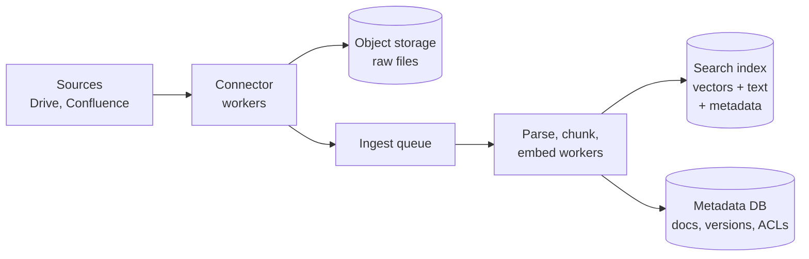
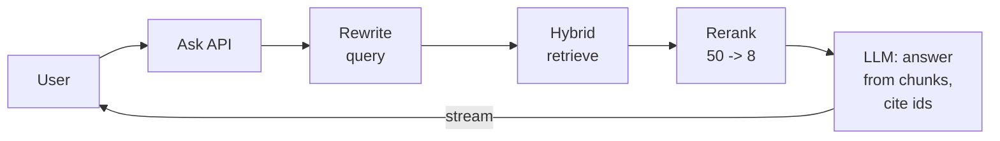

**The prompt:** "Design a Q&A assistant over a company's internal documents. Employees ask questions in plain language and get answers with citations. We sell it to many companies."

This is the most common AI design question, and the foundation of every retrieval problem. It looks like a RAG tutorial, but the interview is about what tutorials skip: thousands of customer companies in one system, per-user permissions, documents that change every minute, answers in about two seconds, and knowing whether the answers are right. Follow the framework from DP-00 out loud.

## 1. Requirements (about 5 minutes)

**Say:** "Before designing, let me pin down who uses this and what it must guarantee."

**Ask:** Which sources (Drive, Confluence, SharePoint, Slack, uploads)? Does it only answer, or also act? How fresh must answers be? Do users have different document permissions? How many companies and how big?

**Write down the functional requirements:**

1. Companies (tenants) connect document sources; the system ingests them and keeps them in sync.
2. Users ask a question and get an answer grounded in their company's documents, with citations.
3. Users only ever see content from documents they can read in the source system.
4. Answers stream token by token.

**Below the line:** long multi-turn memory, actions on documents, images and video, fine-tuning per tenant.

**Non-functional requirements:**

1. **Strict isolation**: nothing crosses tenants or permission boundaries. This outranks everything.
2. **Latency**: first token within ~2 seconds at p95.
3. **Freshness**: edits and permission changes reflected within minutes.
4. **Grounded answers**: say "I don't know" rather than guess; every claim traceable to a source.
5. **Scale**: thousands of tenants, hundreds of millions of chunks, no noisy neighbours.

## 2. Success metrics (about 3 minutes)

**Say:** "Success here means people trust the answers, so quality metrics come first."

- **Business**: questions answered without escalating to a person; weekly active users per tenant.
- **Quality**: groundedness (claims supported by retrieved text), correctness, citation accuracy, correct abstention.
- **System**: time to first token, p95 latency, freshness lag, cost per question.
- **Guardrail**: zero cross-permission leaks.

## 3. Entities, API and numbers (about 5 minutes)

**Core entities:** Tenant; User (with groups from the company's identity provider); Source/Connector (credentials, sync cursor); Document (version, ACL = who may read it); Chunk (text, embedding, and metadata copied from its document: tenant, doc id, version, ACL, title, URL); Conversation and Message (question, answer, cited chunk ids).

**API:**

```text
POST /v1/sources                 { type, credentials } -> { sourceId }
POST /v1/sources/{id}/sync       -> 202 Accepted
POST /v1/ask                     { question, conversationId? }
  -> text/event-stream: tokens ..., then { citations: [{ docId, title, url, snippet }] }
```

**Say:** "Tenant and user come from the auth token, never from the body."

**Numbers that change the design:**

- 1,000 tenants x 50,000 documents = 50M documents, about **500M chunks**.
- 500M chunks x 1,024 dimensions x 4 bytes = **~2 TB of vectors**: index memory is a real cost (quantising vectors cuts it 4x or more).
- 200,000 daily users x 10 questions = 2M questions a day: **~25/s average, ~250/s peak**.
- ~4,000 input tokens per question = **8B input tokens a day**: generation dominates cost, so context size is a lever.

## 4. High-level design (about 10 minutes)

**Say:** "There are two paths: an asynchronous ingestion path that prepares documents, and a synchronous query path that answers. I'll build each one requirement at a time."

### Requirement 1: connect sources and ingest

**Draw:**



**Say while drawing:** "Connectors list documents per tenant and enqueue work. Workers parse, split into chunks along headings with the title prepended so each chunk stands alone, embed, and write to a search index that holds vectors, keyword text and metadata. The metadata database is the source of truth for what should be indexed."

The queue absorbs bursts (a tenant connecting 2 million files) and lets failed documents retry without blocking others.

### Requirement 2: answer with citations

**Draw:**



**Say:** "A small model rewrites follow-ups into standalone queries. Retrieval runs keyword and vector search in parallel and merges them. A reranker reorders the top 50 and keeps 8. The LLM must answer only from those chunks and cite their ids; if they don't contain the answer, it says so."

### Requirement 3: permissions

**Say:** "Every chunk carries its document's ACL, and the user's tenant and groups become a filter inside the search, so restricted chunks are never candidates." (This is deep dive 1.)

### Requirement 4: streaming

**Say:** "The API streams tokens over Server-Sent Events. Retrieval and reranking happen before the first token, so they consume the first-token budget."

## 5. Deep dives (15 to 20 minutes)

### Deep dive 1: How do we enforce permissions without hurting quality?

**Bad: tell the model.** Put the ACLs in the prompt and ask it not to use restricted chunks. The model has already seen the text; a slip or a prompt injection leaks it. Instructions are not access control.

**Good: post-filter.** Retrieve the top 50, drop what the user cannot read, then rerank. Nothing restricted reaches the model, but for a user who can read 2% of the documents most of the 50 get dropped, and good permitted chunks ranked 51st never appear. Quality silently depends on who asks.

**Great: pre-filter inside the index, partitioned by tenant.**

- Partition the index **by tenant** (namespace or partition key; dedicated shards for the largest tenants). A query only searches its tenant's data, which also stops noisy neighbours.
- Each chunk stores `acl_users` and `acl_groups`; the query filters `acl_users contains U OR acl_groups intersects G` **during** the search, so the top results are the best *permitted* chunks.
- Groups come from the identity provider, flattened at sync time and cached for minutes.
- A permission change is a metadata update on the chunks, with no re-embedding.

**Say the trap:** "Approximate vector indexes can lose recall under very selective filters, since many graph neighbours get filtered out. Engines handle it with filter-aware search or by switching to exact search for small filtered sets; tenant partitioning keeps filters reasonable."

### Deep dive 2: How do we keep the index fresh, including deletes?

**Bad: nightly full re-index.** A policy changed at 10 a.m. is wrong until tomorrow, and re-embedding 500M chunks nightly is slow and costly.

**Good: incremental polling.** Every few minutes, ask each source "what changed since my cursor?". Fresh within minutes, but deletes are often invisible to "changed since" queries, and a missed run leaves gaps.

**Great: change events, versioned upserts and reconciliation.**

- Source **webhooks or change feeds** where available, polling as a fallback.
- Key documents by `(tenant, source, docId)` with a **version or content hash**: unchanged content is skipped; a changed document's new chunks are upserted and its **old chunks deleted in the same job**, so two versions never coexist.
- **Deletes** remove every chunk of the document (tracked as tombstones until confirmed).
- A periodic **reconciliation** compares the source's full listing with the metadata database and repairs drift.
- **Idempotent jobs**, so retries are safe; **freshness lag** monitored per tenant.

### Deep dive 3: How do we retrieve well?

**Bad: vector-only top 5 from fixed-size chunks.** Misses exact terms (error codes, product names), splits sentences, cannot tell relevant from merely similar.

**Good: hybrid search.** BM25 keyword plus vector search, merged with Reciprocal Rank Fusion (each chunk scores the sum of `1 / (60 + rank)` across lists). Chunk along structure, with small overlap.

**Great: hybrid, rerank, then decide whether to answer.**

- **Contextual chunks**: prepend title and section path before embedding.
- **Query rewriting** for follow-ups and acronyms.
- **Cross-encoder reranker** on the top ~50 (more accurate than embedding similarity, costs ~100-200 ms).
- **Abstain threshold**: if the best reranker score is low, reply "I couldn't find this in your documents".
- Prefer the latest version and official spaces in ranking.

### Deep dive 4: How do we make answers grounded and citations correct?

- The prompt gives chunks with **ids**; the model must cite ids for each claim.
- The system **validates citations**: every cited id must be one that was retrieved; otherwise drop the citation or regenerate.
- An optional **groundedness check** (a small judge model) on high-stakes answers before showing them, or flags weak support to the user.
- **Abstention** is a designed behaviour with its own metric, not a failure.

### Deep dive 5: Multi-tenant platform concerns

**Say:** "Since we sell to many companies, isolation and fairness are product requirements."

- **Isolation everywhere**: index partitions, caches keyed by tenant, logs and traces tagged by tenant, no shared prompt caches across tenants for private content.
- **Fair ingestion**: per-tenant queues or weighted scheduling, fresh edits on a high-priority queue and backfills on a low one, so one tenant's 2-million-file import does not delay another's edits.
- **Per-tenant limits and costs**: token budgets per tenant at the gateway; cost tracked per tenant for pricing.
- **Re-embedding**: changing the embedding model means re-indexing everything; plan it as a background migration writing to a new index, then switch.

## 6. Evaluation and safety (about 5 minutes)

**Say:** "I'd evaluate retrieval and generation separately, offline and online."

- **Offline**: a golden set of real questions per document type, labelled with the chunks that answer them and the facts the answer needs. Retrieval: recall@k, MRR. Answer: groundedness, correctness, citation accuracy, abstention accuracy. Gate every chunking, model or prompt change.
- **Online**: sample answers and grade groundedness and citation validity with a calibrated judge; track thumbs-down and "no answer" rates per tenant; alert on drops.
- **Safety**: documents can contain instructions ("ignore previous instructions..."): treat retrieved text as data, keep permissions in the retrieval filter, never in the prompt.

## 7. Cost, scale, failures, trade-offs (about 3 minutes)

- **Latency budget**: auth ~20 ms, rewrite ~300 ms (skip on first questions), retrieval ~100 ms, rerank ~150 ms, first token ~700 ms: about 1.3 s.
- **Cost levers**: 8 chunks not 30; prompt caching for the fixed instructions; a cheaper model for rewriting; semantic cache only for non-personal FAQs.
- **Failures**: provider down: fallback model through the gateway; index node down: replicas; connector throttled by the source: back off and report sync status.
- **Trade-off**: pre-filtering adds index complexity but makes quality independent of who asks; worth it.

**The 20-second summary:** "Async ingestion with versioned upserts and reconciliation feeds a tenant-partitioned hybrid index with ACLs on every chunk. Queries rewrite, hybrid-retrieve inside the permission filter, rerank, and answer only from cited chunks, abstaining when evidence is weak. Retrieval and generation are evaluated separately, offline and on live samples."

## What separates levels

- **Mid-level**: ingestion, chunking, embeddings, vector search, a prompt with chunks, streaming; filters by tenant.
- **Senior**: async ingestion with queues; ACLs enforced inside retrieval and why post-filtering fails; incremental sync with deletes; hybrid plus rerank; latency budget; separate retrieval and answer evals.
- **Staff**: partitioning and noisy neighbours, filtered-search recall, fair ingestion, reconciliation, re-embedding migrations, cost per question, abstention policy, and an eval loop per tenant.
