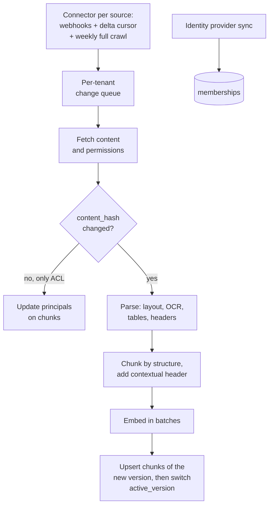
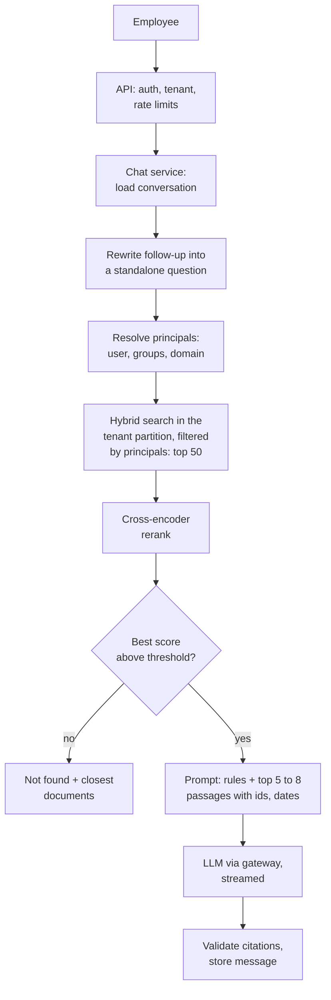
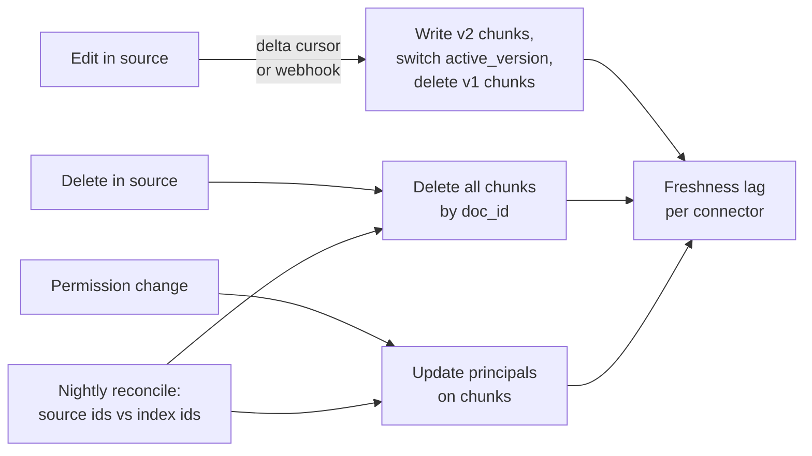

**The prompt:** "Design a Q&A assistant over a company's internal documents. Employees ask questions in plain language and get answers with citations. We sell it to many companies."

The most common AI design question. The model call is the easy part. The interview is about three guarantees across hundreds of tenants: **nobody sees an answer built from a document they cannot open**, **answers reflect the documents as they are now** (edits, deletions, revoked access), and **every claim is traceable to a source**. Each guarantee is a data-pipeline problem before it is a model problem.

Products in this space: Glean, Microsoft 365 Copilot, Notion AI.

## 1. Understanding the problem

**Functional requirements (core)**

1. Users should be able to ask questions in plain language and get answers with citations that open the exact page or section.
2. Users should be able to ask follow-up questions in the same conversation.
3. Users should only get answers built from documents they are allowed to open.
4. Admins should be able to connect sources (Google Drive, Confluence, SharePoint, uploads) and see sync status.

**Below the line**: write actions in source systems, analytics over databases (route those to text-to-SQL), document authoring, search across companies.

**Non-functional requirements**

- The system should never leak across tenants or permissions. Zero tolerance, tested on every release.
- The system should ground every answer: each claim cited, and "not found" when the documents do not say.
- The system should stream the first token within 2 s at p95.
- The system should reflect edits within 15 minutes, and deletions and revoked access within 5 minutes.
- Scale: 500 tenants, 10 million documents, 50,000 daily users; regional data residency; no training on customer data.

**Success metrics**

| Category | Metric | Target (example) |
| --- | --- | --- |
| Quality | Answer correctness on the eval set | >= 90% |
| Quality | Citation accuracy (cited source supports the claim) | >= 95% |
| Quality | Correct "not found" on unanswerable questions | >= 90% |
| Security | Cross-permission leaks in permission tests | 0 |
| Freshness | Revocation and deletion lag, p95 | < 5 min |
| Latency | Time to first token, p95 | < 2 s |
| Cost | Cost per answered question | < $0.01 |

**Framing the AI task.** The model's job is to answer from retrieved passages and cite them. The steps are always the same (understand the question, retrieve, rank, answer, check citations), so this is a **workflow**, not an agent: predictable latency, testable stages. Fine-tuning is the wrong tool: knowledge changes daily, answers must cite, and permissions differ per user. An agentic multi-hop mode can be added later for complex questions.

**Numbers that change the design**

- **Index size**: 10 million documents x about 10 chunks = 100 million chunks. At 1,024 float32 dimensions that is about 410 GB of raw vectors; int8 quantisation brings it near 100 GB, plus the HNSW graph. No single node holds it comfortably, so the index is **sharded, and partitioned by tenant**.
- **Query load**: 50,000 users x 10 questions a day = 500,000 questions a day, about 6 per second on average and about 20 at peak. Modest. The engineering effort belongs in ingestion and correctness, not query throughput.
- **Initial load**: 100 million chunks x 400 tokens = 40 billion tokens to embed, roughly $800 at about $0.02 per million. Embedding is cheap; parsing, OCR and source-API rate limits make the first sync of a large tenant take days, so onboarding is a background job with progress shown to the admin.
- **Generation cost**: about 4,000 input tokens (rules plus passages) and 400 output tokens per question. With illustrative prices of $3 and $15 per million tokens, a large model costs about $9,000 a day; a small model at $0.15 and $0.60 costs about $420. Routing 80% of questions to the small model gives about $2,136 a day. **Routing and passage count are the cost levers.**

## 2. High-level design

### The data model

```text
documents  (tenant_id, doc_id, connector_id, external_id, title, url, mime_type,
            active_version, content_hash, principals[], status, source_updated_at)
chunks     (chunk_id, tenant_id, doc_id, version, ordinal, section_path, page,
            text, embedding, principals[], updated_at)
            chunk_id = hash(doc_id, version, ordinal)  -> retries overwrite, never duplicate
memberships(tenant_id, user_id, group_id)            -> flattened, nested groups expanded
connectors (tenant_id, connector_id, type, credentials_ref, cursor, last_sync, status, error)
conversations / messages / citations (message_id, chunk_id, doc_id, version, quote)
```

- Chunks copy `principals` (who may read) from their document, so access can be filtered inside the search engine without a join.
- `version` and `content_hash` make updates idempotent and let unchanged documents be skipped.
- A citation stores the exact chunk and version, so an answer can always be traced to the text it used.

### Data path: getting documents in



1. **Connectors** use each source's change feed where one exists (Google Drive's changes API with a page token, SharePoint delta queries, Confluence searches by last-modified time) and store a **cursor**, so each poll asks only "what changed since my cursor". Webhooks trigger an immediate poll; they are a hint, not the record, because webhooks get lost. A weekly full crawl catches anything the deltas missed.
2. Each change goes onto a **per-tenant queue**, so one tenant's bulk import cannot delay another tenant's freshness. Workers respect each source's API rate limits per tenant.
3. The worker fetches the content and the document's permissions. If the content hash is unchanged and only permissions changed, it updates `principals` on the existing chunks and stops: no re-embedding.
4. Otherwise it **parses**: layout-aware extraction for PDFs and Office files, OCR for scans, tables kept whole as Markdown, headers and footers stripped, slides one chunk per slide.
5. It **chunks along structure** (headings, sections, list items), 300 to 600 tokens with small overlap, and prepends a contextual header ("Travel Policy > International > Per diem") before embedding.
6. It embeds in batches, upserts the new version's chunks, switches the document's `active_version`, and deletes the old version's chunks, in that order, so a search never sees a mix of versions.
7. The **identity provider** (Okta, Azure AD, Google Workspace) is synced separately into `memberships`, with nested groups flattened.

### Query path: answering with citations



1. The API authenticates the user from the token; the **tenant id comes from the token**, never from the request body.
2. The chat service loads the conversation; a small model rewrites a follow-up into a standalone question (about 200 to 400 ms; skipped on first turns).
3. The user's **principal set** is resolved: their user id, flattened group ids, their domain, and "everyone in the tenant". It is cached for a few minutes.
4. **Hybrid search** runs inside the tenant's partition: a vector query and a BM25 query, both with the filter `principals overlaps user_principals`, fused with reciprocal rank fusion into about 50 candidates (10 to 100 ms).
5. A **cross-encoder** reranks the 50 (50 to 200 ms). If the best score is below a threshold tuned on the eval set, the system answers "I could not find this in your documents" and lists the closest documents, with no generation.
6. The top 5 to 8 passages that fit a token budget (about 3,000 tokens) go into the prompt, each with an id, title, section and date. The rules: answer only from the sources, cite ids after each claim, prefer the newest source when they conflict and say so, say "not found" when the sources do not answer.
7. The model streams the answer (time to first token 0.5 to 1.5 s). Citations are validated: every cited id must be one of the supplied passages; unsupported sentences are flagged by a sampled support check. The message is stored with its citations.

**Latency budget to the first token (p95)**

| Stage | Budget |
| --- | --- |
| Auth, tenant, load conversation | 30 ms |
| Follow-up rewrite (small model; skipped on first turns) | 300 ms |
| Resolve principals (cached) | 10 ms |
| Hybrid search, 50 candidates | 80 ms |
| Rerank 50 candidates | 150 ms |
| Prompt assembly | 10 ms |
| LLM time to first token | 1,200 ms |
| Total | about 1.8 s |

## 3. Deep dive: access control (permissions and tenant isolation)

**What source permissions look like.** A document may be readable by named users, by groups (often nested: "eng-backend" inside "engineering"), by everyone in the company domain, by anyone with the link, or by inheritance from its folder or space. The connector normalises all of these into **principals**: `user:alice`, `group:eng-backend`, `domain:acme.com`, `tenant:all`. "Anyone with the link" is treated carefully: such a document is often not meant to be discoverable, so many products index it only for users who have actually opened it.

**Bad: tell the model not to reveal restricted content.** Retrieve broadly, then instruct the model to ignore documents the user cannot see. Once a passage is in the context the model can repeat or paraphrase it, injected text can override the instruction, and nothing in the system actually prevents the leak. A prompt is not an access control.

**Good: retrieve the top results, then drop what the user cannot access.** Correct in simple cases, but two flaws remain. First, the top 50 were computed over everyone's documents; a user who can see 1% of the corpus gets 0 or 1 allowed results and a useless answer. Second, permissions copied at sync time go stale, and shared caches can serve one user's answer to another.

**Great: permission-aware retrieval with fast propagation.**

- **Filter inside the search.** Chunks store their principals as an indexed keyword field; the query carries the user's principal set; the engine applies the filter during the search (filter-aware HNSW, or exact search when the allowed set is small). Results are always drawn from the allowed set, so narrow-access users still get the best allowed passages.
- **Store groups, not expanded users.** Chunks list `group:eng-backend`, not every member. When someone leaves a group, only `memberships` changes; no chunk is touched, and the next query simply stops including that group. This is why revocation can be fast.
- **Propagate document permission changes as metadata updates.** A sharing change arrives through the connector, the worker sees an unchanged content hash, and updates `principals` on that document's chunks within minutes. A nightly reconciliation compares each document's source permissions with the index and repairs drift.
- **Late binding for sensitive tenants.** Before the final passages are used, check each document against the source system's own permission check (cached for a few minutes). It adds about 100 to 300 ms and closes the window between a change and its propagation. If the source cannot be reached, fail closed for that document.
- **Group explosion.** Some users belong to thousands of groups, making filters slow. Flatten nested groups at sync time; for very large sets, precompute per-document "access keys" (one key per distinct principal set) so the filter is a short list.
- **Everything derived inherits permissions.** Answer caches are keyed by tenant plus a hash of the principal set (or disabled across users); conversation history belongs to its user; eval datasets built from tenant data stay inside the tenant; logs are access-controlled.

**Tenant isolation**, the outer wall:

- **Bad**: one shared index where every query must remember to add a tenant filter. One missing filter leaks a whole company's data, and a heavy tenant slows everyone.
- **Good**: a separate index per tenant. Strong isolation and trivial deletion, but hundreds of small indexes waste memory and multiply operations work.
- **Great**: a **partition (namespace) per tenant** inside a shared, sharded cluster, with the largest tenants on dedicated indexes. Queries go through a single retrieval service that takes the tenant id from the auth context and cannot run without it. Per-tenant quotas and ingestion queues stop noisy neighbours; regional clusters meet residency rules; deleting a tenant drops its partition, conversations, caches and logs, with an audit record.

**Testing it**: a permission test suite creates synthetic users, groups and documents with known access, asks questions that only restricted documents can answer, and asserts that no restricted text appears. It runs on every release and after every connector change; one failure blocks the release.


## 4. Deep dive: freshness, edits and deletes

**Bad: re-index everything nightly.** Answers can be a day out of date, deleted documents remain searchable for hours (a legal problem when someone removes a file containing personal data), and re-embedding every document every night is wasteful.

**Good: re-index a document when its change event arrives.** Fresh in the normal case, but three gaps remain: events get lost, a search during an update can see some old chunks and some new ones, and deletions are easy to miss because a deleted file often produces no event your connector sees.

**Great: versioned updates, reliable deletes, reconciliation and a freshness metric.**



- **Edits, in a safe order.** Write all chunks of the new version first; then switch `active_version` on the document; then delete the old version's chunks. Queries keep only chunks whose version equals the document's active version (or, in an engine without joins, de-duplicate by `doc_id` keeping the highest version). A search during the update therefore sees the whole old version or the whole new one, never a mix.
- **Only changed chunks are re-embedded.** Chunks are compared by content hash; an edit to one paragraph re-embeds one or two chunks, not the whole document.
- **Deletes by document id**, within the 5-minute target when the source reports them. Because deletions are the events most often missed, the **reconciliation job** lists every document id in the source and every id in the index, and deletes the difference. It runs nightly, and hourly for tenants with strict retention rules.
- **Embedding model or chunking changes** are a full re-index into a new versioned index, built in the background, evaluated against the old one, then switched by alias; the old index is kept for rollback.
- **Freshness is measured**: for each change, the time from `source_updated_at` to "searchable" is recorded per connector, with a p95 alert. Connector errors (expired credentials, API quota) show in the admin console with a fix-it action.

## 5. Deep dive: answer quality and trust

**Bad: vector top 20 straight into the prompt.** Exact terms (product names, error codes, policy numbers) are missed because embeddings blur identifiers; twenty passages of mixed quality distract the model; the key passage lands in the middle of the context where it is used least; and nothing stops a confident answer when the evidence is missing.

**Good: hybrid search, a reranker, and the top 5 to 8 passages with ids and a citation rule.** A large improvement. What remains: long procedures split across chunks, follow-up questions that make no sense alone, old and new versions of a policy both retrieved, and citations that point at a source that does not actually support the sentence.

**Great: the whole chain tuned, with trust built into the answer.**

- **Chunks that stand alone**: structure-aware chunking plus a contextual header (document title and section path) on every chunk; for procedures and long sections, retrieve the small chunk but send its parent section (parent-child retrieval).
- **Questions that stand alone**: follow-ups are rewritten with the conversation before searching.
- **Recency**: passages carry dates; only active versions are retrievable; the prompt says to prefer the newest source and to mention a conflict when sources disagree.
- **Abstention**: the reranker-score threshold answers "not found" cheaply and honestly; the prompt rule plus an example covers the rest; unanswerable questions are part of the eval set.
- **Citations you can verify**: each sentence cites passage ids; ids not in the supplied set are removed; a sampled entailment or judge check flags sentences their source does not support; the UI shows the quoted span and opens the exact page.
- **Untrusted content**: documents are written by many people, so passages are delimited as data, the model has no tools with outbound effects, and links in answers are rendered only to known document URLs. A real case: in 2024 researchers showed that a message planted in a public Slack channel could make Slack AI, answering another user's question, output a link carrying data from that user's private channels to an attacker, and the planted message was not cited. Cite every source used; never render links built from retrieved text.

## 6. Evaluation and failure modes

**Evaluation**

- **Offline**: a benchmark corpus with labelled questions (relevant chunks and reference answers), including unanswerable questions, multi-document questions and questions about recently changed documents. Retrieval is scored with recall@10 and context precision; answers with faithfulness, correctness, citation accuracy and abstention accuracy; plus latency.
- **Permission tests**: synthetic users, groups and documents with known access; questions only restricted documents can answer must never leak them. Release-blocking.
- **Freshness tests**: edit and delete documents in a test tenant and measure the time until answers change.
- **Online, per tenant**: thumbs, "not found" rate, users rephrasing the same question, citation clicks, and a sampled groundedness judge.

**Failure modes**

| Failure | Detection | Mitigation |
| --- | --- | --- |
| Revoked access still searchable | Permission tests, reconcile diffs | Group principals, metadata updates, late binding |
| Connector silently stops syncing | Freshness lag alert | Retries, admin alert, credential refresh |
| Scanned PDFs produce garbage text | OCR confidence, empty-chunk rate | Better OCR, page images kept, flagged documents |
| Instructions planted in a document | Red-team set, output checks | Delimited sources, no outbound tools or links |
| Fabricated or wrong citation | Citation validation, support checks | Supplied ids only, unsupported sentences dropped |
| Model provider outage | Error rate, latency | Evaluated fallback model, or passages without an answer |
| One tenant floods ingestion | Queue depth per tenant | Per-tenant queues and quotas |

**Summary: each requirement and the design choice that meets it**

| Requirement | How the design meets it |
| --- | --- |
| Cited answers | Hybrid retrieval, reranking, passages with ids, citation validation |
| Follow-ups | Standalone rewrite using the conversation |
| Permissions | Principals on chunks filtered inside the search, group-based revocation, late binding |
| Connector admin | Per-connector cursors, status and freshness lag in the console |
| Zero leaks | Tenant from the auth token, per-tenant partitions, permission tests gate releases |
| Grounding | Not-found threshold, citation checks, groundedness evals |
| Freshness | Change cursors, versioned switch, delete reconciliation, lag alerts |
| Scale and cost | Sharded int8 index, most questions routed to a small model |

Say it like this: "Connectors sync documents and their permissions into per-tenant partitions using change cursors plus reconciliation; ingestion parses, chunks along structure and embeds, and every chunk carries its access principals as groups, so revoking membership is instant. A question is rewritten, searched with hybrid retrieval filtered inside the search by tenant and the user's principals, reranked with a not-found threshold, and answered with citations I validate. Edits write a new version before switching, deletes are reconciled nightly, and permission tests gate every release."
