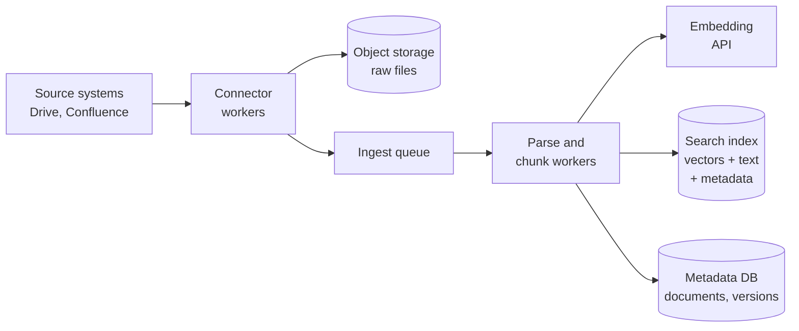
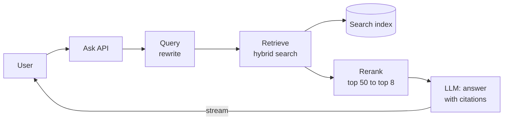
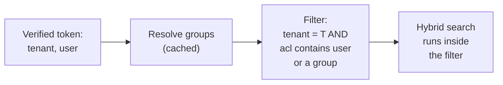
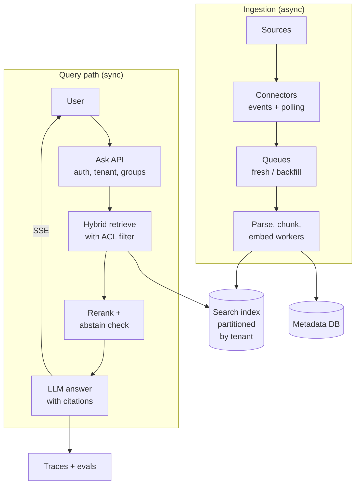

Enterprise document Q&A is the most common AI system design prompt: "employees ask questions in plain language and get answers from their company's own documents, with citations". It looks like a RAG tutorial, but the interview is about everything a tutorial skips: thousands of customer companies in one system, per-user permissions, documents that change every minute, answers in under two seconds, and knowing whether the answers are right.

## Understanding the Problem

**What are we building?** A multi-tenant SaaS product. Each customer company (a **tenant**) connects its sources: Google Drive, Confluence, SharePoint, Slack, uploaded PDFs. Its employees ask questions in a chat box and receive an answer grounded in the documents they are allowed to read, with links to the exact sources.

### Functional Requirements

Core requirements:

1. Tenants connect document sources, and the system ingests and keeps them in sync.
2. Users ask a question and receive an answer grounded in their tenant's documents, with citations.
3. Users only ever see content from documents they have permission to read in the source system.
4. Answers stream token by token.

Below the line (out of scope):

- Multi-turn conversation memory beyond the last few turns.
- Actions on documents (editing, creating tickets).
- Images and video inside documents.
- Fine-tuning models per tenant.

### Non-Functional Requirements

Core requirements:

1. **Strict isolation**: no content ever crosses tenants or permission boundaries. This outranks everything else.
2. **Low latency**: first token within about 2 seconds at p95, full answer within about 8 seconds.
3. **Freshness**: a document edit or permission change is reflected within minutes.
4. **Answer quality**: grounded in retrieved text, with correct citations; say "I don't know" rather than guess.
5. **Scale**: thousands of tenants, hundreds of millions of chunks, with large tenants not slowing down small ones.

Below the line:

- Multi-region active-active deployment.
- Formal compliance certification details.

### The numbers

Back-of-the-envelope math is worth doing here because it changes the design:

- 1,000 tenants x 50,000 documents on average = **50 million documents**. At ~10 chunks each: **500 million chunks**.
- Embeddings at 1,024 dimensions x 4 bytes = 4 KB per chunk: **about 2 TB of vectors** before replication. Storage and index memory are real costs; compressed vectors (int8 or binary quantization) cut this by 4x or more.
- Initial embedding: 500M chunks x ~300 tokens = 150 billion tokens. At embedding prices of a few cents per million tokens, that is a few thousand dollars once, but it takes days if embedding API rate limits are low, so ingestion must be a throttled, resumable pipeline.
- 200,000 daily users x 10 questions = 2 million questions a day: about **25 per second on average, 250 at peak**.
- Each question sends ~4,000 input tokens (instructions plus retrieved chunks) and gets ~300 output tokens: about **8 billion input tokens a day**. Generation, not search, dominates the bill, so context size per question is a cost lever.

## The Set Up

### Core Entities

- **Tenant**: a customer company.
- **User**: belongs to one tenant; has group memberships from the tenant's identity provider.
- **Source / Connector**: a connected system (Drive, Confluence) with its credentials and sync cursor.
- **Document**: an item from a source, with its version and its access control list (ACL: which users and groups may read it).
- **Chunk**: a passage of a document, with its embedding, text, and metadata copied from the document: tenant id, document id, version, ACL, title, URL.
- **Conversation / Message**: a question, the answer, and the cited chunk ids.

### The API

```text
POST /v1/sources                        { type, credentials } -> { sourceId }
POST /v1/sources/{id}/sync              -> 202 Accepted (triggers a sync job)

POST /v1/ask                            { question, conversationId? }
  -> text/event-stream:  token events ..., then { citations: [{ docId, title, url, snippet }] }
```

The tenant and the user never appear in the request body. They come from the authenticated session (a verified token), so a caller can never ask on someone else's behalf.

## High-Level Design

### 1) Tenants connect sources, and documents are ingested

Ingestion is **asynchronous**: connecting a source starts a job; nothing about it happens inside a user request.



1. **Connector workers** list documents from each source using the source's API and the tenant's credentials, store the raw file in object storage, and put a message on the ingest queue: "parse document X, version Y".
2. **Parse and chunk workers** extract text (PDF, DOCX, HTML), split it into chunks of a few hundred tokens along headings and paragraphs, and prepend each chunk with its document title and section heading so it still makes sense on its own.
3. Each chunk is **embedded** and written to the **search index** with its text (for keyword search) and its metadata: tenant id, document id, version, ACL, URL.
4. The **metadata database** (Postgres) records documents, versions, ACLs and sync state, the source of truth for what should be in the index.

The queue decouples connectors from processing, absorbs bursts (a tenant connecting 2 million files), and lets workers retry failed documents without blocking others.

### 2) Users ask a question and get a grounded, cited answer



1. The **Ask API** authenticates the user and loads their tenant and groups.
2. A small, fast model **rewrites** the question into a standalone search query (resolving "what about the second one?" from recent turns).
3. **Hybrid retrieval** runs keyword (BM25) and vector search in parallel and merges the results.
4. A **reranker** (a cross-encoder model that reads the question and each candidate together) reorders the top ~50 and keeps the best ~8.
5. The **LLM** gets the instructions, the 8 chunks with ids, and the question. It must answer only from the chunks and cite chunk ids; if the chunks do not contain the answer, it says so.
6. The answer **streams** to the user over Server-Sent Events; citations are resolved from chunk ids to document titles and links.

### 3) Users only see what they are allowed to read

The simplest correct rule: **every chunk carries its document's ACL, and retrieval only considers chunks the user can read.**



The tenant id and the user's groups become a filter applied **inside** the search query, so chunks the user cannot read are never candidates. The deep dives cover why this placement matters.

### 4) Answers stream

The API opens a streaming request to the LLM provider and forwards each token as an SSE event. Retrieval and reranking happen before the first token, so they consume most of the first-token budget; generation time only affects how long the stream runs.

## Potential Deep Dives

### 1) How do we enforce permissions without hurting answer quality?

**Bad solution: tell the model.** Retrieve from the whole tenant, put the ACL in the prompt, and instruct the model not to use restricted chunks. The model sees the restricted text, so any slip, prompt injection or summary can leak it. Instructions are not access control.

**Good solution: post-filter.** Retrieve the top 50 from the tenant, then drop chunks the user cannot read, then rerank. Restricted text never reaches the model. But if the user can read only a small fraction of the tenant's documents (an intern in a large company), most of the 50 are dropped and good, permitted chunks ranked 51st or lower are never seen. Answer quality silently varies by user.

**Great solution: pre-filter inside the index, partitioned by tenant.**

- The index is **partitioned by tenant** (a namespace, collection or partition key per tenant; dedicated shards for the largest), so a query physically searches one tenant's data. This also prevents noisy neighbours.
- Each chunk stores `acl_users` and `acl_groups`. The query adds the filter `acl_users contains U OR acl_groups intersects G`. Vector databases and search engines (pgvector with a WHERE clause, Elasticsearch/OpenSearch, Pinecone, Weaviate, Qdrant) support filtered search, and the filter is applied during the search, so the top results are the best *permitted* chunks.
- **Group resolution**: the user's groups come from the tenant's identity provider (Okta, Azure AD), cached for a few minutes. Nested groups are flattened at sync time.
- **Permission changes** are metadata updates: when a document's ACL changes, update the ACL fields on its chunks; no re-embedding is needed.

One trap to mention: filtered vector search with a very selective filter can lose recall in approximate indexes (HNSW explores the graph and many neighbours are filtered out). Engines handle this with filter-aware traversal, or by switching to exact search when the filter matches few chunks. Partitioning by tenant keeps filters reasonably selective.

### 2) How do we keep the index fresh as documents change?

**Bad solution: re-index everything nightly.** Simple, but a policy updated at 10 a.m. answers wrongly until tomorrow, and re-embedding 500 million chunks every night costs time and money.

**Good solution: incremental polling.** Every few minutes each connector asks its source "what changed since my cursor?" (modified time or a change token), and re-ingests changed documents. Fresh within minutes. But deletions are often invisible to "changed since" queries, and a missed run can leave gaps.

**Great solution: change events, versioned upserts and reconciliation.**

- Use the source's **change notifications** (webhooks or change feeds) where available, plus incremental polling as a fallback.
- Key every document by `(tenant, source, docId)` with a **version** or content hash. Unchanged content is skipped (no re-embedding). A changed document is re-chunked, its new chunks upserted, and its **old chunks deleted in the same job**, so two versions never coexist.
- **Deletions** remove all chunks of the document. Track deleted ids as tombstones until the delete is confirmed in the index.
- A periodic **reconciliation** compares the source's full listing with the metadata database and repairs drift (missed events, failed jobs).
- Jobs are **idempotent**: processing the same version twice produces the same result, so retries are safe.
- Monitor **freshness lag** (event time to searchable) per tenant.

### 3) How do we get high-quality retrieval?

**Bad solution: vector search only, fixed-size chunks, top 5 straight into the prompt.** Misses exact terms (product codes, error numbers, names), splits sentences mid-thought, and has no way to tell "relevant" from "similar".

**Good solution: hybrid search.** Run BM25 keyword search and vector search, merge with **Reciprocal Rank Fusion** (score each chunk by the sum of `1 / (60 + rank)` across the lists). Keywords catch exact identifiers; vectors catch paraphrases. Chunk by document structure (headings, paragraphs) with small overlap.

**Great solution: hybrid search, then rerank, then decide whether to answer.**

- **Contextual chunks**: prepend the document title and section path to each chunk before embedding ("HR Policy > Leave > Parental leave: ..."), so a chunk is findable and understandable alone.
- **Query rewriting** turns follow-ups into standalone queries and can expand acronyms.
- **Reranker**: a cross-encoder scores (question, chunk) pairs jointly, far more accurately than embedding similarity, at the cost of ~50-200 ms for 50 candidates.
- **Abstain threshold**: if the best reranker score is low, answer "I couldn't find this in your documents" instead of letting the model improvise.
- **Recency and authority signals** in ranking (prefer the latest version, official spaces).

### 4) How do we meet the 2-second first-token target?

Budget the critical path:

```text
auth + group lookup (cached)       ~20 ms
query rewrite (small model)        ~300 ms   (skip when there is no conversation history)
hybrid retrieval (parallel)        ~100 ms
rerank 50 candidates               ~150 ms
LLM time to first token            ~600-900 ms
total                              ~1.2-1.5 s
```

Levers: run keyword and vector search in parallel; skip the rewrite for first questions; cache group lookups and query embeddings; keep the prompt short (8 chunks, not 30) because input length increases time to first token; use provider **prompt caching** for the fixed instructions prefix; stream immediately; and keep the index in memory for hot tenants.

### 5) How does ingestion scale to a tenant connecting 2 million documents?

- Connector jobs **page** through the source and enqueue work; they never hold the whole listing in memory.
- **Per-tenant queues or fair scheduling**, so one huge backfill does not delay a small tenant's fresh edits. Fresh changes go on a high-priority queue; backfills on a low-priority one.
- A shared **rate limiter** for the embedding API and each source's API (sources throttle aggressively); 429s back off with jitter.
- Failed documents retry a few times, then land in a **dead-letter queue** with the error, visible to support.
- Progress per source ("1.2M of 2M processed") from the metadata database, so the tenant sees ingestion status.

### 6) How do we know the answers are right?

- **Offline**: a golden set of real questions per document type, labelled with the chunks that answer them and the facts the answer must contain. Measure retrieval (recall@k, MRR) and answers (groundedness, correctness, citation accuracy, abstention) separately, and gate every change to chunking, models or prompts.
- **Online**: sample production answers and grade groundedness and citation validity with a calibrated LLM judge; track thumbs-down and "no answer" rates per tenant; alert on drops.
- **Citations by construction**: the model cites chunk ids that were in its context, and the system validates them; a citation to a chunk that was not retrieved is a defect, not a formatting issue.

## Final Design



## What is Expected at Each Level

**Mid-level.** A working RAG design: ingestion pipeline, chunking and embeddings, vector search, a prompt with retrieved chunks, streaming. Recognises that permissions matter and proposes filtering by tenant. May need prompting on freshness and evals.

**Senior.** Separates ingestion from the query path with queues; enforces ACLs inside retrieval and explains why post-filtering hurts recall; designs incremental sync with versioned upserts and deletes; uses hybrid search and a reranker; budgets latency; measures retrieval and generation separately.

**Staff.** Drives the trade-offs: index partitioning and noisy neighbours, filtered-ANN recall, cost per question and how to cut it, fair scheduling of ingestion across tenants, reconciliation for correctness, abstention policy, and an evaluation and monitoring loop per tenant. Anticipates operational problems (connector throttling, permission drift, re-embedding when the embedding model changes) before being asked.
