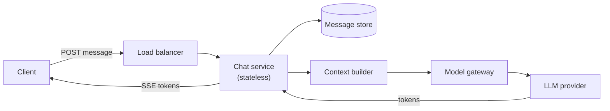
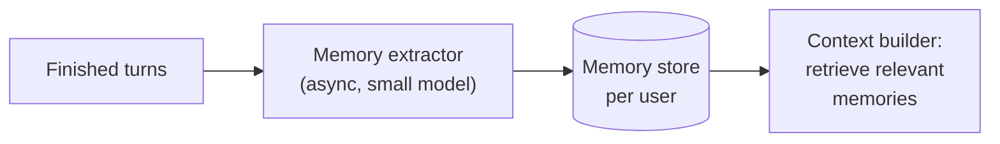
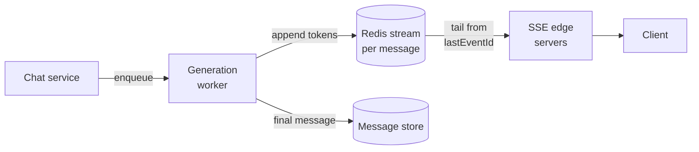
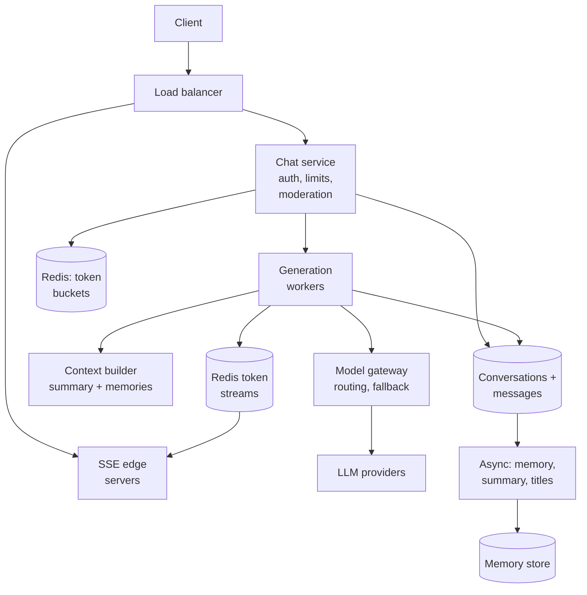

"Design ChatGPT" sounds like it is about the model, but the model is a box you call. The interview is about everything around it: streaming millions of long-lived responses, storing and trimming conversations, remembering users across chats, keeping costs under control when every message re-sends the whole conversation, and stopping abuse. It is a classic system design problem with an LLM in the middle.

## Understanding the Problem

**What are we building?** A consumer chat assistant. Users start conversations, send messages, and watch the reply appear word by word. They come back to old conversations, and the assistant remembers useful facts about them across conversations. Free and paid plans have different limits.

### Functional Requirements

Core requirements:

1. Users send a message and receive the assistant's reply, streamed as it is generated.
2. Users can list, reopen and continue past conversations.
3. The assistant remembers durable facts about a user across conversations (preferences, context they shared), and users can view and delete them.
4. Usage is limited per user and plan; abusive use is blocked.

Below the line:

- File uploads, images and voice.
- Tool use such as web browsing or code execution.
- Sharing conversations publicly.

### Non-Functional Requirements

Core requirements:

1. **Fast feel**: the system adds little on top of the model: first token within ~1 second of the model starting, p95.
2. **Scale**: millions of daily users and tens of thousands of concurrent streams.
3. **Durability**: a message, once sent and answered, is never lost; history loads quickly.
4. **Cost control**: cost per active user stays within plan economics.
5. **Availability**: if one model provider or region degrades, chat keeps working (maybe on a different model).

Below the line:

- Strong consistency across devices within milliseconds (eventual is fine).
- Regional data residency.

### The numbers

- 5 million daily users x 20 messages = **100 million messages a day**: ~1,200 per second on average, ~3,500 at peak.
- A reply streams for ~15 seconds: at peak, 3,500/s x 15 s = **~50,000 concurrent streaming connections**. This drives the serving tier design.
- Storage: ~2 KB per message (user plus reply) = **200 GB of new history a day**, tens of TB a year. History must be partitioned.
- Tokens: if the average call sends 6,000 input tokens (instructions plus history), that is **600 billion input tokens a day**. History re-sent on every turn is the dominant cost, which makes context management and prompt caching central, not optional.

## The Set Up

### Core Entities

- **User** with a plan (free, paid).
- **Conversation**: owner, title, created and updated time.
- **Message**: conversation id, role (user or assistant), content, status (streaming, complete, stopped, failed), model used, token counts.
- **Memory**: a durable fact about a user ("prefers Python examples"), with its source and timestamps.
- **Usage counter**: tokens consumed per user per window, for limits and billing.

### The API

```text
POST /v1/conversations                             -> { conversationId }
GET  /v1/conversations?cursor=...                  -> page of { id, title, updatedAt }
GET  /v1/conversations/{id}/messages?before=...    -> page of messages

POST /v1/conversations/{id}/messages               { content }
  -> text/event-stream:  { messageId } , token events ..., { done, usage }
POST /v1/messages/{id}/stop                        -> stops generation
GET  /v1/messages/{id}/stream?lastEventId=...      -> resume a stream after a disconnect

GET    /v1/memories            DELETE /v1/memories/{id}
```

## High-Level Design

### 1) Users send a message and receive a streamed reply



1. The **chat service** authenticates the user, checks limits, and **persists the user's message first** (so it is never lost even if generation fails).
2. The **context builder** assembles the prompt: system instructions, relevant memories, a summary of older turns, and recent messages, within a token budget (deep dive 2).
3. The **model gateway** (one internal service for every model call: keys, routing, fallback, usage records) calls the provider with streaming enabled.
4. Tokens flow back and are forwarded to the client as **Server-Sent Events**. When the stream ends, the assistant message is saved with its token counts.

**Why SSE?** The reply flows one way, server to client, over plain HTTP; SSE has built-in reconnection with a last-event id, works through proxies and load balancers, and is simpler than WebSockets, which are only needed for two-way real-time interaction.

### 2) Users list and reopen past conversations

Two access patterns: "list my conversations, newest first" and "load the messages of conversation X, latest first, page by page". Both are simple key lookups at huge volume, which suits a partitioned store:

- **Conversations** keyed by `user_id`, sorted by `updated_at`.
- **Messages** keyed by `conversation_id`, sorted by `created_at` (or a time-ordered id).

A wide-column or key-value store (DynamoDB, Cassandra, Bigtable) fits these patterns at tens of TB; sharded Postgres also works. A cache (Redis) holds the recent messages of active conversations, since the next turn needs them immediately.

### 3) The assistant remembers users across conversations



After a conversation turn, an **asynchronous** job (off the critical path) asks a small model: "Does this contain a durable fact about the user worth remembering? Does it update or contradict an existing one?" Facts are stored per user, with embeddings for retrieval. On each new turn the context builder retrieves the few memories relevant to the message. Users can list and delete memories, and a delete removes them everywhere.

### 4) Usage limits and abuse

Before each model call the chat service checks the user's **token budget** (deep dive 4) and runs input **moderation**. Over-limit requests get a clear error ("You've reached your limit; resets at 14:00") instead of a failed stream.

## Potential Deep Dives

### 1) How do we stream reliably to 50,000 concurrent clients?

**Bad solution: generate inside the request, tied to the connection.** The chat server holds the SSE connection and the upstream model stream in the same request. If the user's network blips, the connection drops, generation is lost or orphaned, and a refresh shows nothing. Deploys kill every in-flight answer.

**Good solution: stateless servers, save the final message, let the client reconnect.** Generation continues if the client disconnects, and the final message is saved, so a refresh after completion shows the answer. But during generation a reconnecting client cannot rejoin the live stream, and long-lived connections pinned to one server complicate deploys.

**Great solution: decouple generation from delivery with a per-message token stream.**



- A **generation worker** calls the model and appends each token chunk to a short-lived **stream per message** (Redis Streams, with a TTL of a few minutes after completion).
- **SSE edge servers** only tail that stream and forward events. Any server can serve any client: a reconnect sends `Last-Event-ID`, and the server resumes from that position.
- The final message is written to the message store when generation completes. Stopping is a cancel flag the worker checks between chunks.
- Connections are long-lived, so the load balancer's idle timeout must exceed the longest stream (or heartbeats keep it alive), and deploys drain connections gracefully; clients reconnect transparently.

### 2) What goes into the context window of a 300-turn conversation?

**Bad solution: send the entire history every time.** Cost grows with every turn (each message re-sends all previous ones), latency grows, and eventually the request exceeds the context window and fails.

**Good solution: a sliding window.** Send the system prompt plus the last N messages. Bounded cost, but the assistant forgets anything said earlier ("as I told you at the start, my budget is $500").

**Great solution: a token-budgeted context assembled from layers.**

```text
[system instructions + user's custom instructions]     stable prefix, cached
[relevant long-term memories]                          retrieved by similarity
[running summary of older turns]                       updated in the background
[last few turns, verbatim]                             most recent detail
[the new user message]
```

- A **token budget** (say 8,000 tokens) is filled in priority order; the oldest verbatim turns are folded into the **summary** when the budget is exceeded.
- The summary is refreshed **asynchronously** every few turns by a small model, so it never adds latency to the critical path.
- The **stable prefix comes first**, so provider **prompt caching** reuses it across turns and users: cached input tokens are billed at a fraction of the normal price and cut time to first token.
- The full history stays in the database; only the model's view is condensed.

### 3) How should long-term memory work?

- **What to store**: durable, user-specific facts (preferences, stable context), not every sentence. Extraction is a separate async step with clear rules, and it **updates** facts instead of appending contradictions ("moved to Bangalore" replaces "lives in Pune").
- **Retrieval**: embed memories and fetch the top few relevant to the current message, plus a handful of always-included core facts.
- **User control and privacy**: memories are visible, editable and deletable; deletion is enforced in the store and caches; sensitive categories (health, passwords) are never stored.
- **Isolation**: memories are strictly keyed by user id; retrieval can never cross users.

### 4) How do we rate-limit an LLM product fairly?

**Bad solution: requests per minute.** One request can cost 100 tokens or 100,000. Request limits are either too strict for normal users or too loose for abusers sending huge prompts.

**Good solution: token budgets per user.** Track input plus output tokens per user per window in Redis; reject when exceeded.

**Great solution: layered, token-based limits with reservation.**

- A **token bucket per user and plan**: before the call, reserve an estimate (input tokens plus the max output tokens) with an atomic Redis operation; after the call, settle the actual usage. Paid plans get larger buckets and access to bigger models.
- A **concurrency limit** per user (at most 2 streams at once).
- A **global budget per model** below the provider's rate limits, so a spike sheds or queues free-tier traffic first instead of failing everyone.
- **Degrade, don't fail**: when a user hits the large-model limit, offer the smaller model.

### 5) How do we prevent abuse and unsafe output?

- **Moderation** on input (cheap classifier) and on output (streamed in chunks), blocking or replacing content that violates policy.
- **Account-level signals**: many new accounts from one IP, scripted traffic patterns, repeated jailbreak attempts, which feed stricter limits or blocks.
- **Hard caps** on output length and prompt size; anonymous users get the smallest limits.
- Flagged conversations go to an asynchronous review queue; the system learns new abuse patterns from them.

### 6) How do we stay up when a model provider has an incident?

The model gateway tracks error rates and latency per provider and region, with **circuit breakers**. On failure it **falls back** to another region or an equivalent model; the stream shows no difference other than which model answered (recorded on the message). Non-essential features (memory extraction, title generation, summaries) are paused first to save capacity for the main chat path.

## Final Design



## What is Expected at Each Level

**Mid-level.** A chat service that stores messages, calls the model with history, and streams the reply with SSE or WebSockets. Proposes truncating history when it gets long and a basic rate limit.

**Senior.** Persists the user message first; explains SSE vs WebSockets; designs a partitioned message store from the access patterns; builds token-budgeted context with summaries and prompt caching; designs token-based rate limiting; handles disconnects without losing answers; adds async memory extraction.

**Staff.** Decouples generation from delivery so streams survive disconnects and deploys; quantifies cost per user and shows which levers move it (prefix caching, summarisation, model routing by plan); designs graceful degradation across providers; treats memory as a privacy-sensitive product feature with controls; and plans capacity for concurrent streams and provider rate limits together.
