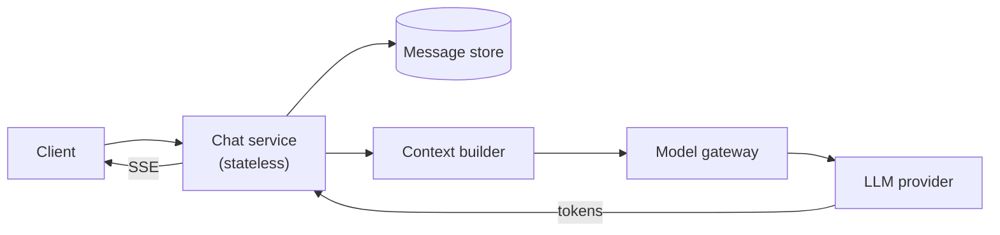
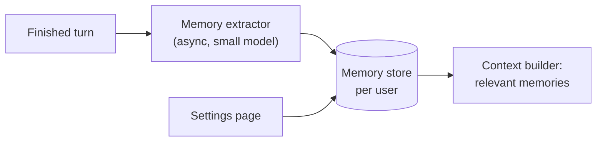
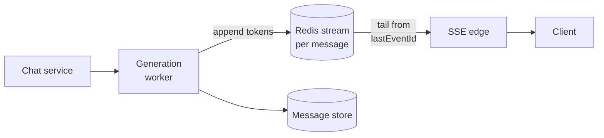

**The prompt:** "Design ChatGPT: a consumer chat assistant with conversation history and memory across chats."

The model is a box you call. The interview is about everything around it: streaming millions of long-lived responses, storing and trimming conversations, remembering users across chats without creeping them out, keeping cost under control when every message re-sends the conversation, and stopping abuse. This page also covers the follow-up prompt "design the memory system for a chat assistant", which is deep dive 3. Run the DP-00 framework.

## 1. Requirements (about 5 minutes)

**Say:** "Let me confirm scope: core chat, history and memory; I'll keep tools and files out unless you want them."

**Functional requirements:**

1. Users send a message and receive the reply streamed as it is generated.
2. Users list, reopen and continue past conversations.
3. The assistant remembers durable facts about a user across conversations; users can view, edit and delete them.
4. Usage is limited per user and plan; abuse is blocked.

**Below the line:** file uploads and images, web browsing and code execution, sharing conversations.

**Non-functional requirements:**

1. **Fast feel**: the platform adds little to the model's own latency (~1 s to first token).
2. **Scale**: millions of daily users, tens of thousands of concurrent streams.
3. **Durability**: an answered message is never lost.
4. **Cost per user** within plan economics.
5. **Availability** through provider incidents (degrade, don't die).
6. **Privacy**: memory is personal data; deletion must really delete.

## 2. Success metrics (about 3 minutes)

- **Business**: daily active users, messages per user, retention, paid conversion.
- **Quality**: user ratings, regenerate rate, memory precision (remembered facts that were correct and wanted), memory-caused complaints.
- **System**: time to first token, stream failure rate, cost per daily active user.
- **Guardrail**: moderation violations, deleted memories ever resurfacing (must be zero).

## 3. Entities, API and numbers (about 5 minutes)

**Core entities:** User (plan); Conversation (owner, title, updated time); Message (role, content, status: streaming/complete/stopped/failed, model, token counts); Memory (user, fact, source message, timestamps, status); Usage counter (tokens per user per window).

**API:**

```text
POST /v1/conversations/{id}/messages     { content } -> SSE: { messageId }, tokens..., { done, usage }
GET  /v1/messages/{id}/stream?lastEventId=...   (resume after a disconnect)
POST /v1/messages/{id}/stop
GET  /v1/conversations?cursor=...        GET /v1/conversations/{id}/messages?before=...
GET  /v1/memories                        DELETE /v1/memories/{id}
```

**Numbers:**

- 5M daily users x 20 messages = **100M messages a day**: ~1,200/s average, ~3,500/s peak.
- A reply streams ~15 s: 3,500 x 15 = **~50,000 concurrent streams** at peak. This shapes the serving tier.
- ~2 KB per message pair = **200 GB of history a day**: it must be partitioned.
- If each call sends 6,000 input tokens (instructions plus history), that is **600B input tokens a day**: re-sent history is the main cost, so context management and caching are central.

## 4. High-level design (about 10 minutes)

### Requirement 1: send a message, stream the reply

**Draw:**



**Say:** "The chat service authenticates, checks limits and persists the user's message first, so it's never lost. The context builder assembles a token-budgeted prompt. The gateway calls the model with streaming, and tokens are relayed over Server-Sent Events. When the stream ends, the reply is saved with its token counts."

**Say why SSE:** "Tokens flow one way over plain HTTP, SSE reconnects with a last-event id and passes through proxies; WebSockets are only needed for two-way real-time."

### Requirement 2: history

**Say:** "Two access patterns: list my conversations newest first, and page through one conversation's messages. Both are key lookups at huge volume, so I'd use a partitioned store: conversations keyed by user id sorted by updated time, messages keyed by conversation id sorted by time. DynamoDB or Cassandra fits; sharded Postgres works too. Recent messages of active conversations sit in Redis."

### Requirement 3: memory

**Draw:**



**Say:** "After a turn, an async job decides whether anything is worth remembering, off the critical path. On each new message the context builder retrieves the few relevant memories. Users manage them on a settings page." (Deep dive 3.)

### Requirement 4: limits and abuse

**Say:** "Before each call: a token-budget check and input moderation. Over-limit users get a clear message with a reset time, not a broken stream." (Deep dive 4.)

## 5. Deep dives (15 to 20 minutes)

### Deep dive 1: How do we stream reliably to 50,000 clients?

**Bad: generate inside the request, tied to the connection.** A network blip kills the answer; a deploy kills every in-flight answer; a refresh shows nothing.

**Good: stateless servers that save the final message.** Generation continues if the client leaves, so a refresh after completion shows the answer, but a reconnecting client cannot rejoin the live stream, and long connections complicate deploys.

**Great: decouple generation from delivery with a per-message token stream.**



A worker calls the model and appends chunks to a short-lived stream per message; any SSE edge server tails it from the client's `Last-Event-ID`, so reconnects resume mid-answer and deploys drain gracefully. Stop is a cancel flag the worker checks between chunks. Load balancer idle timeouts must exceed the longest stream (or use heartbeats).

### Deep dive 2: What goes into the context of a 300-turn conversation?

**Bad: the whole history every time.** Cost grows every turn and eventually overflows the window.

**Good: a sliding window of recent turns.** Bounded, but forgets early facts ("my budget is $500").

**Great: a token-budgeted context built in layers.**

```text
[system instructions + user's custom instructions]   stable prefix -> provider prompt cache
[relevant long-term memories]                         retrieved per message
[running summary of older turns]                      refreshed asynchronously
[last few turns verbatim]
[new message]
```

Fill the budget in priority order; fold the oldest turns into the summary when it overflows. Putting the **stable prefix first** lets provider prompt caching bill it at a discount and cut time to first token. The full history stays in the database.

### Deep dive 3: The memory system (the common follow-up)

**What qualifies as a memory?** Durable, user-specific, useful later: preferences ("prefers Python"), stable context (job, ongoing project), explicit requests ("remember that..."). Not transient task details, not other people's information, never sensitive categories (health, credentials) unless the user explicitly asks. The extractor works from written rules and is evaluated like any classifier.

**Conflicting and outdated facts.** **Bad:** append every extracted fact, so the store contradicts itself. **Good:** keep timestamps and prefer the newest. **Great:** the extractor compares each candidate with similar existing memories and outputs an operation (**add, update, replace, ignore**), so "moved to Bangalore" replaces "lives in Pune"; each memory keeps its source message for audit.

**Retrieval without creepiness.** Embed memories and retrieve the top few relevant to the current message, plus a handful of always-on core facts; never inject unrelated personal details. Scope strictly by user id.

**Deletion that really deletes.** A delete removes the memory from the store, its embedding index and caches immediately; summaries derived from it are regenerated or purged; "delete all" and "memory off" are honoured on the next message. A deleted memory resurfacing is a severity-one bug, so test it.

**Measuring success.** Offline: labelled conversations for extraction precision and recall, and conflict handling. Online: how often users delete or correct memories (a high rate means bad extraction), answer ratings with and without memory (an A/B test), and complaints about unwanted personalisation.

### Deep dive 4: Fair rate limiting for an LLM product

**Bad: requests per minute.** One request costs 100 or 100,000 tokens.

**Good: tokens per user per window** in Redis.

**Great: layered limits with reservation.** A token bucket per user and plan: reserve input plus max output before the call (atomic Redis script), settle actual usage after; a concurrency cap per user; a global budget per model below provider limits so free-tier traffic sheds first; and graceful degradation to a smaller model instead of a hard stop.

## 6. Evaluation and safety (about 5 minutes)

- **Offline**: a regression set of conversations per capability, graded by calibrated judges and code checks; separate sets for memory extraction and context assembly (does the answer use the summary correctly?).
- **Online**: sampled graders on live traffic, regenerate and thumbs-down rates, stream failure rate, per-model dashboards when routing changes.
- **Safety**: input and output moderation, account-level abuse signals, hard caps on prompt and output size, stricter limits for anonymous users, and memory privacy controls.

## 7. Cost, scale, failures, trade-offs (about 3 minutes)

- **Cost levers**: prompt caching of the stable prefix, summarisation, routing simple turns to a smaller model, capping output tokens.
- **Failures**: provider incident: the gateway's circuit breaker falls back to another region or model; non-essential features (titles, summaries, memory extraction) pause first to protect the main path.
- **Trade-off**: summaries lose detail but keep cost flat; keep recent turns verbatim to limit the damage.

**The 20-second summary:** "Stateless chat services persist the user message, build a token-budgeted context (cached prefix, memories, summary, recent turns), and hand generation to workers that write to per-message streams, so any edge server can stream and resume. History lives in a partitioned store; memory is extracted asynchronously with add/update/replace logic and real deletion; token-based limits protect cost and capacity."

## What separates levels

- **Mid-level**: stores messages, calls the model with history, streams, truncates long history, basic rate limits.
- **Senior**: persists first, SSE reasoning, partitioned store from access patterns, budgeted context with summary and caching, token-based limits, disconnect handling, async memory.
- **Staff**: decouples generation from delivery, quantifies cost per user and its levers, designs memory as a privacy-sensitive feature with conflict resolution and verifiable deletion, plans degradation across providers and capacity for concurrent streams.
