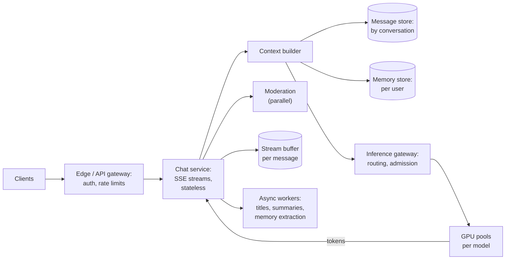
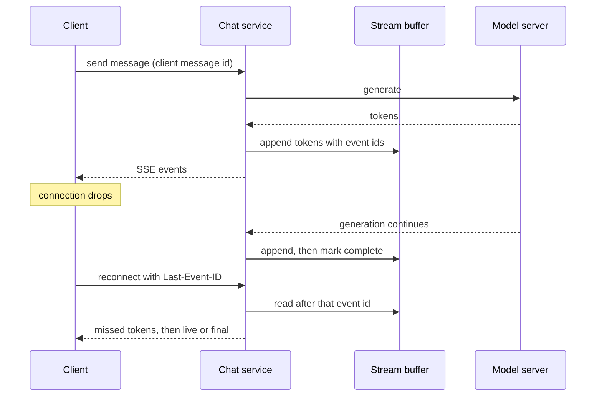
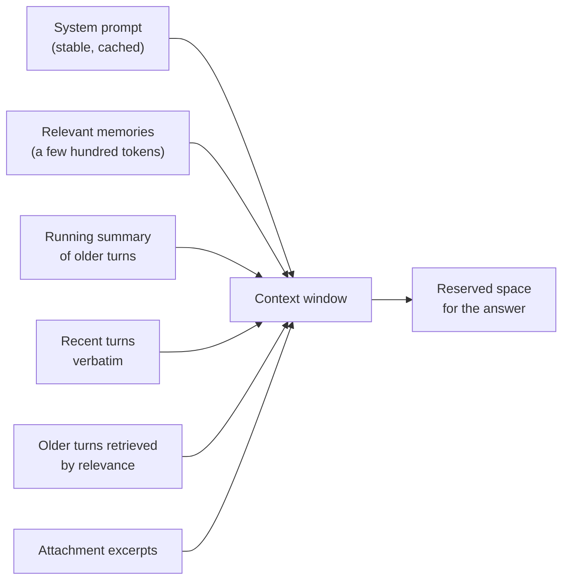

**The prompt:** "Design ChatGPT: a consumer chat assistant with conversation history and memory across chats."

The model is a box you call. The interview is about everything around it at consumer scale: **streaming tens of thousands of concurrent responses** that survive dropped connections, **deciding what goes into each model call** when conversations run for hundreds of turns, **memory across chats** that users control, and **fair limits in tokens** when GPUs are the scarce, expensive resource.

## 1. Understanding the problem

**Functional requirements (core)**

1. Users should be able to chat and see responses stream in; they can stop, regenerate or edit a message.
2. Users should be able to see, rename, continue and delete past conversations.
3. Users should be able to have the assistant remember facts across chats, and view, edit, delete or turn off those memories.
4. Users on different subscription tiers should get different models and limits.

**Below the line**: tools such as web search and code execution, voice, deep file analysis, team workspaces.

**Non-functional requirements**

- The system should stream the first token within 1 s at p95 and never stall mid-answer.
- The system should lose no response when a connection drops, and never generate twice for one message.
- The system should stay 99.9% available and degrade gracefully, not fail, when GPUs are saturated.
- The system should honour deletion everywhere and keep memories strictly per user.
- Scale: 10 million daily users, 100 million messages a day.

**Framing the AI task.** Pure generation with a carefully assembled context. There is no retrieval corpus and no agent in scope; the hard problems are concurrency, context management, memory and capacity.

**Numbers that change the design**

- 100 million messages a day is about 1,160 per second on average and about 3,500 at peak.
- A response streams for about 10 s, so **about 35,000 streams are open at peak** (Little's law: 3,500 x 10). Servers must be asynchronous and stateless, and connections long-lived.
- At about 3,000 input and 500 output tokens per message: 300 billion input and 50 billion output tokens a day, about **580,000 output tokens per second** on average. GPU capacity is planned in output tokens per second per model, with headroom for peaks.
- About 2 KB per message is about 200 GB of new text a day: a horizontally partitioned store, not one database.

## 2. High-level design

**The data model**

```text
conversations (user_id, conversation_id, title, created_at, updated_at,
               active_leaf_id, summary_upto_id)              partitioned by user_id
messages      (conversation_id, message_id, parent_id, role, content_ref,
               model, input_tokens, output_tokens, status, created_at)
                                                             partitioned by conversation_id
summaries     (conversation_id, upto_message_id, text, tokens)
memories      (user_id, memory_id, text, embedding, category, source_conversation_id,
               created_at, updated_at, status)
usage         (user_id, model, window_start, tokens_used, messages_used)
```

- Messages are partitioned by conversation id, so loading a conversation is one partition read; conversations are partitioned by user id for the sidebar list. A wide-column store (Cassandra, DynamoDB, Bigtable) fits this access pattern and the write volume.
- `parent_id` turns a conversation into a **tree**: regenerating or editing creates a sibling, and `active_leaf_id` marks the branch on screen. The visible conversation is the path from the active leaf back to the root.
- `status` (streaming, complete, stopped, failed) lets a client that reconnects know what it is looking at.



**Requirement 1, streamed chat.**

1. The client sends the message with a client-generated message id. The chat service checks the id (a retry of an existing id returns the existing response) and stores the user message.
2. The **context builder** assembles the prompt within a token budget (section 4): system prompt, relevant memories, the conversation summary, recent turns of the active branch, older turns retrieved by relevance, and attachment excerpts.
3. Moderation of the input runs in parallel with the model call and can cancel it.
4. The **inference gateway** checks the user's token budget and current capacity (section 5) and routes the request to a GPU pool for the chosen model.
5. Tokens stream back to the chat service, which forwards them to the client as server-sent events and appends them to a **stream buffer** keyed by message id.
6. When generation completes, the assistant message is stored with its token counts and status `complete`; usage counters are updated.

**Requirement 2, history.** The sidebar reads conversations by user id. Asynchronous workers generate titles after the first exchange and keep summaries current. Deleting a conversation deletes its messages, summaries and any memories sourced only from it, and removes it from search indexes and caches.

**Requirement 3, memory.** After a conversation goes idle, a worker extracts memory candidates and reconciles them with stored memories; each request retrieves a few relevant ones (section 4).

**Requirement 4, tiers.** The gateway applies per-tier token buckets and model access, and routes tiers to pools with different priorities (section 5).

## 3. Deep dive: streaming at scale, and surviving disconnects

**Bad: return the whole response when it is done.** Users stare at a spinner for 10 to 30 s; proxies and load balancers time out long requests; nothing is visible until everything is.

**Good: stream tokens from the model server through the chat server with server-sent events (SSE).** Users see text immediately. Three problems remain: a dropped connection (a tunnel, a phone switching networks) loses the answer; the client's automatic retry starts a second, paid generation; and the stream is pinned to one chat server, so deploys cut streams.

**Great: decouple generation from the connection.**



- **Idempotent submission.** The client message id is the key: a retried send returns the existing response's stream instead of starting a new generation.
- **A stream buffer per message.** Tokens are appended (in small batches, for example every 50 ms, to limit writes) to a short-lived log such as a Redis stream keyed by message id, each batch with an increasing event id, kept for a few minutes after completion.
- **Resume with the standard SSE mechanism.** SSE clients send the `Last-Event-ID` header when they reconnect; the chat service, on any server, reads the buffer after that id, replays what was missed and continues live. Chat servers hold no state that matters, so any server can serve any reconnect.
- **Disconnect policy.** Generation continues when the client vanishes and the result is stored, so the answer is waiting when the user returns; this costs GPU time for abandoned answers but avoids paying twice when users retry. An explicit **stop** sends a cancel to the model server, which frees the GPU slot immediately, and stores the partial answer with status `stopped`.
- **Long-lived connections.** Load balancers are configured for long idle timeouts, the server sends a keep-alive comment every 15 s or so, each chat server (asynchronous I/O) holds tens of thousands of connections, and deploys drain gracefully: a server stops accepting new streams and its clients reconnect elsewhere and resume from the buffer.


## 4. Deep dive: the context window and memory

**Bad: send the whole history every turn.** It overflows the window eventually, and long before that the cost explodes: each turn re-sends everything before it, so a 300-turn conversation of about 200 tokens per turn sends about 200 x 300 x 301 / 2, roughly 9 million input tokens in total. Latency grows with every turn too.

**Good: a sliding window of the last N turns.** Cheap and simple, but the assistant forgets the user's name, early constraints ("I'm vegetarian, cooking for six") and decisions made an hour ago.

**Great: a token budget per section, built for caching.**



- **Budget example** for a request targeting about 16,000 tokens even on a model with a much larger window (cost and latency, not the limit, set the target): system prompt about 1,500; memories up to 500; running summary up to 1,000; recent turns up to 6,000; retrieved older turns up to 1,500; attachment excerpts up to 4,000; about 2,000 reserved for the answer.
- **Running summary, incremental.** When the unsummarised tail of the active branch exceeds a threshold (say 6,000 tokens), a worker folds the oldest unsummarised turns into the summary: previous summary plus those turns in, new summary out, and `summary_upto_id` advances. Requests use the summary plus the turns after it. Because this runs asynchronously, no user waits for it.
- **Retrieval over the conversation itself.** Each turn pair is embedded in the background; when a new message refers back ("the second recipe you gave me"), the most similar older turns are pulled in verbatim.
- **Prompt caching.** The prefix is ordered from most stable to least: system prompt, then memories and summary, then turns. New turns are appended at the end, so consecutive requests share a long cached prefix. The summary is updated in coarse steps, not every turn, so the prefix stays stable for many turns at a time.
- **Branches.** The context always follows the active branch; turns from abandoned branches never leak in.

**Memory across chats.**

- **Bad**: append past conversations into a growing profile included in every prompt: bloated, contradictory, and full of sensitive details nobody chose to store.
- **Good**: background extraction of facts into a per-user store, with a few relevant ones retrieved per request.
- **Great**, the pipeline in detail:
  1. **Extract.** When a conversation goes idle, a worker asks a model for durable facts and preferences ("is vegetarian", "works in Python", "has two children"), each with a category, ignoring one-off details and anything in a sensitive category (health, finances, beliefs) unless the user explicitly asked to remember it. An explicit "remember that..." goes through a memory tool immediately.
  2. **Reconcile.** Each candidate is compared with the user's most similar stored memories, and the model decides: add it, update an existing one (the user moved city), delete a contradicted one, or do nothing. Timestamps record when each fact was last confirmed.
  3. **Retrieve.** For each request, the top few memories by similarity to the message, weighted by recency, above a relevance threshold, within the memory budget.
  4. **Control.** A memory page to view, edit and delete; a global off switch; temporary chats that neither read nor write memory; deleting a conversation removes memories sourced only from it.
  5. **Safety.** The namespace is the authenticated user id, never a value from the model; nothing taken from pasted documents or web content is stored as an instruction, which blocks memory poisoning.

## 5. Deep dive: capacity, fair limits and cost

**Bad: limit requests per minute.** A 100-token message and a 100,000-token message count the same, so a few heavy users starve everyone, and the free tier can consume the GPUs paying users need.

**Good: per-user token buckets per tier.** A bucket refills at a set rate (tokens per minute) up to a capacity; a request needs enough tokens in the bucket. Fair across message sizes, but nothing yet protects the fleet as a whole when demand exceeds GPU supply.

**Great: limits at three levels, plus graceful degradation.**

- **Per user**: token buckets per tier and per model; message caps on the most expensive models (for example a number of messages per few hours); at most one or two concurrent generations per user. Requests reserve estimated tokens (input plus a cap on output) and are reconciled with actual usage afterwards.
- **Per pool, admission control**: each GPU pool reports its queue depth and KV-cache utilisation. When a pool nears saturation, the gateway admits paid tiers first, queues free requests briefly, then routes free traffic to a smaller model, and finally returns a clear "at capacity, try again shortly" message rather than letting requests time out.
- **Capacity itself**: separate GPU pools per model, serving with continuous batching and a paged KV cache to maximise concurrent streams; autoscaling on queue depth and KV utilisation **ahead** of the daily peak, because loading a large model onto new GPUs takes minutes; long-context requests on their own pool so they do not stall short ones.
- **Abuse**: automated-use detection (request patterns, many accounts from one source), moderation of inputs and outputs, and account-level enforcement.
- **Cost levers**: the default model per tier, concise default answers (output tokens dominate GPU time), prompt-cache hit rate, and routing simple turns to smaller models where the product allows. Track cost per active user per tier against what the tier earns.

## 6. Evaluation, failure modes and expectations

**Evaluation**

- **Offline**, for every model or system-prompt change: helpfulness rubrics, instruction following, refusal behaviour in both directions (refusing safe requests is a failure too), long-conversation consistency (does it keep early constraints), and memory use (stored facts used correctly, never surfaced inappropriately).
- **A/B tests** on engagement, thumbs and regenerate rates.
- **Online**: moderation rates, time to first token and stall rate per pool, reconnect and resume success, memory deletions and complaints.

**Failure modes**

| Failure | Detection | Mitigation |
| --- | --- | --- |
| GPU capacity exhausted at peak | Queue depth, admission rejections | Pre-scaling, tier priorities, smaller-model fallback |
| Streams drop mid-answer | Reconnect rate | Stream buffer and Last-Event-ID resume |
| Duplicate generations on retry | Repeated client message ids | Idempotent submission |
| Context overflow on long chats | Token count before each call | Section budgets, summaries, retrieval |
| Memory shown to the wrong user | Namespace audits, tests | Namespace from the authenticated id only |
| Hot conversation partitions | Store latency | Partition by conversation, cap message size |
| Moderation blocks good content | False-positive review | Tuned thresholds, appeals, per-category policy |

**What is expected at each level**

- **Mid-level**: streamed chat with stored history, a sliding context window, basic rate limits.
- **Senior**: idempotent, resumable streaming with stateless servers; a sectioned token budget with incremental summaries, retrieval and prompt caching; a memory pipeline with user controls; token-based limits with admission control; the concurrency and token arithmetic.
- **Staff and above**: GPU capacity planning across pools and tiers as a cost decision, the degradation policy under load, privacy and retention for memory across regions, the evaluation and rollout process for model changes at this scale, and platform-level abuse handling.

Say it like this: "The chat service is stateless and streams over server-sent events while writing tokens to a per-message buffer, so a dropped client resumes with Last-Event-ID and a retried message id never generates twice. Each call is built from a token budget: system prompt, a few relevant memories, an incrementally updated summary, recent turns and retrieved older turns, ordered for prompt caching. Limits are token buckets per user, tier and model, with pool-level admission control that prioritises paid tiers and degrades to smaller models before failing."
