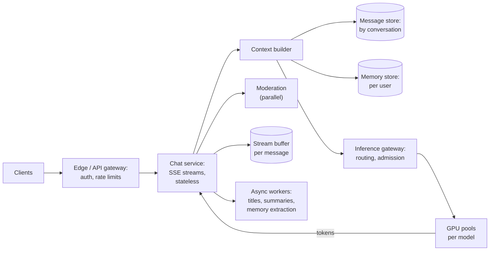
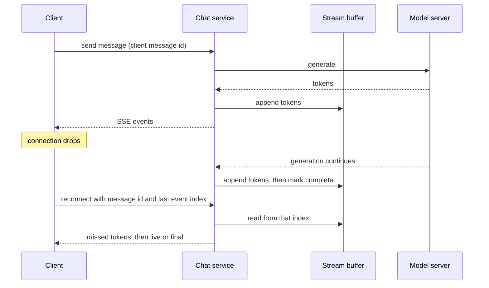
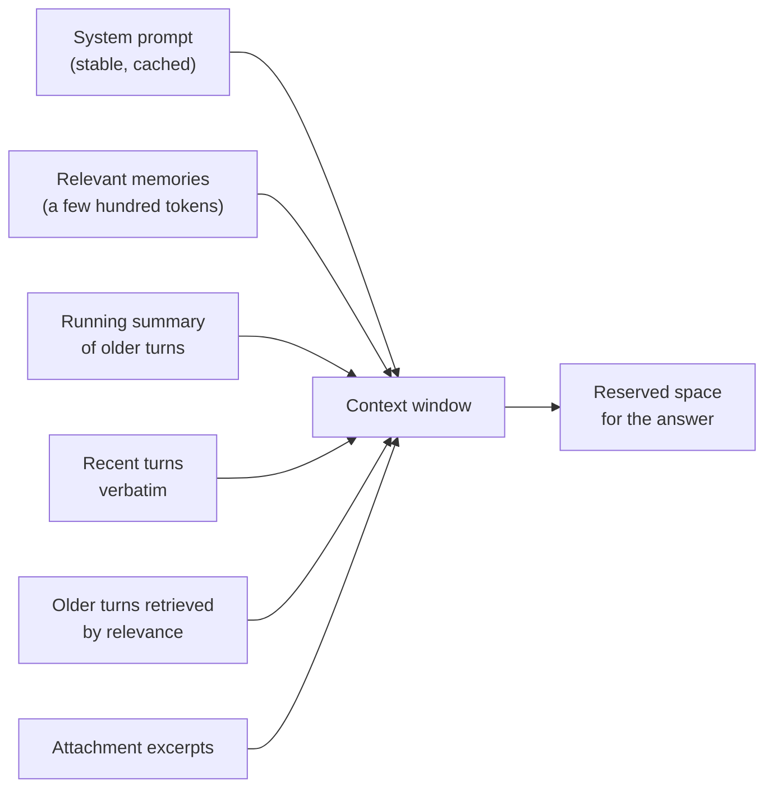

**The prompt:** "Design ChatGPT: a consumer chat assistant with conversation history and memory across chats."

The model is a box you call. The interview is about everything around it at consumer scale: **streaming millions of concurrent responses**, **deciding what goes into each model call** when conversations run for hundreds of turns, **memory across chats** that users control, **fair limits measured in tokens**, and abuse.

## 1. Requirements

Functional:

- Chat with streamed responses; conversation list and history; rename and delete; regenerate and edit a message (branches).
- Memory across chats: the assistant remembers stated preferences and facts; users can view, edit, delete or disable it; temporary chats store nothing.
- Multiple models and subscription tiers; file and image upload.
- Safety: moderation of inputs and outputs.

Non-functional (assumptions):

- 10 million daily active users, 100 million messages a day.
- p95 time to first token under 1 s; streaming never stalls for more than a moment.
- 99.9% availability; graceful degradation under capacity pressure.
- Privacy: deletion honoured everywhere; data retention rules; regional processing where required.

## 2. Success metrics

- Engagement and retention, thumbs-up rate, regenerate rate (a dissatisfaction signal).
- Time to first token, stream stall rate, error rate.
- Safety: policy violation rate, moderation false-positive rate.
- Cost per active user and per message, per tier.

## 3. Entities, API and numbers

Entities: User, Conversation, Message (id, parent id for branches, role, content, model, token counts), ConversationSummary, MemoryItem (user id, text, source, timestamps), Attachment, UsageCounter.

API:

- `POST /conversations/{id}/messages` with a client-generated message id; response streamed over server-sent events.
- `GET /conversations/{id}/stream/{messageId}?from=N`: resume a stream after a disconnect.
- `GET /memories`, `DELETE /memories/{id}`.

Numbers:

- 100 million messages a day is about 1,160 per second on average and about 3,500 at peak.
- Each response streams for about 10 s, so **about 35,000 concurrent streams** at peak (Little's law: 3,500 x 10).
- At 3,000 input and 500 output tokens per message: 300 billion input and 50 billion output tokens a day, about **580,000 output tokens per second** on average. GPU capacity is planned in output tokens per second per model.
- Storage: about 2 KB per message is about 200 GB of new text a day.

## 4. High-level design

1. The client sends a message with its own message id (so retries do not duplicate it).
2. The chat service stores the user message, then the **context builder** assembles the prompt: system prompt, relevant memories, the conversation summary, the most recent turns, and attachments.
3. Moderation runs in parallel with the model call and can cancel it.
4. The inference gateway admits the request (quotas, capacity), routes it to a GPU pool for the chosen model, and tokens stream back through the chat service to the client over server-sent events. They are also appended to a short-lived **stream buffer** keyed by message id.
5. When the response completes, the assistant message is stored with token counts; asynchronous workers generate the title, update the summary and extract memories.

## 5. Deep dives

### 5.1 Streaming and disconnects

- Server-sent events suit one-way token streams over HTTP; WebSockets suit bidirectional features (voice, live collaboration).
- **On disconnect, keep generating** and persist the result, so the answer is there when the user returns; the alternative, cancelling to save GPU time, makes users pay twice when they retry. Many products continue for short outputs and cancel only when the user explicitly stops.
- The stream buffer (a fast store keyed by message id, with event indexes) lets any chat server resume a stream, so servers stay stateless.
- A client retry with the same message id returns the existing response instead of starting a second generation.

### 5.2 What goes into the next model call

A 300-turn conversation does not fit, and should not: cost and quality both suffer.

- **A token budget per section**: system prompt, memories, summary, recent turns, retrieved older turns, attachments, and reserved output space.
- **The running summary** is updated asynchronously whenever the unsummarised history passes a threshold, so no request waits for summarisation.
- **Retrieval over the conversation itself** brings back an old turn when the user refers to it ("the recipe from earlier").
- **Prompt caching**: keep the system prompt and summary stable and append messages at the end, so consecutive turns reuse the cached prefix.
- **Branches**: messages form a tree (each has a parent id); regenerate and edit create siblings, and the context follows the active branch.

### 5.3 Memory across chats

- **Writing**: explicit ("remember that I am vegetarian") through a memory tool, and implicit extraction by background workers after a conversation, with deduplication and contradiction handling (the newer fact replaces the older).
- **Reading**: retrieve a few relevant memories by similarity and recency for each request, within a small budget.
- **User control**: a memory page to view, edit and delete; a global off switch; temporary chats that neither read nor write memory.
- **Risks**: sensitive data stored without intent (filter categories such as health details unless explicitly asked), wrong or over-generalised memories, injected instructions saved as memories (never store instructions taken from documents or web content), and cross-user leakage (namespaces from the authenticated user id only).

### 5.4 Fair rate limits, in tokens

- One request can be 100 tokens or 100,000, so limits are expressed in **tokens** (and messages for the most expensive models), not requests.
- **Per-user token buckets per tier and per model**, plus a cap on concurrent generations per user.
- **Global admission control** when GPUs saturate: queue briefly, prioritise paid tiers, route free traffic to a smaller model, and return a clear "at capacity" message rather than timing out.
- **Abuse**: automated-use detection, anomaly detection on usage patterns, moderation, and account-level enforcement.

### 5.5 Inference capacity

- Separate GPU pools per model, with continuous batching and paged KV cache to maximise concurrent streams.
- Autoscale on queue depth and KV cache utilisation, ahead of daily peaks, because loading a model takes minutes.
- Route simple requests to smaller models where the product allows; long-context requests to pools tuned for them, so they do not stall short ones.

## 6. Evaluation

- Offline suites for every model or system-prompt change: helpfulness rubrics, instruction following, safety and refusal behaviour (both over- and under-refusal), memory use (does it use stored facts correctly, does it avoid leaking them where inappropriate).
- A/B tests on engagement, thumbs and regenerate rates.
- Online: moderation rates, time to first token and stall rates per model pool, memory complaints and deletions.

## 7. Failure modes

| Failure | Detection | Mitigation |
| --- | --- | --- |
| GPU capacity exhausted at peak | Queue depth, admission rejections | Pre-scaling, tier priorities, smaller-model fallback |
| Streams drop mid-answer | Client reconnect rate | Stream buffer and resume by message id |
| Duplicate generations on retry | Duplicate client message ids | Idempotent message submission |
| Context overflow on long chats | Token counter before each call | Budgets, summaries, retrieval of old turns |
| Memory shown to the wrong user | Namespace audits, tests | Namespace from authenticated id only |
| Hot conversation partitions | Store latency metrics | Partition by conversation id, cap message sizes |
| Moderation blocks good content | False-positive reviews | Tuned thresholds, appeal path, per-category policies |

## 8. Cost and next steps

- Cost is GPU time per output token. Levers: smaller models for simple turns, prompt caching of stable prefixes, concise default answers, limits per tier.
- Next: tools (web search, code execution) with the agent controls of earlier chapters, projects with shared files, voice.

Say it like this: "The chat service is stateless and streams tokens over server-sent events while also writing them to a per-message buffer, so a dropped client can resume and a retried message id never generates twice. Each call is built from a token budget: system prompt, a few relevant memories, a rolling summary, recent turns and retrieved older turns, with a stable prefix for caching. Limits are token buckets per user and tier, with global admission control and tier priorities when GPUs are saturated."
