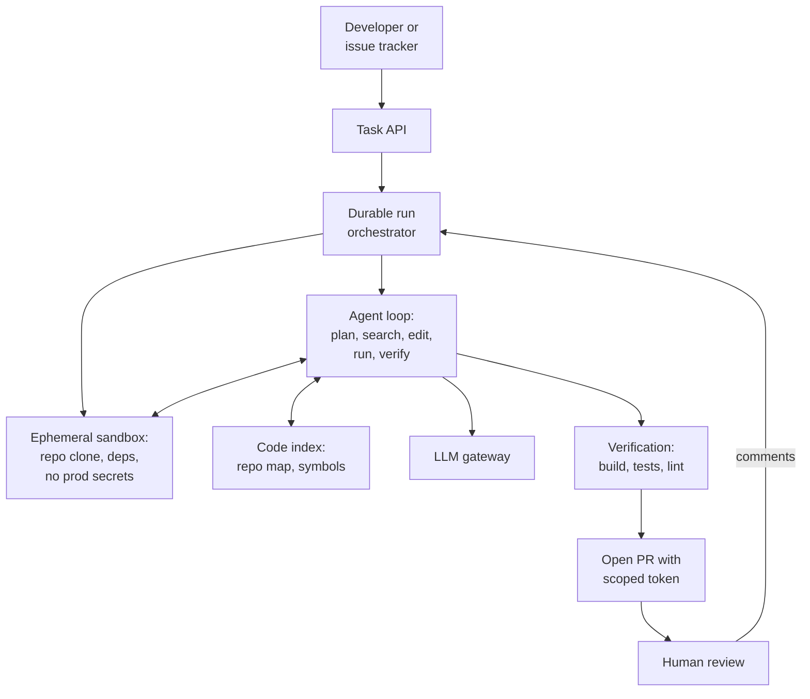
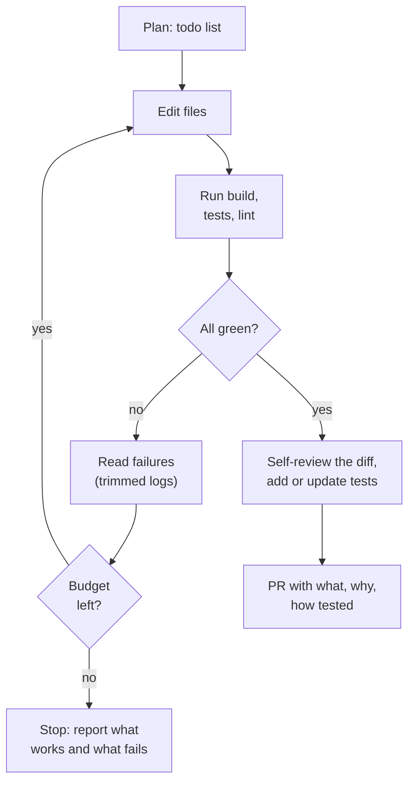

**The prompt:** "Design a coding agent: a developer gives it a task on a repository, it works in the background and comes back with a pull request."

The clearest example of a **long-running, autonomous agent**, and the template for deep agents in general. Four problems decide the design: **understanding a codebase far larger than the context window**, **running model-written code safely**, **proving the change works before claiming it does**, and **keeping a run that lasts an hour durable, observable and within budget**.

## 1. Requirements

Functional:

- Accept a task (an issue or a description) for a repository and branch.
- Explore the code, plan, edit files, run builds, tests and linters, iterate.
- Open a pull request with a clear description: what changed, why, how it was tested.
- Respond to review comments by pushing follow-up commits.
- Show progress while it works; let the developer stop it.

Non-functional (assumptions):

- Runs last minutes to an hour; 10,000 tasks a day across many repositories.
- Strong isolation between tasks; no production secrets reachable.
- A budget per task (tokens, wall time, compute).
- The agent never merges; humans review.

## 2. Success metrics

- **Resolution rate**: tasks producing a PR that passes checks and is merged with little change.
- Review iterations per PR, time to PR, and cost per merged PR.
- Regressions introduced (incidents traced to agent PRs).
- Safety incidents: zero secret leaks, zero sandbox escapes.

## 3. Entities, API and numbers

Entities: Task, Run (status, budget used), Sandbox, Step (model call or tool call with result), Plan (todo items), Artifact (diffs, logs), PullRequest, ReviewComment.

API: `POST /tasks`, `GET /runs/{id}` with a progress stream, `POST /runs/{id}/cancel`; a source-control app receives review comments as webhooks.

Numbers: 10,000 tasks a day, each running about 30 minutes, means about 210 sandboxes running at once on average (10,000 x 30 / 1,440), several hundred at peak. A run of 50 to 150 model calls with large contexts can use millions of tokens, so context management decides the cost.

## 4. High-level design

1. A task creates a **run** in a durable orchestrator (checkpointed, resumable).
2. The orchestrator starts an **ephemeral sandbox** (container or microVM), clones the repository and installs dependencies from a cache.
3. The **agent loop** (a deep agent: system prompt, todo list, file tools, shell tool, sub-agents) explores, plans, edits and runs commands inside the sandbox.
4. **Verification** runs the build, the relevant tests, linters and type checks; the agent iterates until they pass or the budget ends.
5. With checks green, the system opens a PR using a token scoped to that repository; review comments come back as new instructions to the same run.

## 5. Deep dives

### 5.1 Understanding a codebase bigger than the context

- **Agentic search beats preloading**: the agent uses `grep` and glob patterns, reads file ranges, follows imports and call sites, the way a developer does. For code, exact search plus navigation usually outperforms embedding retrieval, which misses identifiers and structure.
- **A repository map**: a compact outline (files, classes, function signatures, extracted with a parser such as tree-sitter) gives the agent a table of contents in a few thousand tokens.
- **Language-server tools**: go to definition, find references, type information.
- **Project instructions**: a conventions file at the repository root (build commands, test commands, style rules) loaded into the system prompt.
- **Sub-agents for exploration**: "find how authentication is wired and report the relevant files and functions" runs in a fresh context and returns a short summary.
- **Notes**: the agent writes findings to a notes file so they survive context compaction.

### 5.2 Running model-written code safely

- **Isolation**: one sandbox per run, a container with a hardened runtime or a microVM; CPU, memory, disk and time limits; destroyed afterwards.
- **No production credentials**: only test-scoped secrets; the source-control token lives outside the sandbox, used by the orchestrator to push and open the PR.
- **Network egress allowlist**: package registries and the repository host only. This closes the exfiltration leg of the lethal trifecta, since repository content (a README, a comment, an issue) can carry injected instructions.
- **Supply chain**: dependencies come through a proxy or cache with known-package policies; new dependencies added by the agent are flagged in the PR.

### 5.3 Proving it works

- Existing tests run first to establish a baseline (some may already fail).
- The agent writes or updates tests for the change; a change without a test is flagged.
- **Guard against cheating**: modifications to existing tests, skipped tests or weakened assertions are detected and called out in the PR, because "make the tests pass" can be satisfied by breaking the tests.
- A reviewer pass (a second model call with a review rubric) reads the full diff before the PR.
- The agent never claims success without green checks; when the budget runs out, it reports honestly what works and what does not.

### 5.4 Long runs: durability, context and budgets

- **Durability**: the run is checkpointed after each step; work in progress is committed to a scratch branch at milestones, so a crashed sandbox is recreated and resumed from the branch plus the run state.
- **Context management**: compaction of old steps into summaries; test and build logs trimmed to failures; files read by line ranges; the todo list recited near the end of the context; large outputs written to files.
- **Budgets**: tokens, model calls, wall time and sandbox minutes per run, with a warning at 80% and a stop at 100%.
- **Progress**: the todo list and current step stream to the developer; cancel stops the run cleanly.

## 6. Evaluation

- **Benchmark from your own history**: take merged PRs, revert the change, give the agent the original issue, and run the PR's own tests as the hidden check. Public benchmarks of the same shape (real issues with hidden tests) exist, but your repositories and conventions are what matter.
- Metrics: resolution rate, pass^k (consistency), cost and time per task, PR acceptance rate and review iterations in production.
- **Trajectory analysis**: where runs waste steps (re-reading files, flailing on environment setup) points to tool and prompt fixes.
- Safety tests: injected instructions in repository files, attempts to reach the network or secrets.

## 7. Failure modes

| Failure | Detection | Mitigation |
| --- | --- | --- |
| Invents APIs that do not exist | Build and type-check failures | Language-server tools, verification loop |
| Edits the wrong files, huge diffs | Diff size and scope checks | Plan review, diff limits, self-review |
| Weakens tests to pass | Test-file diff detection | Flag in PR, protected tests |
| Loops on a failing fix | Step and budget limits | Stop and report, ask the developer |
| Environment setup fails | Setup step errors | Cached environments, project setup instructions |
| Injection in repository content | Egress logs, red-team tests | No secrets, egress allowlist, scoped tokens |
| Sandbox crash mid-run | Orchestrator heartbeat | Resume from checkpoint and scratch branch |

## 8. Cost and next steps

- Cost scales with steps x context size: compaction, trimmed logs, sub-agents with small contexts and a cheaper model for exploration keep it down.
- Next: parallel attempts with the best one selected by tests (pass@k is useful here, because tests can pick the winner), learning repository conventions from review comments, and autonomous handling of routine tasks such as dependency upgrades.

Say it like this: "Each task runs as a durable, checkpointed run in its own ephemeral sandbox with no production secrets and a network allowlist. The agent explores with search, a repository map and language-server tools rather than stuffing the context, keeps a todo plan and notes in files, and must get the build, tests and linters green, with test tampering detected, before a scoped token opens the PR. I evaluate it by replaying our own merged PRs against their hidden tests."
