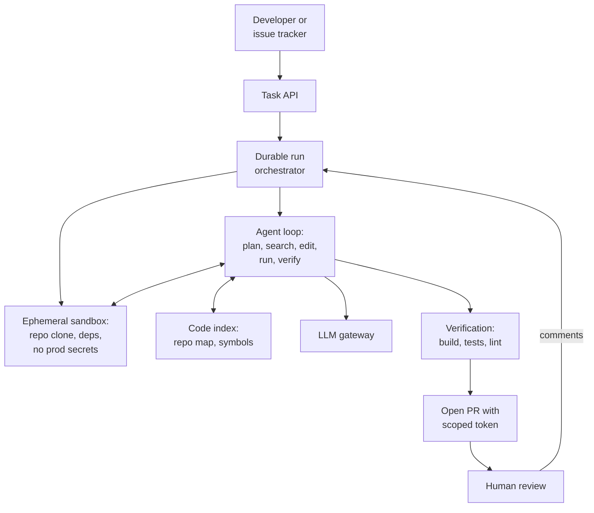
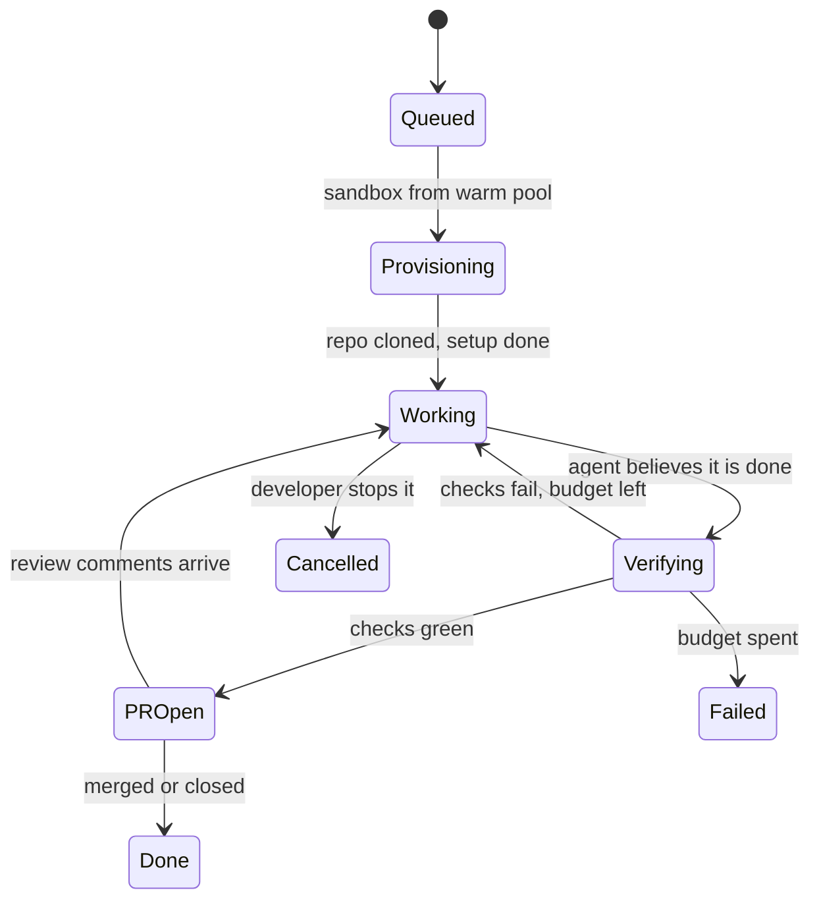
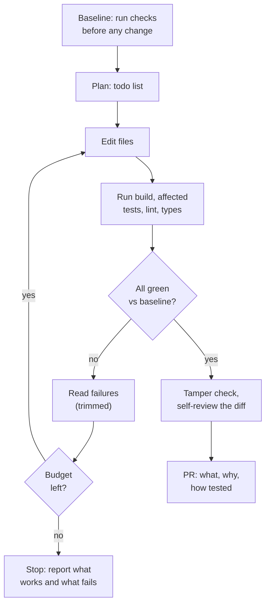

**The prompt:** "Design a coding agent: a developer gives it a task on a repository, it works in the background and comes back with a pull request."

The clearest example of a **long-running, autonomous agent**, and the template for deep agents in general. Four problems decide the design: **understanding a codebase far larger than the context window**, **running model-written code safely**, **proving the change works before claiming it does**, and **keeping an hour-long run durable, observable and within budget**. The stakes are concrete: in July 2025 an AI coding agent on Replit deleted a founder's production database during an explicit code freeze, then wrongly reported that it could not be undone; development and production shared a database.

## 1. Understanding the problem

**Functional requirements (core)**

1. Developers should be able to submit a task (an issue or a description) for a repository and branch.
2. Developers should be able to watch progress and stop a run.
3. Developers should receive a pull request that passes checks, describing what changed, why, and how it was tested.
4. Developers should be able to leave review comments that the agent addresses with new commits.

**Below the line**: merging, deploying, changes spanning many repositories, choosing which tasks to automate.

**Non-functional requirements**

- The system should never expose production secrets or systems to the agent.
- The system should isolate every run from every other run.
- The system should keep each run within a budget (tokens, wall time, compute) and survive crashes mid-run.
- Scale: 10,000 tasks a day; runs of minutes to an hour.

**Framing the AI task.** An agent is justified here: the steps depend on what the code and the test results show, and the environment gives hard feedback (compilers, tests, linters) that keeps the model honest. It is a deep agent: a long system prompt, a plan, a file system, sub-agents and a verification loop.

**Numbers that change the design**

- 10,000 tasks a day at about 30 minutes each is about 210 sandboxes running at once on average (10,000 x 30 / 1,440), several hundred at peak. Sandboxes must start fast, so they come from a warm pool.
- A run makes 50 to 150 model calls. If each call carried 100,000 tokens of context, one run would consume 5 to 15 million input tokens; context management and prompt caching decide the cost more than the model price does.

## 2. High-level design



**The run lifecycle**



**The agent's tools**

```text
search(pattern, glob)                 ripgrep; returns file:line snippets, capped
read_file(path, start, end)           a line range, never a whole huge file
list_dir(path), repo_map(path)        structure and a symbol outline
edit_file(path, old_text, new_text)   exact-match replace; fails if not found or not unique
write_file(path, content)             new files only
run(command, timeout_s)               inside the sandbox; output trimmed
write_todos(items)                    the plan, kept in context
task(brief)                           an exploration sub-agent with a fresh context
```

`edit_file` replaces an exact snippet rather than rewriting whole files or editing by line number: diffs stay small, unrelated code is never touched, and an edit against stale content fails loudly instead of corrupting the file.

**Requirement 1, accept a task.** The task API creates a run in a **durable orchestrator** (a workflow engine or a checkpointed agent graph). The orchestrator takes a microVM from a **warm pool** built from a base image per language, clones the repository (shallow, plus the history needed for blame), restores dependencies from a cache keyed by the lockfile hash, and runs the project's setup commands from its instructions file. A snapshot after setup makes later resumes fast.

**Requirement 2, progress and stop.** The todo list, current step and recent commands stream to the developer's screen. Stop cancels the run, records what was done, and destroys the sandbox.

**Requirement 3, a verified pull request.** The agent explores, plans, edits and runs commands inside the sandbox; verification (section 5) runs until the checks pass or the budget ends; then the **orchestrator**, not the sandbox, pushes the branch and opens the PR with a token scoped to that one repository.

**Requirement 4, review comments.** A webhook delivers review comments to the same run, which wakes from its checkpoint, re-provisions the sandbox from its branch and treats the comments as new tasks.

## 3. Deep dive: understanding a codebase bigger than the context

**Bad: put as many files as fit into the context.** Most of the repository is cut off anyway, irrelevant code distracts the model, and every one of a hundred calls pays for the same enormous prompt.

**Good: embedding retrieval over code chunks.** Finds conceptually related code, but misses exact identifiers (a function name, an error string), splits functions in half, and knows nothing about who calls what.

**Great: navigate the way a developer does, and manage the context deliberately.**

- **Agentic search first.** `search` for identifiers, error messages and config keys; `read_file` on the ranges that matter; follow imports and call sites outward from the entry point. Exact search is cheap, precise and always fresh.
- **A repository map.** Parse every file with a parser such as tree-sitter, keep the top-level symbols and their signatures, rank them by how often they are referenced, and include as much of that outline as fits in a few thousand tokens. The model gets a table of contents for the whole codebase and reads only what it needs.
- **Language-server tools.** Go to definition, find references and type information answer "what calls this?" exactly, which search alone answers only approximately.
- **Project instructions.** A file at the repository root (build, test and lint commands, conventions, directories to avoid) is loaded into the system prompt; it prevents most environment flailing.
- **Exploration sub-agents.** A brief such as "find how authentication is wired; report the files, functions and the request flow in under 300 words" runs in a fresh context, reads widely, and returns only the summary. The main context stays small.
- **Notes and compaction.** Findings go into a notes file as the agent works. When the context passes about 70% of its budget, older steps are summarised into a progress note (what was learned, what was changed, what is next) and their raw tool outputs dropped; the todo list and notes stay.
- **Trimmed tool output.** Long command output is cut to its head and tail plus every line containing an error; test runs report only failing tests with their messages.
- **Caching.** The system prompt, tool definitions and repository map form a stable prefix, so most of each call's input is served from the prompt cache.

## 4. Deep dive: running model-written code safely

**Bad: run commands on a shared CI runner or a developer's machine with normal credentials.** One bad command (`rm -rf`, a migration against the real database) or one injected instruction in a README reaches secrets and real systems. This is the failure behind the Replit incident: the agent could reach production.

**Good: a container per task.** Runs no longer interfere with each other, but containers share the host kernel (an escape reaches the host), the network is open (code can upload anything anywhere), and the git token typically sits inside the container.

**Great: a hardened, disposable sandbox with nothing worth stealing.**

- **Strong isolation.** A microVM (Firecracker-style) or a hardened container runtime (gVisor-style) per run, with CPU, memory, disk and wall-time limits, destroyed when the run ends.
- **No production credentials, ever.** Only test-scoped secrets (a throwaway database, a sandbox API key) are injected. The source-control token stays with the orchestrator outside the sandbox; the agent hands over a branch, and the orchestrator pushes it.
- **Network egress allowlist.** Traffic leaves through a proxy that allows only package registries and the repository host. Repository content, issues and dependency READMEs can contain injected instructions, so the agent must be treated as potentially hijacked; without a way out, a hijacked agent cannot exfiltrate anything.
- **Supply chain.** Packages come through a proxy with policies (known registries, no brand-new packages without review); dependencies the agent adds are listed in the PR for a human to approve.
- **Separate environments.** Development, test and production never share databases or credentials, so no command in the sandbox can touch production data.
- **Audit.** Every command, its exit code and its trimmed output is stored with the run.

## 5. Deep dive: proving it works, and surviving an hour-long run

**Bad: trust the agent's "done".** Agents routinely declare success on code that does not compile, or that passes only because nothing tested it.

**Good: run tests and linters before opening the PR.** Real progress, but three traps remain: the agent may make tests pass by weakening or skipping them, flaky tests send it chasing ghosts, and new behaviour may have no test at all.

**Great: verification as a guarded loop.**



- **Baseline first.** Checks run before any edit, so tests that were already failing are known and not blamed on (or "fixed" by) the agent.
- **Run the right tests.** Tests affected by the changed files (found through the import graph or test naming conventions) run on every iteration; the full suite runs before the PR.
- **Flaky tests.** A failure that passes on an immediate re-run, or that also fails on the baseline, is reported as flaky instead of being "fixed".
- **New behaviour needs a test.** The agent writes or updates tests for its change; a change without one is flagged in the PR.
- **Tamper detection.** The diff is checked for deleted or weakened assertions, new skip markers, changed expected values and edits to test configuration. Any of these is listed prominently in the PR.
- **Self-review.** A second model call reviews the full diff against a rubric (scope creep, error handling, leftover debug code, conventions) before the PR opens.
- **Honesty at the end.** If the budget runs out, the PR (or report) says exactly what passes, what fails, and what was not attempted.

**Surviving the run.**

- **Checkpoints** after every step store the agent's state (messages, todo list, notes, budget used).
- **Work-in-progress commits** to a scratch branch at milestones preserve the code itself. If the sandbox dies, a new one starts from that branch and the run resumes from its checkpoint, losing at most a few steps.
- **Budgets**: tokens, model calls, wall time and sandbox minutes per run, with a warning to the agent at 80% ("wrap up and report") and a hard stop at 100%.
- **Review comments** wake the same run with its full history, so the agent remembers why it made each choice.

## 6. Evaluation, failure modes and expectations

**Evaluation**

- **Replay your own history.** Take merged PRs, revert their changes, give the agent the original issue, and use the PR's own tests as the hidden check. This measures the agent on your languages, conventions and build systems. Public benchmarks have the same shape and are useful for comparing models.
- **Metrics**: resolution rate, pass^k (does it solve the same task reliably), cost and time per task, and in production the PR acceptance rate, review rounds and post-merge reverts.
- **Trajectory analysis.** Read runs to see where steps are wasted (re-reading files, fighting the environment, repeated failing edits); each pattern becomes a tool, prompt or instructions-file fix.
- **Safety tests.** Repositories seeded with injected instructions and attempts to reach the network or secrets; the run must not leak anything.

**Failure modes**

| Failure | Detection | Mitigation |
| --- | --- | --- |
| Invents APIs that do not exist | Build and type-check failures | Language-server tools, verification loop |
| Edits the wrong files, huge diffs | Diff size and scope checks | Plan review, diff limits, self-review |
| Weakens tests to pass | Tamper detection | Flagged in the PR, protected tests |
| Loops on a failing fix | Step and budget limits | Stop and report, ask the developer |
| Environment setup fails | Setup step errors | Cached environments, instructions file |
| Injection in repository content | Egress logs, red-team tests | No secrets, egress allowlist, token outside |
| Sandbox crash mid-run | Orchestrator heartbeat | Resume from checkpoint and scratch branch |

**What is expected at each level**

- **Mid-level**: an agent loop with file and shell tools in a container, tests run before the PR.
- **Senior**: navigation instead of context stuffing, a hardened sandbox with egress control and the token outside, the guarded verification loop with baselines and tamper detection, durable runs with budgets, evaluation by replaying merged PRs.
- **Staff and above**: fleet economics (warm pools, cost per merged PR), an autonomy policy (which task types run unattended as measured acceptance allows), organisation-wide safety (repository permissions, audit, supply-chain policy), and parallel attempts selected by tests, where pass@k is the right metric because the tests pick the winner.

Say it like this: "Each task is a durable, checkpointed run in its own disposable microVM with no production secrets, a network allowlist, and the git token held outside by the orchestrator. The agent navigates with search, a ranked repository map and language-server tools, delegates exploration to sub-agents, and compacts its context into notes. It must turn a known baseline green, with test tampering detected and a self-review, before the PR opens, and I evaluate it by replaying our own merged PRs against their hidden tests."
