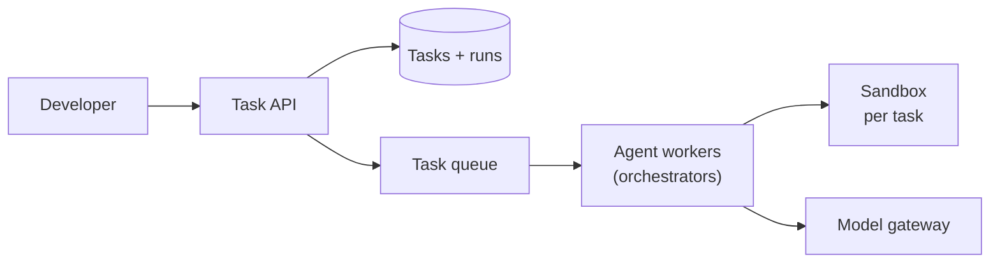
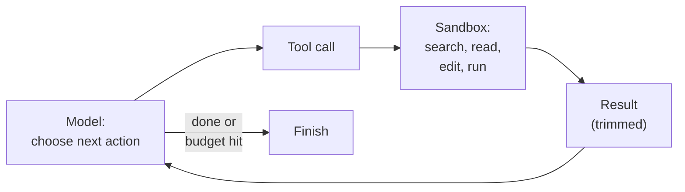
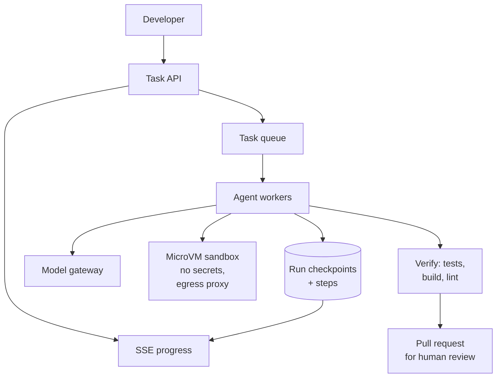

An AI coding assistant that fixes a bug or implements a small feature on its own is the clearest example of a **long-running, multi-step agent**: it explores, edits, runs code, reads the results and tries again, for minutes or hours, across thousands of steps a day. The design questions are the ones every serious agent faces: how it understands a world bigger than its context window, where it runs code safely, how it knows it is done, how it stays within budget, and how you prove it works.

## Understanding the Problem

**What are we building?** A service where a developer points the agent at a repository and a task ("fix the failing date parser test", "add pagination to the orders API"). The agent works in the background, shows its progress, and delivers a pull request that passes the tests, for a human to review.

### Functional Requirements

Core requirements:

1. Users submit a task for a repository and branch, in plain language.
2. The agent explores the code, makes changes and runs commands (tests, build, linters) until the task is done or it gives up.
3. Users watch progress live, can send guidance mid-task, and can cancel.
4. The result is delivered as a diff or pull request, with a summary of what changed and how it was verified.

Below the line:

- Inline autocomplete in the editor.
- IDE plugin details.
- Training or fine-tuning code models.

### Non-Functional Requirements

Core requirements:

1. **Safety**: model-generated code runs fully isolated; it can never reach production systems, secrets or other customers' code.
2. **Verified results**: changes are checked by the project's own tests and build before they are offered.
3. **Bounded cost and time**: every task has a step, token and wall-clock budget.
4. **Durability**: a task running for 40 minutes survives a worker crash or deploy.
5. **Confidentiality**: customer code is not retained beyond the task or used for training.

Below the line:

- Supporting every language toolchain on day one.
- Sub-second interactivity.

### The numbers

- 10,000 tasks a day, averaging 15 minutes: about **100 concurrent tasks on average, 500 at peak**, each needing its own sandbox.
- ~40 steps per task; the context grows as files are read, so the average call might carry 20,000 input tokens: 40 x 20,000 = **800,000 input tokens per task**, about **8 billion a day**. Context management and caching decide whether the product is affordable.
- Repositories up to millions of lines: the agent will see a tiny fraction of the code in any task.

## The Set Up

### Core Entities

- **Task**: repo, base branch, instruction, status (queued, running, waiting for user, succeeded, failed, cancelled), budgets.
- **Run**: the agent's state for a task: messages, plan, notes, step count, tokens used; checkpointed.
- **Step**: one tool call and its result (command, output, exit code, files touched), the audit trail.
- **Sandbox**: an isolated environment with a checkout of the repo.
- **Patch / pull request**: the final diff, test results and summary.

### The API

```text
POST /v1/tasks                    { repo, branch, instruction } -> { taskId }
GET  /v1/tasks/{id}/events        -> text/event-stream of steps, messages, status
POST /v1/tasks/{id}/messages      { text }        (guidance while it runs)
POST /v1/tasks/{id}/cancel
GET  /v1/tasks/{id}               -> status, diff, test results, pull request link
```

## High-Level Design

### 1) Users submit a task, and it runs in the background

A task takes minutes, so it can never live inside an HTTP request.



The API stores the task and enqueues it. An **agent worker** picks it up, creates a **sandbox** with the repository checked out, and runs the agent loop. The worker holds no state that matters only in memory: after every step, the run is **checkpointed** to the database.

### 2) The agent explores, edits and runs code

The agent is a loop: the model sees the task and what it has learned so far, chooses a tool, the worker executes it **inside the sandbox**, and the result goes back to the model.



The tool set is small and precise:

- `list_files(path)`, `search(pattern)` (ripgrep), `find_symbol(name)`: find things.
- `read_file(path, start, end)`: read only the lines needed.
- `edit_file(path, old_text, new_text)`: exact search-and-replace edits (deep dive 3).
- `run(command)`: run tests, the build or a linter, with a timeout; output is trimmed to the relevant parts (failures, last lines).
- `finish(summary)`: declare the task done, with an explanation.

### 3) Changes are verified and delivered

Before `finish` is accepted, the worker runs the project's checks (tests, build, linter) itself, not trusting the model's claim. If they fail, the failure output goes back to the agent. On success, the worker produces the diff, pushes a branch, and opens a pull request with a summary and the test results. A human reviews and merges; the agent never merges its own work.

### 4) Users watch and steer

Every step is written to the database and published as an event. The developer's browser subscribes over SSE and sees "searching for parse_date", "editing utils/dates.py", "running tests: 2 failed". A message from the developer is appended to the run's state and the model sees it on its next step. Cancel sets a flag the worker checks between steps, then destroys the sandbox.

## Potential Deep Dives

### 1) How does the agent work with a codebase far larger than its context window?

**Bad solution: put the repository in the prompt.** Even a medium repository is millions of tokens. It does not fit, and the parts that fit drown the relevant code in noise while cost explodes.

**Good solution: retrieval over code.** Chunk the repository by function and class, embed the chunks, and retrieve the most similar to the task. Useful as a starting point, but similarity is a weak signal for code: the bug is often in a caller, a config file or a test that shares no words with the task.

**Great solution: agentic search with a map, notes and compaction.**

- A **repository map**: a compact outline of files with their classes and function signatures (extracted with a parser such as tree-sitter), so the model sees the shape of the codebase in a few thousand tokens.
- **Search tools** the model drives itself (text search, symbol lookup, "who calls this?"), the same way an engineer explores: follow references, read the test, open the config.
- **Notes and plan in state**: the agent writes down what it learned ("date parsing lives in utils/dates.py; the test uses UTC") so it does not have to keep the raw file contents around.
- **Context compaction**: old tool outputs are replaced by short summaries once used, so the context stays bounded over 40+ steps.
- Optionally, **sub-agents** for exploration: a sub-agent searches the codebase and returns a short report, keeping the main agent's context clean.

### 2) Where does the code run, and how do we keep it safe?

**Bad solution: run commands on the worker machine.** Model-generated commands (or a malicious test file in a repository) could read secrets, attack the internal network, or affect other customers' tasks on the same machine.

**Good solution: a Docker container per task.** Separate filesystem and processes, resource limits. But containers share the host kernel, so a kernel exploit escapes; and without network rules the code can still reach internal services.

**Great solution: a microVM per task, with no secrets and controlled egress.**

- Each task gets a **microVM** (Firecracker, or a sandboxed runtime such as gVisor): its own kernel, strong isolation, starts in about a second.
- **No credentials inside.** The repository is cloned by the worker and copied in; pushing the branch happens outside the sandbox, by the worker, with its own token.
- **Network egress blocked** except an allow-listed proxy to package registries, so dependencies install but nothing else is reachable.
- **CPU, memory, disk and time limits**; the sandbox is destroyed when the task ends.
- **Fast start**: pre-built images per language with common toolchains, and snapshots of a repository after dependency installation, so the agent is not waiting minutes for `npm install` on every task.

### 3) How does the agent make edits that apply reliably?

**Bad solution: rewrite whole files.** The model outputs the entire new file. Slow, expensive, and it silently drops or alters code it was not meant to touch.

**Good solution: unified diffs.** Smaller output, but models often produce diffs with wrong line numbers or context, which fail to apply.

**Great solution: exact search-and-replace with feedback.**

- `edit_file(path, old_text, new_text)` requires `old_text` to match **exactly once** in the file. Zero or several matches return an error the model can act on ("old_text not found; re-read lines 40-80").
- After each edit, the tool returns the changed region, and formatters and linters run, so mistakes surface immediately.
- Tests, not the model's confidence, decide whether the change works.

### 4) How do we keep a long agent run on track and within budget?

- **Budgets**: maximum steps, tokens and wall-clock time per task, set by plan. Hitting a budget ends the run with a report of progress, not silently.
- **Plan first**: the agent writes a short plan (files to inspect, approach, how to verify) before editing, and updates it; reviewers and users see it.
- **Loop detection**: the same failing command with no change in between, or the same search repeated, triggers a different strategy or stops the run.
- **Verification gate**: the task cannot finish until the checks pass (or the agent explains why they cannot).
- **Durability**: the run is checkpointed after every step; if a worker dies, another worker restores the state and re-creates the sandbox from the last snapshot plus the recorded edits.
- **Human checkpoints** for risky operations: deleting many files, touching CI configuration, changing dependencies.

### 5) How do we measure whether the agent works?

**Bad solution: try a few tasks by hand after each change.** Agents vary between runs; a handful of manual tries proves nothing and misses regressions.

**Good solution: a public benchmark.** Benchmarks such as SWE-bench (real GitHub issues with hidden tests) give a comparable number, but they say little about your users' languages, repositories and task types, and some are contaminated by training data.

**Great solution: an internal benchmark of real tasks, graded by hidden tests, run repeatedly.**

- Hundreds of tasks taken from your own repositories' history: an issue, the commit that fixed it, and tests that fail before and pass after (the tests are hidden from the agent).
- Each task runs in a fresh sandbox **several times**; report **pass@1** and **pass^k**, plus steps, tokens, cost and time per solved task.
- Every model, prompt or tool change runs the benchmark before release (sliced by language and task type).
- Failed runs are reviewed and categorised (wrong file, broke other tests, looped, gave up early), which tells you what to fix next.
- In production: pull-request acceptance rate, edits reviewers had to make, and reverted merges.

### 6) How do we control cost and latency?

- **Prompt caching**: the instructions and earlier steps form a stable prefix that grows step by step; caching it cuts the cost of each step's input substantially and speeds up responses.
- **Compaction** (deep dive 1) keeps context from growing without bound.
- **Model routing**: a strong model for planning and editing, a cheaper one for summarising tool output or exploring.
- **Parallel tool calls** for independent reads and searches.
- **Early stopping** on hopeless runs instead of burning the whole budget.

## Final Design



## What is Expected at Each Level

**Mid-level.** An agent loop with tools to read files, edit and run tests; runs the code in a container; returns a diff. Recognises that the whole repository does not fit in context and proposes searching it.

**Senior.** Background tasks with a queue and checkpointed runs; agentic code search with a repository map; exact-match edits with feedback; tests as the verification gate; budgets and loop detection; a sandbox without secrets and with blocked egress; progress streaming and cancel; an internal benchmark reported with pass^k.

**Staff.** Treats isolation as a security boundary (microVMs, egress control, credentials outside the sandbox); designs for cost at scale (caching a growing prefix, compaction, routing); plans sandbox capacity and fast starts; builds the evaluation loop from real repository history; and defines what the agent is allowed to do without a human, with clear escalation for risky changes.
