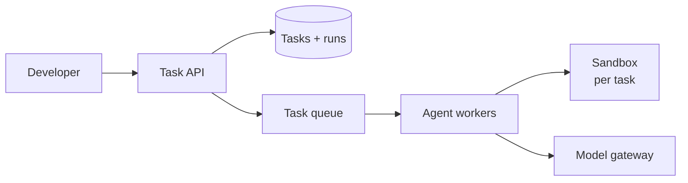
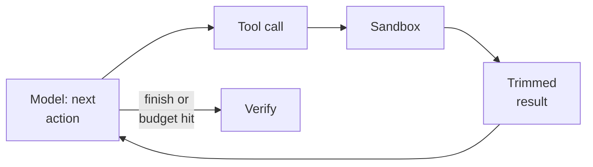

**The prompt:** "Design a coding agent: a developer gives it a task on a repository, it works in the background and comes back with a pull request."

This is the clearest example of a **long-running, multi-step agent**: it explores, edits, runs code, reads results and retries for minutes, thousands of times a day. The design questions apply to every serious agent: how it understands a world bigger than its context window, where it runs code safely, how it knows it is done, how it stays within budget, and how you prove it works. Run the DP-00 framework.

## 1. Requirements (about 5 minutes)

**Say:** "Let me separate this from inline autocomplete: I'm designing an agent that completes whole tasks asynchronously and produces a reviewed change."

**Functional requirements:**

1. Users submit a task for a repository and branch, in plain language.
2. The agent explores the code, edits files and runs commands (tests, build, linters) until done or out of budget.
3. Users watch progress live, can send guidance and can cancel.
4. The result is a pull request with a summary and test results, for human review.

**Below the line:** inline completion, IDE plugin details, training code models.

**Non-functional requirements:**

1. **Isolation**: generated code never reaches production systems, secrets or other customers' code.
2. **Verified output**: the project's own tests and build pass before a change is offered.
3. **Bounded cost and time** per task.
4. **Durability**: a 40-minute task survives a worker crash or deploy.
5. **Confidentiality**: customer code is not retained or used for training.

## 2. Success metrics (about 3 minutes)

- **Business**: pull requests merged, time saved, tasks completed per developer.
- **Quality**: task success on hidden tests (pass@1 and pass^k), reviewer edits needed, reverted merges.
- **System**: cost and time per solved task, sandbox start time.
- **Guardrail**: zero sandbox escapes or secret exposure; regressions in other tests.

## 3. Entities, API and numbers (about 5 minutes)

**Core entities:** Task (repo, branch, instruction, status, budgets); Run (messages, plan, notes, step and token counts; checkpointed); Step (tool call, output, exit code, files touched); Sandbox; Patch / pull request.

**API:**

```text
POST /v1/tasks                  { repo, branch, instruction } -> { taskId }
GET  /v1/tasks/{id}/events      -> SSE: steps, messages, status
POST /v1/tasks/{id}/messages    { text }
POST /v1/tasks/{id}/cancel
GET  /v1/tasks/{id}             -> status, diff, test results, PR link
```

**Numbers:**

- 10,000 tasks a day x ~15 minutes = **~100 concurrent tasks, ~500 at peak**, each with its own sandbox.
- ~40 steps per task with growing context (~20,000 input tokens per call) = **~800,000 input tokens per task**, ~8B a day: context management and caching decide affordability.
- Repositories of millions of lines: the agent sees a tiny fraction in any task.

## 4. High-level design (about 10 minutes)

### Requirement 1: submit and run in the background

**Draw:**



**Say:** "A task takes minutes, so it's a queued job. A worker creates a sandbox with the repo checked out and runs the agent loop, checkpointing the run after every step, so no state lives only in memory."

### Requirement 2: explore, edit, run

**Draw:**



**Say:** "A small, precise tool set: list files, text and symbol search, read a line range, exact search-and-replace edits, run a command with a timeout, and finish with a summary. All commands execute inside the sandbox; outputs are trimmed to what matters, like failures and the last lines."

### Requirement 3: progress and steering

**Say:** "Every step is stored and published as an event; the UI subscribes over SSE. A user message is appended to the run's state and seen on the next step. Cancel sets a flag the worker checks between steps, then destroys the sandbox."

### Requirement 4: verified pull request

**Say:** "Before finish is accepted, the worker runs tests, build and linters itself rather than trusting the model's claim. Failures go back to the agent. On success the worker, outside the sandbox, pushes a branch and opens a PR. A human merges; the agent never merges its own work."

## 5. Deep dives (15 to 20 minutes)

### Deep dive 1: Working with a codebase larger than the context window

**Bad: paste the repository into the prompt.** It doesn't fit, and what fits buries the relevant code in noise.

**Good: embedding retrieval over code chunks.** A useful start, but similarity is weak for code: the bug is often in a caller, a config or a test sharing no words with the task.

**Great: agentic search with a map, notes and compaction.**

- A **repository map**: files with class and function signatures (parsed with tree-sitter), a few thousand tokens showing the shape of the code.
- **Search tools the model drives**: text search, symbol lookup, "who calls this?", like an engineer exploring.
- **Notes and a plan in state**, so learned facts survive without raw file contents.
- **Compaction**: old tool outputs replaced with short summaries once used.
- Optional **exploration sub-agents** that return short reports, keeping the main context clean.

### Deep dive 2: Running code safely

**Bad: run commands on the worker host.** Generated commands or a malicious test file could read secrets or reach internal services.

**Good: a container per task.** Separate filesystem and processes with resource limits, but it shares the host kernel, and without network rules it can still reach internal systems.

**Great: a microVM per task, no secrets, controlled egress.** Firecracker or a sandboxed runtime like gVisor gives each task its own kernel, starting in about a second. No credentials inside: the worker clones the repo outside and pushes from outside. Network egress is blocked except an allow-listed proxy to package registries. CPU, memory, disk and time are limited, and the VM is destroyed afterwards. For fast starts, use pre-built images per language and snapshots after dependency installation.

### Deep dive 3: Edits that apply reliably

**Bad: rewrite whole files.** Slow, expensive, silently drops code.

**Good: unified diffs.** Smaller, but line numbers and context are often wrong, so diffs fail to apply.

**Great: exact search-and-replace with feedback.** `edit_file(path, old, new)` requires `old` to match exactly once; zero or multiple matches return an actionable error. The changed region, formatter and linter output return immediately, and tests decide whether the change works.

### Deep dive 4: Keeping a long run on track and within budget

- **Budgets** for steps, tokens and wall-clock time; hitting one ends the run with a progress report.
- **Plan first**, updated as the agent learns; visible to the user.
- **Loop detection**: the same failing command with no change in between triggers a new strategy or a stop.
- **Verification gate**: the task cannot finish until the checks pass, or it explains why they can't.
- **Durability**: checkpoint after every step; after a crash, another worker restores state and rebuilds the sandbox from the snapshot plus recorded edits.
- **Human checkpoints** for risky operations (mass deletes, CI config, dependency changes).

## 6. Evaluation and safety (about 5 minutes)

**Say:** "Agents vary between runs, so one manual try proves nothing."

- **Offline**: an internal benchmark of real tasks from your repositories' history (an issue, its fixing commit, tests that fail before and pass after, hidden from the agent). Each task runs in a fresh sandbox several times; report pass@1, **pass^k**, steps, tokens and cost per solved task; gate every model, prompt or tool change; review failed runs by category (wrong file, broke other tests, looped).
- Public benchmarks such as SWE-bench help compare models but say little about your languages and repos.
- **Online**: PR acceptance rate, reviewer edit size, reverted merges.
- **Safety**: microVM isolation, no secrets inside, egress control, human review before merge.

## 7. Cost, scale, failures, trade-offs (about 3 minutes)

- **Cost**: prompt caching of the growing prefix (instructions plus earlier steps), compaction, a cheaper model for summarising tool output, parallel independent reads, early stop on hopeless runs.
- **Scale**: sandbox capacity is the bottleneck: a warm pool sized from peak concurrency, autoscaled.
- **Failures**: worker crash: resume from checkpoint; model outage: pause tasks and retry later rather than fail them.
- **Trade-off**: microVMs cost more than containers but are the right security boundary for untrusted code.

**The 20-second summary:** "Tasks are queued jobs run by checkpointed agent workers. Each gets a microVM sandbox without secrets and with controlled egress. The agent explores with a repo map and search tools, edits with exact search-and-replace, and can only finish when the project's tests pass; a human reviews the PR. Quality is measured by repeated runs on an internal benchmark with hidden tests."

## What separates levels

- **Mid-level**: agent loop with read, edit and test tools, container execution, returns a diff, searches rather than pastes the repo.
- **Senior**: queued checkpointed runs, repo map plus agentic search, exact edits, tests as the gate, budgets and loop detection, a sandbox without secrets, progress streaming, a benchmark with pass^k.
- **Staff**: isolation as a security boundary, cost at scale (prefix caching, compaction, routing), sandbox capacity and fast starts, an eval loop from repo history, and clear rules for what needs a human.
