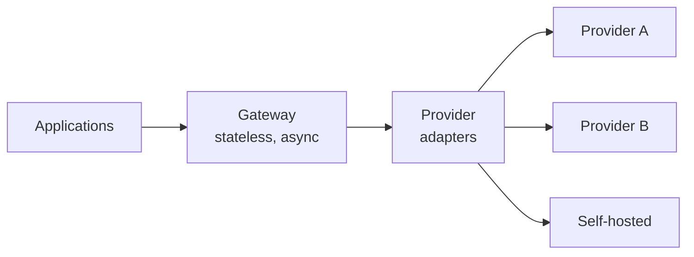
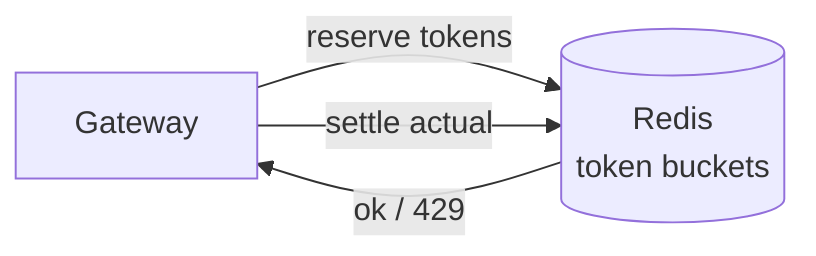
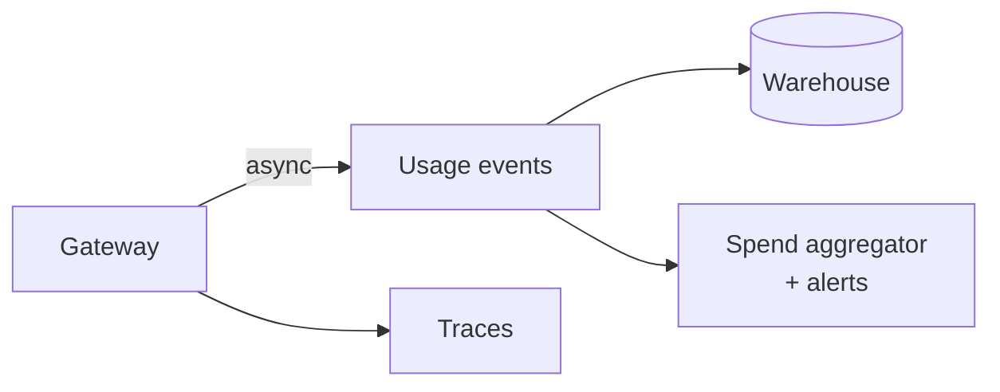

**The prompt:** "Many teams in our company call different LLM providers directly. Design an internal LLM gateway."

Once a company has more than a few AI features, every team rebuilds the same plumbing around model calls: keys, retries, limits, fallbacks, cost tracking, logging, redaction. The gateway does it once. It is a pure backend problem (a specialised API gateway and streaming proxy), which makes it a favourite for backend engineers moving into AI. Run the DP-00 framework.

## 1. Requirements (about 5 minutes)

**Say:** "Let me check what pain we're solving: cost control, reliability, security, or all three. That decides which parts get the deep dives."

**Functional requirements:**

1. Applications call one API for chat and embeddings, with streaming, whatever the provider.
2. Per-application quotas (tokens per minute) and budgets (money per month) are enforced.
3. Requests are routed by policy and fall back to another provider or region on failure.
4. Every call is recorded: application, model, tokens, cost, latency, outcome.

**Below the line:** prompt management UI, hosting models (the gateway only routes to them), fine-tuning.

**Non-functional requirements:**

1. **Low overhead**: under ~20 ms added at p50; never buffers a stream.
2. **More available than any single provider**: it sits on every AI feature's path.
3. **Accurate accounting** for chargeback and budgets.
4. **Security**: provider keys only in the gateway; PII redacted by policy.
5. **Scale**: thousands of requests per second, tens of thousands of open streams.

## 2. Success metrics (about 3 minutes)

- **Business**: share of company AI traffic on the gateway, spend saved through routing and caching, time for a team to ship a new AI feature.
- **Quality**: no change in application quality after routing changes (validated by each application's evals).
- **System**: added latency, gateway availability, fallback success rate.
- **Guardrail**: zero leaked keys; budget overruns caught before month end.

## 3. Entities, API and numbers (about 5 minutes)

**Core entities:** Application (keys, quotas, budget, allowed models); **Model alias** ("chat-fast", "chat-strong", "embed-default") mapping to concrete endpoints; Provider endpoint (provider, region, model, price, limits, health); Routing policy; Usage record (one per call).

**API**, OpenAI-compatible because every SDK already speaks it:

```text
POST /v1/chat/completions   { model: "chat-fast", messages, stream: true }
POST /v1/embeddings         { model: "embed-default", input }
Headers: Authorization (application key), X-Request-Id, traceparent
Admin:   PUT /admin/apps/{id}/quota   PUT /admin/aliases/{alias}
```

**Say:** "Applications ask for an alias, not a provider model, so we can move 'chat-fast' to a better or cheaper model without touching any application."

**Numbers:**

- 50M calls a day: ~600/s average, **~3,000/s peak**.
- ~10 s average stream: **~30,000 concurrent streams**, so async I/O is required.
- ~500 bytes per usage record: **25 GB a day**, belongs in an analytics store.
- At $50,000 a day of spend, 10% cache hits or 20% routed to cheaper models is real money: that is the business case.

## 4. High-level design (about 10 minutes)

### Requirement 1: one API for any provider

**Draw:**



**Say:** "The gateway authenticates the application key, resolves the alias, translates the request through a provider adapter, and proxies the stream chunk by chunk without buffering."

### Requirement 2: quotas and budgets

**Draw:**



**Say:** "Before forwarding, reserve an estimate from the application's token bucket; after the call, settle the real usage. Over the limit returns 429 with Retry-After." (Deep dive 1.)

### Requirement 3: routing and fallback

**Say:** "Each alias maps to an ordered list of endpoints. The router picks the first healthy one and, on a retriable failure before streaming starts, tries the next." (Deep dive 2.)

### Requirement 4: recording every call

**Draw:**



**Say:** "Usage records are emitted asynchronously, never on the request path: a warehouse for chargeback and dashboards, an aggregator for near-real-time budgets and spend alerts, and propagated trace context."

## 5. Deep dives (15 to 20 minutes)

### Deep dive 1: Token limits when output length is unknown

**Bad: count requests.** A 50-token and a 100,000-token request count the same.

**Good: count tokens after each call.** Accurate eventually, but 200 large concurrent calls all pass the check before any finishes, overshooting the limit and the provider's.

**Great: reserve, then settle, atomically.** Estimate input tokens plus `max_tokens`, atomically reserve from the bucket (a Redis Lua script that refills, checks and deducts), and return the unused part after the call. Use **hierarchical limits**: per key, per application, per business unit, plus a global limit per endpoint kept below the provider's limit so the gateway sheds load first. Decide the failure policy explicitly: if Redis is down, fail open with conservative local limits for normal traffic, fail closed for applications over budget.

### Deep dive 2: Fallback without breaking streams or behaviour

**Bad: one hard-coded provider.** Any incident is a company-wide outage.

**Good: retry another provider on error.** It covers outages, but blind retries double-charge, retry requests that can never succeed (400s), and can switch models mid-stream.

**Great: health-aware routing with circuit breakers.**

- Track error rate, timeouts and **time to first token** per endpoint; a circuit breaker opens after repeated failures and probes before closing.
- **Retry only before the first chunk** reaches the client, and only for retriable errors (timeouts, 429, 5xx). After that, end the stream with an error event; switching models mid-answer produces nonsense.
- **Fallbacks are validated equivalents**: a model enters an alias's fallback list only after passing the evals of the applications using it.
- **Data residency**: an EU-tagged application only routes to EU endpoints, even during fallback.

### Deep dive 3: What to cache, and what never to cache

**Bad: no caching.** Identical embedding requests and deterministic prompts are paid for again and again.

**Good: exact-match cache.** Hash the normalised request (alias, resolved model version, messages, parameters); safe for embeddings and opt-in deterministic calls; scoped per application with a TTL.

**Great: layered caching, semantic only by opt-in.** First make **provider prompt caching** work (stable content at the start of prompts, consistent request shapes). Then an exact cache. A **semantic cache** (return a stored answer for a "close enough" prompt) only for applications that opt in with non-personal, stable content: it can return a confident wrong answer for a similar-but-different question and leak data across users. Scope it per application, include model and prompt versions in the key, and measure its wrong-hit rate.

### Deep dive 4: Not becoming the single point of failure

- **Stateless instances** across zones; shared state in Redis.
- **Async I/O** so tens of thousands of open streams are cheap.
- **Nothing slow on the hot path**: logging and accounting are asynchronous with local buffering.
- **Degraded modes**: local limits if Redis is down; last-known routing table if config is unavailable.
- **Versioned configuration** canaried to a few applications, with instant rollback.

**Say the alternative:** "A client library or sidecar removes a hop and a central dependency, but makes key management, global limits and upgrades much harder. Most companies run a central gateway and keep it boring."

## 6. Evaluation and safety (about 5 minutes)

- **Routing changes are model changes**: every alias change runs the affected applications' eval suites before rollout, then a canary.
- **Monitoring**: per-endpoint latency, time to first token, error rates, fallback rate, cache hit and wrong-hit rates, spend anomalies (a loop burning tokens at 3 a.m.).
- **Safety**: keys in a secrets manager; PII redaction before sending per application policy; pluggable input and output guardrails; audit of who called which model with which data classification; payload logging off by default for sensitive applications.

## 7. Cost, scale, failures, trade-offs (about 3 minutes)

- **Cost**: aliases make cheaper models a config change; caching; budgets with soft and hard thresholds; chargeback changes team behaviour.
- **Usage record**: request id, trace id, app, key, alias, provider, model version, region, input, cached and output tokens, cost, time to first token, latency, status, error type, cache hit, fallback used.
- **Failures**: provider outage: fallback; Redis outage: local limits; gateway overload: autoscale plus shedding low-priority traffic.
- **Trade-off**: a central hop adds a few milliseconds but buys control, consistency and cost visibility.

**The 20-second summary:** "An async, stateless, OpenAI-compatible gateway resolves aliases to provider endpoints, enforces hierarchical token buckets with reserve-and-settle, routes with circuit breakers and retries only before the first streamed chunk, caches in layers with semantic caching opt-in, and emits asynchronous usage records for budgets, chargeback and alerts."

## What separates levels

- **Mid-level**: proxy with one API, keys per application, a rate limiter, retries, logging.
- **Senior**: token-based reserve-and-settle limits, aliases and adapters, health-aware routing that is safe for streams, exact and prompt caching, async usage pipeline, stateless multi-zone deployment.
- **Staff**: degraded modes and fail-open versus fail-closed policy, eval-validated fallbacks, data residency in routing, semantic-cache risk management, cost governance and chargeback, safe config rollouts, and the central-versus-library trade-off.
