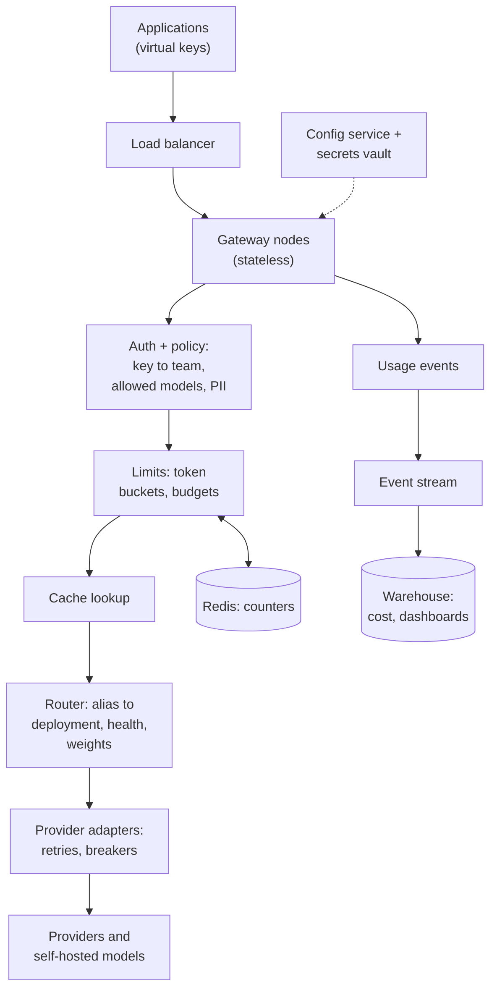
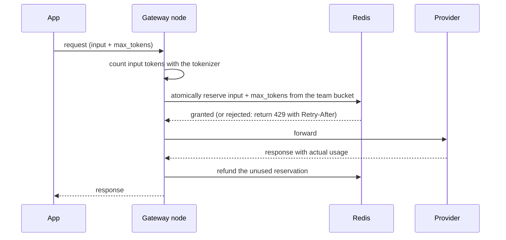

**The prompt:** "Many teams in our company call different LLM providers directly. Design an internal LLM gateway."

Once a company has more than a few AI features, every team rebuilds the same plumbing: provider keys, retries, fallbacks, rate limits, cost tracking, logging, data policies. A gateway centralises it. The interview probes **per-tenant limits in tokens across a distributed fleet**, **routing and fallbacks that do not silently lower quality**, **caching that does not leak or serve wrong answers**, **cost attribution**, and the fact that the gateway is now **a single point of failure on every AI feature's critical path**.

## 1. Requirements

Functional:

- One API (OpenAI-compatible, so existing SDKs work) for many providers and self-hosted models, with streaming passed through.
- **Virtual keys** per team or service, mapped to policies: allowed models, limits, budgets, data rules.
- Limits on requests and tokens per minute, and monthly budgets, per key, team and model.
- Routing by model alias, with retries, fallbacks and circuit breakers.
- Caching: exact-match opt-in, provider prompt caching passed through, semantic caching only where explicitly enabled.
- Logging, tracing and cost attribution per team, feature and model; payload logging policies with PII redaction.
- Provider keys kept in a vault, never in applications.

Non-functional (assumptions):

- 5,000 requests per second at peak, most of them streamed.
- Added latency under about 20 ms at p99 for non-streamed overhead; no added delay per streamed token.
- Higher availability than any single provider: multi-zone, stateless nodes.

## 2. Success metrics

- Gateway overhead latency and availability.
- Provider error rates absorbed (requests that succeeded thanks to retries or fallbacks).
- Cost visibility: share of spend attributed to a team and feature (target 100%), budget overruns prevented.
- Policy violations: zero sensitive-data requests to unapproved providers.

## 3. Entities, API and numbers

Entities: VirtualKey (team, policies), ModelAlias (route definition), Deployment (provider, model, region, limits, price table version), Quota and Budget counters, UsageEvent (key, model, input, cached and output tokens, cost, latency, status, fallback used), CacheEntry.

API: `POST /v1/chat/completions` and `POST /v1/embeddings` (compatible), `GET /usage`, admin endpoints for keys, aliases and limits.

Numbers: 5,000 requests per second, each streaming for about 10 s, means about **50,000 open connections** at peak (Little's law), so the gateway needs asynchronous, event-driven I/O. Usage events: 5,000 per second into a log pipeline, about 430 million a day.

## 4. High-level design

1. The application calls with its virtual key; the gateway resolves the team and its policies (allowed models, data classification rules, logging policy).
2. Policy checks run: is this model allowed for this data class; redact PII if the policy requires it.
3. **Limits**: estimate the request's tokens and reserve them from the team's token bucket; check the budget.
4. Cache lookup for routes that enable it.
5. The **router** maps the alias (for example `chat-default`) to a concrete deployment using health, weights, latency, cost and region rules.
6. The provider adapter translates the request, applies timeouts, retries and circuit breakers, and streams the response back unchanged.
7. On completion, actual usage reconciles the reservation and a usage event is emitted for cost attribution.

## 5. Deep dives

### 5.1 Per-tenant token limits across many nodes

- **Tokens, not requests**, because one request can be a thousand times another.
- **Reserve, then reconcile**: before the call, reserve input tokens plus `max_tokens`; after it, refund what was not used. Without reservation, many concurrent long requests overshoot the limit before any usage is recorded.
- **Atomic counters** in Redis (a script that checks and decrements in one step), sharded by key; nodes may keep small local allowances refreshed from Redis to save a network hop, accepting slight overshoot.
- **Levels**: per key, per team, per model, and a global level matching the provider's own quota, shared fairly between teams with priority classes (interactive above batch).
- **Budgets in money**: monthly spend per team from the usage events, with alerts at thresholds and a hard stop or downgrade at the limit.
- **If Redis is down**: fail open with conservative local limits, rather than taking every AI feature down.

### 5.2 Routing and fallbacks

- **Aliases** decouple applications from providers: changing which model serves `chat-default` is a config change plus an eval run, not a code change in twenty services.
- **Routing policies**: primary and secondary; weighted splits (canaries, A/B tests); latency-aware choice among equivalent deployments; cost tiers; data-residency rules (EU traffic to EU deployments; sensitive classes only to zero-retention or self-hosted models).
- **Fallbacks only to evaluated equivalents**: a fallback model must pass the same eval suite for that alias, because models differ in tool-calling behaviour, structured output and quality. Fall back on errors and timeouts, never on content.
- **Retries**: on 429, 5xx and timeouts, with backoff and jitter. A stream that has already sent tokens to the client cannot be silently retried (the client would get a spliced answer), so mid-stream failures are surfaced to the client.
- **Circuit breakers** per deployment stop sending traffic to a failing provider and probe for recovery.

### 5.3 Caching

- **Exact-match cache**: key = hash of (tenant, model, parameters, messages); only for deterministic, non-personalised calls; opt-in per route; TTL.
- **Provider prompt caching**: pass cache hints through and help teams keep stable prefixes; report cache hit rates per team.
- **Semantic caching** only where a team explicitly enables it, scoped by tenant and permission, with a conservative threshold and a measured false-hit rate. It returns answers for different questions that look similar, so it is dangerous as a default.

### 5.4 Observability and cost attribution

- Every request emits a usage event: team, key, feature tag, model and deployment, input, cached and output tokens, cost from a versioned price table, time to first token, total latency, status, retries and fallback.
- Trace context is propagated, so a gateway span joins the application's trace.
- Payload logging is a per-team policy (off, sampled, full) with redaction and retention limits.
- Dashboards and alerts: spend per team and feature, error and fallback rates per provider, latency percentiles, cache hit rates, budget burn.

### 5.5 Security

- Provider keys live only in the vault and the gateway; virtual keys are revocable and scoped.
- Data classification policies decide which providers a request may reach; PII redaction is applied before forwarding where required.
- Audit of who called what with which data class. Prompt injection remains an application concern, but the gateway can host shared guardrail services (moderation, PII detection) as optional steps.

## 6. Evaluation and change management

- Changing an alias target goes through: offline evals for every consuming feature's suite, shadow traffic (send a copy to the new model, compare), a weighted canary, then full switch, with automatic rollback on error or quality alarms.
- The gateway is the natural place to collect cross-team quality signals and to run scheduled canary evals that detect silent provider model changes.

## 7. Failure modes

| Failure | Detection | Mitigation |
| --- | --- | --- |
| Gateway outage takes down all AI features | Health checks, error rate | Multi-zone stateless fleet, fast rollback of config and code |
| Redis counters unavailable | Limiter errors | Fail open with conservative local limits |
| Provider outage or rate limiting | Breaker state, 429 and 5xx rates | Evaluated fallbacks, queue batch traffic |
| A buggy client loop burns the budget | Spend spike per key | Per-key limits, budget hard stops, alerts |
| Bad config push breaks routing | Config validation, canary nodes | Versioned config, staged rollout, instant revert |
| Sensitive data sent to an unapproved provider | Policy audit logs | Classification enforced in the gateway, deny by default |
| Connection exhaustion at peak | Open connections metric | Async I/O, horizontal scaling, per-client connection caps |

## 8. Scaling and next steps

- Stateless nodes scale horizontally; the hot shared state is the counters, sharded by key.
- Next: a model catalogue with evaluated quality, cost and latency per alias; automatic routing of easy requests to cheaper models per feature; shared guardrails and eval services; chargeback reports.

Say it like this: "The gateway gives every team one compatible API behind virtual keys. Each request is checked against its team's policy, reserves its estimated tokens from an atomic Redis token bucket and refunds the difference afterwards, then is routed by alias to a deployment with retries, circuit breakers and fallbacks only to models that passed the same evals. Every call emits a usage event for cost attribution, and since the gateway sits on every AI critical path, it is stateless, multi-zone and fails open on its own limiter."
