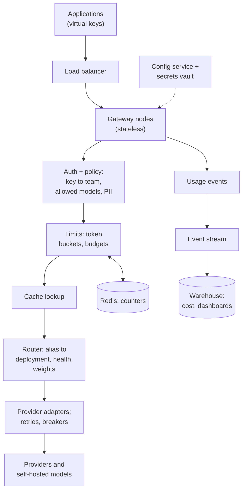
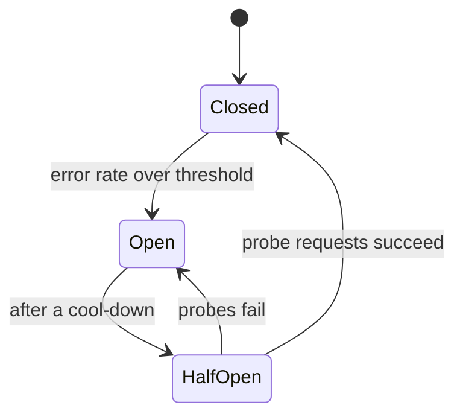

**The prompt:** "Many teams in our company call different LLM providers directly. Design an internal LLM gateway."

Once a company has more than a few AI features, every team rebuilds the same plumbing: provider keys, retries, fallbacks, rate limits, cost tracking, logging and data policies. A gateway centralises it. The interview probes **per-team limits measured in tokens across a distributed fleet**, **routing and fallbacks that do not silently lower quality**, **caching that never serves a wrong or leaked answer**, **cost attribution**, and the uncomfortable fact that the gateway is now **on the critical path of every AI feature in the company**.

Products in this space: LiteLLM, Portkey, Kong AI Gateway, Cloudflare AI Gateway.

## 1. Understanding the problem

**Functional requirements (core)**

1. Teams should be able to call any approved model (several providers, plus self-hosted models) through one API, with streaming.
2. Platform admins should be able to set per-team limits (requests and tokens per minute) and monthly budgets.
3. Teams should get automatic retries, fallbacks and routing by model alias, without code changes.
4. Finance and platform owners should be able to see usage and cost per team, feature and model.

**Below the line**: prompt management, evaluation tooling, application-level guardrails (offered as optional add-ons later), fine-tuning.

**Non-functional requirements**

- The system should add under about 20 ms at p99 before the first byte, and no delay per streamed token.
- The system should be more available than any single provider: no single point of failure inside the gateway.
- The system should never send restricted data to an unapproved provider, and never expose provider keys to applications.
- The system should handle 5,000 requests per second at peak, most of them streamed.

**Success metrics**

| Category | Metric | Target (example) |
| --- | --- | --- |
| Latency | Gateway overhead before the first byte, p99 | < 20 ms |
| Availability | Gateway availability | >= 99.99% |
| Reliability | Requests saved by retries or fallbacks | tracked per provider |
| Cost | Spend attributed to a team and feature | 100% |
| Security | Requests sent to a provider their data class forbids | 0 |

**Framing the problem.** There is no model task here; this is infrastructure. The AI-specific parts are what makes it different from an ordinary API gateway: **cost is per token** and unknown until the response ends, **providers differ in behaviour**, so failover can change answers, and **responses stream** for many seconds.

**Numbers that change the design**

- 5,000 requests per second, each streaming for about 10 s, is about **50,000 open connections** at peak (Little's law). The gateway must use asynchronous, event-driven I/O; a thread per connection would need 50,000 threads.
- About 430 million usage events a day (5,000 per second at peak, less on average) go to an event stream and a warehouse, never to a transactional database on the request path.
- A limiter call happens on every request: it must be one round trip to an in-memory store (sub-millisecond), or the latency budget is gone.

## 2. High-level design

**The configuration model**

```text
virtual_keys (key_hash, team_id, feature, allowed_aliases[], data_class_max, status)
teams        (team_id, rpm, tpm, monthly_budget_usd, priority_class, log_policy)
aliases      (alias, routes[{deployment_id, weight}], fallbacks[deployment_id], eval_suite)
deployments  (deployment_id, provider, model, region, provider_tpm, zero_retention, price_version)
prices       (price_version, model, input_per_m, cached_input_per_m, output_per_m)
```

- Applications hold **virtual keys**, which identify a team and feature and can be revoked instantly; real provider keys live only in a secrets vault read by the gateway.
- An **alias** such as `chat-default` names what an application wants; the routing table decides which deployment serves it. Changing models becomes a configuration change.
- Configuration is versioned, validated, and pushed to gateway nodes, which keep it in memory.



**Requirement 1, one API.**

1. The application calls `POST /v1/chat/completions` (an OpenAI-compatible shape, so existing SDKs work) with its virtual key.
2. The gateway resolves the key to a team and policy, checks that the alias is allowed and that the request's data class may go to the alias's deployments, and applies PII redaction when the policy demands it.
3. The limiter reserves the request's estimated tokens.
4. The router picks a deployment; the provider adapter translates the request to that provider's API and streams the response back, translating each chunk to the common format.
5. When the stream ends, the adapter reads the provider's final usage numbers (input, cached and output tokens), reconciles the reservation, and emits a usage event.

**Requirement 2, limits and budgets.** Every request reserves its worst-case tokens from the team's bucket in a shared counter store and returns the unused part afterwards; a consumer of the usage events enforces monthly budgets.

**Requirement 3, retries, fallbacks and routing.** The router maps the alias to a healthy deployment, retries transient errors only before the first byte, and falls back only to models that passed the alias's evals.

**Requirement 4, usage and cost**: usage events flow to a stream and a warehouse; cost is computed from the versioned price table.

**Overhead budget inside the gateway (typical)**

| Stage | Budget |
| --- | --- |
| Auth: virtual key lookup in memory | 1 ms |
| Policy checks (more if redaction runs) | 2 ms |
| Token counting | 2 ms |
| Limiter reservation: one Redis round trip | 1 ms |
| Cache lookup | 2 ms |
| Routing decision | under 1 ms |
| Total | under 10 ms typical, 20 ms at p99 |

## 3. Deep dive: per-team limits in tokens, across many nodes

**Bad: count requests in memory on each gateway node.** With 40 nodes behind a load balancer, a team's limit is effectively multiplied by 40, and a team can be throttled on one node while idle on another. Requests are also the wrong unit: one request can carry 100 tokens or 100,000.

**Good: a shared Redis counter of requests per minute.** Now limits are global, but still in requests. Two long requests can consume a team's whole token allowance, and because usage is known only when a response finishes, many concurrent long requests overshoot the limit before any of them is counted.

**Great: token buckets with reservation, at several levels.**

- **Estimate before the call.** Count the input tokens with the target model's tokenizer and add the request's `max_tokens` (or a default cap). That is the most the call can cost.
- **Reserve atomically.** A script running inside Redis refills the team's bucket for the elapsed time and subtracts the estimate in one step, or rejects:

```text
reserve(bucket, need):
    tokens, last = read bucket
    tokens = min(capacity, tokens + (now - last) * refill_per_second)
    if tokens < need: return REJECT, retry_after = (need - tokens) / refill_per_second
    write bucket: tokens - need, last = now
    return OK
reconcile(bucket, reserved, actual):
    add (reserved - actual) back to the bucket, capped at capacity
```

- **Reconcile after the call.** Actual usage (from the provider's final usage numbers) usually falls well below the reservation; the difference goes back, so short answers do not waste allowance. If a stream is cut off, the tokens already streamed are charged.
- **Several levels, checked together**: per key, per team, per model, and a global level per deployment matching the provider's own tokens-per-minute quota. The provider quota is shared fairly: interactive traffic has priority over batch traffic, and each team is guaranteed a share before others can borrow unused capacity.
- **Rejections are cheap and clear**: a 429 response with `Retry-After`, so client libraries back off instead of hammering.
- **Budgets in money**: a consumer of the usage stream sums spend per team per month; at 80% it alerts, at 100% it blocks or downgrades the team to a cheaper alias, as the team chose in advance.
- **Latency**: one Redis round trip, sub-millisecond. Nodes may hold a small local allowance per hot key, refreshed from Redis, trading a little accuracy for fewer round trips.
- **If Redis is unavailable**: fail open with conservative per-node limits (the global limit divided by the node count), and alert. Failing closed would turn a cache outage into a company-wide AI outage.

## 4. Deep dive: routing, fallbacks and the gateway's own reliability

**Bad: each application hard-codes a provider, with no plan for outages.** A provider incident takes features down, and switching models means code changes in every service.

**Good: on any error, retry on any other available model.** Features stay up, but quality can collapse silently: models differ in prompt sensitivity, tool-calling formats and reliability, structured-output support, context length and refusal behaviour. A support agent that suddenly runs on an untested model may start mishandling tool calls without anyone noticing.

**Great: aliases, measured health, evaluated fallbacks and careful retries.**

- **Routing policies per alias**: weighted splits across deployments (for canaries and A/B tests), latency-aware choice among equivalent deployments, cost tiers, and residency rules (EU traffic to EU deployments; restricted data classes only to zero-retention or self-hosted deployments).
- **Health is measured continuously** per deployment: an exponentially weighted moving average of time to first token and of error rate, from real traffic.
- **Circuit breakers** stop sending traffic to a failing deployment and probe it before trusting it again:



- **Fallbacks only to evaluated equivalents.** Each alias lists its fallback deployments, and a fallback is allowed only after it passes the alias's eval suite (the same suites the consuming teams use). Fallback triggers on errors and timeouts, never on content.
- **Retries, carefully.** Retry on 429, 5xx and connection errors with exponential backoff and jitter, honouring `Retry-After`, but **only before the first byte reaches the client**. Once tokens have been streamed, a silent retry would splice two different answers together, so a mid-stream failure is reported to the client, which decides.
- **Timeouts**: separate limits for time to first token (a stuck queue) and for total duration.
- **Changing an alias's target** goes through offline evals, shadow traffic (a copy of live requests sent to the candidate, results compared, never shown), a weighted canary, then full traffic, with automatic rollback on error or quality alarms.
- **The gateway's own reliability**: stateless nodes in several availability zones behind the load balancer; configuration validated and rolled out to a few canary nodes first; instant rollback of configuration and code; the limiter failing open; health checks that remove bad nodes. The gateway must be boring.

**Keeping the gateway fast.** Configuration and keys live in memory; the request path makes at most one Redis round trip; tokens are counted with fast native tokenizers; streams pass through chunk by chunk with no buffering; connections to providers are pooled and kept alive; usage events and payload logs are written asynchronously, off the request path; and the gateway runs in the same region as its callers.

## 5. Deep dive: caching, data protection and cost attribution

**Caching.** Bad: a semantic cache in front of everything, which returns stored answers for questions that merely look similar and can serve one team's or user's answer to another. Good: an exact-match cache, safe but with a low hit rate. Great:

- **Exact-match cache, opt-in per alias.** The key is a hash of (team, model, parameters, the full message list); entries have a TTL; it is enabled only for deterministic, non-personalised calls (classification, extraction at temperature 0). Cached streamed responses are replayed as a stream.
- **Provider prompt caching** is the bigger win: the gateway passes cache hints through, reports each team's cache hit rate, and documents how to keep prompt prefixes stable.
- **Semantic caching** only where a team explicitly enables it for FAQ-like traffic, scoped by team and permission, with a conservative threshold and a measured false-hit rate.

**Data protection.**

- Each virtual key declares the highest data class it sends; each deployment declares what it may receive (for example: personal data only to zero-retention or self-hosted deployments). The router never sends a request where its class is not allowed.
- An optional redaction step replaces detected personal data (emails, phone numbers, card numbers) with placeholders before forwarding, and restores them in the response when the policy allows.
- Provider keys are rotated in the vault without application changes. Payload logging is a per-team policy: off, sampled or full, always with redaction and a retention limit.

**Cost attribution.**

- Every request emits a usage event: team, key, feature tag, alias, deployment, input, cached and output tokens, cost computed from the price table version in force, time to first token, total latency, status, retries and whether a fallback served it.
- Prices are versioned, so historical costs stay correct when providers change prices.
- Dashboards show spend per team, feature and model, cache hit rates, fallback and error rates per provider, and budget burn; alerts fire on spend spikes (a client stuck in a loop) and budget thresholds.
- Trace context is propagated, so the gateway's span appears inside the calling application's trace.

## 6. Failure modes

**Failure modes**

| Failure | Detection | Mitigation |
| --- | --- | --- |
| Gateway outage takes down all AI features | Health checks, error rate | Multi-zone stateless fleet, staged config, fast rollback |
| Redis counters unavailable | Limiter errors | Fail open with conservative per-node limits |
| Provider outage or throttling | Breaker state, 429 and 5xx rates | Evaluated fallbacks, batch traffic queued |
| A buggy client loop burns the budget | Spend spike per key | Per-key limits, budget hard stops, alerts |
| Bad configuration push | Validation, canary nodes | Versioned config, staged rollout, instant revert |
| Restricted data sent to the wrong provider | Policy audit logs | Data classes enforced in the router, deny by default |
| Connection exhaustion at peak | Open-connection metrics | Async I/O, horizontal scaling, per-client caps |

**Summary: each requirement and the design choice that meets it**

| Requirement | How the design meets it |
| --- | --- |
| One API | Compatible endpoint, provider adapters, streaming passthrough |
| Limits and budgets | Token buckets with reservation and reconciliation, budget enforcement |
| Retries, fallbacks, routing | Aliases, health scores, circuit breakers, evaluated fallbacks, retries before the first byte |
| Usage and cost | Usage events, versioned prices, dashboards and alerts |
| Low overhead | In-memory config, one Redis hop, asynchronous logging |
| Availability | Stateless multi-zone fleet, fail-open limiter, staged config rollout |
| Data protection | Data classes enforced in routing, redaction, keys only in the vault |

Say it like this: "Teams call one compatible API with revocable virtual keys. Each request is checked against its team's policy and data class, reserves its worst-case tokens from an atomic Redis token bucket and gives back the unused part afterwards, and is routed by alias using measured health, circuit breakers, retries only before the first byte, and fallbacks only to models that passed the alias's evals. Every call emits a usage event priced from a versioned table, and since the gateway sits on every AI critical path, it is stateless, multi-zone, and fails open on its own limiter."
