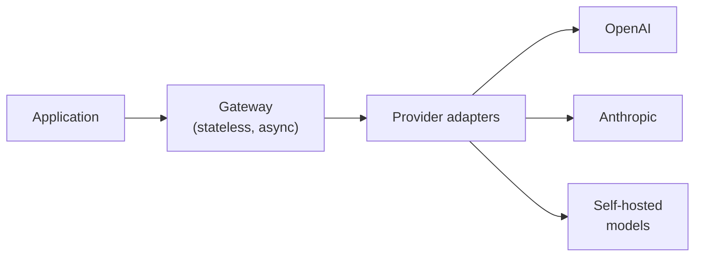
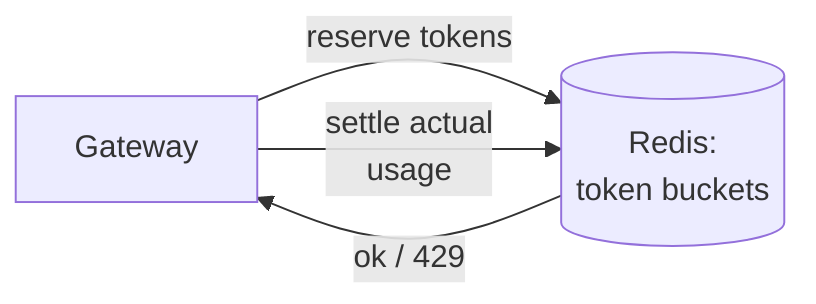
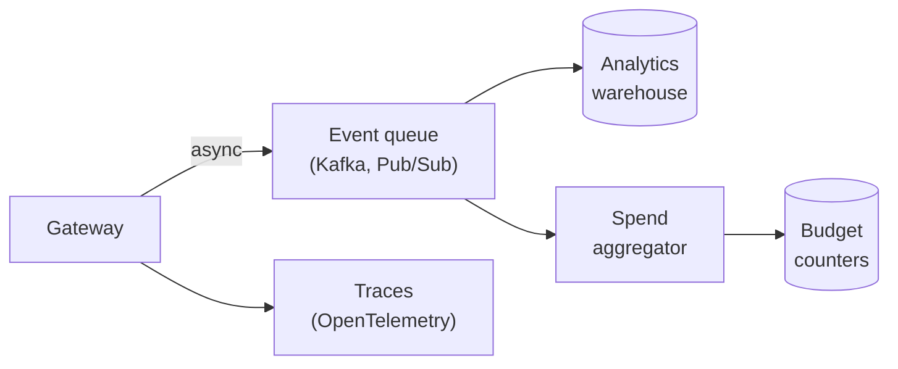
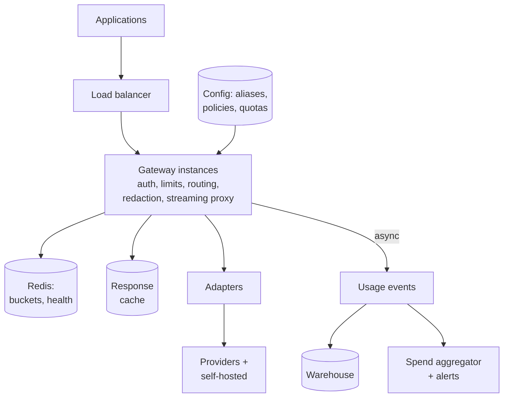

Once a company has more than a few AI features, every team ends up rebuilding the same things around model calls: API keys, retries, rate limits, fallbacks when a provider is down, cost tracking, logging, redaction. An **LLM gateway** is the shared service that does all of it once, in front of every model provider. This is a pure backend design problem (a specialised API gateway and proxy) and a favourite for backend engineers moving into AI, because it rewards rate limiting, streaming proxies, caching and high availability, not prompt engineering.

## Understanding the Problem

**What are we building?** An internal service that every product team calls instead of calling OpenAI, Anthropic, Google or self-hosted models directly. It exposes one API, applies per-team limits and budgets, routes each request to a suitable model, falls back when a provider fails, caches where safe, redacts sensitive data and records every call for cost and debugging.

### Functional Requirements

Core requirements:

1. Applications call one API for chat and embeddings, with streaming, regardless of the underlying provider.
2. The gateway enforces per-application quotas (tokens per minute) and budgets (money per month).
3. Requests are routed to a model by policy, and fall back to another provider or region on failure.
4. Every call is recorded with its application, model, tokens, cost, latency and outcome.

Below the line:

- Prompt management and versioning UI.
- Serving self-hosted models (the gateway only routes to them).
- Fine-tuning workflows.

### Non-Functional Requirements

Core requirements:

1. **Low overhead**: adds under ~20 ms at p50 to a call, and never buffers a stream.
2. **Higher availability than any single provider**: the gateway is on the path of every AI feature, so it must not become the outage.
3. **Accurate accounting**: usage and cost records are complete enough for chargeback and budgets.
4. **Security**: provider keys live only in the gateway; sensitive data is redacted per policy.
5. **Scale**: thousands of requests per second, tens of thousands of concurrent streams.

Below the line:

- Exactly-once accounting (approximate within a small margin is acceptable).

### The numbers

- 200 internal applications, 50 million calls a day: ~600 requests per second on average, **~3,000 at peak**.
- Average stream of 10 seconds: 3,000 x 10 = **~30,000 concurrent streams at peak**: the gateway is a high-concurrency streaming proxy, so it should be built on async I/O.
- One usage record of ~500 bytes per call: **25 GB a day** of records, which belong in an analytics store, not the gateway's primary database.
- Spend: at, say, $50,000 a day across teams, a 10% cache hit rate or a 20% shift to cheaper models is real money, which is why routing and caching justify the gateway on their own.

## The Set Up

### Core Entities

- **Application** (tenant): a calling service or team, with API keys, quotas, budget and allowed models.
- **Model alias**: a stable name applications use ("chat-fast", "chat-strong", "embed-default") that maps to concrete provider models.
- **Provider endpoint**: a provider, region and model, with credentials, price per token, limits and health.
- **Routing policy**: rules mapping an alias (and request properties) to an ordered list of endpoints.
- **Usage record**: one per call: application, alias, endpoint, tokens in/out, cached tokens, cost, latency, time to first token, status, trace id.

### The API

Most gateways expose an **OpenAI-compatible** interface, because every SDK and framework already speaks it:

```text
POST /v1/chat/completions     { model: "chat-fast", messages, stream: true, ... }
POST /v1/embeddings           { model: "embed-default", input }
Header: Authorization: Bearer <application key>
Header: X-Request-Id, traceparent (propagated to traces)

Admin: PUT /admin/apps/{id}/quota   { tokensPerMinute, monthlyBudgetUsd }
       PUT /admin/aliases/{alias}   { endpoints: [...], policy }
```

Applications ask for an alias, not a provider model, so the platform team can move "chat-fast" to a better or cheaper model without touching any application.

## High-Level Design

### 1) Applications call one API for any provider



The gateway authenticates the application key, resolves the alias, translates the request into the provider's format through an **adapter**, and translates the response (and each streamed chunk) back. Streams are **proxied chunk by chunk** without buffering, so the gateway adds almost nothing to time to first token.

### 2) Quotas and budgets are enforced on every call



Before forwarding, the gateway **reserves** an estimate of the call's tokens from the application's bucket; after the call, it **settles** the real usage (deep dive 1). Over the limit: `429 Too Many Requests` with `Retry-After`. Monthly budgets are checked against spend aggregated from usage records.

### 3) Requests are routed and fall back on failure

Each alias maps to an ordered list of endpoints, for example `chat-fast -> [provider A model X in us-east, provider A model X in eu-west, provider B model Y]`. The router picks the first **healthy** endpoint; if it fails before streaming starts, the gateway retries the next (deep dive 2).

### 4) Every call is recorded



After each call the gateway emits a usage record **asynchronously** (never on the request path). The warehouse powers dashboards and chargeback; an aggregator keeps near-real-time spend per application for budget enforcement and spend alerts. Trace context is propagated so a slow request can be followed from the application through the gateway to the provider.

## Potential Deep Dives

### 1) How do we enforce token limits when we don't know the output length in advance?

**Bad solution: count requests.** "100 requests per minute" treats a 50-token request and a 100,000-token request the same, so limits are either useless or strangle normal use.

**Good solution: count tokens after the call.** Add each call's real token usage to a per-application counter and reject new calls once the counter passes the limit. Accurate eventually, but a burst of 200 large concurrent calls all pass the check before any of them finishes, overshooting the limit (and the provider's limit) by a wide margin.

**Great solution: reserve, then settle, atomically.**

- On each request, estimate tokens: input tokens counted from the prompt plus the requested `max_tokens` for output. Atomically **reserve** that amount from the application's token bucket (a Redis Lua script: refill based on elapsed time, check, deduct).
- After the call, **settle**: return the unused part of the reservation (most calls use far fewer output tokens than the maximum).
- **Hierarchical limits**: per API key, per application, per business unit, and a global limit per provider endpoint kept below the provider's own limit, so the gateway sheds load before the provider starts returning 429s to everyone.
- **Redis unavailable?** Decide explicitly: fail open with conservative local in-memory limits per gateway instance (keep features running) for normal traffic, fail closed for applications over budget.

### 2) How do we fall back without breaking streams or behaviour?

**Bad solution: one provider, hard-coded.** Any provider incident is a company-wide AI outage.

**Good solution: retry the next provider on error.** Covers outages, but retrying blindly can double-charge, retry requests that will never succeed (a 400 for an invalid request), and switch models in the middle of a stream.

**Great solution: health-aware routing with circuit breakers, retrying only safe failures.**

- **Health tracking** per endpoint: error rate, timeouts, latency, time to first token. A **circuit breaker** opens after repeated failures and sends a small probe periodically before closing.
- **Timeouts on time to first token**, not just total time: a provider that accepts the connection but stalls is detected in seconds.
- **Retry only before the first chunk is streamed**, and only for retriable errors (timeouts, 429, 5xx). Once tokens have reached the client, a failure ends the stream with an error event; switching models mid-answer would produce an incoherent response.
- **Fallbacks are validated equivalents**: a model only appears in an alias's fallback list after it passes the evals of the applications that use that alias. "Any model" is not a fallback.
- **Data residency**: an application tagged "EU data" only ever routes to EU endpoints, even during fallback.

### 3) What can we cache, and what must we never cache?

**Bad solution: no caching.** Identical embedding requests and repeated deterministic prompts are paid for again and again.

**Good solution: exact-match caching.** Key on a hash of the normalised request (alias, resolved model and version, messages, parameters). Return the cached response when the same request repeats. Safe for embeddings (deterministic) and for `temperature = 0` calls an application marks as cacheable. Scoped per application, with a TTL.

**Great solution: layered caching, with semantic caching only by opt-in.**

- **Provider prompt caching** first: the providers cache repeated prompt prefixes themselves and bill them at a discount. The gateway's job is to make it work: keep stable content (system prompt, tools, documents) at the start of the prompt, and preserve request shapes so prefixes match.
- **Exact cache** for embeddings and opt-in deterministic calls.
- **Semantic cache** (return a stored answer for a prompt whose embedding is very close to a previous one) **only** for applications that opt in with non-personal, stable content, like FAQ answers. It can return a confidently wrong answer for a question that is similar but different ("refund policy for annual plans" vs "for monthly plans"), and across users it can leak data. Scope it per application, include model and prompt versions in the key, and measure its wrong-hit rate.

### 4) How does the gateway avoid becoming the single point of failure?

- **Stateless, horizontally scaled instances** across availability zones behind a load balancer; all shared state (limits, health) in Redis or replicated per instance.
- **Async I/O** (Go, Node.js, Java virtual threads, Python asyncio) so tens of thousands of open streams cost little memory.
- **Never on the hot path**: usage logging, spend aggregation and trace export are asynchronous; if the queue is down, records buffer locally.
- **Degraded modes**: if the limit store is down, fall back to local limits; if the config store is down, run with the last known routing table.
- **Rollout safety**: routing and alias changes are versioned configuration, canaried to a few applications first, with instant rollback.

A design alternative to mention: a **client library or sidecar** instead of a central service removes one network hop and one point of failure, but makes key management, global limits and consistent upgrades much harder. Most companies use a central gateway and keep it boring and highly available.

### 5) How do we handle sensitive data and policy?

- **Provider keys** live in a secrets manager, readable only by the gateway; applications never see them.
- **PII redaction** before sending, per application policy: detect emails, phone numbers, card numbers and IDs, replace them with placeholders, and optionally restore them in the response.
- **Guardrails** as a pluggable step: input checks (prompt injection patterns, banned content) and output checks (moderation), with per-application configuration.
- **Audit**: who called which model with what classification of data; payload logging is configurable (off by default for sensitive applications).

### 6) What does a useful usage record contain?

```text
request_id, trace_id, app_id, key_id, alias, provider, model_version, region,
input_tokens, cached_input_tokens, output_tokens, cost_usd,
time_to_first_token_ms, total_latency_ms, status, error_type, cache_hit, fallback_used
```

From these: cost per application and feature (chargeback), spend anomaly alerts (a loop burning tokens at 3 a.m.), provider reliability comparisons, cache effectiveness, and the latency that applications actually experience.

## Final Design



## What is Expected at Each Level

**Mid-level.** A proxy with one API in front of providers, API keys per application, a rate limiter, retries and logging. May count requests rather than tokens, and log synchronously.

**Senior.** Token-based limits with reservation and settlement; aliases and adapters; health-aware routing with circuit breakers, retrying only before the first streamed chunk; exact caching and provider prompt caching; asynchronous usage pipeline; a stateless, async, multi-zone deployment.

**Staff.** Frames the gateway as critical infrastructure: degraded modes and failure policies (fail open vs closed), fallback models validated by evals, data residency in routing, semantic-cache risk management, cost governance (budgets, chargeback, anomaly alerts), safe configuration rollouts, and the trade-off between a central gateway and client-side libraries.
