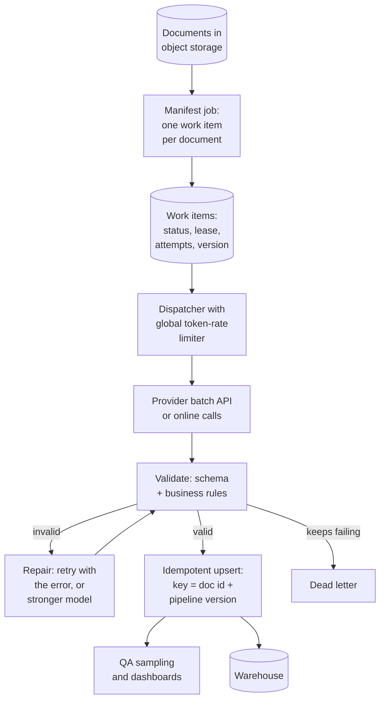
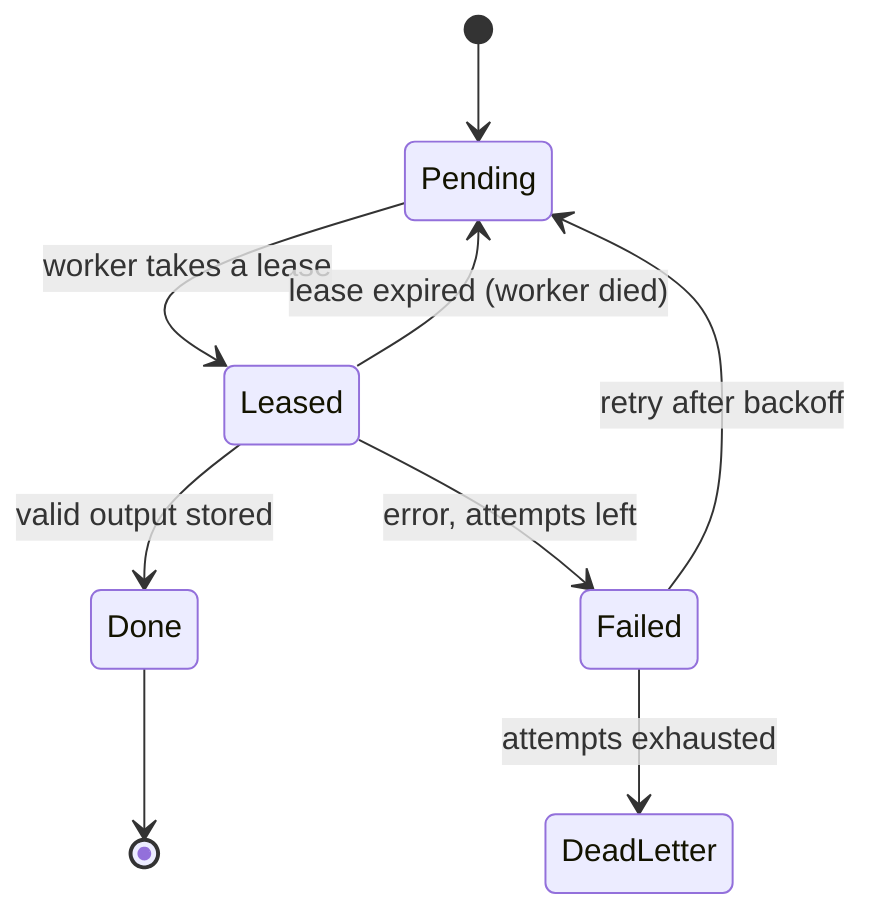

**The prompt:** "We need to run an LLM over 10 million documents (summarise them, or extract fields). Design the system."

Much real AI work is batch: tagging support tickets, extracting fields from contracts, summarising archives, backfilling a new feature over historical data. Nobody waits on a single request, so the design is about **throughput against rate limits**, **work that can crash at any point and resume without duplicates**, **cost** (the bill is large and mostly controllable), and **knowing the outputs are right** when nobody can read ten million of them.

Built on: provider batch APIs such as OpenAI's Batch API and Anthropic's Message Batches API.

## 1. Understanding the problem

**Functional requirements (core)**

1. Operators should be able to run a prompt and output schema over a set of documents in object storage and get one validated output per document.
2. Operators should be able to see progress, pause, resume, and re-run failed or changed subsets.
3. Operators should be able to reprocess everything with a new prompt or model version without losing the old outputs.
4. Analysts should get the outputs in the warehouse, versioned by pipeline version.

**Below the line**: real-time processing of new documents (a later extension), a user interface for reviewing individual outputs, training a custom model.

**Non-functional requirements**

- The system should finish 10 million documents within 7 days and within a fixed budget.
- The system should produce exactly one output per document per pipeline version, even when workers crash or calls are retried.
- The system should never starve the company's interactive AI traffic of provider quota.
- The system should report measured accuracy per document type, with a confidence interval.

**Success metrics**

| Category | Metric | Target (example) |
| --- | --- | --- |
| Quality | Field accuracy per document type on the gold set | >= 95% for critical fields |
| Quality | Error rate from stratified QA | within the agreed margin, per type |
| Throughput | Documents completed per day | >= 1.43 million (10 million in 7 days) |
| Cost | Total spend | within budget; cost per thousand documents tracked |
| Reliability | Duplicate or missing outputs | 0 |

**Framing the AI task.** Extraction (or summarisation) into a schema: one model call per document, with validation. A fixed workflow; no agent.

**Numbers that change the design**

- **Tokens**: 10 million x about 3,000 input = 30 billion input tokens; 10 million x about 300 output = 3 billion output tokens.
- **Cost**, with illustrative prices: a small model at $0.15 and $0.60 per million gives $4,500 + $1,800 = **$6,300**, and a batch API discount of about half brings that near $3,150. A large model at $3 and $15 gives $90,000 + $45,000 = **$135,000**. The model choice is a 20 to 40 times cost decision, so it is made by measurement on a pilot, not by habit.
- **Throughput**: 33 billion tokens in 7 days (10,080 minutes) needs about **3.3 million tokens per minute**. With a quota of 2 million tokens per minute the job takes 16,500 minutes, about **11.5 days**: the plan fails on throughput before it fails on anything else.
- **Closing the gap**, in order: the provider's **batch API** (separate and larger quotas, about half price, results within 24 hours); fewer tokens (send only the relevant sections, a shorter prompt, a cached shared prefix); a quota increase requested early; additional regions or providers; a self-hosted open model for part of the volume.

## 2. High-level design

**The work-item table** is the heart of the design:

```text
work_items (pipeline_version, doc_id, doc_uri, content_hash, doc_type,
            status, attempts, lease_owner, lease_until, last_error,
            output_ref, tokens_in, tokens_out, cost, updated_at)
            primary key (pipeline_version, doc_id)
outputs    (pipeline_version, doc_id, fields_json, model, confidence, validated_at)
```



**Requirement 1, run a job.**

1. The **manifest job** lists the documents and inserts one work item each for the pipeline version (prompt, model, schema). Documents with identical content hashes are linked to one item, so duplicates are processed once.
2. The **dispatcher** leases batches of pending items and sends them out under a global token-rate limiter, either as files to the batch API or as online calls with bounded concurrency.
3. A **pre-processor** trims each document to the sections the task needs (for an invoice extractor: the header and totals pages, not 40 pages of terms), which cuts input tokens.
4. Each output is **validated** against the schema and business rules. An invalid output gets one repair attempt with the validation error in the prompt, then one attempt on a stronger model, then goes to the dead-letter store with its error for inspection.
5. A valid output is **upserted** keyed by (pipeline version, document id), and the work item is marked done with its token counts and cost.

**Requirement 2, progress and control.** Progress is a count of work items per status, per document type; pausing stops the dispatcher; resuming starts it again; re-running a subset is an update that sets chosen items back to pending.

**Requirement 3, reprocessing.** A new pipeline version creates a new set of work items; old outputs remain, so the two versions can be compared on the same documents before the new one becomes the default.

**Requirement 4, the warehouse.** Outputs are loaded into the warehouse in batches, partitioned by pipeline version, with the measured accuracy published alongside.

## 3. Deep dive: resumable, safe-to-retry work

**Bad: a script that loops over the documents and writes outputs as it goes.** When it crashes at document 3.2 million, it either starts again from zero (paying again) or someone guesses where it stopped. Two copies started by accident write duplicate outputs.

**Good: a message queue with one message per document and at-least-once delivery.** Workers can crash safely: an unacknowledged message is redelivered. But redelivery means duplicate processing and duplicate outputs, there is no global view of progress or failures, and a poison document (huge, corrupt) can be redelivered forever.

**Great: leased work items, idempotent writes, explicit states.**



- **Leasing a batch** is one statement, safe with many workers:

```sql
UPDATE work_items
SET status = 'leased', lease_owner = :worker, attempts = attempts + 1,
    lease_until = now() + interval '15 minutes'
WHERE (pipeline_version, doc_id) IN (
    SELECT pipeline_version, doc_id FROM work_items
    WHERE pipeline_version = :v
      AND (status = 'pending' OR (status = 'leased' AND lease_until < now()))
    ORDER BY doc_id
    LIMIT 100
    FOR UPDATE SKIP LOCKED)
RETURNING doc_id, doc_uri;
```

  `SKIP LOCKED` lets many workers grab different batches without blocking each other; an expired lease (a dead worker) makes the item claimable again, with no coordinator needed to notice the crash.
- **Exactly-once effect through idempotent writes.** After a lease expires, an item can be processed twice. That is harmless: the output is upserted on (pipeline version, document id), so the second write replaces the first with an equivalent result. Aiming for exactly-once *processing* is expensive and fragile; exactly-once *effect* is cheap.
- **Attempts and the dead letter.** Each failure records its error; after a few attempts with backoff the item moves to the dead letter. Poison documents (too large, corrupt, unsupported format) therefore cost a few attempts, not the whole job.
- **Resumability is free.** Stopping the dispatcher at any moment and starting it later continues exactly where it was, because the table is the progress.
- **Changed documents.** When a document's content hash changes, its work item returns to pending for the current version.

## 4. Deep dive: throughput and cost

**Bad: maximum concurrency until the provider returns 429 errors.** Requests thrash (most of the effort is spent on rejected calls), and the shared quota is drained, so the company's interactive features start failing.

**Good: a fixed-rate limiter set at the quota.** Stable, but it cannot use spare capacity at night, still competes with interactive traffic, and the job still takes 11.5 days.

**Great: use the batch API, shape the traffic, and spend fewer tokens.**

- **Batch API mechanics.** The dispatcher writes requests into files of thousands of lines, each with a `custom_id` equal to the work-item key, uploads them, creates a batch with a 24-hour completion window, polls its status, then downloads the output and error files and matches every line back to its work item by `custom_id`. Batch quotas are separate from and larger than online quotas, prices are about half, and nothing competes with interactive traffic. Providers cap requests per batch and tokens queued per model, so the dispatcher keeps a bounded number of batches in flight.
- **Token-aware limiting for online calls.** A shared limiter counts tokens per minute (estimated input plus the output cap), not requests, and stays below the quota by a safety margin.
- **Adaptive concurrency.** Increase concurrency slowly while calls succeed; halve it on 429 responses (additive increase, multiplicative decrease). The job finds the real available rate instead of guessing it.
- **Isolation.** Separate keys or projects for batch work, so a backfill can never consume interactive quota.
- **Cost levers**, applied in this order:
  1. **Pilot first**: run 1,000 representative documents through two or three candidate models, measure field accuracy against labels, and choose the cheapest model that meets the bar.
  2. **Cascade**: the small model processes everything; only items that fail validation or show low confidence go to the larger model. If 5% escalate, the large model's cost applies to 5% of the volume.
  3. **Fewer input tokens**: section extraction before the call; a shared instruction prefix that the provider caches.
  4. **Compact output**: JSON with short keys, no prose.
  5. **Skip work**: duplicates by content hash, unchanged documents on re-runs.

## 5. Deep dive: knowing the outputs are right

**Bad: spot-check a handful of outputs at the end.** Ten looks say nothing about ten million outputs, problems are found after the money is spent, and a systematic failure on one document type stays invisible.

**Good: schema validation on every output.** Catches malformed output, but a well-formed wrong value (the wrong date, the subtotal instead of the total) passes.

**Great: a measured quality system.**

- **A labelled gold set per document type**, built during the pilot: a few hundred documents per type with correct field values, labelled by domain experts. It defines field-level accuracy and decides the model and prompt.
- **Business-rule validation** on every output: dates within plausible ranges, line items that add up to the total, ids in the right format, required fields present, values that must appear verbatim in the source text actually appearing there.
- **Confidence signals**: token log probabilities on key fields, agreement between two prompts or two models on a sample, and validation repairs. Low-confidence items escalate in the cascade or go to review.
- **Stratified sampling with a confidence interval.** Reviewers check a random sample from each document type and each batch. To estimate an error rate near 2% within plus or minus 1% at 95% confidence, you need about 1.96^2 x 0.02 x 0.98 / 0.01^2, roughly **750 reviewed items per stratum**. If a type's error rate breaches its threshold, that type is paused, the prompt fixed, and its items reprocessed under a new pipeline version.
- **Drift monitoring**: the distribution of extracted values and the validation failure rate per document type and source, compared over time. A sudden change means a new document format, a broken source, or a changed model.
- **The flywheel**: reviewer corrections become labels; for the highest-volume types, they become fine-tuning data for a smaller model that is cheaper and more accurate on exactly this task.

## 6. Failure modes

**Failure modes**

| Failure | Detection | Mitigation |
| --- | --- | --- |
| Worker crashes mid-batch | Lease expiry | Items become claimable; idempotent upserts |
| Rate limits, job too slow | 429 rate, throughput vs plan | Batch API, adaptive concurrency, token cuts, quota |
| Poison documents | Repeated failures | Size limits, attempts cap, dead letter |
| Silent quality drop on one type | Stratified QA, value distributions | Pause the type, fix, reprocess |
| Provider outage for hours | Error rate | Pause and resume; nothing is lost |
| Cost overrun | Spend vs budget per thousand items | Budget guard stops the job; cascade tuning |
| Schema change mid-run | Pipeline version mismatch | New version, deliberate reprocessing |

**Summary: each requirement and the design choice that meets it**

| Requirement | How the design meets it |
| --- | --- |
| Run a job | Manifest, work items, dispatcher, validation, idempotent upserts |
| Progress and control | Counts by status, pause and resume, subset re-runs |
| Reprocessing | Pipeline version in the key, side-by-side comparison |
| Warehouse | Batched loads per version, accuracy published alongside |
| 7-day deadline | Batch API, token cuts, quota planning, adaptive concurrency |
| Exactly one output | Leases with SKIP LOCKED, upserts on (version, document) |
| Measured accuracy | Gold set, validation rules, stratified sampling with confidence intervals |

Say it like this: "The numbers come first: 33 billion tokens in seven days needs about 3.3 million tokens a minute, so the batch API, token cuts and quota planning set the timeline, and a pilot on a labelled sample picks the cheapest model that meets accuracy. Each document is a work item keyed by document id and pipeline version, leased with SKIP LOCKED and written with idempotent upserts, so the job can crash and resume anywhere without duplicates. Outputs are validated, escalated through a cascade when needed, and audited by stratified sampling per document type with a confidence interval."
