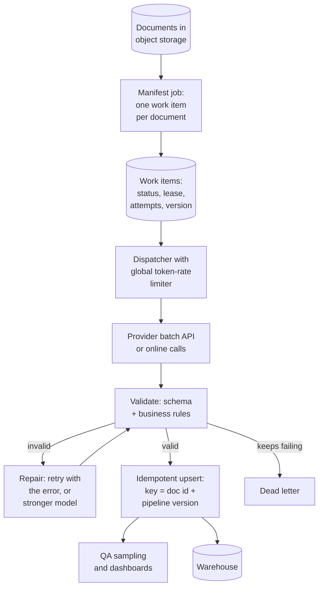
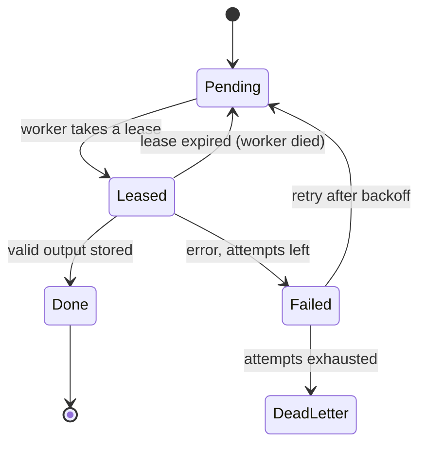

**The prompt:** "We need to run an LLM over 10 million documents (summarise them, or extract fields). Design the system."

Much real AI work is batch: tagging tickets, extracting from contracts, summarising archives, backfilling a new feature. Nobody waits on a single request, so the design is about **throughput against rate limits**, **work that can crash at any point and resume without duplicates**, **cost** (the bill is large and mostly controllable), and **knowing the outputs are right** when nobody can read ten million of them.

## 1. Requirements

Functional:

- Read documents from object storage; produce per-document output (structured fields validated against a schema, or a summary).
- Track progress; re-run failed or changed subsets; reprocess everything when the prompt or model improves.
- Load outputs into the warehouse, versioned by pipeline version.

Non-functional (assumptions):

- 10 million documents, about 3,000 input tokens each; outputs about 300 tokens.
- Finish within 7 days; a fixed cost budget.
- Must not starve the company's interactive traffic on the same provider quota.

## 2. Success metrics

- Field-level accuracy (or summary quality) on a labelled sample, per document type.
- Completion time, cost per document, failure and retry rates.
- Reprocessing cost when the prompt changes.

## 3. The numbers that shape the design

- Tokens: 10 million x 3,000 = **30 billion input** and 10 million x 300 = **3 billion output** tokens.
- Cost with illustrative prices: a small model at $0.15 and $0.60 per million gives $4,500 + $1,800 = **$6,300**; a batch API discount of about half brings that near $3,150. A large model at $3 and $15 gives $90,000 + $45,000 = **$135,000**. The model choice is a 20 to 40 times cost decision, made by measurement on a pilot.
- Throughput: 33 billion tokens in 7 days needs 33 billion / 10,080 minutes, about **3.3 million tokens per minute**. With a quota of 2 million tokens per minute, the job would take 16,500 minutes, about **11.5 days**.

Closing that gap, in order: use the provider's **batch API** (separate, larger quotas, about half price, results within 24 hours); cut tokens (send only the relevant sections, shorten the prompt, cache the shared prefix); request a quota increase; split across regions or providers; self-host an open model for part of the volume.

## 4. High-level design

1. A **manifest** job lists the documents and creates one work item each, keyed by (document id, pipeline version). Content hashes deduplicate identical documents.
2. The **dispatcher** leases pending items and sends them out under a global token-rate limiter, as batch API files or as online calls with bounded concurrency.
3. Each output is **validated** (schema and business rules). Invalid outputs get one repair attempt with the validation error, then a stronger model, then the dead-letter store for inspection.
4. Valid outputs are **upserted**, keyed by document id and pipeline version, so any retry overwrites instead of duplicating.
5. QA sampling and dashboards track accuracy, progress, cost and errors throughout.

## 5. Deep dives

### 5.1 Resumable, safe to retry

- A **lease** (an expiry time on the item) means a crashed worker's items return to the queue automatically; no coordinator has to notice the crash.
- **Exactly-once effect through idempotent writes**, not exactly-once processing: an item may be processed twice after a lease expires, but the upsert key makes the second write harmless.
- Progress is the count of items per state, so the job can stop and resume at any time, and re-running "everything not Done" is one query.
- **Versioning**: the pipeline version (prompt, model, schema) is part of the key, so a new version reprocesses without destroying the old outputs, and results can be compared side by side.

### 5.2 Throughput under rate limits

- A **token-aware limiter** (tokens per minute, not requests) shared by all workers, set below the quota.
- **Adaptive concurrency**: increase slowly while calls succeed, halve on 429 responses (additive increase, multiplicative decrease).
- **Isolation from interactive traffic**: separate keys, quotas or the batch API, so a backfill never degrades the product.
- **Batch API flow**: write requests to files of thousands of lines, submit, poll for completion, download results, and match them to work items by a custom id per line.

### 5.3 Cost

- **Pilot first**: run 1,000 representative documents through two or three candidate models and measure accuracy against labels, then pick the cheapest model that meets the bar.
- **Cascade**: the small model processes everything; items that fail validation or have low confidence escalate to a larger model.
- **Fewer tokens**: extract the relevant sections before calling the model; share a cached instruction prefix; ask for compact JSON.
- **Skip work**: deduplicate by content hash; skip unchanged documents on re-runs.

### 5.4 Correct across ten million documents

- **A labelled gold set** per document type, built during the pilot, defines field-level accuracy.
- **Validation rules** catch impossible values: dates in range, totals that add up, ids in the right format, required fields present.
- **Confidence signals**: token log probabilities for key fields, agreement between two prompts or models on a sample, values that must appear verbatim in the source text.
- **Stratified sampling QA**: reviewers check a random sample per document type and batch; the error rate is estimated with a confidence interval, and a type whose rate breaches the threshold is paused and fixed.
- **Drift**: watch the distribution of extracted values and the validation failure rate per type and source; a sudden change means a new document format or a model change.

## 6. Failure modes

| Failure | Detection | Mitigation |
| --- | --- | --- |
| Worker crashes mid-batch | Lease expiry | Items return to Pending; idempotent upserts |
| Rate limits hit, job too slow | 429 rate, throughput vs plan | Adaptive concurrency, batch API, quota, token cuts |
| Poison documents (huge, corrupt) | Repeated failures | Size limits, truncation rules, dead letter |
| Silent quality drop on one document type | Stratified QA, value distributions | Pause that type, fix prompt, reprocess its items |
| Provider outage for hours | Error rate | Pause and resume; nothing is lost |
| Cost overrun | Spend vs budget per thousand items | Budget guard stops the job; cascade tuning |
| Schema change mid-run | Pipeline version mismatch | New version key, reprocess deliberately |

## 7. Next steps

- Turn the job into a continuous pipeline for new documents (event-driven, same work-item model).
- Use the reviewed samples and corrections to fine-tune or distil a smaller model for the highest-volume document types.

Say it like this: "First the numbers: 33 billion tokens in seven days needs about 3.3 million tokens a minute, so the batch API, token cuts and quota planning decide the timeline, and a pilot on a labelled sample picks the cheapest model that meets accuracy. Each document is a work item keyed by document id and pipeline version, leased by workers and written with idempotent upserts, so the job can crash and resume anywhere without duplicates. Outputs are validated, escalated through a model cascade when needed, and audited by stratified sampling per document type."
