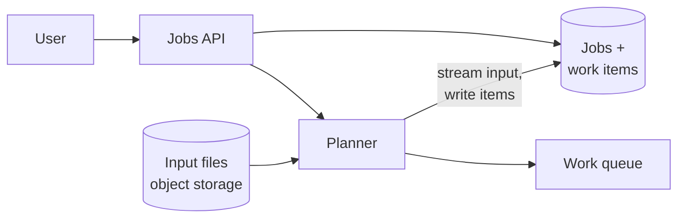
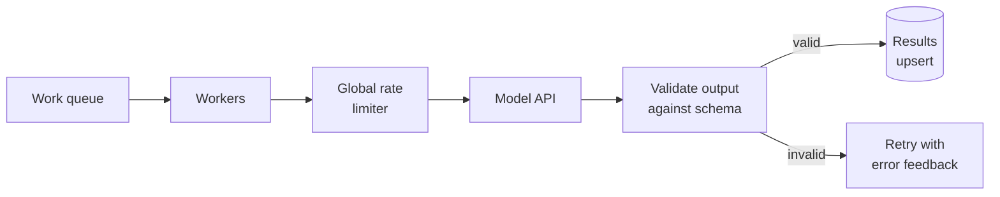
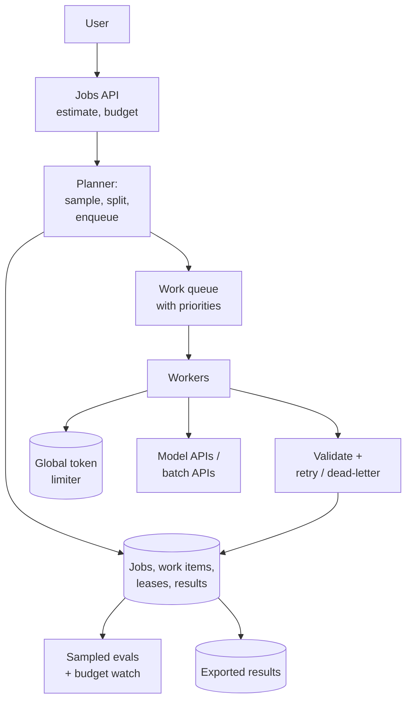

Not every LLM workload is a chat. A huge share of real AI work is **batch**: summarise 10 million support tickets, extract fields from every contract, classify a product catalogue, tag a year of call transcripts. Nobody is waiting on a single answer, but the job runs for hours or days, hits provider rate limits, fails in the middle, costs real money and must produce results you can trust. This prompt is backend engineering (queues, workers, idempotency, rate limiting) with LLM-specific twists (token limits, batch APIs, output validation, sampling-based quality).

## Understanding the Problem

**What are we building?** A platform where a team submits a job: a dataset of documents plus a task ("extract invoice number, total and due date as JSON" or "summarise in 3 bullet points"). The system processes every item with an LLM, shows progress and cost as it runs, and delivers structured results.

### Functional Requirements

Core requirements:

1. Users submit a job: an input dataset, a task template (prompt, output schema, model) and a budget.
2. The system processes every item and stores a validated result per item.
3. Users see progress, cost so far and errors while the job runs, and can cancel it.
4. Failed items are retried automatically, and the remaining failures can be inspected and re-run.

Below the line:

- Real-time or per-request processing.
- Building the task prompt for the user.
- Fine-tuning on the results.

### Non-Functional Requirements

Core requirements:

1. **Fault tolerance**: a crash, deploy or provider outage never loses progress or duplicates results; jobs resume where they stopped.
2. **Throughput within limits**: use as much of the provider capacity as allowed without triggering storms of rate-limit errors.
3. **Cost predictability**: an estimate before the job starts and a hard budget cap.
4. **Quality**: every output is schema-valid, and accuracy is measured before and during the job.
5. **Fairness**: one giant job does not starve everyone else's.

Below the line:

- Exactly-once billing at the provider (we pay for retries; we minimise them).

### The numbers

This is the prompt where back-of-the-envelope math changes the design most:

- 10 million documents x ~2,000 input tokens = **20 billion input tokens**, plus ~300 output tokens each = 3 billion output tokens.
- **Throughput**: with a provider limit of 2 million tokens per minute, each item uses ~2,300 tokens, so at most ~870 items a minute: **10 million items take about 8 days** on one quota. To finish faster you need more capacity (several deployments, regions or providers), a **batch API** with separate, much larger limits, or shorter inputs.
- **Cost**: model prices span more than an order of magnitude. The same job can cost a few thousand dollars on a small model or tens of thousands on a large one. Provider batch APIs typically cost about half the normal price in exchange for asynchronous results (within about 24 hours). Choosing the model and the mode is the biggest cost decision, and should be made with measured quality, not guesses.

## The Set Up

### Core Entities

- **Job**: input location, task template version, model, budget, status, counters (pending, done, failed), cost so far.
- **Task template**: prompt, output schema, model and parameters, versioned. Results always record which version produced them.
- **Work item**: one unit of work (a document, or a small batch of short ones), with status (pending, leased, done, failed), attempts, lease expiry and last error.
- **Result**: the validated output for an item, keyed by (job, item, template version).
- **Dead-letter entry**: an item that failed all retries, with the error and the raw model output.

### The API

```text
POST /v1/jobs            { inputUri, templateId, templateVersion, model, budgetUsd, priority }
  -> { jobId, estimate: { tokens, costUsd, durationHours } }
GET  /v1/jobs/{id}       -> status, progress, cost so far, error summary
GET  /v1/jobs/{id}/results?cursor=...        (or an export to object storage)
POST /v1/jobs/{id}/cancel
POST /v1/jobs/{id}/retry-failed
```

## High-Level Design

### 1) Users submit a job, and it is split into work items



The **planner** streams through the input (never loading 10 million documents into memory), writes work items to the database in batches, and enqueues them. Very short documents are grouped so one model call handles several; very long ones are flagged for a map-reduce path (deep dive 5). Before any real work, the planner runs a **sample** (say 100 random items) to estimate tokens, cost and duration, and shows the estimate to the user.

### 2) Workers process items



Each worker takes an item, renders the prompt from the template, waits for capacity from the **global rate limiter**, calls the model with structured output, **validates** the result against the schema and business rules, and **upserts** it keyed by (job, item, template version). Then it marks the item done.

### 3) Users see progress and results

Counters per job (done, failed, in progress, tokens, cost) are updated as items finish, and the API serves them. Results are queryable by cursor or exported as files to object storage when the job completes. A budget check runs continuously: when spend reaches the cap, the job pauses and asks the owner.

### 4) Failures are retried, then parked

Transient failures (timeouts, 429s, 5xx) retry with exponential backoff and jitter. Invalid outputs retry with the validation error included in the prompt. After a fixed number of attempts the item goes to the **dead-letter** set with its error and raw output; the job continues. The user can inspect failures by category and re-run them after a fix.

## Potential Deep Dives

### 1) How do we maximise throughput without hammering the provider?

**Bad solution: as many workers as possible.** A thousand workers fire requests; the provider answers with a wall of 429s; every worker retries at once; the retries cause more 429s. Throughput collapses while cost and noise go up.

**Good solution: a fixed concurrency per worker.** Each worker sends at most N requests at a time. Better, but the limit is per worker, not global: scale the worker count and you exceed the provider limit again, and the right N changes with item size.

**Great solution: a shared token-based limiter with adaptive concurrency.**

- A **global token bucket** (in Redis) sized to the provider quota, in tokens per minute and requests per minute. Workers reserve the estimated tokens for an item before calling, and settle the real amount after, so all workers together stay under the limit no matter how many there are.
- **Adaptive concurrency**: increase concurrency slowly while latency and error rates are healthy, cut it sharply on 429s or rising latency (additive increase, multiplicative decrease, like TCP congestion control).
- **More capacity**: spread across several deployments or regions, each with its own bucket.
- **Batch APIs for non-urgent jobs**: submit files of thousands of requests and collect results later, at lower cost and with separate, larger limits. The pipeline then tracks batch ids and their status instead of individual calls.

### 2) How do we resume after a crash without losing or duplicating work?

**Bad solution: a loop in one process.** `for doc in docs: result = llm(doc); save(result)`. A crash at item 4 million means restarting from zero, or guessing where it stopped.

**Good solution: a queue with acknowledgement after the write.** Items are messages; a worker acknowledges a message only after saving the result, so a crash causes redelivery, not loss. But redelivery means some items are processed twice, and a plain queue gives poor visibility into per-item status, attempts and errors.

**Great solution: work items with leases and idempotent results.**

- Each work item is a row with a status. A worker **claims** a batch atomically (`UPDATE ... SET status = 'leased', lease_until = now() + 10 min WHERE status = 'pending' ... FOR UPDATE SKIP LOCKED`, or the equivalent in a queue with visibility timeouts).
- If the worker dies, the lease expires and another worker re-claims the item.
- The result is written with an **upsert keyed by (job, item, template version)**, so processing an item twice produces the same single row: at-least-once processing, exactly-once results.
- Restarting a job simply processes items that are not done. Cancel stops new claims and lets in-flight items finish.
- **Poison items** (always crashing the worker, too large) are detected by attempt count and parked, so they do not block progress.

### 3) How do we control cost?

- **Estimate first** from a random sample, and enforce a **hard budget**: the job pauses when spend reaches it.
- **Pick the model with data**: run a labelled sample through two or three models and compare accuracy and cost; often a small model is good enough for extraction.
- **Cascade**: process everything with a small model; send only low-confidence or invalid outputs to a stronger one.
- **Batch API** discount for jobs that can wait.
- **Deduplicate**: hash item content and reuse results for identical inputs (common in tickets and logs).
- **Trim inputs**: strip boilerplate (signatures, headers, repeated disclaimers) before sending; put the shared instructions first so provider prompt caching applies.
- **Cap output** with `max_tokens` and a tight schema; output tokens are the expensive ones.

### 4) How do we know 10 million outputs are good?

**Bad solution: spot-check a few results at the end.** By then the money is spent, and systematic errors in one document type go unnoticed.

**Good solution: schema validation.** Structured output plus validation guarantees every result has the right shape and types. Necessary, but a perfectly shaped wrong answer passes.

**Great solution: validation, a canary run, and continuous sampled evaluation.**

- **Validation** of shape and business rules (dates parse, totals equal the sum of lines, enums valid); failures retry or go to review.
- **Canary**: run 1% of the job first, evaluate it on a labelled sample, and only then release the rest. A bad prompt costs 1% instead of 100%.
- **Sampled evaluation during the job**: a stratified random sample per document type, graded by a calibrated LLM judge or by people; accuracy per field and per slice on a dashboard; the job pauses if a slice drops below its threshold.
- **Versioned templates**: results record their template version; improving the prompt means a new job version that reprocesses only what changed or failed.

### 5) What about documents longer than the context window?

**Map-reduce**: split the document into sections, run the task on each section (map), then combine the partial results with a final call (reduce): merge extracted fields, or summarise the summaries. For hierarchical summaries of very long documents, repeat the reduce step in levels. Each section is its own work item, so the same retry and idempotency machinery applies, and the reduce step runs when all of a document's sections are done.

### 6) How do we share capacity between many jobs fairly?

- **Priorities** per job (interactive backfills vs overnight analytics) and **fair-share scheduling**: each active job gets a share of the token budget, so a 10-million-item job does not starve a 10,000-item one.
- **Quotas per team**, enforced by the same limiter.
- **Pre-emption**: low-priority jobs pause (their items simply stop being claimed) when high-priority work arrives, and resume automatically.

## Final Design



## What is Expected at Each Level

**Mid-level.** A queue of documents, a pool of workers calling the model, results saved to a database, retries on errors. Recognises rate limits and proposes limiting concurrency.

**Senior.** Does the throughput math and sees that the provider limit sets the timeline; designs work items with leases and idempotent upserts; a global token-based limiter with backoff; schema validation with retry and dead-lettering; cost estimation and budget caps; batch APIs; progress reporting.

**Staff.** Optimises the whole job economically (model selection on labelled samples, cascades, dedupe, batch mode) and operationally (adaptive concurrency, multi-deployment capacity, fair-share scheduling across teams), and builds quality control into the run itself: a canary slice, sampled evaluation per document type, and automatic pausing when quality or budget thresholds are crossed.
