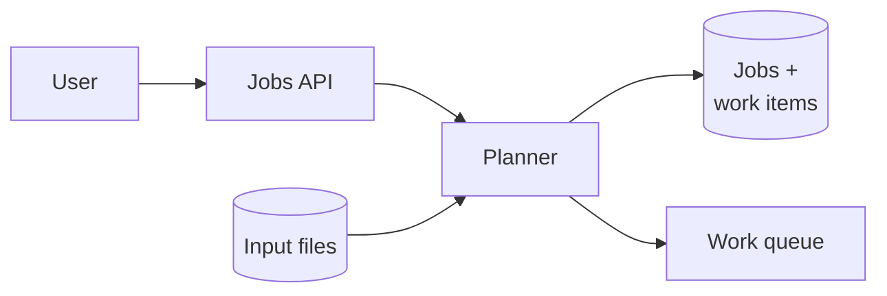
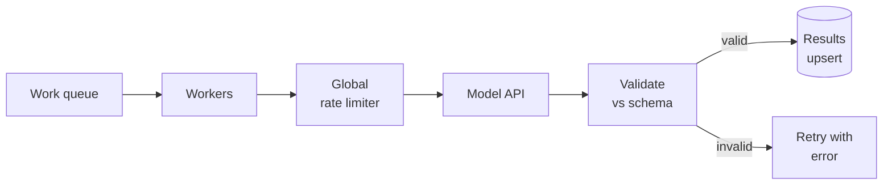

**The prompt:** "We need to run an LLM over 10 million documents (summarise them, or extract fields). Design the system."

Much real AI work is **batch**: tagging tickets, extracting from contracts, classifying catalogues. Nobody waits on one answer, but the job runs for hours or days, hits rate limits, fails in the middle, costs real money and must produce results you can trust. It is backend engineering (queues, workers, idempotency, rate limiting) with LLM twists (token limits, batch APIs, output validation, sampled quality). Run the DP-00 framework.

## 1. Requirements (about 5 minutes)

**Say:** "Let me understand urgency and correctness first: when are results needed, and what does a wrong output cost? That decides batch versus real-time APIs and how much quality checking we build in."

**Functional requirements:**

1. Users submit a job: input dataset, task template (prompt, output schema, model) and budget.
2. Every item is processed into a validated result.
3. Users see progress, cost and errors while it runs, and can cancel.
4. Failed items retry automatically; the rest can be inspected and re-run.

**Below the line:** real-time per-request processing, writing the prompt for the user, fine-tuning on the results.

**Non-functional requirements:**

1. **Fault tolerance**: crashes and outages never lose progress or duplicate results; jobs resume.
2. **Throughput** up to the provider limits, without storms of rate-limit errors.
3. **Cost predictability**: an estimate before running and a hard budget cap.
4. **Quality**: schema-valid outputs, accuracy measured before and during the job.
5. **Fairness** between jobs and teams.

## 2. Success metrics (about 3 minutes)

- **Business**: jobs finished on time and within budget; manual effort replaced.
- **Quality**: field-level accuracy on labelled samples per document type; schema-valid rate.
- **System**: items per minute, retry and dead-letter rates, cost per 1,000 items.
- **Guardrail**: duplicate results (must be zero), budget overruns.

## 3. Entities, API and numbers (about 5 minutes)

**Core entities:** Job (input, template version, model, budget, status, counters, cost so far); Task template (prompt, schema, model, versioned); **Work item** (status pending/leased/done/failed, attempts, lease expiry, last error); Result (keyed by job, item, template version); Dead-letter entry.

**API:**

```text
POST /v1/jobs     { inputUri, templateId, templateVersion, model, budgetUsd, priority }
  -> { jobId, estimate: { tokens, costUsd, durationHours } }
GET  /v1/jobs/{id}                  progress, cost, error summary
GET  /v1/jobs/{id}/results?cursor=  (or an export to object storage)
POST /v1/jobs/{id}/cancel           POST /v1/jobs/{id}/retry-failed
```

**Numbers (the ones that change the design here):**

- 10M documents x ~2,000 input tokens = **20B input tokens**, plus ~3B output tokens.
- **Throughput**: with a 2M tokens-per-minute limit and ~2,300 tokens per item, at most ~870 items a minute: **10M items take ~8 days** on one quota. Faster needs more quota (several deployments or regions), a **batch API** with separate, larger limits, or shorter inputs.
- **Cost**: model prices span more than 10x, and batch APIs typically cost about half. The model and mode are the biggest cost decision, and should be decided with measured quality, not guesses.

**Say:** "The provider's rate limit, not our servers, sets the timeline. So the design is about using that limit fully and safely."

## 4. High-level design (about 10 minutes)

### Requirement 1: submit and split into work items

**Draw:**



**Say:** "The planner streams the input instead of loading it, writes work items in batches and enqueues them. It groups tiny documents and flags huge ones for map-reduce. First it runs ~100 random items to estimate tokens, cost and duration, shown to the user before the real run."

### Requirement 2: process items

**Draw:**



**Say:** "A worker takes an item, renders the prompt, waits for capacity from a global limiter, calls the model with structured output, validates against the schema and business rules, and upserts the result keyed by job, item and template version. Then it marks the item done."

### Requirement 3: progress, cost, cancel

**Say:** "Counters per job update as items finish. Spend is checked continuously and the job pauses at the budget cap. Results are queryable or exported to object storage at the end. Cancel stops new claims."

### Requirement 4: failures

**Say:** "Transient errors retry with exponential backoff and jitter; invalid outputs retry with the validation error in the prompt. After N attempts the item goes to the dead-letter set with its error and raw output, and the job continues."

## 5. Deep dives (15 to 20 minutes)

### Deep dive 1: Maximising throughput without hammering the provider

**Bad: as many workers as possible.** A wall of 429s; synchronized retries cause more 429s; throughput collapses.

**Good: fixed concurrency per worker.** Better, but it isn't global: add workers and you exceed the limit again.

**Great: a shared token limiter with adaptive concurrency.** A **global token bucket** in Redis sized to the quota (tokens and requests per minute); workers reserve an estimate and settle the actual amount. **Adaptive concurrency**: raise it slowly while healthy, cut it sharply on 429s or rising latency (additive increase, multiplicative decrease). **More capacity** from several deployments or regions, each with its own bucket. For jobs that can wait, the **batch API**: submit files of requests, track batch ids, collect results later at lower cost.

### Deep dive 2: Resuming without losing or duplicating work

**Bad: a loop in one process.** A crash at item 4 million means restarting or guessing.

**Good: a queue, acknowledged after the write.** No loss, but redelivery means duplicates, and per-item status is hard to see.

**Great: leased work items with idempotent results.** Workers claim items atomically (`UPDATE ... SET status='leased', lease_until=now()+10min WHERE status='pending' ... FOR UPDATE SKIP LOCKED`, or a queue's visibility timeout). Expired leases are re-claimed. Results are written with an **upsert keyed by (job, item, template version)**, which gives at-least-once processing but exactly-once results. Restart processes whatever isn't done; **poison items** are parked by attempt count.

### Deep dive 3: Controlling cost

- **Estimate first, enforce a hard budget.**
- **Choose the model on a labelled sample**: compare accuracy and cost of two or three models.
- **Cascade**: a small model for everything, escalating only low-confidence or invalid items to a stronger one.
- **Batch API discount** for non-urgent work.
- **Deduplicate** identical inputs by content hash.
- **Trim inputs** (signatures, boilerplate); shared instructions first so prompt caching applies.
- **Cap output** with `max_tokens` and a tight schema.

### Deep dive 4: Knowing 10 million outputs are good

**Bad: spot-check at the end.** The money is spent and systematic errors are found too late.

**Good: schema validation.** Guarantees shape and types, but a well-formed wrong answer passes.

**Great: validation, a canary, and sampled evaluation during the run.** Validate business rules (dates parse, totals match line items). Run a **1% canary** first and evaluate it on labelled data before releasing the rest. During the run, grade a **stratified sample** per document type with a calibrated judge or people, showing field-level accuracy per slice, and **pause the job automatically** if a slice drops below threshold. Templates are versioned, so a better prompt means a new job version that reprocesses only what changed.

### Deep dive 5: Documents longer than the context window

**Say:** "Map-reduce: split into sections, run the task per section, then combine with a final call, recursively if needed. Each section is a work item, so retries and idempotency apply, and the reduce step waits for all sections."

## 6. Evaluation and safety (about 5 minutes)

- **Before the job**: model and prompt chosen on a labelled sample; the canary gate.
- **During**: sampled grading per slice, schema-valid rate, dead-letter categories.
- **After**: accuracy report per document type shipped with the results, so consumers know their reliability.
- **Safety**: documents are data. Instructions inside them are ignored, and outputs are schema-bound. Sensitive inputs are handled per data policy (regional endpoints, no retention).

## 7. Cost, scale, failures, trade-offs (about 3 minutes)

- **Fairness**: per-job priorities and **fair-share** token allocation so a 10M-item job does not starve a 10k one; low-priority jobs pause by not being claimed.
- **Failures**: provider outage: workers back off and the job resumes later; poison items park; budget reached: pause and ask.
- **Trade-off**: the batch API is cheaper with larger limits but has hours of latency; use real-time calls only for urgent jobs.

**The 20-second summary:** "A planner samples to estimate cost and splits the input into leased work items. Workers pace themselves through a global token limiter with adaptive concurrency, validate structured outputs, and upsert results idempotently, so jobs resume safely. Cost comes down through model choice on labelled samples, cascades, dedupe and batch APIs; quality is guarded by a canary and sampled per-slice evaluation that can pause the job."

## What separates levels

- **Mid-level**: a queue, workers, results in a database, retries, a concurrency limit.
- **Senior**: throughput math from provider limits, leases plus idempotent upserts, a global token limiter, validation with retry and dead-lettering, estimates and budget caps, batch APIs, progress reporting.
- **Staff**: optimises the job economically (model selection on samples, cascades, dedupe, batch mode) and operationally (adaptive concurrency, multi-deployment capacity, fair share), and builds quality control into the run with a canary and auto-pausing sampled evals.
